# 20261019 最终面试向理解文档

> 这是一份解释项目如何工作的教程。先理解问题和算法，再记实验数字。项目基于 vLLM V1，在 `experiment/4x3080ti` 分支开展四张 RTX 3080 Ti 实验。本文核对了最终代码、有效实验记录和论文原文；性能数字以[最终实验报告](./20261019实验报告.md)为准。
>
> 本文中的“小例子”是为了解释算法手算构造的，不是实测结果。下文明确区分：论文提出了什么、vLLM/LMCache 已经提供什么、自己具体修改了什么、实验实际证明了什么。

阅读顺序：第 1 节是可用的项目描述；第 2～5 节建立背景；第 6～7 节解释论文；第 8～14 节解释每层算法及架构变量；第 15～16 节解释正确性和实验；第 18～21 节用于口述、自测和查代码。时间有限时按第 20.3 节的路线阅读。

## 一、先给出可以使用的项目描述

**vLLM KV-Aware Scheduling：大模型推理调度与分层 KV Cache 性能优化｜独立开发**

**项目背景：** 面向 Agent、Coding、RAG 等共享前缀、多轮交互的推理场景，研究有限显存下缓存复用、排队延迟与恢复开销的关系。基于 vLLM V1，将优化拆分为实例内调度、跨实例放置、分层 KV 保存三个层次，并在四张 RTX 3080 Ti 上使用公开 Coding 轨迹及独立任务集验证性能与适用边界。

**技术栈：** Python、PyTorch、vLLM V1、CUDA、Paged KV Cache、Automatic Prefix Caching、LMCache、NIXL、CUDA Graph。

1. **实例内 KV 感知调度：** 实现 Top-W 缓存亲和准入、重算成本感知抢占与 aging 保护，设计 KV generation 驱动的懒解析特征上下文，避免重复查询和失效状态。BF16、8K、32 会话自然容量对照中吞吐提高 **33.80%**，独立任务集提高 **19.09%**；同时记录 TTFT P95 分别上升 4.85% 和 17.14%，明确吞吐与尾延迟的权衡。
2. **缓存与负载联合路由：** 借鉴 Preble 的缓存收益与负载共同决策思路，在缓存优先/负载阈值基线上实现原子在途账本、真实输出进度更新，以及受 batch 槽位和 KV 容量约束的 FIFO 排队近似。双副本 4K 对照中吞吐提高 **6.55%**、TTFT P95 降低 **11.82%**；独立任务集吞吐提高 **7.96%**。同次决策、同 worker 的排队预测 MAE 从 6.82 秒降至 1.66 秒。
3. **工作集感知 KV Offload：** 借鉴 EfficientAgent，将会话工作集、CPU 实际驻留和容量淘汰反馈引入 LMCache 写入准入；对一次请求冻结保存决定，修复打包 KV 初始化与部分 GPU 前缀加载边界。相同 decode Graph 配置中，相对默认 CPU 保存吞吐提高 **7.46%**、TTFT P95 降低 **11.68%**，Stored tokens 减少 **91.41%**；文件层对照吞吐提高 **2.37%**。
4. **多卡架构与正确性验证：** 实现严格元数据交接的 1P1D/2P2D 实验链路，区分必需 NIXL 传输和可选 CPU 保存，覆盖四种 P/D 配对及概率、事实、代码执行检查。对完整副本、PD 比例、chunked prefill、权重/KV 量化和 Graph 进行控制实验，识别 host staging、decode 资源与容量变化带来的适用边界。

这四条中，第二、三条有自己的策略实现与端到端对照；第四条的贡献主要是架构接线、适配、验收和边界分析。不能把 NIXL 搬运、AWQ 或 Graph 本身写成自己的原创算法。

**简历篇幅有限时：** 保留背景与前三条，第四条压缩为“完成 1P1D/2P2D 真传输验收及同卡数架构对照”。不要往一条里塞十个实验百分比。以上数字来自不同实验格，不能相加成总收益。

### 1.1 原单卡项目的数字还能不能讲？

可以，但要作为**前一阶段 RTX 4090 上的独立证据**讲，与本次四卡实验分开。

| 原单卡证据 | 正确解释 |
|---|---|
| 16 类共享前缀、1250 KV blocks，吞吐 +4.20%、总耗时 −4.00%、TTFT P99 −2.24%、TPOT P99 −15.43% | 对照两组都已经启用 recompute-aware 抢占；主要比较默认准入与 cache-affinity 准入，不能把全部收益归因于抢占 |
| resume recompute −5.52%、total local context −3.37% | 少计算了模型上下文 token；后者不是“CPU 调度开销降低 3.37%” |
| prefix resolver 调用减少 7.94% | generation 内复用了已解析特征，减少重复解析；不是 APC 命中率增加 7.94%，也不是端到端速度提高 7.94% |

旧吞吐结果是两组反向顺序配对后的均值；本次主要报告三轮中位数。旧实验还出现 ITL P99 +4.21% 的代价，不能只背正数。证据见[旧端到端报告](./PHASE6H_PREFIX_DIVERSITY_REPORT_CODEX.md)和[旧归因报告](./PHASE6I_MECHANISM_ATTRIBUTION_REPORT_CODEX.md)。

## 二、先把推理、KV 和性能指标讲明白

### 2.1 Prefill 和 Decode 分别做什么？

输入一段 2000-token 提示词，模型先处理这段输入，建立每层注意力需要的 K、V 状态，这个阶段叫 **prefill**。之后自回归生成：生成一个 token，把它接到历史后面，再生成下一个，这个阶段叫 **decode**。

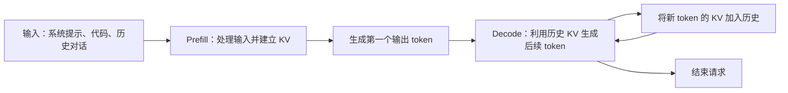

注意力里 Q 是当前查询，K、V 是供它查询的历史信息。历史 token 在各层的 K、V 一旦算好，后续生成就可以重复使用。**KV Cache 是中间张量，不是最终答案文本。**

没有 KV Cache，生成每个 token 都要重复处理大量历史。缓存保留下来，就用显存换取重复计算的减少。即使 decode 只产生一个新 token，它仍需读取历史 KV；所以“decode 没有初始 prefill”不代表它不做注意力计算。

### 2.2 为什么 Agent/Coding 很适合研究前缀缓存？

一个 Coding Agent 往往反复经历“读代码 → 生成操作 → 工具返回 → 再思考”。下一轮输入保留前面的系统指令、任务、已有对话，后面再增加新内容。

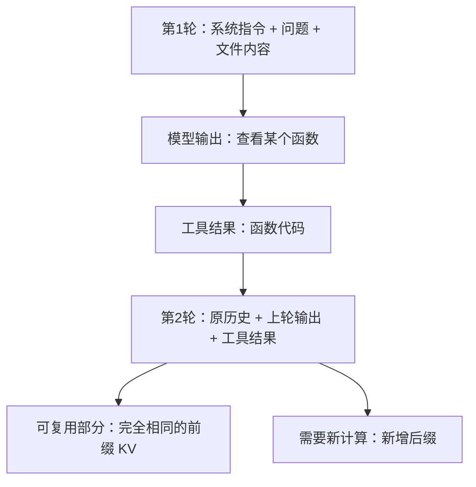

如果第 1 轮已有 1800 个 token，第 2 轮增加 300 个 token，理想情况下可以复用前 1800 个的 KV，只处理新增部分。RAG 也有类似结构：共享系统指令、同一篇文档开头、重复检索材料等。

但复用要求很严格：**从开头开始的 token 序列一致**，并且相关模型配置、适配器等条件兼容。语义相似、同一文件名、相同“任务类型”都不等于可直接复用 KV。中间有一个 token 不同，后面的注意力状态通常也不同。

### 2.3 Paged KV、APC 和 Offload 是三个概念

| 概念 | 解决什么问题 | 可以怎样理解 |
|---|---|---|
| Paged KV Cache | 怎样分配、复用有限显存 | 把 KV 放进固定大小 block，使用映射组织各请求的逻辑历史 |
| APC，自动前缀缓存 | 怎样避免相同前缀重复计算 | 按前缀识别可共享的完整 block |
| KV offload | 显存放不下的 KV 还能保存在哪里 | 复制到 CPU 或文件层，将来需要时再加载 |

逻辑请求可以共享物理 KV block，因此“一个请求用了 100 个逻辑块”不等于“抢占它马上能释放 100 个物理块”。共享引用、正在传输的 pin、延迟释放都会影响真正可回收量。调度器必须使用 KVCacheManager 管理所有权，不能自己随意改引用计数。

APC 通常以完整块匹配。即使输入完全重复，也可能需要重新计算末尾部分来得到当前预测所需的 logits；本分支的命中查询最多检查 `request.num_tokens - 1`，再受 block 对齐约束。所以“重复输入”不保证实际 prefill 为零。

### 2.4 一个 token 的 KV 有多大？

对本次 TP=1 的稠密全注意力模型，可用下式解释：

```text
每 token KV 字节 = 2 × 层数 × KV heads × head dimension × 每元素字节数
                    ↑ K 和 V
```

本次 Qwen2.5-3B BF16 对应：

```text
2 × 36 × 2 × 128 × 2 = 36864 bytes = 36 KiB/token
```

这里用的是 **KV heads**，不能直接代入 query heads。GQA 的 query heads 可以多于 KV heads。8192 个 token 的 KV 总量约 288 MiB，这是实验固定池的毛容量；还要扣除保留 block 等，不能当作全部可用空间。

INT8 KV 的实际传输载荷还包括 scale，本配置为 **19008 bytes/token**，不是简单把 36864 除以二。权重量化也不能直接改变这个公式里的 KV dtype。

### 2.5 面试最容易混的指标

| 指标 | 含义 | 本项目怎样看 |
|---|---|---|
| Output throughput | 整体每秒产生多少输出 token | 回放所有任务输出总数 / 整体完成时间 |
| TTFT | 请求发出到第一个输出 token 的时间 | 包括路由、排队、加载、prefill 等，不只是 GPU prefill 时间 |
| TPOT | 请求首尾输出跨度 / 后续输出 token 数 | 描述一个请求平均生成间隔；本项目使用这一逐请求口径 |
| ITL | 相邻输出 token 的时间间隔 | 更能看到某一次明显停顿；与 TPOT 分位数不能互换 |
| P95 / P99 | 95% / 99% 的样本不超过的值 | 尾部体验，不能由平均值推出 |
| Prefix hit ratio | 有多少输入前缀复用 | 高命中仍可能排队；不同计数分母不能直接横比 |
| Resume recompute | 抢占恢复后重新计算的上下文量 | 是额外模型工作，不等于抢占次数 |
| Stored / Retrieved tokens | LMCache 日志中的保存/读取 token 计数 | 反映操作量；不是精确物理总线字节或 SSD 写放大 |

例如：让一批高命中请求先完成，可以提高整体吞吐；队列中一个低命中长请求却等待更久，TTFT P95 可能变差。这不是指标互相矛盾，而是优化目标不同。

### 2.6 Continuous batching：为什么在途工作不能直接串行相加？

传统固定 batch 可以等一批请求全结束再接下一批。推理请求长度不同，短请求结束后留下的空位可能一直闲置。Continuous batching 在连续迭代中移除已完成请求、加入可运行的新请求，让 batch 成员随执行变化。


并行运行不等于每个请求完全没有相互影响：它们共享 GPU 执行与内存带宽，batch 变大后单请求速度也会变化。这正是路由的单请求时间模型只能作为近似的原因。

还要区分客户端并发与引擎上限。例如客户端同时回放 16 个会话，而 CPU 实验引擎最多驻留 2 个请求，其他请求需要排队。即使还有 batch 槽位，也可能因 KV 空间不足无法加入；命中共享 block 能减少一部分容量需求，却不能消除所有执行成本。

## 三、整个项目究竟在解决哪三个决策？

用餐厅比喻：多个厨房对应多个推理实例，厨房内有多个正在处理的订单，冰箱和仓库保存可复用的材料。

- **R：Routing，跨实例放置。** 新请求该交给哪个实例？命中好但很忙的实例，未必最快。
- **L：Local scheduling，实例内调度。** 请求进入实例后先让谁开始？显存紧张时暂停谁损失更小？
- **O：Offload admission，分层缓存保存。** 本轮 KV 是否值得写到 CPU/文件层？容量不够时，大量写入可能挤掉更有用的缓存。

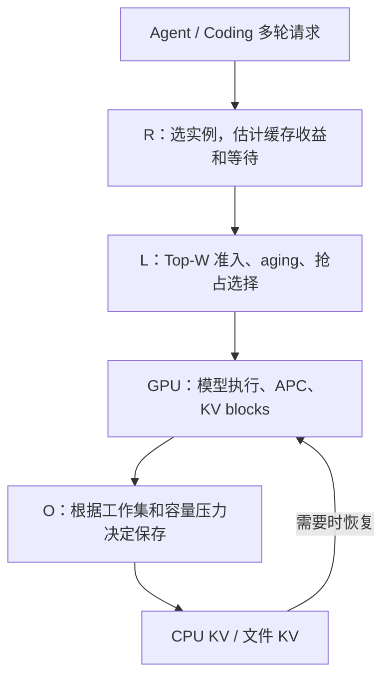

R、L、O 的信息粒度不同。R 通常只有目录和请求进度的近似；L 可以读取本实例真实 KV 管理状态；O 接触 host 缓存和保存生命周期。没有一个简单分数能自动替代全部三层。

**PD 是执行架构，不是第四个同类排序分数。** 它将一个请求的 prefill 和 decode 放到不同角色实例上，后文单独解释。上图用于说明职责，不表示所有实验都同时开启三层，也不表示每个 CPU 缓存跨全部实例共享。

## 四、本次四张卡是怎样使用的？

### 4.1 机器限制决定了实验边界

本机为 **4×RTX 3080 Ti，每卡 12GB**。四张卡的显存彼此独立，不能直接当作一块 48GB 显存。实验没有可用的 NVLink/P2P/RDMA 路径，UCX 允许 `tcp,sm,cuda_copy`，跨 GPU 传输按需要 host staging 的环境解释。

主模型是 **Qwen2.5-3B-Instruct，BF16**。每个实验引擎通常 TP=1，一张卡保存一份完整模型权重。即使是 P 或 D 角色，也不是只加载半个模型。

选 3B 是为了在 12GB 单卡内给 KV、运行缓冲和 Graph 留出空间，从而让四卡比较聚焦调度与缓存。目标是证明机制能否成立，不是通过模型参数量制造亮点。

### 4.2 单卡、双副本、四副本、PD 的区别

| 配置 | GPU 分工 | 主要验证什么 |
|---|---|---|
| 单卡完整实例 | 一张卡同时做 P 和 D | L、CPU/file offload、chunk、量化、Graph |
| 双完整副本 | 每张卡各自完成整个请求 | R 的缓存与负载决策，以及 R/O/L 组合 |
| 四完整副本 | 四张卡都能完成完整请求 | 四卡吞吐对照；与 2P2D 比较资源效率 |
| 1P1D | 一卡 prefill，一卡 decode | 真 KV 交接、角色压力、可选 CPU 保存 |
| 1P2D / 2P1D | 改变两种角色的 GPU 比例 | 哪个角色更值得增加资源 |
| 2P2D | 两卡 prefill，两卡 decode | 四种 P/D 配对、角色路由、四卡架构对照 |

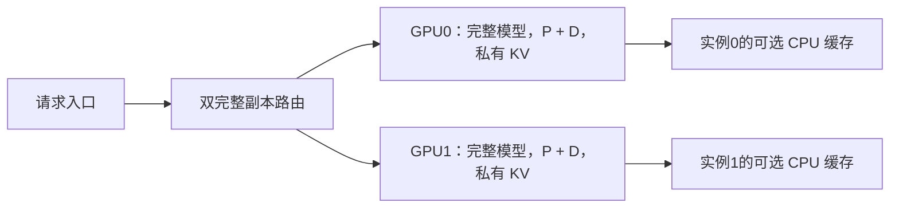

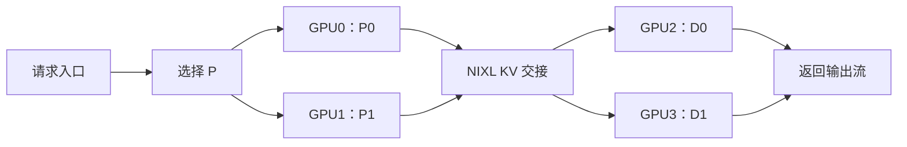

**双副本不是 TP=2。** TP=2 是两张卡协同执行一个模型，通常有逐层通信；双副本则是两张卡分别接请求。2P2D 也不是四卡 TP，每个角色仍是 TP=1。

### 4.3 为什么既有“固定小 KV 池”，又有“自然容量”？

固定压力组每引擎使用 `512 blocks × 16 tokens = 8192 KV tokens`。这是主动制造有限缓存条件：模型能装下，但多个请求的历史容易竞争，便于比较准入、恢复和 offload。

自然容量组让 BF16 模型使用可分配的较大 KV 池，在本次配置中为 **111184 tokens**；AWQ 模型为 **224544 tokens**。这类实验回答“显存较宽裕时策略是否仍有效”，但 AWQ/BF16 的自然容量不同，跨两者不能只归因于量化 kernel。

一般非 CPU 固定池组 `max-num-seqs=8`，CPU 组为 2；自然容量长上下文组为 32。架构比较中的 seq8 与 PD+CPU 的 seq2 是不同实验格，不能直接用吞吐横比策略好坏。

### 4.4 执行环境有一个必须知道的限制

本机默认预编译算子路径出现异常：直接调用 RMSNorm 并同步后，输出仍保持初始化的 123；相同权重的 Transformers eager 路径正常。根因没有完全定位。

正式对照统一使用经过检查的 V1 runner、native RMSNorm、禁用 custom ops、Triton attention 路径，eager 和 decode Graph 分组比较。这里没有把有问题的默认路径当弱基线，也没有宣称解决了整个二进制兼容根因。因此绝对吞吐不应代表健康默认环境的最佳性能。

## 五、压测数据有多接近真实 Agent？

### 5.1 数据来自哪里？

来源为[公开 mini-SWE-agent Coding 运行轨迹](https://github.com/john-b-yang/20260901_mini-v2.4.2_gemini-3-5-flash)，固定源码 commit 为 `2f6637a2557da1f7b5f2b583ab7090a077bbeed2`。原始轨迹是 Gemini 的历史运行记录，本次把历史输入转换成 Qwen 可回放的文本请求。

保留的是实际问题、代码片段、历史操作与工具观察形成的长前缀结构。它比“随机 token + 固定前缀”更接近 Coding 输入分布，但**不是运行 Qwen 完成真实软件修复任务**。

| 划分 | 任务数 | 上下文上限 | 保留调用数 | 平均输入 tokens | 最大输入 tokens |
|---|---:|---:|---:|---:|---:|
| 原任务，seed17 | 32 | 4K | 112 | 2366.7 | 3955 |
| 原任务，seed17 | 32 | 8K | 176 | 3540.9 | 8075 |
| 独立任务，seed71 | 32 | 4K | 99 | 2512.6 | 4010 |
| 独立任务，seed71 | 32 | 8K | 173 | 3805.1 | 8123 |

原任务与独立任务互不重叠；不是拿同一批请求换个顺序就叫泛化。独立集没有再用来调参。4K/8K 过滤出的调用也不同，不能只把两组差异当作上下文长度的单变量效应。

4K 原任务过滤了 1091 条超长调用，8K 过滤了 355 条，因此数据明显偏向能装入所选窗口的部分，不能声称代表完整长程 Agent 的所有阶段。

### 5.2 回放怎样保持多轮关系？

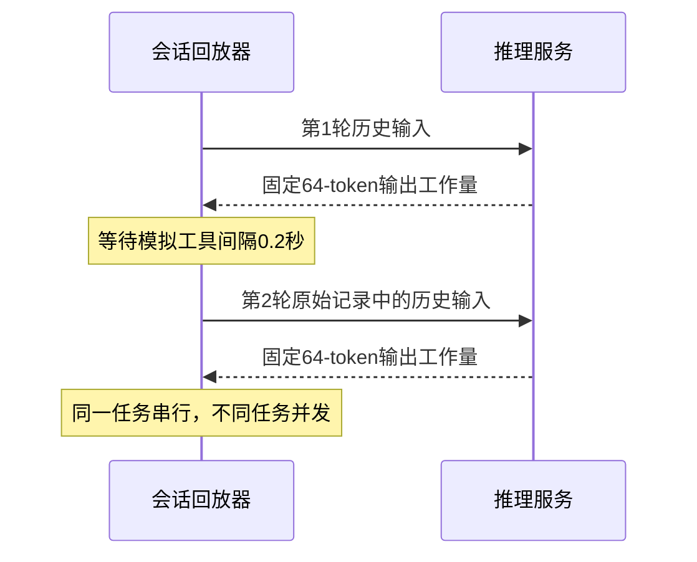

关键细节：

1. 同一任务上一轮完成后才能发下一轮，保留依赖关系。
2. 工具结果来自原轨迹，转成文本观察；本轮不真的执行搜索、编译或 shell 工具。
3. 主性能组输出预算为 64，忽略 EOS，温度为 0，使各策略输出工作量可比较。
4. **下一轮输入仍用原始轨迹历史**，不会把当前 Qwen 新输出接回去；也没有强制输出原始轨迹 token IDs。
5. 工具间隔固定模拟 0.2 秒，不是原始生产时间戳。
6. 并发控制按会话槽位计算，一个任务在工具等待期间仍占会话槽；常规 16，会话长上下文组 32。

所以这叫**保留会话依赖的历史文本回放**。它能研究增长前缀、会话活跃集和缓存竞争，不能测 Agent 成功率、真实工具等待分布或生产开环容量。

另有 24 会话、96 调用、8 类共享前缀的半合成热点负载，用来控制热点与复用；混合输出预算组使用可见的 32/64/128 上限。半合成数据是机制实验，不替代公开轨迹。

### 5.3 为什么还要做质量检查？

固定 64-token 输出适合控制性能工作量，却可能输出半截代码，不能用它评价回答质量。因此另做非强制长度的代码生成并执行探测，以及缓存恢复后的 next-token 概率与前缀事实检查。

6 项代码探测只是一组小型工程门禁，不是 HumanEval 分数，更不是 SWE-bench 修复成功率。HTTP 200 也只说明服务返回成功，不说明读取的 KV 正确。

## 六、Preble 的算法：怎样同时考虑缓存和负载？

### 6.1 它抓住的矛盾

同一请求在 GPU0 能复用 90% 输入，在 GPU1 只能复用 10%。直觉会选 GPU0。但 GPU0 已经排了很多请求，GPU1 很空，GPU0 最终反而更慢。

另一个极端是只做均衡：总把请求送给空闲卡，会把本来可复用的长前缀拆散到所有卡，重复 prefill，增加缓存占用。

Preble 用全局放置配合本地调度处理这个矛盾：前缀树维护缓存所在 GPU 和共享信息，全局 E2 策略在利用已有缓存与探索其他 GPU 之间切换；本地按缓存比例分组分配机会。[论文原文](https://arxiv.org/html/2407.00023v2)、[作者实现](https://github.com/WukLab/preble)。

### 6.2 先理解 radix tree 表示什么

把多个 token 序列的公共开头合并成树。节点可以代表一段连续 token，并记录哪些 GPU 缓存了这一段、近期有哪些请求共享它。

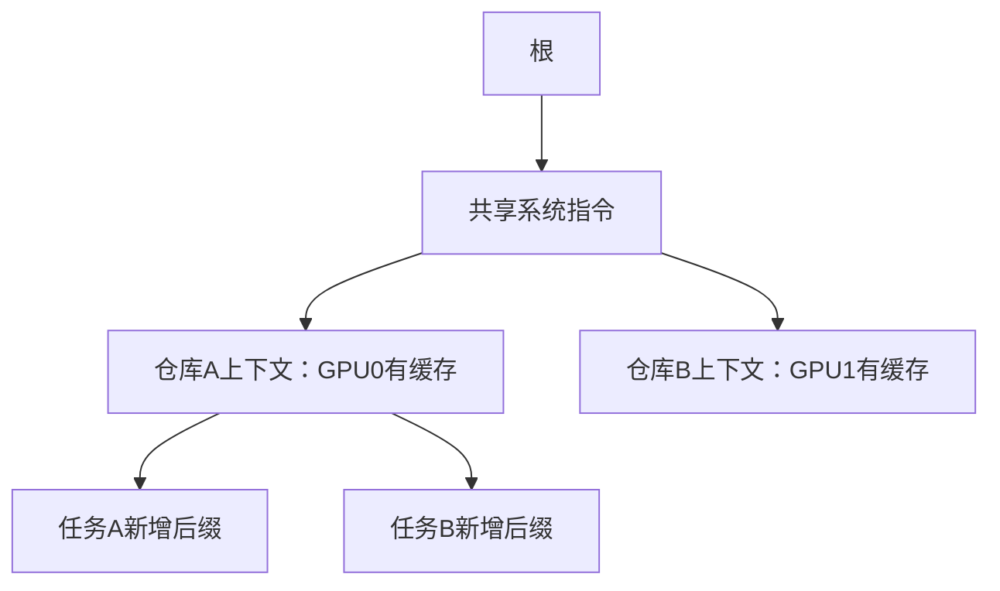

这棵树不是按“语义相近”组织，仍然是 token 前缀。共享计数帮助估计未来复用价值：挤掉很多请求反复使用的节点，比挤掉一次性前缀更可能造成后续重复计算。

### 6.3 E2：什么时候优先命中，什么时候看成本？

可以先记住论文主要分支：**已匹配前缀比未匹配后缀长时，倾向利用已有缓存；否则比较不同 GPU 的估计成本。** 这不是本项目“负载差四个请求就切换”的规则。

成本可用教学记号写为：

```text
选择 GPU i 的成本 ≈ L_i + M_i + P_i
L_i：该 GPU 近期工作的估计负载
M_i：接收请求可能挤掉缓存，导致后续重算的估计代价
P_i：新请求尚未命中的 prefill 代价
```

论文中 L 的构造使用历史窗口与性能估计；M 结合被挤出节点的计算成本和共享频率；相同请求在各 GPU 上相同的 decode 项可以在比较时省略。原算法还处理 prefill/decode 工作混合和平衡热点等情况。[Preble 算法说明](https://arxiv.org/html/2407.00023v2)、[作者调度源码](https://raw.githubusercontent.com/WukLab/preble/multi_modal_main/preble/global_scheduler_with_time.py)。

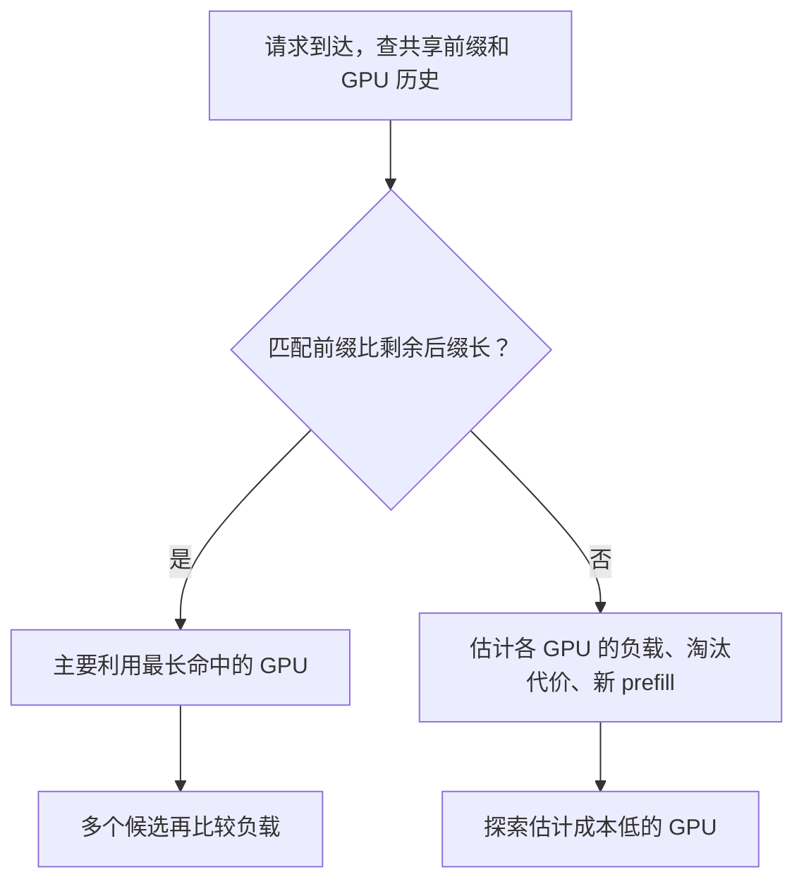

此图是主分支示意，省略了论文其他平衡细节，便于先建立直觉。

小例子：两个 GPU 接收同一请求，取教学假设数值：

| GPU | 等待/负载估计 | 新 prefill | 挤出缓存代价 | 总计 |
|---|---:|---:|---:|---:|
| 0 | 800ms | 20ms | 40ms | 860ms |
| 1 | 100ms | 180ms | 0ms | 280ms |

GPU0 命中更好，GPU1 预计却更早服务。**命中收益必须换算成时间，并与等待比较**，这是本项目真正借鉴的思想。

### 6.4 本地调度为什么也要考虑公平？

如果全局把同一类前缀送到同一张卡，而卡内又永远让最高命中请求先运行，低命中请求可能长期等待。Preble 的本地思路是按缓存比例分组，再给不同组一定调度机会；它不是本项目的 Top-W + aging 实现。[作者仓库](https://github.com/WukLab/preble)。

本项目采用更容易接入当前 Scheduler 的有限窗口和等待阈值保护。借鉴的是“复用和公平需要一起处理”，没有声称复现原论文全部本地算法。

### 6.5 本项目用了哪些，没有用哪些？

| Preble 思想 | 本项目对应 | 差异 |
|---|---|---|
| 缓存收益不能单独决策 | 缓存/负载阈值基线与成本路由 | 阈值规则是基线，不冒充论文 E2 |
| 新 prefill + 已有工作 | 校准 prefill、剩余工作账本 | 使用真实输出进度和本项目的队列近似 |
| 缓存挤出有未来成本 | 简化淘汰代价项 | 是目录代理，不是准确物理 victim 预测 |
| 全局前缀状态 | 历史目录与事件目录 | 没有完整全局 radix tree 和自动子树复制 |
| 兼顾本地公平 | Top-W、aging | 与原论文分组分配机会不同 |

不是“照抄一个公式”：主要改造是让路由可见在途工作、输出推进、batch 槽位和有限 KV 容量，并用同次决策的影子预测核对误差。也不能称已经实现完整 Preble。

## 七、EfficientAgent 的算法：为什么不是所有 KV 都值得写出去？

### 7.1 缓存有收益，但保存不是免费的

将 2000-token KV 存到 CPU，可以避免将来重算；代价是当前复制、CPU 空间占用，以及挤掉其他缓存。若它在下一次使用前已被挤出，当前保存几乎只付出了成本。

EfficientAgent 区分两个问题：命中后是否比重算划算，以及数据能否存活到下次复用。前者可用 offload benefit ratio 理解，后者与工作集和访问距离有关。[论文原文](https://arxiv.org/html/2609.33762v1)、[作者发布仓库](https://github.com/KunmingSHAO/efficientagent_release)。

### 7.2 OBR：命中到底能省多少？

教学上可写：

```text
OBR ≈ (重算时间 − 加载时间) / 重算时间
加载时间 ≈ 固定开销 + KV字节数 / 有效传输带宽
```

例如重算 100ms、加载 30ms，理想命中收益约 70%；若加载 120ms，单看这次就未必值得。真实系统还存在复制与计算重叠，因此这只是理解成本的近似，不是本项目已经在线执行的精确模型。

还缺一个条件：这份 KV 是否真的能留到再次使用？可以用自己的教学表达说明预期收益：

```text
预期净收益 ≈ 存活概率 × 命中节省时间 − 当前保存成本 − 挤出其他缓存的代价
```

这不是本项目用于打分的原始代码公式，它说明为什么“扩大缓存池”之外还需要准入。

### 7.3 Stack distance：两次使用之间插进了多少别人？

假设一次访问顺序为 `A → B → C → A`。A 两次使用之间有 B、C 两个不同 chunk；容量只有两个 chunk 的 LRU 缓存，到最后一次 A 时，A 可能已经不在。

Agent 的问题更复杂：复用往往要求从头连续命中的前缀，而不是历史里任意几个散落 chunk。分析还应区分 GPU 已经保存的前缀与需要 host 提供的前缀。论文的离线模型考虑这类访问距离与前缀覆盖，本项目没有实现完整离线栈距离预测器。[EfficientAgent](https://arxiv.org/html/2609.33762v1)。

### 7.4 为什么工作集可以作为一个便宜的信号？

一个会话在等工具时，其他活跃会话会继续生成和保存 KV。轮到它回来时，其他会话总共占了多少空间，决定它旧前缀被挤出的风险。

可用如下尺度解释：

```text
预计复用竞争量 ≈ (活跃会话数 − 1) × 平均上下文长度 × 每token KV字节
```

这不是精确缓存并集：不同会话可能共享前缀，长度也会变化。但它比只看“当前来了几个 HTTP 请求”更贴近 Agent 的跨轮缓存竞争。

### 7.5 运行时策略：压力大时拒绝大块新写入，保留小增量

论文运行时机制结合工作集、host 容量/淘汰状态与新增完整 chunk 数，压力成立时过滤大的新增保存；同一请求只决定一次，避免中途来回改变。作者说明与实现见[固定版本 README](https://raw.githubusercontent.com/KunmingSHAO/efficientagent_release/b21b12a07a3ccf473c82acf00820b1aa2073044b/README.md)。

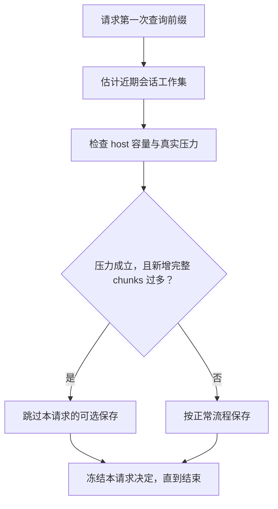

为何保留小增量？若 CPU 已保存前 1792 tokens，而本轮增长到 2048，只需补一个 256-token chunk，可能以较低成本延续一个即将复用的完整前缀。另一个冷请求却需要从零写 8 个 chunk，压力下更容易造成循环覆盖。

### 7.6 本项目不是完整复现 EfficientAgent

本项目实现了运行时条件化保存与生命周期适配，并加入当前 LMCache/vLLM 路径下可核对的驻留、淘汰与正确性检查。完整 OBR 动态加载决策、离线 stack-distance 分析、全套论文执行系统没有实现。

具体区别也要说清：作者遥测缺失时可以只用估计判断；本项目遥测过期时恢复正常保存。作者的上下文均值统计与本项目“每个活跃会话最近长度再取均值”不同。作者回放可强制记录的输出 token；本项目不强制历史输出。阈值、chunk、会话窗口应以本项目 manifest 为准，不能照抄论文默认值。

## 八、L 层：实例内调度究竟怎么改？

代码入口：[policy.py](../vllm/v1/core/sched/policy.py)、[scheduler.py](../vllm/v1/core/sched/scheduler.py)、[feature_context.py](../vllm/v1/core/sched/feature_context.py)、[kv_cache_manager.py](../vllm/v1/core/kv_cache_manager.py)。

### 8.1 先区分“准入”和“抢占”

**准入**是在等待队列中选择下一位尝试进入运行集合的请求。**抢占**是在运行请求申请后续空间失败时，选择暂停谁，把资源交回管理器。

它们的目标并不相同：准入看谁还需要计算多少输入；抢占看暂停谁更可能损失较少已计算工作。不能给两者都套一个“剩余 prefill 越少越好”。

本实现的运行中分配失败，既可能发生在 decode，也可能发生在继续处理 prefill chunk 时。等待请求的首次分配失败不会直接通过本策略强行抢占一个正在运行的请求；仍按调度框架处理。

### 8.2 Top-W：不要为排序把整个队列扫描一遍

如果每次都对 1000 个请求查 KV，策略本身可能比节省的计算还贵。Top-W 只在靠近基础队首的有限候选窗口中，解析需要的缓存特征。

主要参数为 `W=8`、aging 阈值 10 秒。候选必须可调度，并保留用户优先级约束：不为了缓存命中跨越基础队首所属的优先级层；尚未就绪、阻塞或 LoRA 等条件不满足的请求不能硬塞进运行集合。

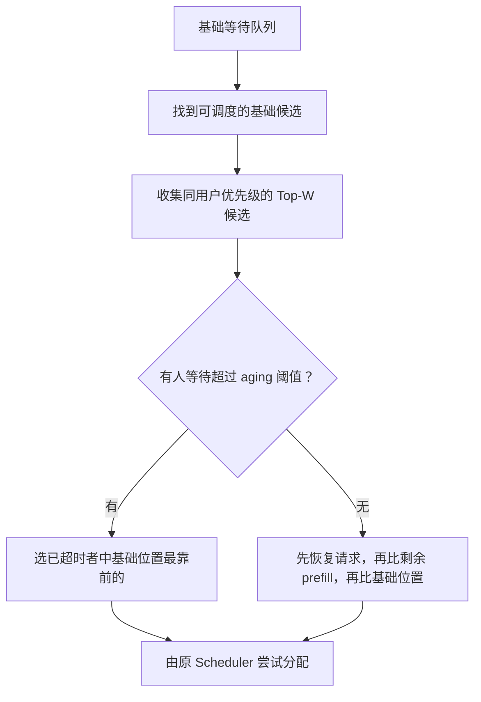

实际比较是**按顺序比较的元组**，不是随意设置权重相加：

```text
没有 aging 触发时，选择最小：
(是否从未被抢占, 剩余 prefill tokens, 基础队列位置)

False 小于 True，因此已被抢占的恢复请求优先。
剩余 prefill = max(当前请求总 token 数 − 本地已计算/可复用 token 数, 0)
```

小例子，假设四个请求都在同优先级窗口内，均未超过 aging 阈值：

| 请求 | 是否恢复 | 总 tokens | 本地可复用 tokens | 剩余 prefill |
|---|---|---:|---:|---:|
| A | 否 | 2000 | 1800 | 200 |
| B | 否 | 500 | 400 | 100 |
| C | 是 | 3000 | 1000 | 2000 |
| D | 否 | 200 | 0 | 200 |

此时先选 C，因为保护恢复请求是第一层规则；如果 C 不在窗口内，则选 B。它不是简单“命中率最高优先”：A 命中 90%，B 命中 80%，但 B 实际剩余工作更少。

若 A 已等待 11 秒、B 只等 1 秒，就先按 aging 保护 A。aging 只是有限窗口内的顺序保护，不能保证显存不足时请求马上运行，也不是全局严格公平证明。

### 8.3 为什么要保护恢复请求？

一个请求被抢占后已经受过一次延迟。如果重新进入队列时被当作普通冷请求，甚至刚恢复又被选为 victim，它会反复停顿。为此，恢复请求在准入和 victim 选择中都得到保护。

这里有代价：保护恢复与老请求，会放弃一部分眼前最短任务收益。因此项目不声称某个排序同时优化所有指标，而是通过吞吐、尾延迟和恢复重算共同观察。

### 8.4 Recompute-aware：暂停谁损失更小？

默认 FCFS 抢占常倾向运行集合尾部，新到请求不一定是恢复代价最低的。新策略先守住用户优先级：只从**最差优先级层**找 victim；本分支数值越小优先级越高。

再在该层内最小化：

```text
(是否已经被抢占过, 已计算 tokens, 负的到达时间, request_id)
```

解释顺序：

1. 优先暂停从没被抢占过的请求，避免同一请求反复成为 victim。
2. 再优先暂停已计算上下文较少者，作为损失工作量的便宜代理。
3. 平局倾向较晚到达者，再用 ID 固定结果，避免依赖运行列表偶然位置。

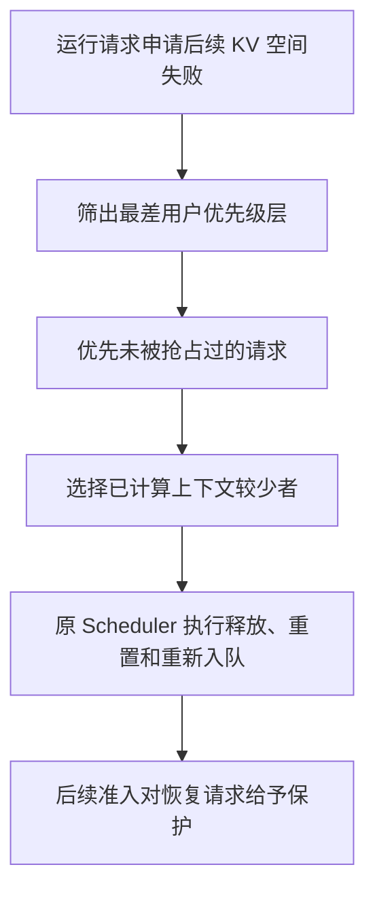

例子：同优先级 A 已算 3000 tokens、B 已算 500，均未抢占，优先暂停 B。若 B 已被抢占过、A 没有，则先保护 B，可能暂停 A。这是对抗反复抖动的选择，不能简化为“永远最短 victim”。

**代价估计是近似。** 已计算 tokens 并不等于实际必须全部重算：可能仍有共享 APC，或 host 保存可恢复。主策略没有将精确传输成本、物理可回收块数全部纳入统一最优解。

代码另有 reclaimable-aware 策略用于显式考虑释放进展，但当前主 L1 使用 `recompute_aware`，不能把未启用策略的能力归给主结果。策略只返回决定，真正的分配、释放和状态修改由原框架执行。

### 8.5 Generation + 懒解析：为什么需要这套状态机制？

Top-W 排序要看本地前缀，随后分配也要看。如果同一 KV 状态下重复解析，会浪费 CPU；如果一直复用旧结果，又可能引用已经淘汰的块。

本项目分两类特征：

- **便宜特征：** priority、arrival time、num_preemptions、num_computed_tokens，直接读当前请求，不依赖 KV 查询。
- **KV 派生特征：** prefix blocks、cached tokens、shared boundary，按需第一次解析，同一 generation 内复用。

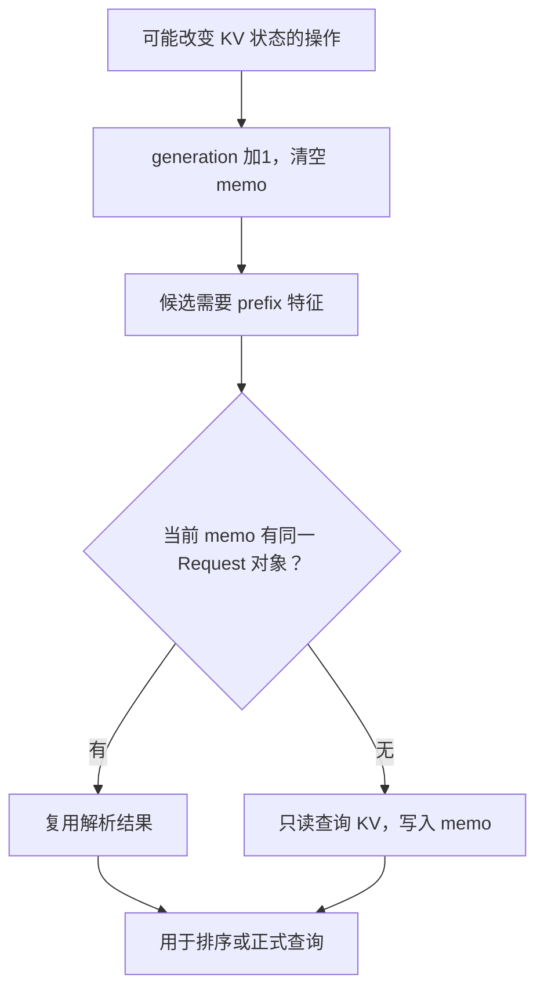

这里 generation 是**状态版本**，不是“第几次生成 token”，也不是固定时间 TTL。当前实现失效时直接清空 memo，而非给每条记录附版本后逐条比较。

用 `id(request)` 查表同时保存对象引用并检查对象身份，避免 Python 对象 ID 重用造成误命中。特征放在独立 context 中，不往 Request 上不断增加可能失效的缓存字段。

需要失效的边界包括分配、释放、淘汰、缓存重置、异步接收/缓存变化、部分尾部处理，以及延迟释放真正生效。**分配失败也可能先做清理而改变 KV**，不能只在成功时失效。

排序的 peek 必须只读：不能因为看一眼命中就提前 pin block、改变引用计数、发出实际命中事件或重复累计指标。正式 `get_computed_blocks` 可以使用先前结果，但仍保持正式查询应有的统计与事件语义。

### 8.6 L 层实验到底支持了什么？

本次 BF16 自然容量、8K、32 会话：L0→L1 吞吐 `160.12→214.25 tok/s`，+33.80%；GPU 命中比例约 `0.258→0.502`。两组抢占次数均为 0，因此主要支持**准入排序促进复用**，不支持“重算抢占贡献了 33.80%”。

独立任务吞吐 +19.09%，说明收益不只发生在原任务；但 TTFT P95 +17.14%，说明长尾代价也能迁移。Graph 同模式内 +31.99%，说明改进在另一执行模式下仍存在，不是 Graph 的加速全归策略。

原归因实验还出现抢占 `407→458`，重算 tokens 却 `197286→186390`。**抢占次数更多仍可能总重算更少**，因此次数不是成本。原 A/B 主要改变准入，不能独立证明 victim 策略的因果增益。

### 8.7 恢复重算量是怎样测出来的？

原有首次 prefill 指标排除了抢占后的重复 prefill，所以不能直接拿它代表全部上下文工作。本项目记录抢占前已经计算到的位置，称为旧 frontier；恢复时只累计本次计算区间与旧 frontier 重叠的部分。

小例子：抢占前已经算到 token1000，恢复后 APC 找回前400。重新计算400～1000的600个 token 才是重复工作；继续处理1000～1100的100个 token 是新进展，不能算重算。若恢复到700时再次抢占，原先尚未恢复到1000的历史边界仍需保留，不能因此漏计。

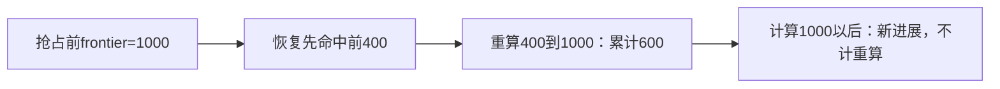

这套只读 telemetry 把“抢占前可能丢失多少进度”与“恢复中实际重复安排了多少计算”分开，避免把整个新 prefill 或全部后续 decode 都计入恢复成本。旧总本地上下文计算量由首次本地 prefill 加实际 resume recompute 得到，解释了 −3.37% 的真实含义。计数说明的是调度计算量，不是通过 GPU kernel profiler 直接测得的时间。

## 九、R 层：从“缓存优先”到“批处理与 KV 约束下的等待估计”

入口：[policies.py](./experiments_20261019/policies.py)、[router.py](./experiments_20261019/router.py)、[calibration.py](./experiments_20261019/calibration.py)。

### 9.1 先建立一个足够强的阈值基线

用户提到的“正常优先命中，负载差过大时优先均衡”已纳入。当前基线规则为：

```text
负载悬殊 = 请求数差 >= 4，且 最大请求数 / max(最小请求数, 1) >= 1.5
如果负载悬殊，或最佳命中比例 < 0.5：选在途请求数少的实例
否则：选估计命中最多的实例
```

平局再按请求数、实例编号固定。它已经同时看缓存和负载，不能拿纯轮询作为唯一弱基线后声称实现了高级路由。它也不是自己的原创思想。

### 9.2 请求数为什么不够？

实例 A 有两个请求，每个还要输出 120 tokens；实例 B 也有两个，每个只剩 5 tokens。请求数同为 2，等待显然不同。

第一步改为维护每个在途请求的可见工作预算：

```text
初始预算 = 估计新 prefill 时间 + 可见最大输出 tokens × decode 时间系数
Q_serial = 实例上所有在途剩余预算之和
工作量路由选择：min(Q_serial + 新请求 prefill)
cost 系列策略还加入简化淘汰代价 E
```

**可见最大输出预算是客户端提供的上限，不是偷看最终输出长度。** 主要性能组固定 64，只代表控制工作量；混合预算组也只使用请求到来时就知道的 32/64/128。

### 9.3 为什么在途账本必须在发送前登记？

若两个异步请求同时看见 GPU0 空闲，等网络发送后才计数，可能都选 GPU0。当前路由在同步 choose 中先登记 reservation，再进入网络 await；结束、失败或取消时清理。

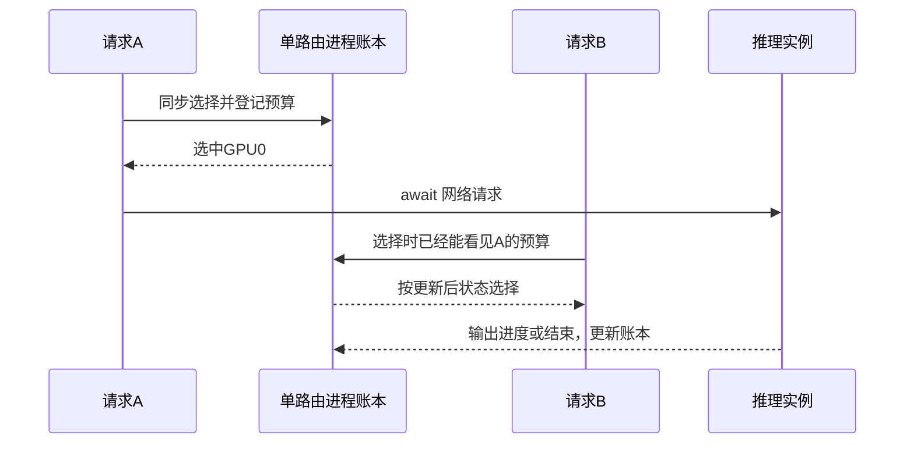

这里“原子”指同一异步路由进程中选择与登记之间没有让出执行，不是实现了分布式事务或多进程共享账本。

### 9.4 Remaining：按真实输出进度扣预算

如果请求从开始到结束一直按 64-token 总成本占账本，已经输出 60 tokens 的请求还会被高估。remaining 版本随输出更新：

```text
观察到第一个实际输出 token：说明初始 prefill 已完成，去掉 prefill 预算
已输出 g tokens：剩余 decode 预算 = max(输出上限 − g, 0) × decode 系数
结束或提前 EOS：释放 reservation
```

不是用“经过两秒”直接减两秒。请求可能排队、抢占或等待传输，墙钟时间不代表完成了多少模型工作。也不能把一个 SSE event 当一个 token：一个 event 可以承载多个 token。当前路径使用真实 token IDs/可靠使用量，拿不到可靠计数时保持保守，不凭事件数虚减。

这一改进在逻辑上合理，但简单 `work_remaining` 原 4K 三轮仅 +0.51%，独立任务 −1.96%，没有稳定吞吐增益。原因之一是把请求预算相加仍然假设串行服务，而 vLLM 会并行组成 batch。

### 9.5 为什么串行总工作量会误判？

实例上三个请求各剩 100ms，总和 300ms。如果三个能同时运行，新请求可能不必等满 300ms；如果 batch 满了，或者 KV 空间不足，即使请求数少也得等。

因此更有用的问题是：**新请求最早什么时候能同时拿到一个 batch 槽位和足够 KV？**

本项目 `memory_remaining` 使用 FIFO 开始时间近似：

1. 按在途登记顺序模拟已有请求入场。
2. 入场同时检查最大 batch 槽位与 KV token 预算。
3. 两者都满足，就允许并行；否则把虚拟时钟推进到最早结束的请求，释放其占用，再尝试。
4. 轮到新请求时的虚拟时钟，作为等待估计 `Q_fifo`。
5. 最终按 `Q_fifo + 新请求 prefill` 选择实例。

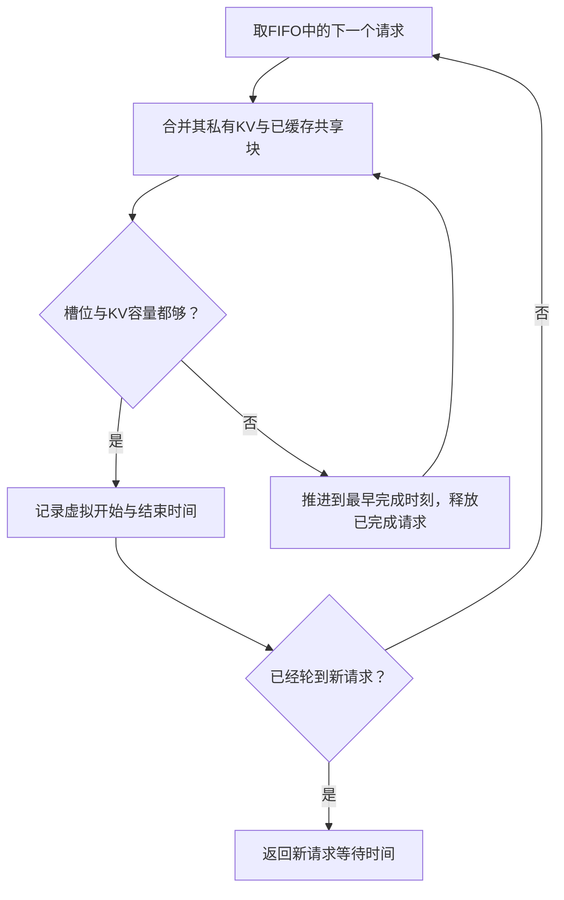

注意：`memory_remaining` 的实际选择没有加入 E；E 用于 `cost*` 策略。日志结构里的 total 字段可能包含 E，但不能据此把真实 argmin 说成三个项全都有。

### 9.6 一个能手算的槽位/KV 例子

假设最多同时跑 2 个请求，KV 容量 8 个逻辑块：

| 请求 | 占用 | 从现在起剩余时间 |
|---|---:|---:|
| A | 2 blocks | 100ms |
| B | 5 blocks | 300ms |
| 新请求 C | 4 blocks | 暂不需要其服务时间，只问何时入场 |

A、B 当前总占 7 块。100ms 时 A 结束，出现空槽，但 B 的 5 块加 C 的 4 块大于 8，C 仍进不来。300ms 时 B 结束，C 才入场。

- 只算串行总工作：可能估计 400ms。
- 只看最早空槽：会估计 100ms。
- 同时看槽位与 KV：估计 300ms。

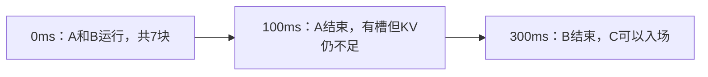

共享又会改变结论：若 B 的 5 块是“私有 3 + 已缓存共享 2”，C 的 4 块是“私有 2 + 同样共享 2”，二者合计为 `3+2+2=7`，不是 9，C 在 100ms 就能进入。

### 9.7 模型怎样避免重复计算共享占用？

```text
私有需求 = 向上按block对齐(输入长度 − 估计已缓存前缀 + 最大输出预算)
共享需求 = 同时活跃请求的“已缓存前缀 block keys”并集 × block大小
总需求 = 私有需求之和 + 共享需求
```

对新后缀没有因为内容相似就假设会共享；只把目录中已经确认/估计存在的前缀视为共享。容量扣除保留的 null block。输出的最大 KV 增长提前保留，比较保守。

**工作减少和占用释放不同。** 请求已经输出了 60 tokens，剩余计算少了，但已生成 token 的 KV 还要给后续 token 使用，不能顺手从显存账本减掉；这里只在请求结束时释放其需求。

这仍然是近似：独立请求的单请求服务时间不等于真实 batch 下时间，没有精确模拟逐轮 continuous batching、抢占、物理 pin 和传输。超过 64 个已有任务时回退串行估计，限制路由开销。无法单独装入的需求视为不可行，避免无限推进虚拟时间。

### 9.8 Prefill 成本怎么校准？

单独做 C=1 校准，输入长度取 128、512、1024、2048、3072，分别测冷输入与完整 APC 复用，用 warm/cold 中位数构造近似。首次 warm 测量不计入稳态，decode 系数也独立采样。

部分命中教学表达为：

```text
P ≈ warm时间 + (cold时间 − warm时间) × 未命中比例
```

因此高命中并不估计成零开销。长度使用相邻配置桶近似；Graph 与 eager 使用各自校准，不把 eager 的 decode 系数直接用于 Graph。它不是精确 GPU 延迟预测器，更没有用待测试请求的最终结果反过来指导当前选择。

### 9.9 目录是真实 GPU 缓存吗？

默认历史目录按完整 token block 链式哈希，带 60 秒 TTL 和容量边界；成功完成后更新观察，失败不发布，查询本身不刷新 recency。它只是有限历史，不知道每次真实驱逐、pin 或异步完成。

事件目录进一步消费真实 KV 事件，但本分支 `BlockStored` 可能在分配时发出，GPU 数据尚未完成。因此采用“事件存在且有成功完成请求覆盖”的保守交集：

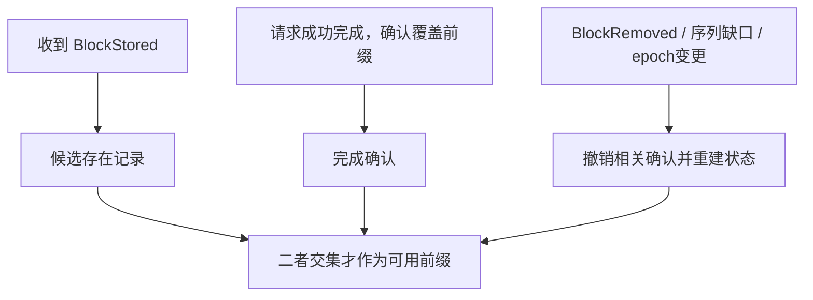

重放事件时先在私有快照完成重建再原子发布，避免短暂对外暴露已移除旧块。代码见[event_directory.py](./experiments_20261019/event_directory.py)和[events_router.py](./experiments_20261019/events_router.py)。即使如此，目录仍不是物理驻留 oracle，最后能不能真正复用由引擎判定。事件对照只有单轮，不主张稳定吞吐增益。

### 9.10 结果如何支撑“做出了改造”？

双副本 eager/4K、threshold→memory：

- 吞吐 `95.42→101.67 tok/s`，+6.55%；TTFT P95 `8.868→7.820s`，−11.82%。
- 独立任务吞吐 +7.96%，TTFT P95 −35.63%；三组配对吞吐均为正。
- 同次决策、同选中 worker，将串行估计作为影子记录：MAE `6.82→1.66s`，−75.69%。这样避免拿两套不同 worker 样本直接比较误差。

预测更准不代表一定大幅加速。Graph 中，threshold→memory 中位数 +5.08%，但一轮配对为负；在相同 profile 下，仅串行 remaining→memory 的独立吞吐增量 **+0.46%**，尽管影子 MAE 仍下降 49.57%。这说明执行模式、服务速度、候选排序接近程度都会影响策略空间。

主张应是“在指定 eager 资源配置中获得复验收益，并改善等待近似”，不能说这个队列模型对所有 GPU 都普遍提升几个百分点。

## 十、O 层：CPU KV Offload 具体怎样做？

入口：[WriteAdmission](./experiments_20261019/policies.py)、[lmcache_adapter.py](./experiments_20261019/lmcache_adapter.py)。

### 10.1 现成能力和自己的逻辑分别是什么？

LMCache 提供 KV 查找、存储、加载、去重、淘汰及相关连接能力。vLLM/connector 管理何时调用这些流程。`lmcache.skip_save` 是已有控制入口。

本轮分层保存主实现选择 LMCache，并未对所有 native offload、ARC/LRU、MP/lazy-offload 模式做完整优劣比较。框架还存在其他保存策略，不应把默认保存说成当前所有已有方案中的最强基线。

自己实现的是：**什么时候设置跳过保存、用哪些状态判断、一次请求如何保持一致、状态何时清理，以及当前 KV 布局/加载边界怎样正确接入。** 仅手工打开 offload 开关不包含这些机制。

### 10.2 用三个条件确认真实压力

本次主对照参数：host chunk=256 tokens，阈值 `κ=2`，会话窗口 60 秒，遥测有效期 5 秒。

```text
W = max(活跃会话数 A − 1, 0) × 活跃会话最近输入长度的均值 × 实际KV bytes/token

pressure = W > host容量
           且 遥测新鲜
           且 真实驻留占比 >= 95%
           且 近期发生过容量淘汰
```

为什么多看几项？W 是估计，可能高估共享；容量表面满不一定意味着有竞争；pin 比例也不等于有效缓存占用。只有工作集估计超容量，且缓存确实接近满并正在因容量淘汰，才激活过滤。

真实驻留读 LocalCPUBackend 的 hot cache；容量淘汰与普通清理分开计数，不把一次主动删除都算成内存压力。遥测失效时恢复正常保存，避免用旧压力长期误拒绝。

教学例子：17 个活跃会话，平均 2048 tokens，每 token 36KiB，则 W 约 1.125GiB。若 CPU 池只有 0.5GiB，并且实际满、近期在淘汰，才确认压力。会话等工具时仍保留在 60 秒活跃窗里，而不是 HTTP 返回就立刻删除。

### 10.3 新增 chunk 数怎么计算？

```text
u = floor(prompt_tokens / 256) − floor(host_prefix_tokens / 256)
u 至少为0
save = 非(pressure 且 u > 2)
```

这里 host prefix 是 CPU/目标 host 层实际可命中的连续前缀，不是 GPU APC 命中长度。GPU 已经有一份，不代表 CPU 也保存过；误用 GPU 命中会低估需要写入量。

| 本轮 prompt | host 已有前缀 | 新完整 chunks | 压力下决策 |
|---:|---:|---:|---|
| 2048 | 1792 | 1 | 正常保存，补小增量 |
| 2048 | 0 | 8 | 跳过大范围新保存 |
| 2048 | 2048 | 0 | 允许正常流程，实际新增由后端去重等决定 |

没有压力时，以上都允许正常保存。**跳过保存不等于跳过加载**，也不等于清空已有缓存。请求仍正常推理，已有 host 命中仍可使用。

### 10.4 为什么每请求只决定一次？

Chunked prefill 会让同一逻辑请求多次经过相关流程，抢占恢复也可能重入。若第一次允许写、下一次改成跳过，就很难解释请求完整 KV 的状态和统计。

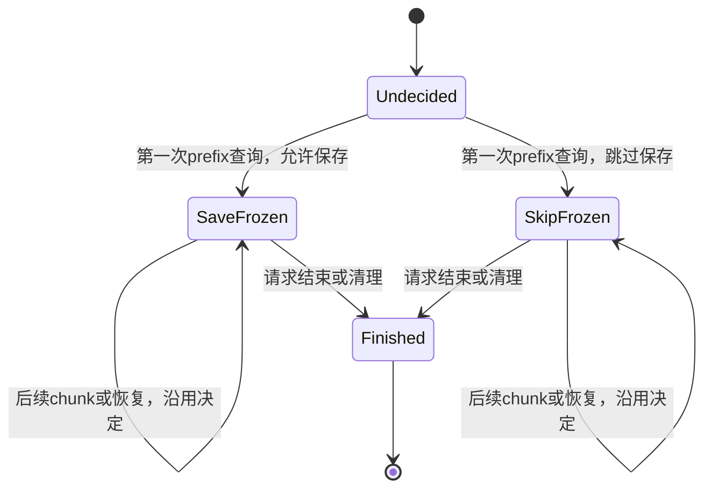

按逻辑 request ID 保存决定；结束时删除决定，保留会话历史。冻结的是本请求的策略选择，不是永远 pin 住缓存，也不是保证之后每个 chunk 都一定写成功。

### 10.5 三种策略为什么都要测？

| 模式 | 决策 | 用途 |
|---|---|---|
| 默认保存 `none` | 不主动过滤 | LMCache 基线；名称不表示关闭 offload |
| 固定过滤 `fixed` | 不看压力，u 大于阈值就跳过 | 检查收益是否仅来自少写，而非压力判断 |
| 条件过滤 `conditioned` | 压力成立才过滤大写入 | 避免容量宽裕时错失未来复用 |

还需要一个真正的 **offload 关闭组**：证明不是把本来有害的功能尽量关掉，就包装成加速。

eager/CPU0.5GiB 下，条件化比默认保存快 3.63%，但比关闭 offload 慢约 0.33%；因此该格只能说减轻了默认保存开销。decode Graph 同容量下，条件化相对默认 +7.46%，相对关闭也有 +4.02%，证据更完整。

### 10.6 为什么少写反而读得更多？

Graph 组 Stored tokens `235520→20224`，Retrieved `11264→33280`。一种与计数一致的解释是：减少大冷前缀反复覆盖，给更可能复用的前缀留出生存空间，因此总写入少了，而有效后续读取更多。

仍不能单凭计数证明每一个被保留前缀的未来价值；需要结合工作集、压力日志与端到端对照。Stored −91.41% 是逻辑保存量，不等于真实 PCIe 写带宽也精确下降这个比例。

### 10.7 为什么 Graph 下改善不同？

执行变快后，固定 60 秒窗口覆盖的会话活动不同，CPU 保存占比、排队以及复用时机都会变化。因此把策略分别放到 eager/Graph 内做 A/B。不能把跨模式吞吐差全部算作 O，也不能把读写计数的变化全归某一个 GPU kernel。

## 十一、L2/L3 扩容：文件层不只是“换个保存位置”

入口：[disk_adapter.py](./experiments_20261019/disk_adapter.py)。这里的 L2/L3 指缓存层级，不是前文 L 层调度，也不是 CPU 芯片自带的 L2/L3 硬件缓存。

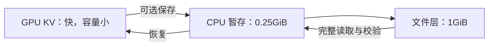

### 11.1 扩容和准入解决不同问题

增加文件层让更多 KV 有机会存下来；准入策略减少低价值写入和覆盖。更大池也可能被大量一次性内容填满，故“容量扩展 + 保存决策”可以共同考虑。

文件层压力统计只用目标文件层的容量/淘汰，不把 CPU 暂存中的重复副本与文件副本相加。它们不是两份不同内容的有效容量。

使用独立运行目录隔离文件缓存。文件读取必须得到完整目标长度，缺文件、截断或 EOF 不能当成命中；否则可能把旧 buffer 残留当成正确 KV。正确性诊断开启 SHA256 写入/读取核验，正式性能关闭这项额外哈希开销。

### 11.2 部分 GPU 命中为什么让 load cap 容易出错？

假设 GPU 已有 32 tokens，host 原本还能提供 2304 tokens。现在限制最多加载 2048，新端点仍要按 256 对齐：

```text
绝对目标端点 = floor((32 + 2048) / 256) × 256 = 2048
实际新增 = 2048 − 32 = 2016
```

因此不能仍向引擎报告“新增 2048”。引擎认为的进度与真正复制的内容不同，会破坏状态一致性。

```mermaid
flowchart TB
    A["GPU已有32 tokens"] --> B["host新增加载上限2048"]
    B --> C["按绝对位置对齐，LoadSpec终点2048"]
    C --> D["真正新增2016，而非2048"]
    D --> E["adapter按真实范围返回，保留边界断言"]
```

修复只接受不足一个 chunk 的向下差异，并核对真实 LoadSpec、GPU 前沿与末 token 调整；更大或方向异常的差异报错。没有删除断言，也没有把未加载内容伪报为已计算。专门构造了 GPU 前缀 0/32/288/512 的边界检查，实际模型探针触发了 2048→2016 分支并核对读取字节。

### 11.3 最终效果和边界

有效三轮默认→条件化：吞吐 `36.98→37.86 tok/s`，+2.37%；TTFT P95 −5.33%；Stored tokens −79.79%。早期小暂存配置有数值失败，旧开发轮全部隔离，最终只采用通过门禁的 0.25GiB 暂存/1GiB 文件配置。

文件 IO 使用 buffered read，可能命中操作系统页缓存。因此它是**文件后端链路及准入实验**，不能声称测出 SSD/NAND 的裸盘性能，也没有证明进程重启后的持久复用。LMCache Stored/Retrieved 在该配置下包含 CPU 与文件相关操作，文件真实字节计数需另看后端日志。

## 十二、PD 分离：拆开的是什么，为什么本机不一定划算？

### 12.1 P 和 D 的资源特点不同

Prefill 一次处理较多输入 token，decode 则反复生成少量新 token、读取历史 KV。将两种角色分开，可以分别规划资源和调度，减少相互干扰；代价是每个请求必须跨角色交接 KV，还可能损失完整副本的灵活性。

vLLM 已有 disaggregated prefill 与 connector 基础。本项目不是发明 PD，而是接通并检查本机链路、增加严格交接和角色实验。[vLLM 官方 PD 文档](https://docs.vllm.ai/en/latest/features/disagg_prefill/)。

### 12.2 一次真实请求怎样经过 1P1D？

入口：[pd_proxy.py](./experiments_20261019/pd_proxy.py)、[pd_fidelity.py](./experiments_20261019/pd_fidelity.py)。

```mermaid
sequenceDiagram
    participant C as 客户端
    participant X as PD代理
    participant P as Prefill实例
    participant D as Decode实例
    C->>X: 输入、输出上限、会话信息
    X->>P: 请求prefill与远端decode交接
    P-->>X: 权威KV元数据
    Note over X: 检查engine、block、token等交接字段
    X->>D: 原始请求 + P返回的交接信息
    P->>D: NIXL完成实际KV传输
    D-->>X: 持续decode输出
    X-->>C: 转发输出流
```

图中的传输箭头表示 P/D 间的逻辑交接，实际控制和搬运由 connector/NIXL 执行，不表示代理 Python 进程逐字节转发 GPU 张量。

代理先向 P 发送非流式、`max_tokens=1` 的准备请求，并开启远端 decode 交接。P 返回的 `remote_engine_id`、`remote_block_ids`、`remote_num_tokens` 等是权威元数据。缺失就失败返回，不能悄悄把完整输入交给 D 重算，然后继续声称完成了 PD。

P 的这个一步输出预算用于协议边界，可能涉及首个采样步骤；不要机械地说“P 绝不生成任何输出”。最终是否正确由端到端概率与输出检查验证。

D 使用原请求的完整输出预算，按协议读取远端 KV。会话 ID 和可选 CPU 保存参数可以透传，但不能覆盖 P 已确认的关键交接信息。

### 12.3 必需 NIXL 和可选 CPU 保存必须分清

```mermaid
flowchart TB
    P["P的GPU KV"] --> N["必需：NIXL交给D"]
    N --> D["D读取KV并继续生成"]
    P --> O["可选：LMCache保存策略"]
    D --> O
    O --> H["CPU缓存，服务未来复用"]
```

本项目的多连接接法将必需 NIXL 放在前，可选 LMCache 在后。`skip_save` 只控制可选 CPU 保存，不得取消 P→D 的必需交接。NIXL 用到 CPU 中转缓冲也不等于启用了持久 CPU KV 缓存：**传输暂存**与**跨请求复用**是不同职责。

若把两者混成一个 offload 开关，策略可能为了减少保存顺手破坏 PD。相应适配与测试就是本轮工程工作的一部分。

### 12.4 2P2D 的路由怎么做？

分两次选角色：P 在 P0/P1 中选，D 在 D0/D1 中选。1P1D 每个角色只有一个实例，没有同角色路由选择空间。

当前 D 工作量策略主要根据可见输出预算/剩余工作分配 decode 压力。没有发明新的 D 端缓存最优算法，也没有让 D 的 KV 自动回传给任意 P 作为下一轮 Agent 前缀。**双向 P/D 缓存迁移未实现。**

四种可能配对为：P0→D0、P0→D1、P1→D0、P1→D1。不能只验证默认 P0→D0 就认为 2P2D 全部正确。

### 12.5 如何证明不是“名义 PD”？

本次验收组合了几类证据：

| 证据 | 排除什么问题 |
|---|---|
| P 权威交接元数据完整，D 严格接收 | 排除缺失元数据后隐式走普通完整请求 |
| NIXL 实际传输字节与成功计数 | 排除只有 API 参数、没有真正移动 KV |
| D 初始本地 prefill 为 0 | 排除 D 重新完整 prefill 输入的隐藏回退 |
| 概率/事实检查，四配对独立前缀 | 排除错误地址、错前缀或只测一个配对 |
| 非强制代码生成与执行探测 | 补充最终模型行为检查 |

2P2D 每轮诊断有 19 项检查：原有 11 项加四配对各 2 项，六个架构正式运行逐轮通过。性能回放每轮 112 次实际传输、零传输失败，D 初始 prefill 为 0。

不过 D 后续仍做 attention、decode，也可能抢占并恢复重算。“初始 prefill 为零”不等于“D 计算量为零”。性能计数中 D 有 6～21 次抢占、130～504 个恢复重算 tokens，这些事实必须同时保留。

### 12.6 为什么四完整副本比 2P2D 快？

同四张 GPU、各实例固定相同 KV、seq8 的三轮中位数：

| 架构 | 输出 tok/s | TTFT P95 | TPOT P95 |
|---|---:|---:|---:|
| 四完整副本 + threshold | 167.66 | 4.129s | 52.05ms |
| 2P2D 轮询 | 87.13 | 11.951s | 59.57ms |
| 2P2D 的 D 按工作量选路 | 90.36 | 10.739s | 54.27ms |

2P2D 轮询相对四副本吞吐 **−48.03%**，三轮都退化。可以从三点解释机制：

1. 四副本有四张卡能做 decode；2P2D 只有两张。固定角色会牺牲弹性，并非拆开就能凭空增加算力。
2. 每实例 KV 相同时，D 侧合计容量只有四副本的一半；decode 在途历史更集中，压力更高。
3. 本机需要 host staging，每请求多一次跨角色 KV 交接。性能每轮约传输 8.79～9.37GB，传输有代价。

```mermaid
flowchart TB
    A["2P2D固定角色"] --> B["只有两张D卡承担生成"]
    A --> C["D侧KV容量相对四副本减少"]
    A --> D["每请求增加跨角色交接"]
    B --> E["D更容易形成瓶颈"]
    C --> E
    D --> F["额外传输与交接开销"]
    E --> G["本机回放吞吐下降、等待增加"]
    F --> G
```

这些是与观测一致的解释，尚未用单独的 DMA kernel 计时隔离出每一部分。不能把全部退化归因于 PCIe，也不能反过来宣称 PD 普遍无效。更高效互连、不同 P/D 比例、不同输入输出长度、动态角色调整，都可能改变结果。

1P2D 单轮约 85.47 tok/s，2P1D 约 46.68，支持本配置更缺 D 的线索，但只是单轮筛选。D 工作路由对轮询中位数 +3.71%，其中一轮配对为负，也不能称稳定增益。

### 12.7 PD+CPU 做到了哪一步？

2P2D、seq2、每实例 CPU0.25GiB，总 CPU1GiB 条件下，成功配对 1/3/4 轮：默认→条件化吞吐 `66.49→68.18 tok/s`，+2.55%；TTFT P95 −7.81%；Stored tokens −87.53%。

但共 8 次尝试中有一次在计时前诊断发生 HTTP502，根因未定位；其成功对照也随配对撤出，另补完整配对。诊断禁用可选 CPU 保存，不能把该失败归因于保存策略。现在补充了异常类型、repr 和完整堆栈。

因此这是**成功条件下的策略迁移证据**，不是生产稳定性证明，也不选作简历主要加速数字。该组只做 L0，不能说 PD+R+O+L 全组合都已验证。

## 十三、Chunked Prefill：把长输入分几轮处理，改变了什么？

### 13.1 为什么要分块？

一个长 prefill 如果一次占用大量本轮 token 预算，正在 decode 的请求可能等它完成才继续，产生输出停顿。Chunked prefill 把长输入拆成多轮处理，让 decode 与部分 prefill 在连续调度中穿插。

它是 vLLM 的现有功能，本项目重点是把它作为调度策略的实验变量，并检查开关是否真的引起切分。[官方调优说明](https://docs.vllm.ai/en/stable/configuration/optimization/)。

```mermaid
flowchart TB
    A["一个4096-token长输入"] --> B["第1轮：decode tokens + 部分prefill"]
    B --> C["第2轮：decode tokens + 下一段prefill"]
    C --> D["多轮继续，直到输入完成"]
    D --> E["该请求进入持续decode"]
```

分块后单个长请求的 prefill 完成时间可能变长，但其他请求的 decode 更容易及时获得机会。预算太小会增加轮次与调度开销，太大又可能干扰生成；不存在“越小一定越快”。

### 13.2 一定要分清三个粒度

| 名称 | 本质 | 本次常见值 | 谁使用 |
|---|---|---:|---|
| GPU KV block | 显存分配与前缀共享单元 | 16 tokens；INT8 对齐组 256 | KVCacheManager/APC |
| LMCache chunk | host 查找、保存、加载单元 | 256 tokens | LMCache 与 O 策略 |
| 每轮 batched token budget | 一轮调度允许处理多少 token | 512/2048/8192 | Scheduler/chunked prefill |

它们都可能被口头称作“块”，但修改一个不会自动修改其他两个。INT8 的 GPU/host 粒度对齐也不是把 prefill token budget 改为 256。

假设本轮 budget=512，有 4 个 decode 请求各需 1 token，理想简化后留给 prefill 的预算为 508。4096-token 输入至少需多轮。这个例子假设请求数稳定、无其他约束；实际还受队列、对齐、空间与调度细节影响。

### 13.3 与 Top-W 的关系是什么？

L 的 Top-W 决定等待请求中谁先获得准入；chunked prefill 决定已被选择的长输入本轮能处理多少。Top-W 不会在每一轮把所有运行中的 prefill chunks 重新按命中全局排序。

```mermaid
flowchart LR
    A["等待队列"] --> B["L：有限窗口选择准入"]
    B --> C["原Scheduler按本轮budget分配token"]
    C --> D["模型执行本轮prefill/decode"]
    D --> E["剩余输入留待后续轮次"]
    E --> C
```

因此应固定 budget 比较 L0/L1，再换 budget 比较交互，不能同时换两项后把全部差异归一个算法。

### 13.4 本次检查了“开关真的生效”吗？

检查了真实 AsyncScheduler 调度诊断：budget512 时 L0/L1 分别 111/110 个请求发生分块，2048 时为 77/79。8192 的开/关对照两边都没有请求分块，输入最大约 3802，预算足够一次处理。

所以“8192 下开启 chunked prefill 更快/更慢”不能直接解释成切分效果。只有确实发生切分的组，才讨论分块与排序交互。带详细调度日志的诊断组不作为正式性能组，避免诊断开销污染结论。

本轮没有形成可主张的普适最优 budget；它是已覆盖的控制变量和解释维度，不是新发明了 chunked prefill。

## 十四、量化与 Graph：它们为什么影响策略收益？

### 14.1 权重量化与 KV 量化节省的是不同对象

```mermaid
flowchart TB
    A["GPU显存"] --> W["模型权重"]
    A --> K["各请求KV状态"]
    A --> T["临时缓冲与Graph等"]
    W --> QW["AWQ：压缩权重"]
    K --> QK["INT8 / FP8 KV：压缩状态"]
    QW --> C["可能留出更多KV容量"]
    QK --> C
```

AWQ 通常降低权重存储精度；本次 AWQ 模型的 KV 未因此自动从 BF16 变成 INT8。KV 量化则直接改变每 token 状态的载荷与数值精度，加载/恢复还需要正确处理 scale。[vLLM KV 量化文档](https://docs.vllm.ai/en/stable/features/quantization/quantized_kvcache/)。

### 14.2 为什么量化以后吞吐不一定更高？

权重更小可以减轻带宽或增加可用显存，但还需反量化，kernel 实现与 GPU、batch、长度有关。小 batch、不同算子路径下，额外开销可能抵消收益。

实验要回答两个不同问题：

- **固定 KV 容量比较：** 主要观察执行路径/精度变化，但仍有 kernel 差异。
- **自然 KV 容量比较：** 更接近“换量化模型后整体可用资源变化”，同时混入更大缓存池，不能全算计算加速。

本次自然池 BF16 111184 tokens，AWQ 224544。容量宽裕可能降低缓存竞争，原先缓存感知排序的边际收益也会下降。AWQ 自然容量 L1 相对 L0 吞吐 −0.88%，TTFT P95 约改善 14.83%；固定 KV 单轮 AWQ 也没有比 BF16 快。不要说 AWQ 一定让本项目再多提升一层。

### 14.3 INT8 offload 为什么要单独验收？

INT8 的 GPU 内存格式、scale、host chunk 对齐共同决定复制后的含义。不能看到事实问答正常就当数值正确。

原 GPU block16/host chunk256 配置有 4/11 项数值检查未通过；GPU block256/host chunk256 对齐后 11/11 通过，并通过 6 项代码探测。同配置准入单轮 +1.09%，只作为可用性筛选。

总池保持 8192 tokens，但 block 粒度变大后，null block 等保留量也变大，因此跨 block16/256 不能说可用空间完全相同。对齐配置可用，也没有证明原失败的全部根因都已经定位。

FP8 KV 在本机 SM86 的当前 Triton 后端被拒绝，记录为该路径不可用。不能扩大成“3080 Ti 不支持任何量化”，AWQ 与已验收的 INT8 路径就是反例。

### 14.4 CUDA Graph 解决哪一类开销？

每一步 decode 常有很多 GPU 操作；CPU 逐个发起会有启动开销。Graph 对适合的形状记录并重放一组操作，减少反复提交开销。动态请求需要相应形状桶与运行适配。

```mermaid
flowchart LR
    A["普通执行：每轮反复提交多个GPU操作"] --> B["CPU启动开销"]
    C["Graph：对支持形状记录执行图"] --> D["后续重放图"]
    D --> E["减少重复提交"]
```

本次使用现有 decode Graph 能力，常规捕获 batch1/2/4/8，其他配置按实际 seq 上限调整。没有声称写了新的 CUDA Graph 算法或新的融合 kernel。

Graph 改变服务速度，也改变等待模型和 CPU 复制在整体中的占比。因此：路由 profile 重新校准，O 策略同 Graph 内比较，L 也同模式比较。Graph 组能说明自己的策略在该模式下仍有/没有增益，不应把开启 Graph 的全部速度变化写入自己策略的贡献。

## 十五、正确性工程：本项目最值得深讲的部分

### 15.1 为什么“速度变快”有时正是错误信号？

错误恢复 KV 可能让模型跳过了真正应该做的计算，或者基于错误中间状态继续生成。服务仍可能返回可读文本，速度却看起来更好。若只看 HTTP 成功、简单事实和吞吐，容易把错误路径当成果。

本轮发现的 V2 打包复制问题使旧 offload 性能永久隔离。最后报告使用修复后的 V3 数据，旧数字再好也不沿用。

### 15.2 元素数相同，布局为什么仍会错？

教学上把两个层、K/V、token、head 的坐标想成一个多维地址。展平后的元素数量一致，只说明容量够，并不保证第 k 个元素代表同一个坐标。

本机 Triton KV 是打包形式；LMCache V2 分离缓冲与它不兼容。需要在 CPU allocator 捕获元数据前，让 V3 connector 识别实际格式：

```text
分离形状示意：[2, L, T, H*D]
打包形状示意：[1, L, T, H*2D]
```

```mermaid
flowchart TB
    A["检查worker实际KV形状与格式"] --> B["初始化V3的指针与packed元数据"]
    B --> C["CPU allocator按正确元数据分配"]
    C --> D["注册与使用connector"]
    D --> E["逐元素round-trip"]
    E --> F["实际驱逐恢复后的模型概率/事实检查"]
```

这是解释本次具体兼容问题，不是建议任意张量改 reshape 即可互通。初始化时序也关键：allocator 已经记录错形状后，再修改后面的字段可能仍保留错误内存解释。

### 15.3 为什么字节与模型两种检查都需要？

| 层次 | 本次检查 | 能证明的范围 |
|---|---|---|
| 张量复制 | V3 20 项逐元素 round-trip 通过，另 4 项旧 V2 预期失败保留 | 当前测试布局、精度和形状复制一致 |
| 模型恢复 | 先真实保存，再驱逐 GPU，再从 CPU/file 恢复 | 确实走到恢复路径，而非 GPU 命中绕过 |
| 数值语义 | 8 项 Coding next-token logprob + 3 项长前缀事实 | 检查恢复后模型状态；不只看最后字符串 |
| 生成行为 | 6 项非强制代码生成并执行 | 提供小规模功能门禁，不替代完整质量评测 |
| PD 链路 | 元数据、NIXL 字节、D 初始 prefill、四配对 | 证明交接及其模型行为，而非只有请求成功 |

BF16 CPU、Graph、HND 分别 11/11；文件层与部分 GPU 前缀边界也各 11/11。通过的是具体配置，不是数学证明所有长度、所有模型都正确。

### 15.4 调度状态也需要一致性

还有三种不直接表现为模型概率错误的问题：

- **旧 prefix 特征：** 淘汰后仍用旧 block → generation 失效处理。
- **在途账本泄漏：** 失败/取消没释放预算，实例长期被误判为忙 → finally/取消路径清理与测试。
- **错误后端身份：** 端口上其实是上轮遗留进程 → 启动前端口检查与健康监听 PID/子进程所有权核验。

不能只查“端口能连通”。本轮确有端口污染导致一组路由配对撤出，补新干净轮并保留原日志。它与另一次根因未明的 PD+CPU 诊断502不同，没有证据把两者混为一个故障。

### 15.5 测试和记录保留到什么程度？

新增策略/adapter/目录/编排针对性测试 43 项通过；原核心调度此前 31 项回归通过，本轮追加未修改其核心实现。取消与错误清理追加重跑的 4 项是已有集合的子集，不应加成“47 个独立测试”。

每轮保存 manifest、源码 SHA256、模型 revision、trace 身份、逐请求结果和指标快照。失败、隔离、补跑都保留，不覆盖旧输出。累计尝试数包括开发、失败、诊断和复验，不等于独立有效对照数。

## 十六、实验设计：怎样让数字能经得住追问？

### 16.1 每个 A/B 先说清四件事

1. **改了什么？** 例如只切换 threshold→memory，或默认→条件化保存。
2. **固定什么？** 模型、执行模式、GPU 数、KV 容量、seq 上限、输出预算、轨迹和预热流程。
3. **用什么证据？** 端到端指标、相应机制计数与正确性门禁。
4. **结论覆盖哪里？** 原任务/独立任务、eager/Graph、压力池/自然池，不越界推广。

```mermaid
flowchart LR
    A["固定模型、资源、trace与预热"] --> B["先过正确性门禁"]
    B --> C["交错运行A/B，多轮记录"]
    C --> D["端到端指标 + 机制计数"]
    D --> E["保留负结果，给出适用边界"]
```

### 16.2 为什么要交错、独立任务和机制计数？

GPU 状态、启动与系统负载会漂移。交错 A/B、改变顺序比先把 A 全跑完再跑 B 更稳。三轮仍是小样本，因此同时给每轮值和中位数，不称统计显著，不把范围当置信区间。

独立任务说明没有只针对那 32 个任务生效；机制计数说明结果与假设是否一致。例如 L 吞吐提高伴随命中增加，O 少写伴随更多读取，R 的预测误差下降。但观测相关仍不等于排除全部其他机制。

### 16.3 什么叫“中位数之比”和“配对变化”？

```text
报告的中位数变化 = median(B1,B2,B3) / median(A1,A2,A3) − 1
逐轮配对变化 = B1/A1−1，B2/A2−1，B3/A3−1
```

两者一般不相等。例如 PD+CPU 的有效配对吞吐变化为 +7.21%/+2.43%/+5.00%，两组中位数之比是 +2.55%，不能把其中一个替换成“平均提升”而不说明口径。

主要候选完成至少三轮复验；单轮的 INT8、部分 PD 比例/布局只标记筛选。对照之间可能共享一个基线运行，也不能称“27 套彼此独立实验”。

### 16.4 预热和回放口径会影响结论

每轮重新启动服务，每 backend 两个短预热请求；先做数值门禁再计时。诊断前缀与正式负载首块隔离，避免直接把同一输入提前暖好；但诊断后没有强制清空全部 APC，不同架构的历史并非完全一致。因此架构结论限定本次预热流程。

性能吞吐是全部任务输出 tokens 除以最后完成减最早开始的 makespan，包含会话依赖与工具间隔。它不是固定开放到达率下的最大稳定 RPS，也没有完整测服务饱和曲线。

### 16.5 主要成果和反例放在一起看

| 方向 | 有效成果 | 必须一起记住的边界 |
|---|---|---|
| L，自然容量 BF16 | 原任务 +33.80%，独立 +19.09% 吞吐 | TTFT 尾部上升，且无抢占，不证明 victim 增益 |
| R，双副本 eager | 原任务 +6.55%，独立 +7.96% | Graph 相对串行模型增量只有 +0.46% |
| O，CPU Graph | 默认→条件化 +7.46%，关闭→条件化 +4.02% | eager 相对关闭略慢；容量宽裕时过滤价值减小 |
| 文件层 | +2.37%，Stored −79.79% | buffered IO，不是裸盘性能结论 |
| R/O 组合 | 相对阈值+默认保存 +4.98%，TTFT −15.43% | 再叠加 L 没有额外吞吐收益，TTFT 还退化 |
| PD | 真交接、四配对、正确性覆盖 | 同四卡 2P2D 轮询比四副本 −48.03% |
| 量化 | AWQ、对齐 INT8 路径验收 | AWQ 不总更快，INT8 单轮只作筛选 |
| Chunk/Graph | 控制变量与交互检查 | 现成功能，不能写成自己的算法发明 |

R/O 组合使用的是串行 `work_remaining`，不能把它直接叫作已验证的“memory 路由 + O 完整矩阵”。双副本五格×三轮也不是全部八种开关组合；PD+CPU 更不是三层全开矩阵。

### 16.6 哪些看起来很好的说法不能用？

| 容易说错 | 应当怎么说 |
|---|---|
| 三层各提升若干，加起来提高 40% 多 | 各自配置独立比较，组合增益需要实测；本轮部分叠加无收益 |
| 我的算法降低了 CPU 调度开销 3.37% | 旧实验少计算了 3.37% 本地上下文 tokens |
| 减少 7.94% prefix 查询，提高 7.94% 缓存命中 | 减少的是 prefix resolver 重复解析次数 |
| 这次 +33.80% 证明抢占更聪明 | 该格无抢占，证据支持准入与复用 |
| CPU 保存少 91.41%，所以 PCIe 写带宽也少同样比例 | 逻辑 Stored tokens 减少，物理字节需单独测量 |
| PD 慢完全因为传输 | D 数量、D KV 池与传输共同变化，尚未隔离每项 |
| 多万次 HTTP 成功，所以模型质量可靠 | 成功响应统计含隔离/失败轮的部分响应，且不是质量正确率 |
| 论文思想不原创，所以我只是开开关 | 论文提供思路，具体在线状态、评分/队列近似、适配和验证是本项目工作 |

## 十七、把一个请求从头走一遍

假设会话 S 的新一轮输入长 2048、输出上限 64；两个完整副本 A/B，各有私有 GPU 和 CPU 缓存。以下是组合流程解释，不代表每个最终成绩都来自这套全开配置。

```mermaid
flowchart TB
    A["新请求：session S，输入2048，输出上限64"] --> B["R读取A/B前缀目录与在途账本"]
    B --> C["估计等待 + 新prefill，先登记选中实例预算"]
    C --> D["进入实例等待队列"]
    D --> E["L在同优先级Top-W内选择"]
    E --> F["KVManager正式验证命中并分配"]
    F --> G["模型按token budget运行"]
    G --> H["输出token进度更新R账本"]
    F --> I["O首次查询时决定是否保存，冻结到结束"]
    I --> J["LMCache执行允许的加载/保存"]
    G --> K["请求结束"]
    K --> L["清理R与O的请求状态，保留会话历史"]
```

1. R 可能发现 A 命中更多但 KV/槽位都紧，B 缓存少却可立即开始，于是选 B；选择与预算登记同步完成。
2. L 不直接相信路由估计，调用本地真实状态；窗口内如有 aging 请求，则先保护它，否则按恢复/剩余输入/原位置选。
3. O 依据目标 host 层命中、活跃会话与真实压力做一次保存决定；即使跳过新写入，已有 CPU 数据仍可加载。
4. Scheduler 运行时 KV 有变化，generation 失效，不能继续复用旧 prefix 特征。
5. 首 token 到来，R 去掉初始 prefill 预算，之后按真实输出扣剩余预算；生成的 KV 仍占显存。
6. 结束、异常或取消后清理请求账本；会话没有马上消失，因为它还可能在工具等待后继续回来。

若改成 PD，第 3～5 步在不同角色上分布，P 还需提供权威交接元数据、NIXL 必须成功交接给 D。当前没有把所有完整副本模式的细节与所有 PD 组合都穷举验证，不能把教学流程当完整组合成果。

## 十八、面试怎样讲：按理解深度逐步展开

### 18.1 30 秒版本

“我的项目研究多轮 Agent 推理中，有限显存下怎样利用 KV Cache。我把问题拆成三个决策：实例内谁先运行、请求放到哪张卡、哪些 KV 值得写到 CPU。基于 vLLM V1，我实现了缓存亲和准入和状态失效管理，进一步借鉴 Preble 与 EfficientAgent，加入工作量/容量感知路由和条件化保存。在四张 3080 Ti 上使用公开 Coding 轨迹和独立任务复验，同时检查缓存恢复的数值正确性。结果有指定配置下的收益，也发现尾延迟、Graph 和 PD 架构的适用边界。”

### 18.2 三分钟版本

第一段讲问题：

“Agent 多轮输入不断增长，旧历史能复用 KV，但命中率高不代表请求快。实例可能已经很忙，显存也可能被其他请求占住；CPU 缓存即使开启，也可能反复写入很快被淘汰的内容。所以我没有只优化一个命中率指标。”

第二段讲算法：

“实例内使用有限 Top-W 窗口，在用户优先级约束下，保护老请求与恢复请求，再比较剩余 prefill；抢占用已计算工作量作代价代理。为避免排序读到旧 KV，特征只在同一 generation 内复用，状态变化立即失效。

路由先保留缓存优先、负载悬殊时均衡的阈值基线，然后用真实输出进度维护剩余工作。进一步考虑 batch 槽位和 KV 容量，近似估计新请求最早能进入的时间，避免把并行请求简单串行相加。

CPU 保存借鉴 EfficientAgent：估计其他活跃会话构成的竞争工作集，结合真实驻留和容量淘汰确认压力，再拒绝大范围新写入、保留小增量。请求第一次决定后冻结，避免分块和恢复时反复切换。”

第三段讲证据：

“我在公开 Coding 历史文本回放和不重叠任务上做同配置交错对照。双副本 eager 路由对阈值基线吞吐提高 6.55%，独立任务提高 7.96%；相同 Graph 下 CPU 准入对默认保存提高 7.46%。本地调度自然容量组吞吐提高，但 TTFT 尾部也变差。我把这些范围分开报告，没有相加成一个总收益。”

第四段讲工程深度：

“最关键的工程问题是 KV 复制和进度一致性。我发现 V2 的分离 K/V 格式与本机打包格式不兼容，修正 V3 初始化时序后，先验证逐元素 round-trip，再验证真实驱逐恢复后的概率。还有部分 GPU 命中加 host 加载上限时的 2048→2016 对齐边界，不能只改返回值而不核对实际加载范围。PD 则做了四配对真传输检查，并保留本机四副本优于 2P2D 的负结果。”

### 18.3 如果只能深入讲一个算法

建议讲 R 的 FIFO 槽位/KV 模型：问题容易理解，能用第 9.6 节手算；有清楚的代码入口、误差对照与端到端证据。然后主动补一句“Graph 下相对串行模型吞吐增量很小”，体现知道模型改进的实际边界。

若面试官偏系统工程，重点讲 generation、packed layout、load-cap 守恒与错误恢复。若偏推理服务，重点讲 batch、吞吐/尾延迟、PD 资源比例和控制变量。

## 十九、常见追问：把回答说到算法和证据上

### Q1：你到底是做调度还是做缓存？

做的是利用缓存状态进行调度与保存决策。KV 的底层分配、复制、attention kernel 主要复用现有系统。自己的工作在“什么时候运行、送到哪里、保存哪些数据”和跨组件一致性上，不是重写一个 KV 存储系统。

### Q2：你说 KV-aware，具体 aware 了哪些状态？

L 读取本地可复用前缀、已计算 tokens、恢复次数和等待时间；R 使用按实例的前缀估计、在途预算、真实输出进度及容量/槽位代理；O 使用 host 已有前缀、活跃会话长度、实际驻留和容量淘汰。不同层信息可信度不同，R 的目录估计不能替代 L 的真实检查。

### Q3：为何不直接让所有高命中请求先跑？

命中比例不等于剩余计算量，也不包含等待与公平。90% 命中的超长请求可能比 80% 命中的短请求剩余工作更多。一直偏向命中请求还会饿死低命中任务，所以使用有限窗口、用户优先级和 aging 约束。

### Q4：为什么 Top-W，而不是全队列最优排序？

全队列查 KV 会增加调度 CPU 开销，跨很远重排还会破坏队列公平。Top-W 用有限搜索换取局部复用收益，使成本随窗口而非整个队列增长。它不是全局最优证明；W 和 aging 都是需要按负载验证的参数。

### Q5：Aging 能保证每个请求十秒内开始吗？

不能。它只在可调度、同优先级、有限候选中保护已经等待较久的请求。显存不足、外部 KV 未到或其他硬约束仍可能阻止运行，也没有严格全局服务时限保证。

### Q6：为什么抢占代价不是“剩余输入长度”？

暂停会损失已经完成但无法继续保留的状态，因此看已计算工作更自然；剩余输入短可能恰好意味着已经计算很多，暂停它损失大。当前用已计算 tokens 作代理，还受 APC、host 恢复影响，并不等于精确实际重算时间。

### Q7：为什么保护已经抢占过的请求？

恢复时进度可能重置得很小，若总选最小进度，它会立即再次成为 victim，反复抖动。先保护这类请求，牺牲部分即时最小代价，换取连续进展与用户输出体验。

### Q8：Generation 是不是又建了一个 prefix cache？

它缓存的是调度所需的**解析结果**，不是 GPU KV 张量。APC 负责复用模型中间状态；feature memo 负责同一 KV 状态下少做重复查询。KV 一变化就清空，生命周期与 APC 不同。

### Q9：为什么分配失败也要失效？

分配流程可能在最终判定失败前清理已跳过/不需要的 block，这已经改变状态。如果只把成功视为 mutation，会继续使用旧派生结果。失效应贴合实际可能修改 KV 的边界，而非简单检查返回值。

### Q10：你的路由用了未来输出长度吗？

没有。只使用请求到来时可见的输出上限，随后用真实已输出 tokens 更新。提前结束就释放；不知道准确 token 数时保守保留。固定预算性能实验是控制工作量，不是预知真实生产回复长度。

### Q11：为什么不直接用过去耗时减掉剩余耗时？

墙钟经过可能只是排队或等待传输，也可能发生抢占，不能说明模型完成多少工作。输出进度更直接。但首 token 前仍只能估计 prefill，batch 服务时间也不精确，所以模型有误差。

### Q12：路由中的共享 KV 怎样计费？

对预计已缓存前缀用完整 block 的链式身份求并集，只算一次；新后缀作为私有需求，输出按最大预算保留。它避免一类显然的重复计费，但不是实际 pin/refcount 的精确模拟，也暂不覆盖 LoRA、salt、多模态或复杂多 group 身份。

### Q13：为什么不直接把 vLLM 所有真实状态传给路由？

信息同步有成本和延迟，分布式观察不能自动变成瞬时真值；事件本身也可能只表示分配而非数据 ready。因此目录要标明近似与保守边界，真正的分配和复用由引擎执行。事件版本还处理缺口、移除和 epoch，不以一条 Stored 事件作为完整正确性保证。

### Q14：你的排队模型比串行更准确，为何有时不加速？

更准确可能仍选中同一个 worker；候选负载差异很小时，误差下降未必改变排序。模型也没有精确描述 batch 吞吐和传输。Graph 下相同 profile 的 work_remaining→memory 吞吐只 +0.46%，就是预测改善与决策价值分开的例子。

### Q15：CPU 容量满了，LRU 自己淘汰不就够了？

LRU 决定已经接收的数据保留谁；准入决定新内容是否值得接收。大量大冷前缀到来时，先写再淘汰会付复制成本并覆盖可复用前缀。条件化策略尝试在真实压力下拒绝这类写入；容量宽裕时仍正常保存，避免过度过滤。

### Q16：为什么不永远只存小增量？

一个首次出现的大前缀可能后续反复使用。永远拒绝会让它永远没有 host 基础，损失复用。条件化保存先确认工作集和真实淘汰压力，不把大写入一概判为无用。

### Q17：W 为什么用活跃会话而不是当前请求数？

Agent 在工具等待时没有活跃 HTTP 推理，但其 KV 仍希望保留到下一轮。当前请求数低估跨轮竞争；最近会话窗口可以保留这类需求。窗口和长度均值仍是近似，不是完整未来访问预测。

### Q18：为什么遥测失效时恢复保存？

本项目选择避免旧压力把后续新会话长期误拒绝，恢复正常后端行为。代价是遥测失效期间可能多写。这是一个明确的工程选择，与作者实现的估计回退方式不同，需要在日志中显示，而不是悄悄声称仍有准确压力判断。

### Q19：Offload 为什么不能只用输出文本检查？

错误 KV 可能仍产生碰巧正确的简单答案。要先确认实际发生 host 读取和 GPU 驱逐，再看 next-token 概率和长前缀事实；更底层还要检查布局与字节。只测“首都是什么”不足以发现打包格式错误。

### Q20：你做 PD 为什么最后慢了，算失败吗？

架构速度目标在本机配置下没有达成，应该如实报告。工程上完成了严格真传输、数值验收和同 GPU 数对照，并识别两张 D、较小 D KV 池和 host staging 的限制。这是有用的架构边界证据，但不能包装成 PD 加速成果。

### Q21：你借鉴论文，自己的价值在哪里？

论文思想应归原作者。本项目价值在当前代码与机器上把思想变成可运行的决策：真实输出账本、FIFO 槽位/KV 近似、同决策影子误差、请求级保存冻结、真实驻留反馈，以及 packed/load-cap 适配和可复核消融。没有学术原创性证明，定位为系统实现与实验改造。

### Q22：为什么不直接用大模型、真实生产流量证明？

目前个人机器和时间有限，先在能完整装入的模型上控制变量，验证机制与正确性。公开 Coding 轨迹保留了真实输入结构，独立任务降低了对某一批数据的依赖；但窗口过滤、固定输出和模拟工具等待仍限制外推。后续应增加真实工具执行、长上下文、开放到达和更多模型规模。

### Q23：有没有把所有优化全开，证明整体更好？

有双完整副本的选定 R/O/L 组合实验，但不是全部组合穷举。R/O 组合有收益，进一步叠 L 没有增量并恶化 TTFT；PD+CPU 仅 L0。不存在“全开一定更好”的证据，各层争用同一资源，边际收益会互相影响。

### Q24：下一步最值得改什么？

按目前证据，优先做：把路由服务时间从单请求系数扩展到 batch 条件模型，加入可观察的传输/恢复时间；让 O 同时比较加载与重算收益，而非仅决定保存；增加开放到达、真实输出与工具等待分布。PD 需先补稳定性定位与更合适 D 资源比例，再谈复杂策略。

不能说这些已经实现。完整 stack-distance、动态跳读、双向 P/D 迁移、自动子树复制等都属于后续方向。

## 二十、代码与证据阅读索引

### 20.1 先看接口，再看状态更新

| 要回答的问题 | 阅读入口 | 重点看什么 |
|---|---|---|
| 谁先进、谁被暂停？ | [policy.py](../vllm/v1/core/sched/policy.py) | 两类排序元组，用户优先级，恢复保护 |
| 真正何时分配/释放？ | [scheduler.py](../vllm/v1/core/sched/scheduler.py) | 调用策略、allocation 失败、free、invalidate |
| 特征怎样复用与失效？ | [feature_context.py](../vllm/v1/core/sched/feature_context.py) | 只读便宜字段、对象身份、memo clear |
| 前缀查询是否有副作用？ | [kv_cache_manager.py](../vllm/v1/core/kv_cache_manager.py) | peek 与正式查询，统计/事件边界 |
| 路由到底比较哪个公式？ | [policies.py](./experiments_20261019/policies.py) | `choose`、`memory_queue_wait`、`observe_output` |
| 网络失败后账本如何清理？ | [router.py](./experiments_20261019/router.py) | reserve、流进度、finish 与取消 |
| 系数怎样得到？ | [calibration.py](./experiments_20261019/calibration.py) | cold/warm、长度桶与独立 decode 系数 |
| 工作集如何进入 LMCache？ | [lmcache_adapter.py](./experiments_20261019/lmcache_adapter.py) | 首次决定、host prefix、真实驻留、格式初始化 |
| 文件层有哪些边界？ | [disk_adapter.py](./experiments_20261019/disk_adapter.py) | 完整读取、目标层计数、LoadSpec 守恒 |
| PD 怎样确保真交接？ | [pd_proxy.py](./experiments_20261019/pd_proxy.py) | 权威元数据、缺失报错、角色选择与清理 |
| 为什么相信模型状态？ | [correctness_suite.py](./experiments_20261019/correctness_suite.py)、[check_kv_transfer.py](./experiments_20261019/check_kv_transfer.py) | 实际驱逐/读取、数值与张量两层检查 |
| 四配对怎样验收？ | [pd_fidelity.py](./experiments_20261019/pd_fidelity.py) | 独立前缀、各配对真实字节、D 计算计数 |
| 轨迹怎样构造与回放？ | [build_trace.py](./experiments_20261019/build_trace.py)、[replay_client.py](./experiments_20261019/replay_client.py) | 过滤、历史输入、会话依赖、输出计数 |
| 哪些运行进入结论？ | [evidence.py](./experiments_20261019/evidence.py) | 明确配对、隔离、单轮与复验区分 |

核心 L 策略主要来自前期分支，本轮在新硬件与新负载上复验；`experiments_20261019` 中是本轮新增/扩展的原型、adapter 和实验工具。不要把原型实验路由说成已经合入 vLLM 上游的生产路由器。用户仓库是个人实验分支，没有向上游提交 PR。

### 20.2 想核对数字，按这个顺序

1. [最终实验报告](./20261019实验报告.md)：快速确认数字、配置和负结果。
2. 本机 [`summary/evidence.md`](/root/autodl-tmp/outputs/kv_aware_20261019/summary/evidence.md)：查看每轮值、配对变化和入选运行。
3. 本机 [`summary/evidence.json`](/root/autodl-tmp/outputs/kv_aware_20261019/summary/evidence.json)：机器可读的明确对照。
4. 每轮 `runs/<ID>/manifest.json`：命令、模型、trace、代码 SHA256。
5. 该轮 `replay/result.json`、逐请求记录、metrics 快照和 `details.json`：检查异常、恢复、命中与角色计数。

原始运行根目录为 `/root/autodl-tmp/outputs/kv_aware_20261019`。大型原始数据没有随源码全部提交到 Git；上面的绝对路径仅在实验机上可用，GitHub 上先看仓库内报告和工具。

[任务验收进度](./20261019任务验收进度.md)解释已实现与条件追加；[过程与排查记录](./20261019实验过程与排查记录.md)保留历史失败；[完整任务规划](./20261019任务规划.md)包含更广的候选研究。规划中的候选方向不自动等于最终完成的功能。

### 20.3 按时间选择阅读路径

- **只有 20 分钟：** 第 1 节项目描述 → 第 2～3 节基本概念 → 第 9.6 节手算路由 → 第 10.2～10.4 节保存决策 → 第 18.2 节口述。先理解三层，再记两个自己能解释的数字。
- **有 60 分钟：** 加读第 4～7 节架构/数据/论文、第 8 节 L、第 12 节 PD；把四副本和 2P2D 差别说出来。
- **有 90 分钟以上：** 完整读第 13～16 节变量和正确性，对照代码索引，再用第 19 节逐题自测。

## 二十一、术语速查与参考资料

### 21.1 术语速查

| 术语 | 本文含义 |
|---|---|
| Instance / Replica | 一个完整推理引擎/副本，通常有自己的调度与 KV 状态 |
| Prefix | 从输入开头连续的一段 token；不是任意相同子串 |
| Suffix | 除去可复用前缀后，需要新处理的后缀 |
| Admission | 准入；选择谁尝试获得运行资源 |
| Preemption | 抢占；暂停运行请求，后续恢复 |
| Recompute | 重新计算丢失/不能直接恢复的上下文状态 |
| Aging | 等待时间达到阈值后给予顺序保护 |
| Generation | 本项目特征上下文的 KV 状态版本 |
| Resident | 实际驻留在目标缓存中的数据 |
| Pin | 因使用/传输等原因暂时不能自由回收；不等于全部驻留 |
| Eviction | 淘汰缓存；要区分容量淘汰与其他删除 |
| Host | 本文指 CPU 内存或文件等非 GPU 缓存侧 |
| Stack distance | 两次访问之间经过的不同缓存对象数量，用于理解存活 |
| Reservation | 路由提前登记的在途工作/容量预算 |
| Shadow prediction | 不改变本次选择，同时记录另一模型的预测作比较 |
| MAE | 绝对误差的平均值；本文主要对等待/TTFT 预测使用 |
| TP | Tensor Parallel，多卡协同执行同一模型 |
| PD | Prefill/Decode 角色分离 |
| H2D / D2H | CPU 到 GPU / GPU 到 CPU 的数据传输 |
| Host staging | 跨设备传输借助主机缓冲中转 |
| Holdout | 与原任务不重叠、未继续用于调参的任务集 |
| Eager | 常规逐步执行，与本次 Graph 分组对应 |
| SLO | 预先设定的服务目标；本轮 TTFT≤5s、TPOT≤0.1s |

### 21.2 原始参考资料

- [Preble 论文](https://arxiv.org/html/2407.00023v2)：缓存感知的多 GPU 请求放置与本地调度。
- [Preble 作者仓库](https://github.com/WukLab/preble)与[全局调度源码](https://raw.githubusercontent.com/WukLab/preble/multi_modal_main/preble/global_scheduler_with_time.py)：用于核对算法与实现。
- [EfficientAgent 论文](https://arxiv.org/html/2609.33762v1)：Agent 工作负载下的 KV offload 收益与复用分析。
- [EfficientAgent 作者仓库](https://github.com/KunmingSHAO/efficientagent_release)与[固定版本说明](https://raw.githubusercontent.com/KunmingSHAO/efficientagent_release/b21b12a07a3ccf473c82acf00820b1aa2073044b/README.md)：运行时机制与回放边界。
- [公开 Coding 轨迹来源](https://github.com/john-b-yang/20260901_mini-v2.4.2_gemini-3-5-flash)：本项目输入数据来源，具体选取身份见 trace manifest。
- [vLLM PD 文档](https://docs.vllm.ai/en/latest/features/disagg_prefill/)、[调优文档](https://docs.vllm.ai/en/stable/configuration/optimization/)、[KV 量化文档](https://docs.vllm.ai/en/stable/features/quantization/quantized_kvcache/)：解释已有功能；动态文档与本地分支可能不同，本项目最终行为以固定源码和 manifest 为准。

本文没有使用论文报告的吞吐百分比充当本项目结果。自己的数字必须能回到对应实验格、原始运行和正确性门禁；讲不清条件时，先讲算法与证据链。
