# 20261019 最终面试向理解文档

## 开场先讲两个请求：项目介绍与追问

先用两个具体请求，让别人看见资源冲突，再解释调度为什么有价值。下面的长度是教学举例，不是数据集中某个真实样本。

| 教学请求 | 本轮输入总长度 | 可复用历史 | 本轮需要新处理的输入 |
|---|---:|---:|---:|
| A：全新的代码请求 | 4000 tokens | 基本没有 | 约4000 tokens |
| B：Agent继续下一轮 | 6000历史+200新增=6200 tokens | 若完全一致且KV仍在，可复用大部分历史 | 理想情况下主要是新增200 tokens |

### 先让对方理解五件事

1. **KV Cache容量有限。** 多个会话竞争缓存，旧历史不一定能一直留下。
2. **输入长度不等于本轮计算量。** 一个全新的4000-token请求，可能比“已有长历史、只增加200 tokens”的请求需要更多prefill。
3. **到达顺序未必是合适的处理顺序。** 可以结合缓存复用情况，决定谁先获得运行机会。
4. **收益要落到用户体验上。** 高复用请求可以更早开始生成；及时复用也可能避免缓存被淘汰后的重算。
5. **准入和抢占都需要解释动机。** 等待队列里先选谁，与运行过程中暂停谁，是两个不同决策。

**需要守住的权衡：先处理高复用请求，可能让冷请求多等，不能说完全不影响其他请求。本项目实验确实发现了吞吐与尾延迟的权衡。**

### 可以直接口述的项目介绍

“我做的是多轮Coding Agent场景下，利用KV Cache状态优化推理调度。

先举一个实际场景。Agent前面已经读过一批代码，积累了6000个token的历史；下一轮只是追加200个token的报错和问题。如果前面的输入完全一致，而且KV还在，就可以复用大部分历史，只处理新增部分。与此同时，另一个请求可能带来4000个token的全新代码，基本都需要重新计算。

所以，这两个请求虽然一个总长度更长，但它本轮新增的计算量反而更少。多个这样的会话同时进来时，就会出现三个决策。

**第一，在一个推理实例里，谁先运行。** 我基于vLLM V1，在等待队列的有限窗口里，保留用户优先级，先保护等得太久和被抢占后恢复的请求，再比较剩余prefill工作量。比如刚才两个请求都在等待、都满足运行条件，就可以优先尝试让只新增200 tokens的请求运行，让它尽快复用缓存、完成这一轮。

如果运行过程中KV空间不足，需要暂停请求，我用已计算的token数近似衡量暂停损失，同时保护已经被抢占过的请求，避免反复暂停、恢复。

**第二，有多个推理副本时，请求发给谁。** 比如GPU0有这段历史缓存，但已经很忙；GPU1没缓存，却比较空闲。这时不能只追求命中率，还要比较排队与重算的成本。我维护在途请求和真实输出进度，并结合batch槽位、KV容量，估计请求什么时候能进入运行。

**第三，哪些KV值得保存到CPU。** CPU缓存也有限，写入还有复制成本。如果多个会话轮流写大前缀，可能刚存进去就被挤掉。我借鉴工作集感知的思路，在确认缓存确实接近满、发生容量淘汰时，过滤大范围新写入，保留小增量更新。

实验使用公开mini-SWE-agent的Coding历史轨迹，保留同一任务多轮串行、不同任务并发的关系，在四张3080 Ti上用Qwen2.5-3B-Instruct做回放，并用不重叠的任务复验。

本地调度在BF16、8K、32会话的自然容量配置下，吞吐从约160提高到214 token/s，提升33.80%，独立任务提升19.09%；但原任务TTFT P95上升了4.85%，所以这部分是吞吐与尾延迟的权衡。另一组双副本路由实验中，吞吐提升6.55%，TTFT P95下降11.82%。这些是不同配置下的结果，分别报告。”

例子里的“优先尝试B”，默认A、B处在同用户优先级的候选窗口内，且没有更先触发的aging或恢复保护规则；不表示缓存命中可以跨越这些约束。具体实现继续看第八、九节。

### 追问一：为什么还需要准入？

抢占解决的是：已经运行的请求遇到空间不足时，暂停谁。但在请求开始运行之前，等待队列里也有完全冷的请求和大部分历史可复用的请求。选择谁先获得运行机会，会影响新增计算量、等待时间，以及能不能及时用上还没被淘汰的缓存，所以还需要准入排序。

**实现边界：A、B都在等，先选B，属于准入；不是B一来就强行暂停正在运行的A。**

### 追问二：抢占为什么这么选？

比如同优先级的A已经算了3000 tokens，B只算了500 tokens，两者都没被抢占过。当运行中申请后续KV空间失败时，我倾向暂停B，用已计算工作量近似衡量恢复损失。如果B已经被抢占过，则会保护它，避免反复抖动。

**33.80%吞吐提升那组没有发生抢占，因此应主要解释为准入与缓存复用改善，不能拿它证明抢占策略贡献。**

这里的3000/500是另一个说明victim选择的教学状态，不是前表4000/6200两个请求的实测进度。

### 追问三：CPU不是有LRU吗，为什么还要保存准入？

LRU决定已经接收的数据淘汰谁，保存准入决定新数据值不值得先写进去。比如CPU已有1792 tokens，本轮输入是2048 tokens，只需要补一个256-token chunk；另一个请求CPU完全没有，要新写八个chunk。确认容量压力后，我允许前者补小增量，跳过后者的大范围新保存，减少写入后很快被淘汰的浪费。

### 数据介绍最后记住这一句

**“保留多轮依赖的Coding历史输入回放。”** 每轮固定输出64 tokens，下一轮仍用原轨迹历史，因此不能说成Qwen实际执行工具、完成了软件修复任务。

---

> 这是一份解释项目如何工作的教程。先理解问题和算法，再记实验数字。项目基于 vLLM V1，在 `experiment/4x3080ti` 分支开展四张 RTX 3080 Ti 实验。本文核对了最终代码、有效实验记录和论文原文；性能数字以[最终实验报告](./20261019实验报告.md)为准。
>
> 本文中的“小例子”是为了解释算法手算构造的，不是实测结果。下文明确区分：论文提出了什么、vLLM/LMCache 已经提供什么、自己具体修改了什么、实验实际证明了什么。

阅读顺序：第 1 节是可用的项目描述；第 2～5 节建立背景；第 6～7 节解释论文；第 8～14 节解释每层算法及架构变量；第 15～16 节解释正确性和实验；第 18～21 节用于口述、自测和查代码。时间有限时按第 20.4 节的路线阅读。

## 一、先给出可以使用的项目描述

**vLLM KV-Aware Scheduling：大模型推理调度与分层 KV Cache 性能优化｜独立开发**

**项目背景：** 面向 Agent、Coding、RAG 等共享前缀、多轮交互的推理场景，研究有限显存下缓存复用、排队延迟与恢复开销的关系。基于 vLLM V1，将优化拆分为实例内调度、跨实例放置、分层 KV 保存三个层次，并在四张 RTX 3080 Ti 上使用公开 Coding 轨迹及独立任务集验证性能与适用边界。

**技术栈：** Python、PyTorch、vLLM V1、CUDA、Paged KV Cache、Automatic Prefix Caching、LMCache、NIXL、CUDA Graph。

1. **实例内 KV 感知调度：** 实现 Top-W 缓存亲和准入、重算成本感知抢占与 aging 保护，设计 KV generation 驱动的懒解析特征上下文，避免重复查询和失效状态。BF16、8K、32 会话自然容量对照中吞吐提高 **33.80%**，独立任务集提高 **19.09%**；同时记录 TTFT P95 分别上升 4.85% 和 17.14%，明确吞吐与尾延迟的权衡。
2. **缓存与负载联合路由：** 借鉴 Preble 的缓存收益与负载共同决策思路，在缓存优先/负载阈值基线上实现原子在途账本、真实输出进度更新，以及受 batch 槽位和 KV 容量约束的 FIFO 排队近似。双副本 4K 对照中吞吐提高 **6.55%**、TTFT P95 降低 **11.82%**；独立任务集吞吐提高 **7.96%**。同次决策、同 worker 的首 token 时间预测 MAE 从 6.82 秒降至 1.66 秒。
3. **工作集感知 KV Offload：** 借鉴 EfficientAgent，将会话工作集、CPU 实际驻留和容量淘汰反馈引入 LMCache 写入准入；对一次请求冻结保存决定，修复打包 KV 初始化与部分 GPU 前缀加载边界。相同 decode Graph 配置中，相对默认 CPU 保存吞吐提高 **7.46%**、TTFT P95 降低 **11.68%**，Stored tokens 减少 **91.41%**；文件层对照吞吐提高 **2.37%**。
4. **多卡架构与正确性验证：** 实现严格元数据交接的 1P1D/2P2D 实验链路，区分必需 NIXL 传输和可选 CPU 保存，覆盖四种 P/D 配对及概率、事实、代码执行检查。对完整副本、PD 比例、chunked prefill、权重/KV 量化和 Graph 进行控制实验，识别 host staging、decode 资源与容量变化带来的适用边界。

这四条中，第二、三条有自己的策略实现与端到端对照；第四条的贡献主要是架构接线、适配、验收和边界分析。不能把 NIXL 搬运、AWQ 或 Graph 本身写成自己的原创算法。

**简历篇幅有限时：** 保留背景与前三条，第四条压缩为“完成 1P1D/2P2D 真传输验收及同卡数架构对照”。不要往一条里塞十个实验百分比。以上数字来自不同实验格，不能相加成总收益。

### 1.1 原单卡项目的数字还能不能讲？

可以，但要作为**前一阶段 RTX 4090 上的独立证据**讲，与本次四卡实验分开。

| 原单卡证据 | 正确解释 |
|---|---|
| 16 类共享前缀、1250 KV blocks，吞吐 +4.20%、总耗时 −4.00%、TTFT P99 −2.24%、TPOT P99 −15.43% | 对照两组都已经启用 recompute-aware 抢占；主要比较默认准入与 cache-affinity 准入，不能把全部收益归因于抢占 |
| resume recompute −5.52%、total local context −3.37% | 少计算了模型上下文 token；后者不是“CPU 调度开销降低 3.37%” |
| prefix resolver 调用减少 7.94% | generation 内复用了已解析特征，减少重复解析；不是 APC 命中率增加 7.94%，也不是端到端速度提高 7.94% |

旧吞吐结果是两组反向顺序配对后的均值；本次主要报告三轮中位数。旧实验还出现 ITL P99 +4.21% 的代价，不能只背正数。证据见[旧端到端报告](./PHASE6H_PREFIX_DIVERSITY_REPORT_CODEX.md)和[旧归因报告](./PHASE6I_MECHANISM_ATTRIBUTION_REPORT_CODEX.md)。

## 二、先把推理、KV 和性能指标讲明白

### 2.1 Prefill 和 Decode 分别做什么？

输入一段 2000-token 提示词，模型先处理这段输入，建立每层注意力需要的 K、V 状态，这个阶段叫 **prefill**。之后自回归生成：生成一个 token，把它接到历史后面，再生成下一个，这个阶段叫 **decode**。

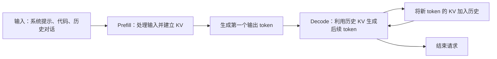

注意力里 Q 是当前查询，K、V 是供它查询的历史信息。历史 token 在各层的 K、V 一旦算好，后续生成就可以重复使用。**KV Cache 是中间张量，不是最终答案文本。**

没有 KV Cache，生成每个 token 都要重复处理大量历史。缓存保留下来，就用显存换取重复计算的减少。即使 decode 只产生一个新 token，它仍需读取历史 KV；所以“decode 没有初始 prefill”不代表它不做注意力计算。

### 2.2 为什么 Agent/Coding 很适合研究前缀缓存？

一个 Coding Agent 往往反复经历“读代码 → 生成操作 → 工具返回 → 再思考”。下一轮输入保留前面的系统指令、任务、已有对话，后面再增加新内容。

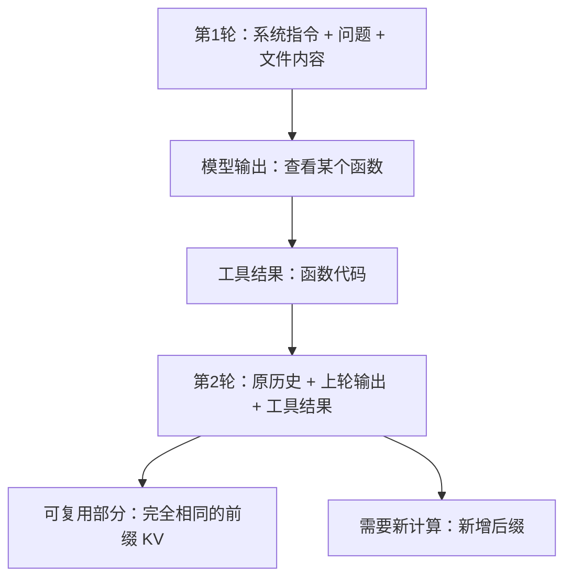

如果第 1 轮已有 1800 个 token，第 2 轮增加 300 个 token，理想情况下可以复用前 1800 个的 KV，只处理新增部分。RAG 也有类似结构：共享系统指令、同一篇文档开头、重复检索材料等。

但复用要求很严格：**从开头开始的 token 序列一致**，并且相关模型配置、适配器等条件兼容。语义相似、同一文件名、相同“任务类型”都不等于可直接复用 KV。中间有一个 token 不同，后面的注意力状态通常也不同。

### 2.3 Paged KV、APC 和 Offload 是三个概念

| 概念 | 解决什么问题 | 可以怎样理解 |
|---|---|---|
| Paged KV Cache | 怎样分配、复用有限显存 | 把 KV 放进固定大小 block，使用映射组织各请求的逻辑历史 |
| APC，自动前缀缓存 | 怎样避免相同前缀重复计算 | 按前缀识别可共享的完整 block |
| KV offload | 显存放不下的 KV 还能保存在哪里 | 复制到 CPU 或文件层，将来需要时再加载 |

逻辑请求可以共享物理 KV block，因此“一个请求用了 100 个逻辑块”不等于“抢占它马上能释放 100 个物理块”。共享引用、正在传输的 pin、延迟释放都会影响真正可回收量。调度器必须使用 KVCacheManager 管理所有权，不能自己随意改引用计数。

APC 通常以完整块匹配。即使输入完全重复，也可能需要重新计算末尾部分来得到当前预测所需的 logits；本分支的命中查询最多检查 `request.num_tokens - 1`，再受 block 对齐约束。所以“重复输入”不保证实际 prefill 为零。

### 2.4 一个 token 的 KV 有多大？

对本次 TP=1 的稠密全注意力模型，可用下式解释：

```text
每 token KV 字节 = 2 × 层数 × KV heads × head dimension × 每元素字节数
                    ↑ K 和 V
```

本次 Qwen2.5-3B BF16 对应：

```text
2 × 36 × 2 × 128 × 2 = 36864 bytes = 36 KiB/token
```

这里用的是 **KV heads**，不能直接代入 query heads。GQA 的 query heads 可以多于 KV heads。8192 个 token 的 KV 总量约 288 MiB，这是实验固定池的毛容量；还要扣除保留 block 等，不能当作全部可用空间。

INT8 KV 的实际传输载荷还包括 scale，本配置为 **19008 bytes/token**，不是简单把 36864 除以二。权重量化也不能直接改变这个公式里的 KV dtype。

### 2.5 面试最容易混的指标

| 指标 | 含义 | 本项目怎样看 |
|---|---|---|
| Output throughput | 整体每秒产生多少输出 token | 回放所有任务输出总数 / 整体完成时间 |
| TTFT | 请求发出到第一个输出 token 的时间 | 包括路由、排队、加载、prefill 等，不只是 GPU prefill 时间 |
| TPOT | 请求首尾输出跨度 / 后续输出 token 数 | 描述一个请求平均生成间隔；本项目使用这一逐请求口径 |
| ITL | 相邻输出 token 的时间间隔 | 更能看到某一次明显停顿；与 TPOT 分位数不能互换 |
| P95 / P99 | 95% / 99% 的样本不超过的值 | 尾部体验，不能由平均值推出 |
| Prefix hit ratio | 有多少输入前缀复用 | 高命中仍可能排队；不同计数分母不能直接横比 |
| Resume recompute | 抢占恢复后重新计算的上下文量 | 是额外模型工作，不等于抢占次数 |
| Stored / Retrieved tokens | LMCache 日志中的保存/读取 token 计数 | 反映操作量；不是精确物理总线字节或 SSD 写放大 |

例如：让一批高命中请求先完成，可以提高整体吞吐；队列中一个低命中长请求却等待更久，TTFT P95 可能变差。这不是指标互相矛盾，而是优化目标不同。

### 2.6 Continuous batching：为什么在途工作不能直接串行相加？

传统固定 batch 可以等一批请求全结束再接下一批。推理请求长度不同，短请求结束后留下的空位可能一直闲置。Continuous batching 在连续迭代中移除已完成请求、加入可运行的新请求，让 batch 成员随执行变化。


并行运行不等于每个请求完全没有相互影响：它们共享 GPU 执行与内存带宽，batch 变大后单请求速度也会变化。这正是路由的单请求时间模型只能作为近似的原因。

还要区分客户端并发与引擎上限。例如客户端同时回放 16 个会话，而 CPU 实验引擎最多驻留 2 个请求，其他请求需要排队。即使还有 batch 槽位，也可能因 KV 空间不足无法加入；命中共享 block 能减少一部分容量需求，却不能消除所有执行成本。

## 三、整个项目究竟在解决哪三个决策？

用餐厅比喻：多个厨房对应多个推理实例，厨房内有多个正在处理的订单，冰箱和仓库保存可复用的材料。

- **R：Routing，跨实例放置。** 新请求该交给哪个实例？命中好但很忙的实例，未必最快。
- **L：Local scheduling，实例内调度。** 请求进入实例后先让谁开始？显存紧张时暂停谁损失更小？
- **O：Offload admission，分层缓存保存。** 本轮 KV 是否值得写到 CPU/文件层？容量不够时，大量写入可能挤掉更有用的缓存。

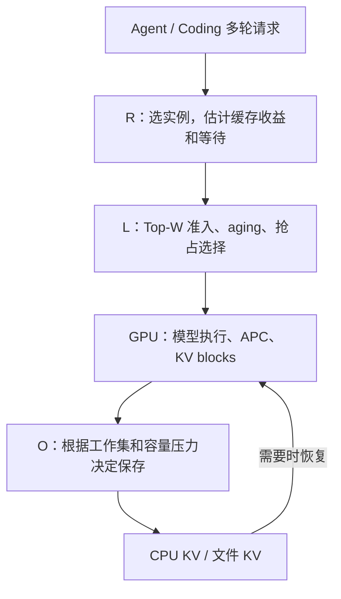

R、L、O 的信息粒度不同。R 通常只有目录和请求进度的近似；L 可以读取本实例真实 KV 管理状态；O 接触 host 缓存和保存生命周期。没有一个简单分数能自动替代全部三层。

**PD 是执行架构，不是第四个同类排序分数。** 它将一个请求的 prefill 和 decode 放到不同角色实例上，后文单独解释。上图用于说明职责，不表示所有实验都同时开启三层，也不表示每个 CPU 缓存跨全部实例共享。

## 四、本次四张卡是怎样使用的？

### 4.1 机器限制决定了实验边界

本机为 **4×RTX 3080 Ti，每卡 12GB**。四张卡的显存彼此独立，不能直接当作一块 48GB 显存。实验没有可用的 NVLink/P2P/RDMA 路径，UCX 允许 `tcp,sm,cuda_copy`，跨 GPU 传输按需要 host staging 的环境解释。

主模型是 **Qwen2.5-3B-Instruct，BF16**。每个实验引擎通常 TP=1，一张卡保存一份完整模型权重。即使是 P 或 D 角色，也不是只加载半个模型。

选 3B 是为了在 12GB 单卡内给 KV、运行缓冲和 Graph 留出空间，从而让四卡比较聚焦调度与缓存。目标是证明机制能否成立，不是通过模型参数量制造亮点。

### 4.2 单卡、双副本、四副本、PD 的区别

| 配置 | GPU 分工 | 主要验证什么 |
|---|---|---|
| 单卡完整实例 | 一张卡同时做 P 和 D | L、CPU/file offload、chunk、量化、Graph |
| 双完整副本 | 每张卡各自完成整个请求 | R 的缓存与负载决策，以及 R/O/L 组合 |
| 四完整副本 | 四张卡都能完成完整请求 | 四卡吞吐对照；与 2P2D 比较资源效率 |
| 1P1D | 一卡 prefill，一卡 decode | 真 KV 交接、角色压力、可选 CPU 保存 |
| 1P2D / 2P1D | 改变两种角色的 GPU 比例 | 哪个角色更值得增加资源 |
| 2P2D | 两卡 prefill，两卡 decode | 四种 P/D 配对、角色路由、四卡架构对照 |

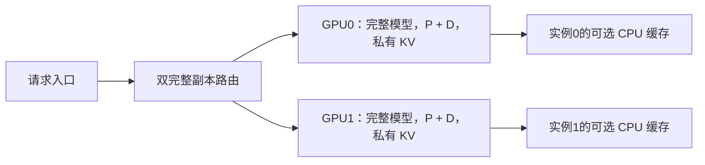

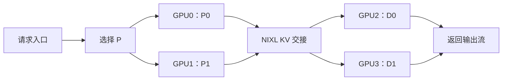

**双副本不是 TP=2。** TP=2 是两张卡协同执行一个模型，通常有逐层通信；双副本则是两张卡分别接请求。2P2D 也不是四卡 TP，每个角色仍是 TP=1。

### 4.3 为什么既有“固定小 KV 池”，又有“自然容量”？

固定压力组每引擎使用 `512 blocks × 16 tokens = 8192 KV tokens`。这是主动制造有限缓存条件：模型能装下，但多个请求的历史容易竞争，便于比较准入、恢复和 offload。

自然容量组让 BF16 模型使用可分配的较大 KV 池，在本次配置中为 **111184 tokens**；AWQ 模型为 **224544 tokens**。这类实验回答“显存较宽裕时策略是否仍有效”，但 AWQ/BF16 的自然容量不同，跨两者不能只归因于量化 kernel。

一般非 CPU 固定池组 `max-num-seqs=8`，CPU 组为 2；自然容量长上下文组为 32。架构比较中的 seq8 与 PD+CPU 的 seq2 是不同实验格，不能直接用吞吐横比策略好坏。

### 4.4 执行环境有一个必须知道的限制

本机默认预编译算子路径出现异常：直接调用 RMSNorm 并同步后，输出仍保持初始化的 123；相同权重的 Transformers eager 路径正常。根因没有完全定位。

正式对照统一使用经过检查的 V1 runner、native RMSNorm、禁用 custom ops、Triton attention 路径，eager 和 decode Graph 分组比较。这里没有把有问题的默认路径当弱基线，也没有宣称解决了整个二进制兼容根因。因此绝对吞吐不应代表健康默认环境的最佳性能。

## 五、压测数据有多接近真实 Agent？

### 5.1 数据来自哪里？

来源为[公开 mini-SWE-agent Coding 运行轨迹](https://github.com/john-b-yang/20260901_mini-v2.4.2_gemini-3-5-flash)，固定源码 commit 为 `2f6637a2557da1f7b5f2b583ab7090a077bbeed2`。原始轨迹是 Gemini 的历史运行记录，本次把历史输入转换成 Qwen 可回放的文本请求。

保留的是实际问题、代码片段、历史操作与工具观察形成的长前缀结构。它比“随机 token + 固定前缀”更接近 Coding 输入分布，但**不是运行 Qwen 完成真实软件修复任务**。

| 划分 | 任务数 | 上下文上限 | 保留调用数 | 平均输入 tokens | 最大输入 tokens |
|---|---:|---:|---:|---:|---:|
| 原任务，seed17 | 32 | 4K | 112 | 2366.7 | 3955 |
| 原任务，seed17 | 32 | 8K | 176 | 3540.9 | 8075 |
| 独立任务，seed71 | 32 | 4K | 99 | 2512.6 | 4010 |
| 独立任务，seed71 | 32 | 8K | 173 | 3805.1 | 8123 |

原任务与独立任务互不重叠；不是拿同一批请求换个顺序就叫泛化。独立集没有再用来调参。4K/8K 过滤出的调用也不同，不能只把两组差异当作上下文长度的单变量效应。

4K 原任务过滤了 1091 条超长调用，8K 过滤了 355 条，因此数据明显偏向能装入所选窗口的部分，不能声称代表完整长程 Agent 的所有阶段。

### 5.2 回放怎样保持多轮关系？

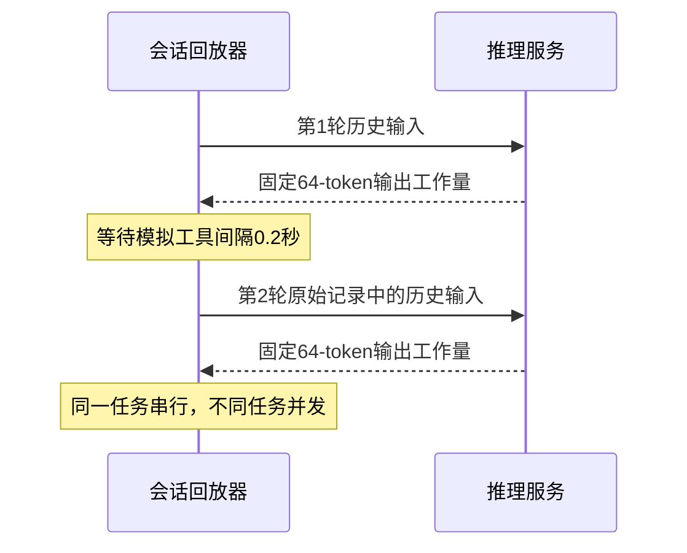

关键细节：

1. 同一任务上一轮完成后才能发下一轮，保留依赖关系。
2. 工具结果来自原轨迹，转成文本观察；本轮不真的执行搜索、编译或 shell 工具。
3. 主性能组输出预算为 64，忽略 EOS，温度为 0，使各策略输出工作量可比较。
4. **下一轮输入仍用原始轨迹历史**，不会把当前 Qwen 新输出接回去；也没有强制输出原始轨迹 token IDs。
5. 工具间隔固定模拟 0.2 秒，不是原始生产时间戳。
6. 并发控制按会话槽位计算，一个任务在工具等待期间仍占会话槽；常规 16，会话长上下文组 32。

所以这叫**保留会话依赖的历史文本回放**。它能研究增长前缀、会话活跃集和缓存竞争，不能测 Agent 成功率、真实工具等待分布或生产开环容量。

另有 24 会话、96 调用、8 类共享前缀的半合成热点负载，用来控制热点与复用；混合输出预算组使用可见的 32/64/128 上限。半合成数据是机制实验，不替代公开轨迹。

### 5.3 为什么还要做质量检查？

固定 64-token 输出适合控制性能工作量，却可能输出半截代码，不能用它评价回答质量。因此另做非强制长度的代码生成并执行探测，以及缓存恢复后的 next-token 概率与前缀事实检查。

6 项代码探测只是一组小型工程门禁，不是 HumanEval 分数，更不是 SWE-bench 修复成功率。HTTP 200 也只说明服务返回成功，不说明读取的 KV 正确。

## 六、Preble 的算法：怎样同时考虑缓存和负载？

### 6.1 它抓住的矛盾

同一请求在 GPU0 能复用 90% 输入，在 GPU1 只能复用 10%。直觉会选 GPU0。但 GPU0 已经排了很多请求，GPU1 很空，GPU0 最终反而更慢。

另一个极端是只做均衡：总把请求送给空闲卡，会把本来可复用的长前缀拆散到所有卡，重复 prefill，增加缓存占用。

Preble 用全局放置配合本地调度处理这个矛盾：前缀树维护缓存所在 GPU 和共享信息，全局 E2 策略在利用已有缓存与探索其他 GPU 之间切换；本地按缓存比例分组分配机会。[论文原文](https://arxiv.org/html/2407.00023v2)、[作者实现](https://github.com/WukLab/preble)。

### 6.2 先理解 radix tree 表示什么

把多个 token 序列的公共开头合并成树。节点可以代表一段连续 token，并记录哪些 GPU 缓存了这一段、近期有哪些请求共享它。

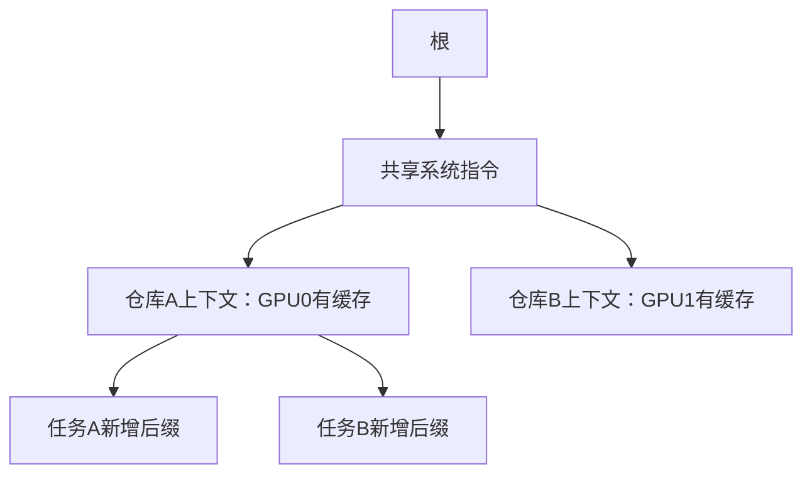

这棵树不是按“语义相近”组织，仍然是 token 前缀。共享计数帮助估计未来复用价值：挤掉很多请求反复使用的节点，比挤掉一次性前缀更可能造成后续重复计算。

### 6.3 E2：什么时候优先命中，什么时候看成本？

可以先记住论文主要分支：**已匹配前缀比未匹配后缀长时，倾向利用已有缓存；否则比较不同 GPU 的估计成本。** 这不是本项目“负载差四个请求就切换”的规则。

成本可用教学记号写为：

```text
选择 GPU i 的成本 ≈ L_i + M_i + P_i
L_i：该 GPU 近期工作的估计负载
M_i：接收请求可能挤掉缓存，导致后续重算的估计代价
P_i：新请求尚未命中的 prefill 代价
```

论文中 L 的构造使用历史窗口与性能估计；M 结合被挤出节点的计算成本和共享频率；相同请求在各 GPU 上相同的 decode 项可以在比较时省略。原算法还处理 prefill/decode 工作混合和平衡热点等情况。[Preble 算法说明](https://arxiv.org/html/2407.00023v2)、[作者调度源码](https://raw.githubusercontent.com/WukLab/preble/multi_modal_main/preble/global_scheduler_with_time.py)。

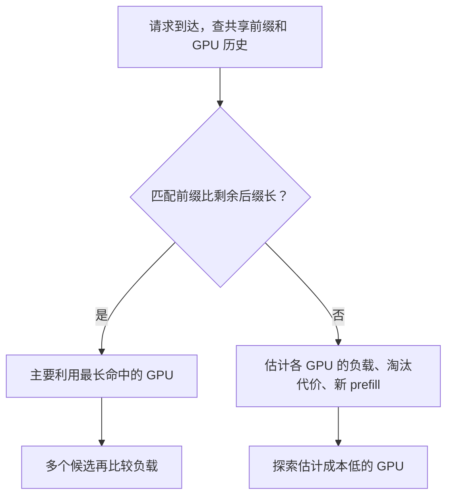

此图是主分支示意，省略了论文其他平衡细节，便于先建立直觉。

小例子：两个 GPU 接收同一请求，取教学假设数值：

| GPU | 等待/负载估计 | 新 prefill | 挤出缓存代价 | 总计 |
|---|---:|---:|---:|---:|
| 0 | 800ms | 20ms | 40ms | 860ms |
| 1 | 100ms | 180ms | 0ms | 280ms |

GPU0 命中更好，GPU1 预计却更早服务。**命中收益必须换算成时间，并与等待比较**，这是本项目真正借鉴的思想。

### 6.4 本地调度为什么也要考虑公平？

如果全局把同一类前缀送到同一张卡，而卡内又永远让最高命中请求先运行，低命中请求可能长期等待。Preble 的本地思路是按缓存比例分组，再给不同组一定调度机会；它不是本项目的 Top-W + aging 实现。[作者仓库](https://github.com/WukLab/preble)。

本项目采用更容易接入当前 Scheduler 的有限窗口和等待阈值保护。借鉴的是“复用和公平需要一起处理”，没有声称复现原论文全部本地算法。

### 6.5 本项目用了哪些，没有用哪些？

| Preble 思想 | 本项目对应 | 差异 |
|---|---|---|
| 缓存收益不能单独决策 | 缓存/负载阈值基线与成本路由 | 阈值规则是基线，不冒充论文 E2 |
| 新 prefill + 已有工作 | 校准 prefill、剩余工作账本 | 使用真实输出进度和本项目的队列近似 |
| 缓存挤出有未来成本 | 简化淘汰代价项 | 是目录代理，不是准确物理 victim 预测 |
| 全局前缀状态 | 历史目录与事件目录 | 没有完整全局 radix tree 和自动子树复制 |
| 兼顾本地公平 | Top-W、aging | 与原论文分组分配机会不同 |

不是“照抄一个公式”：主要改造是让路由可见在途工作、输出推进、batch 槽位和有限 KV 容量，并用同次决策的影子预测核对误差。也不能称已经实现完整 Preble。

## 七、EfficientAgent 的算法：为什么不是所有 KV 都值得写出去？

### 7.1 缓存有收益，但保存不是免费的

将 2000-token KV 存到 CPU，可以避免将来重算；代价是当前复制、CPU 空间占用，以及挤掉其他缓存。若它在下一次使用前已被挤出，当前保存几乎只付出了成本。

EfficientAgent 区分两个问题：命中后是否比重算划算，以及数据能否存活到下次复用。前者可用 offload benefit ratio 理解，后者与工作集和访问距离有关。[论文原文](https://arxiv.org/html/2609.33762v1)、[作者发布仓库](https://github.com/KunmingSHAO/efficientagent_release)。

### 7.2 OBR：命中到底能省多少？

教学上可写：

```text
OBR ≈ (重算时间 − 加载时间) / 重算时间
加载时间 ≈ 固定开销 + KV字节数 / 有效传输带宽
```

例如重算 100ms、加载 30ms，理想命中收益约 70%；若加载 120ms，单看这次就未必值得。真实系统还存在复制与计算重叠，因此这只是理解成本的近似，不是本项目已经在线执行的精确模型。

还缺一个条件：这份 KV 是否真的能留到再次使用？可以用自己的教学表达说明预期收益：

```text
预期净收益 ≈ 存活概率 × 命中节省时间 − 当前保存成本 − 挤出其他缓存的代价
```

这不是本项目用于打分的原始代码公式，它说明为什么“扩大缓存池”之外还需要准入。

### 7.3 Stack distance：两次使用之间插进了多少别人？

假设一次访问顺序为 `A → B → C → A`。A 两次使用之间有 B、C 两个不同 chunk；容量只有两个 chunk 的 LRU 缓存，到最后一次 A 时，A 可能已经不在。

Agent 的问题更复杂：复用往往要求从头连续命中的前缀，而不是历史里任意几个散落 chunk。分析还应区分 GPU 已经保存的前缀与需要 host 提供的前缀。论文的离线模型考虑这类访问距离与前缀覆盖，本项目没有实现完整离线栈距离预测器。[EfficientAgent](https://arxiv.org/html/2609.33762v1)。

### 7.4 为什么工作集可以作为一个便宜的信号？

一个会话在等工具时，其他活跃会话会继续生成和保存 KV。轮到它回来时，其他会话总共占了多少空间，决定它旧前缀被挤出的风险。

可用如下尺度解释：

```text
预计复用竞争量 ≈ (活跃会话数 − 1) × 平均上下文长度 × 每token KV字节
```

这不是精确缓存并集：不同会话可能共享前缀，长度也会变化。但它比只看“当前来了几个 HTTP 请求”更贴近 Agent 的跨轮缓存竞争。

### 7.5 运行时策略：压力大时拒绝大块新写入，保留小增量

论文运行时机制结合工作集、host 容量/淘汰状态与新增完整 chunk 数，压力成立时过滤大的新增保存；同一请求只决定一次，避免中途来回改变。作者说明与实现见[固定版本 README](https://raw.githubusercontent.com/KunmingSHAO/efficientagent_release/b21b12a07a3ccf473c82acf00820b1aa2073044b/README.md)。

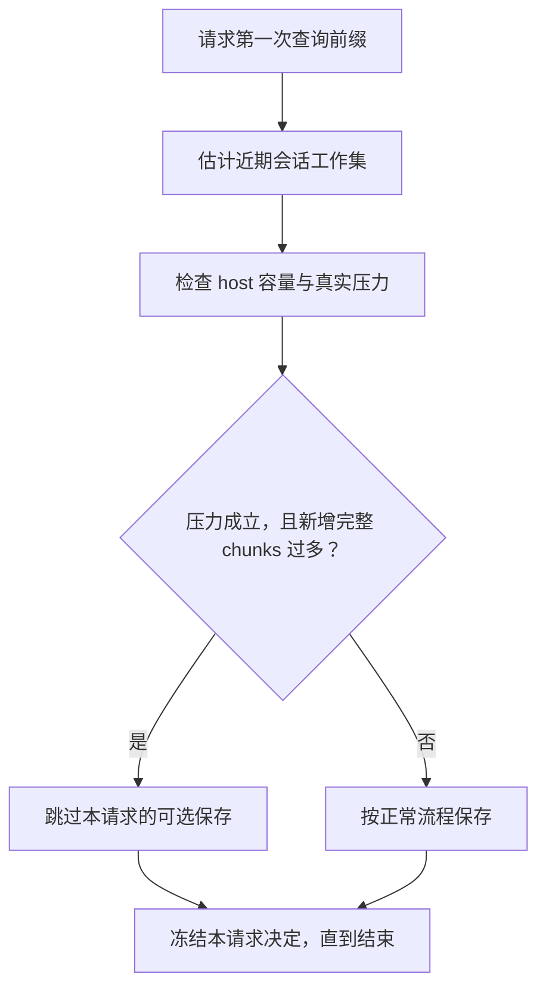

为何保留小增量？若 CPU 已保存前 1792 tokens，而本轮增长到 2048，只需补一个 256-token chunk，可能以较低成本延续一个即将复用的完整前缀。另一个冷请求却需要从零写 8 个 chunk，压力下更容易造成循环覆盖。

### 7.6 本项目不是完整复现 EfficientAgent

本项目实现了运行时条件化保存与生命周期适配，并加入当前 LMCache/vLLM 路径下可核对的驻留、淘汰与正确性检查。完整 OBR 动态加载决策、离线 stack-distance 分析、全套论文执行系统没有实现。

具体区别也要说清：作者遥测缺失时可以只用估计判断；本项目遥测过期时恢复正常保存。作者的上下文均值统计与本项目“每个活跃会话最近长度再取均值”不同。作者回放可强制记录的输出 token；本项目不强制历史输出。阈值、chunk、会话窗口应以本项目 manifest 为准，不能照抄论文默认值。

## 八、L 层：实例内调度究竟怎么改？

代码入口：[policy.py](../vllm/v1/core/sched/policy.py)、[scheduler.py](../vllm/v1/core/sched/scheduler.py)、[feature_context.py](../vllm/v1/core/sched/feature_context.py)、[kv_cache_manager.py](../vllm/v1/core/kv_cache_manager.py)。

### 8.1 先区分“准入”和“抢占”

**准入**是在等待队列中选择下一位尝试进入运行集合的请求。**抢占**是在运行请求申请后续空间失败时，选择暂停谁，把资源交回管理器。

它们的目标并不相同：准入看谁还需要计算多少输入；抢占看暂停谁更可能损失较少已计算工作。不能给两者都套一个“剩余 prefill 越少越好”。

本实现的运行中分配失败，既可能发生在 decode，也可能发生在继续处理 prefill chunk 时。等待请求的首次分配失败不会直接通过本策略强行抢占一个正在运行的请求；仍按调度框架处理。

### 8.2 Top-W：不要为排序把整个队列扫描一遍

如果每次都对 1000 个请求查 KV，策略本身可能比节省的计算还贵。Top-W 只在靠近基础队首的有限候选窗口中，解析需要的缓存特征。

主要参数为 `W=8`、aging 阈值 10 秒。候选必须可调度，并保留用户优先级约束：不为了缓存命中跨越基础队首所属的优先级层；尚未就绪、阻塞或 LoRA 等条件不满足的请求不能硬塞进运行集合。

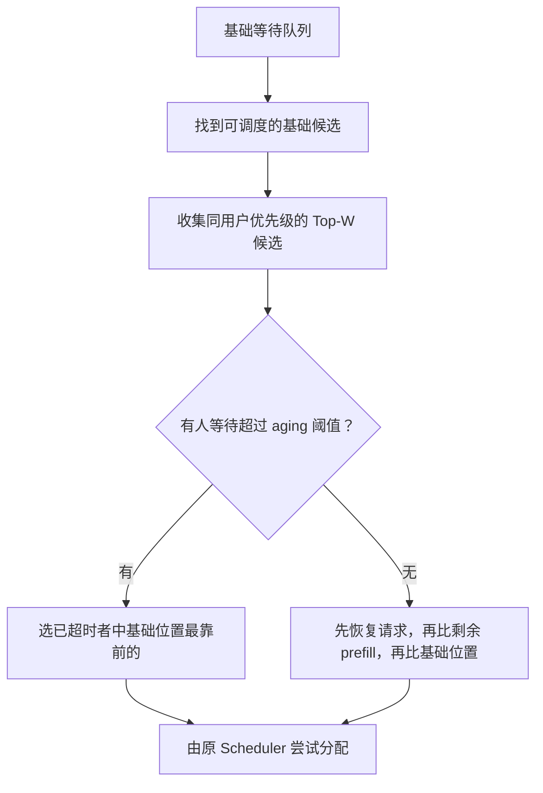

实际比较是**按顺序比较的元组**，不是随意设置权重相加：

```text
没有 aging 触发时，选择最小：
(是否从未被抢占, 剩余 prefill tokens, 基础队列位置)

False 小于 True，因此已被抢占的恢复请求优先。
剩余 prefill = max(当前请求总 token 数 − 本地已计算/可复用 token 数, 0)
```

小例子，假设四个请求都在同优先级窗口内，均未超过 aging 阈值：

| 请求 | 是否恢复 | 总 tokens | 本地可复用 tokens | 剩余 prefill |
|---|---|---:|---:|---:|
| A | 否 | 2000 | 1800 | 200 |
| B | 否 | 500 | 400 | 100 |
| C | 是 | 3000 | 1000 | 2000 |
| D | 否 | 200 | 0 | 200 |

此时先选 C，因为保护恢复请求是第一层规则；如果 C 不在窗口内，则选 B。它不是简单“命中率最高优先”：A 命中 90%，B 命中 80%，但 B 实际剩余工作更少。

若 A 已等待 11 秒、B 只等 1 秒，就先按 aging 保护 A。aging 只是有限窗口内的顺序保护，不能保证显存不足时请求马上运行，也不是全局严格公平证明。

### 8.3 为什么要保护恢复请求？

一个请求被抢占后已经受过一次延迟。如果重新进入队列时被当作普通冷请求，甚至刚恢复又被选为 victim，它会反复停顿。为此，恢复请求在准入和 victim 选择中都得到保护。

这里有代价：保护恢复与老请求，会放弃一部分眼前最短任务收益。因此项目不声称某个排序同时优化所有指标，而是通过吞吐、尾延迟和恢复重算共同观察。

### 8.4 Recompute-aware：暂停谁损失更小？

默认 FCFS 抢占常倾向运行集合尾部，新到请求不一定是恢复代价最低的。新策略先守住用户优先级：只从**最差优先级层**找 victim；本分支数值越小优先级越高。

再在该层内最小化：

```text
(是否已经被抢占过, 已计算 tokens, 负的到达时间, request_id)
```

解释顺序：

1. 优先暂停从没被抢占过的请求，避免同一请求反复成为 victim。
2. 再优先暂停已计算上下文较少者，作为损失工作量的便宜代理。
3. 平局倾向较晚到达者，再用 ID 固定结果，避免依赖运行列表偶然位置。

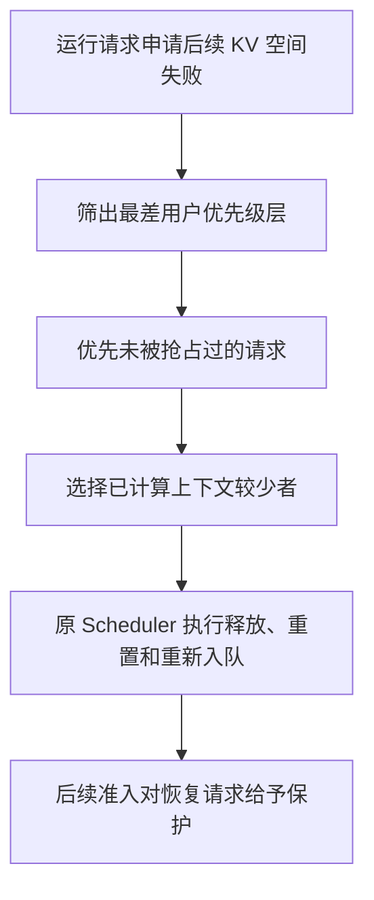

例子：同优先级 A 已算 3000 tokens、B 已算 500，均未抢占，优先暂停 B。若 B 已被抢占过、A 没有，则先保护 B，可能暂停 A。这是对抗反复抖动的选择，不能简化为“永远最短 victim”。

**代价估计是近似。** 已计算 tokens 并不等于实际必须全部重算：可能仍有共享 APC，或 host 保存可恢复。主策略没有将精确传输成本、物理可回收块数全部纳入统一最优解。

代码另有 reclaimable-aware 策略用于显式考虑释放进展，但当前主 L1 使用 `recompute_aware`，不能把未启用策略的能力归给主结果。策略只返回决定，真正的分配、释放和状态修改由原框架执行。

### 8.5 Generation + 懒解析：为什么需要这套状态机制？

Top-W 排序要看本地前缀，随后分配也要看。如果同一 KV 状态下重复解析，会浪费 CPU；如果一直复用旧结果，又可能引用已经淘汰的块。

本项目分两类特征：

- **便宜特征：** priority、arrival time、num_preemptions、num_computed_tokens，直接读当前请求，不依赖 KV 查询。
- **KV 派生特征：** prefix blocks、cached tokens、shared boundary，按需第一次解析，同一 generation 内复用。

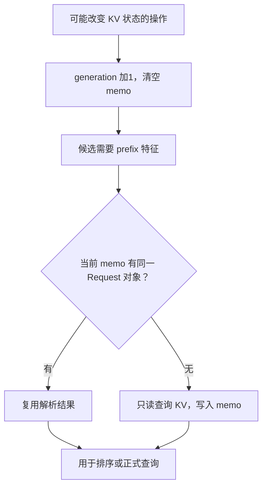

这里 generation 是**状态版本**，不是“第几次生成 token”，也不是固定时间 TTL。当前实现失效时直接清空 memo，而非给每条记录附版本后逐条比较。

用 `id(request)` 查表同时保存对象引用并检查对象身份，避免 Python 对象 ID 重用造成误命中。特征放在独立 context 中，不往 Request 上不断增加可能失效的缓存字段。

需要失效的边界包括分配、释放、淘汰、缓存重置、异步接收/缓存变化、部分尾部处理，以及延迟释放真正生效。**分配失败也可能先做清理而改变 KV**，不能只在成功时失效。

排序的 peek 必须只读：不能因为看一眼命中就提前 pin block、改变引用计数、发出实际命中事件或重复累计指标。正式 `get_computed_blocks` 可以使用先前结果，但仍保持正式查询应有的统计与事件语义。

### 8.6 L 层实验到底支持了什么？

本次 BF16 自然容量、8K、32 会话：L0→L1 吞吐 `160.12→214.25 tok/s`，+33.80%；GPU 命中比例约 `0.258→0.502`。两组抢占次数均为 0，因此主要支持**准入排序促进复用**，不支持“重算抢占贡献了 33.80%”。

独立任务吞吐 +19.09%，说明收益不只发生在原任务；但 TTFT P95 +17.14%，说明长尾代价也能迁移。Graph 同模式内 +31.99%，说明改进在另一执行模式下仍存在，不是 Graph 的加速全归策略。

原归因实验还出现抢占 `407→458`，重算 tokens 却 `197286→186390`。**抢占次数更多仍可能总重算更少**，因此次数不是成本。原 A/B 主要改变准入，不能独立证明 victim 策略的因果增益。

### 8.7 恢复重算量是怎样测出来的？

原有首次 prefill 指标排除了抢占后的重复 prefill，所以不能直接拿它代表全部上下文工作。本项目记录抢占前已经计算到的位置，称为旧 frontier；恢复时只累计本次计算区间与旧 frontier 重叠的部分。

小例子：抢占前已经算到 token1000，恢复后 APC 找回前400。重新计算400～1000的600个 token 才是重复工作；继续处理1000～1100的100个 token 是新进展，不能算重算。若恢复到700时再次抢占，原先尚未恢复到1000的历史边界仍需保留，不能因此漏计。

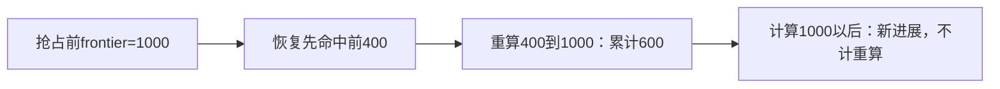

这套只读 telemetry 把“抢占前可能丢失多少进度”与“恢复中实际重复安排了多少计算”分开，避免把整个新 prefill 或全部后续 decode 都计入恢复成本。旧总本地上下文计算量由首次本地 prefill 加实际 resume recompute 得到，解释了 −3.37% 的真实含义。计数说明的是调度计算量，不是通过 GPU kernel profiler 直接测得的时间。

## 九、R 层：新请求究竟该送给哪张 GPU？

这一章只回答一个问题：**现在来了一个请求，送到 GPU0 还是 GPU1，预计能更早收到第一个输出 token？**

路由是请求进入 vLLM 实例**之前**的一次选择。它不负责替 vLLM 执行 attention，也不直接指挥实例内部下一轮先跑谁。它查看两边的信息，做一个时间估计，然后把请求发送过去。

先看整个计算的用途：

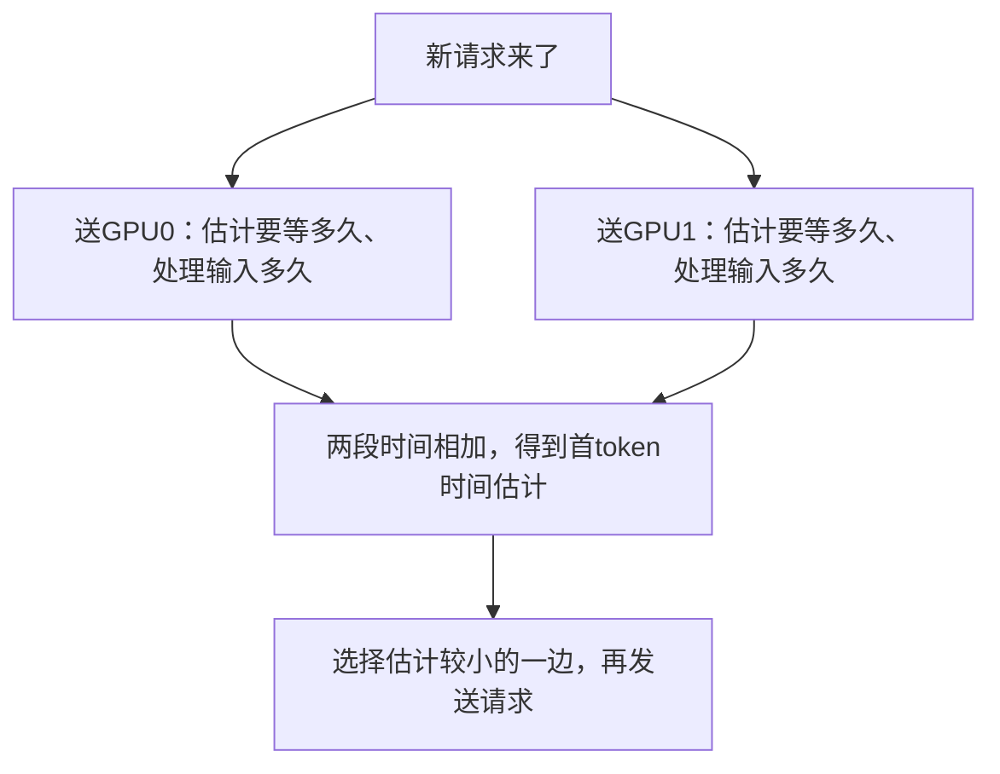

下面会逐步改进这个估计：先看请求数，再看剩余工作，再考虑并行执行与 KV 空间。**这些不是互不相关的一堆公式，而是为了同一个选择，逐步补上原先没考虑的因素。**

代码入口是 [policies.py](./experiments_20261019/policies.py) 的 `PlacementPolicy`，网络收发在 [router.py](./experiments_20261019/router.py)。不用先读代码也能理解本章。

### 全章贯穿的例子：请求 X 要去哪里？

以下数值专门用于教学，不是实验结果。

新请求 X 输入长 **128 tokens**，客户端要求**最多输出 10 tokens**。两张卡加载同一个模型，但缓存和已有请求不同：

| 当前情况 | GPU0 | GPU1 |
|---|---:|---:|
| 已经接收、还没结束的请求数 | 2 | 2 |
| X 可以复用的输入前缀 | 96 tokens | 32 tokens |
| 因此 X 还没命中的输入 | 128−96=32 tokens | 128−32=96 tokens |
| 已有请求还需输出多少 | A剩30，B剩10 | C剩2，D剩2 |

“已有请求”就是 X 到来前已交给该实例、还未结束的请求，可能正在计算，也可能在实例队列里等。路由需要把它们的影响算进去。

为方便手算，再假设提前测得：

- 估计每输出 1 token 需要 **10ms**。
- 对 128-token 输入，完全冷启动到首 token 约 **100ms**，接近完整前缀复用时约 **20ms**。
- 根据命中情况，X 在 GPU0 的输入处理/首响成本估计为 **40ms**，GPU1 为 **80ms**；第 9.8 节会从头算出这两个数，暂时把它们当已知条件。

GPU0 缓存更好，GPU1 的老请求更接近结束。究竟选哪边，要看两种因素合起来的结果。

### 9.1 第一版：请求数差不多就优先缓存，相差很大就均衡

这是项目保留的 `threshold` 基线，也就是此前讨论的建议：正常时优先命中；负载差距明显时，优先负载均衡。

本项目把“明显”具体规定为同时满足两个条件：

1. 最忙实例比最空实例**至少多 4 个在途请求**。
2. 最忙实例的请求数**至少是最空实例的 1.5 倍**。最空为 0 时，用 1 作分母，避免除以零。

例如 8 个对 4 个：多了 4 个，比例为 2，两个条件都满足，转向负载均衡。6 个对 4 个虽然比例为 1.5，但只多 2 个，不触发这次阈值。

如果没有触发，且最佳缓存命中至少占输入一半，就选缓存最多的实例；连一半都命不中时，改选请求少的一边。阈值来自当前配置，不是自然定律。

回到 X：两边都是 2 个请求，没有请求数差；GPU0 可复用 `96/128=75%`，超过一半，所以基线会选 **GPU0**。

**它的问题是：知道两边各有两个请求，却不知道一边快结束、一边还要算很久。** 下一节就是为了解决这个信息缺口。

### 9.2 第二版：不再只数人头，估计已有请求还剩多少工作

#### 第一步：先把“剩余 tokens”换成同一单位的时间

输入处理和输出生成不是同一类工作，不能直接拿“100 个输入 token + 100 个输出 token”当作相同成本。路由最终要比较快慢，所以先把它们都换成 **毫秒**。

贯穿例子里，输出 1 token 估计 10ms：

| 已有请求 | 还需输出 | 换算后的剩余工作 |
|---|---:|---:|
| GPU0上的 A | 30 tokens | 30×10=300ms |
| GPU0上的 B | 10 tokens | 10×10=100ms |
| GPU1上的 C | 2 tokens | 2×10=20ms |
| GPU1上的 D | 2 tokens | 2×10=20ms |

这些老请求都已开始输出，所以这里不再给它们加初始输入处理成本。尚未开始输出的请求则还要保留那部分预算，第 9.4 节解释何时扣掉。

#### 第二步：先用最简单的方法，把同一实例的剩余工作相加

于是得到：

```text
GPU0已有工作 = 300 + 100 = 400ms
GPU1已有工作 = 20 + 20 = 40ms
```

原文里的 `Q_serial` 就是这个量。`Q` 表示排队影响的估计，`serial` 表示**暂时按串行相加**。先记住中文“已有工作总量”，不必先背变量名。

为什么加起来？第一版模型把已有请求想成前面的订单，X 要在它们之后获得服务。这个假设很粗，但已经能区别“两个快结束的请求”和“两个很长的请求”。第 9.5 节再修正串行假设。

**注意：400ms 是按单请求速度折算的工作量，不是测得 GPU0 一定还要忙 400ms。** 请求可组成 batch，所以真实墙钟时间可能不同。

#### 第三步：还要加上 X 自己处理输入的成本

X 就算到一张空卡上，也不是零时间出首 token。需要处理未命中的输入，并支付请求/模型的基础开销。GPU0 缓存好，X 的该项估计 40ms；GPU1 为 80ms。

| 候选 | 已有工作估计 | X自己的首响处理估计 | 相加结果 |
|---|---:|---:|---:|
| GPU0 | 400ms | 40ms | **440ms** |
| GPU1 | 40ms | 80ms | **120ms** |

因此这版策略选 **GPU1**。它多付了 40ms 的输入处理成本，却在已有工作上少了 360ms，合起来预计更快。

现在再看公式就很简单：

```text
新请求的首token时间估计 = 前面已有工作的影响 + 新请求自己的首响处理成本
```

原文写成 `Q + P`：Q 是前一项，P 是后一项；代码比较两张卡的结果，选较小者。**公式的用途就是把“缓存省下的时间”和“排队多花的时间”放到同一个单位里比较。**

为什么没把 X 后续 10 个输出 token 加进去？这里优化的是第一个 token 到来的时间；而且当前简化模型对同一请求在两边使用相同的 decode 系数，给两边都加同一个数也不会改变选择。真实 batch 下两边生成速度可能不同，这属于模型尚未精确覆盖的部分。

#### 一个新请求刚被接收时，其工作预算怎么算？

X 被送到 GPU1 后，后面还会有新请求来。为了让后来的请求知道“GPU1 又多了一项工作”，路由先给 X 登记预算：

```text
X的初始预算 = 首响处理估计80ms + 最多输出10个 × 每个10ms
             = 180ms
```

这里的“预算”是估计值：输出上限由客户端提前给定，实际可能提前结束。它不是偷看模型最终会说多少字，也不是严格的 GPU kernel 时间分解。后续看到实际进度，就更新预算。

`work` / `work_remaining` 采用工作量思路。另有 `cost*` 版本再加一项“挤掉旧缓存可能造成的未来重算成本”；它用于探索淘汰影响。当前主 `memory_remaining` 实际选路只比较等待和首响处理两项，没有额外加入这一淘汰项。

### 9.3 算完后为什么要马上记账，再发送请求？

假设 X 选中 GPU1，却要等网络请求发出去以后才更新路由账本。此时另一个新请求 Y 到来，它看到的还是“GPU1 很空”，可能也选 GPU1。许多同时到来的请求就会集中到同一边。

因此实际顺序是：

1. 读取当前账本并选卡。
2. **立刻把 X 的预算登记到 GPU1。**
3. 再发网络请求，等待输出。
4. Y 再选卡时，已经能看到 X 的存在。

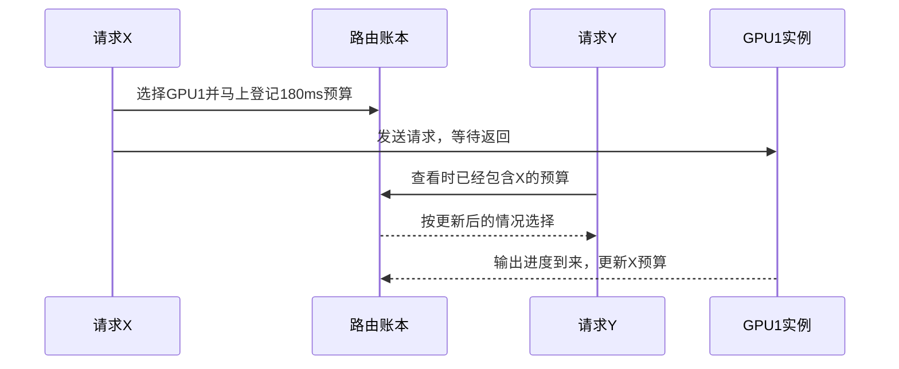

原文称“同步 reservation / 原子在途账本”，就是这件事：在一个异步路由进程里，选择和记账之间不暂停去等网络。它不是跨多进程的分布式锁算法。完成、失败或取消后，必须清掉对应记录，否则路由会一直误以为那张卡很忙。

### 9.4 第三版：请求已经输出了很多，就不能一直按初始预算计费

现在 X 已经被送到 GPU1，初始预算是 180ms。过一会它已经生成 6 个 token。如果账本仍写 180ms，后来的请求就会高估 GPU1 的负载。

**这一节的用途：让路由估计跟上请求的实际进展。**

#### 先看完整变化过程

沿用“输出上限 10、每 token 10ms”的教学假设：

| 路由看到了什么 | 能确定什么 | X的剩余预算 |
|---|---|---:|
| 刚发送，还没看到输出 | 暂时无法确认输入处理完成到哪 | 先保留180ms |
| 第1个输出 token 到来 | 初始输入处理已经完成，且已输出1个 | 剩9个：9×10=90ms |
| 累计输出6个 | 已完成6个，不再需要为它们预留计算 | 剩4个：4×10=40ms |
| 累计输出10个 | 已到输出上限 | 生成工作预算降为0 |
| 请求正式结束 | 后端不再处理该请求 | 从请求账本删除 |

为什么第一个 token 到来时，预算从 180 一下降到 90？因为不光完成了一个输出 token，**它还证明前面的输入处理已经做完**，所以那 80ms 也不再是未来工作。

原文的公式：

```text
剩余decode预算 = max(输出上限 − 已输出数量, 0) × 每token时间估计
```

逐项解释：

- `输出上限`：请求发送时就知道最多允许生成多少，这里为 10。
- `已输出数量`：到当前确实观察到了多少，这里可能为 1、6、10。
- 两者相减：还可能继续生成多少。
- `max(..., 0)`：不让预算因为重复/边界上报变成负数。
- 最后乘 10ms：把 token 数换成能和其他工作比较的时间单位。

模型若在第 6 个 token 就提前结束，不需要等到第 10 个，结束事件直接清掉账本。主要性能实验为了固定工作量而忽略 EOS，但路由的生命周期仍要正确处理提前结束。

#### 为什么不直接“过去了50ms，就扣50ms”？

这 50ms 可能都在排队，也可能在等 KV 传输或经历暂停，并不证明完成了 50ms 的模型工作。若请求从未运行，却因等待越久被认为剩余越少，会把繁忙卡误判为快空了。

本项目用**观察到的输出进度**扣减。流式网络消息不一定一条就是一个 token：一条消息可能带 3 个 token，所以要用真实 token IDs 等可靠计数；拿不到可靠计数时不凭消息条数虚减。

也要知道其不足：第一个输出到来前，模型可能已经做了一部分 prefill，但路由看不见，就先保留原预算。它是保守的进度代理，不是逐个 GPU 指令跟踪器。

**`remaining` 就是“剩余”的意思：新意在于更新已有工作的估计，不是又增加一种模型计算阶段。**

### 9.5 第四版：vLLM会把请求一起跑，所以“前面所有时间相加”仍不够

到这里，预算会随输出推进了，但还有一个问题：**同一张 GPU 并不是始终一次只处理一个请求。**

vLLM 可把多个请求组成 batch，在一轮里处理它们。于是请求 A 剩 300ms、B 剩 100ms，不必理解成先完整做完 A，再完整做 B。

先人为假设：两者并行后仍分别在 300ms、100ms 完成。真实系统不一定如此，这里只是为解释排队。

#### 情况一：最多能同时容纳3个请求，KV也充足

已有 A、B 只用掉 2 个位置，X 可以立刻加入。此时 X 的等待估计应该接近 0，而不是 `300+100=400ms`。

#### 情况二：最多同时容纳2个，KV充足

A、B 已占满两个位置，X 至少等某个位置空出来。100ms 时 B 先结束，X 可以加入，所以等待估计是 **100ms**，仍不是 400ms。

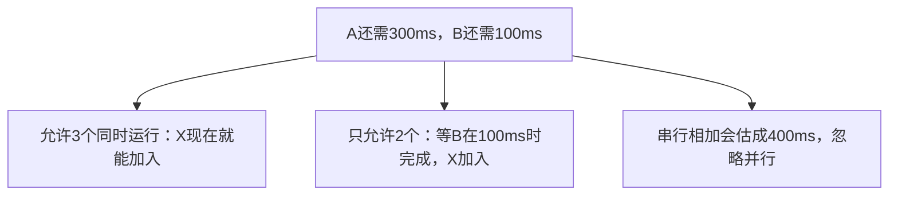

“batch 槽位”就是这里允许同时驻留/运行的请求位置，用 `max-num-seqs` 等配置约束。路由模型用配置的最大槽位数做近似；不是从 GPU 里找到一个真的座椅。

#### 模型真正要改问的，是“什么时候能进去”，不是“前面总共有多少工作”

更好的问题是：

> 把 X 送到这里，它最早在什么时候既能拿到一个位置，又有足够 KV 空间？

位置只解决请求数量，KV 空间解决这些请求的历史是否装得下。即使有空位，也可能没有足够显存；下一节专门手算这一点。

`memory_remaining` 的方法，是在路由进程里做一个很小的**假想排程**：

1. 把当前时间当作 0，把已经接收的请求按登记先后排好，再把 X 放在末尾。
2. 从第一个开始，问当前模拟中是否有槽位、KV是否够。
3. 都够，就在假想时间线上放进去，记录预计结束时刻。
4. 不够，就先走到最早有请求结束的时刻，把它占用的资源拿掉，再试一次。
5. 轮到 X 能进去的时刻，就是估计的等待时间。

**这段模拟只算时间和空间，没有真的执行请求，也不会命令 vLLM 按模拟顺序运行。** 真实实例仍使用自己的 Scheduler，可能有 Top-W、chunked prefill 或抢占，所以是假想排程近似，不是实际队列的精确复刻。

原文的 `Q_fifo` 是“按登记顺序做这个模拟得出的等待时间”。FIFO 即先来先看；`Q_serial` 则是前一版简单求和。两者的区别是**怎么算等待**，不是多算了一种 GPU 工作。

回到贯穿例子，如果两张卡都只有 2 个槽位、KV充足：

| 候选 | 并行模拟的等待 | X自己的首响处理成本 | 新估计 |
|---|---:|---:|---:|
| GPU0 | B先结束，等100ms | 40ms | 140ms |
| GPU1 | C/D约20ms结束 | 80ms | 100ms |

仍选 GPU1，但理由更接近并行服务。若 GPU0 可立即容纳 X，或 GPU1 的 KV 很紧，选择就可能反过来。**不是工作量模型永远偏向某张卡，而是要跟资源约束一起算。**

### 9.6 为什么“有空位”还不够？再把KV空间放进时间线

这一小节另用一个更小的容量例子，方便手算。这里新请求叫 Z，避免与前面的128-token X混淆。

假设一个实例最多同时放 2 个请求，GPU KV 可用容量是 **8个块**；此处把“块”只当作固定大小的空间单位。

| 请求 | 需要的KV空间 | 剩余时间 |
|---|---:|---:|
| A | 2块 | 100ms |
| B | 5块 | 300ms |
| 新请求Z | 4块 | 先不关心它多久完成，只问什么时候能开始 |

当前 A+B 占 `2+5=7块`。按时间往后推：

| 时刻 | 还在运行什么 | 槽位情况 | 放入Z后的KV需求 | Z能否进入 |
|---|---|---|---:|---|
| 0ms | A、B | 两个全满 | 2+5+4=11块 | 不能，槽位与空间都不够 |
| 100ms | B，A已结束 | 空出一个 | 5+4=9块 | 仍不能，容量只有8块 |
| 300ms | B也结束 | 有空位 | 4块 | 可以 |

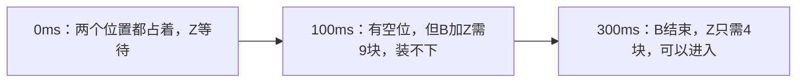

所以：

- 把 A、B 剩余时间串行相加：估 **400ms**。
- 只找第一个空位：估 **100ms**。
- 同时检查槽位和 KV：估 **300ms**。

**KV公式的用途到这里就明确了：不是单独追求“算出显存数字”，而是在模拟的每个时刻判断 Z 能不能真正放进去。** 判断错了，等待时间和最终路由都可能错。

还有共享：若 B 的5块包含“私有3块+共享2块”，Z的4块包含“私有2块+同样的共享2块”，两者只需 `3+2+2=7块`，共享部分不放两份，Z便能在100ms加入。下一节解释代码如何估计这种空间。

### 9.7 KV占用公式：先拆成“自己独有的”和“可共用的”

这一节要算的是：**模拟中把这些请求一起放进去，预计要占多少 KV 空间？是否超过容量？** 不在这里算执行时间。

#### 第一步：理解新请求为什么既有旧前缀，也要增加新KV

回到 X：输入128 tokens，在 GPU0 已有前96的 KV。X 仍需要：

- 继续用已有前96的 KV；它们不能因为“已经缓存”就当作不占显存。
- 为后32个输入 token 产生新 KV。
- 为随后最多10个输出 token 的 KV 留空间。

所以分成两类：**已有前缀按共享数据计费，新输入与将来输出按私有数据计费。**

“私有”是模型中保守地假设这部分要单独留位置，不表示底层永远不能在未来发现其他复用。

#### 第二步：计算X的私有需求，逐步代数

假设 GPU block 大小是16 tokens：

```text
1. 未命中的输入：128 − 96 = 32 tokens
2. 加上最多输出：32 + 10 = 42 tokens
3. 按16个token一块分配：2块只能放32，不够；需要3块
4. 3块对应的容量：3 × 16 = 48 token位置
```

这就是原来的公式：

```text
私有需求 = 把(输入总长 − 估计缓存前缀长 + 最大输出长)向上补齐到整块
```

“向上对齐”就是不足一块也得占一块。不是说要计算48个 token：42是这部分最多需要承载的 token 数，48是分配粒度下占用的位置数，最后6个位置可能未填满。

GPU1只命中32时，同样算：`128−32+10=106`，需要7块，按112个token位置预留。GPU0的私有需求小，是因为有更多既有前缀可用。

#### 第三步：已有前缀为什么要去重？

假设 GPU0 上还要同时放另一个 Y，它与 X 共享前96 tokens，后面各有不同的32-token输入，各最多输出10个。

| 部分 | X需要 | Y需要 | 实际合计 |
|---|---:|---:|---:|
| 已缓存的共同前96 | 6块 | 同样6块 | **6块，共用一份** |
| 后缀和输出预留 | 3块 | 3块 | **6块，各留各的** |
| 总计 | 单独看为9块 | 单独看为9块 | **12块，而不是18块** |

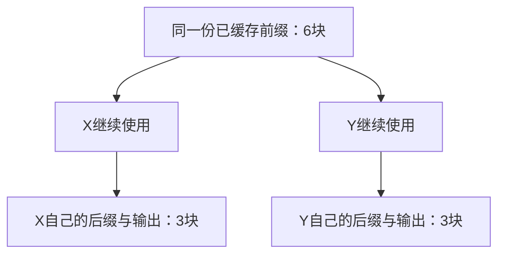

代码中用每个完整前缀块的身份标记来识别“这是同一块内容”。例如两人都有 `{p1,p2,p3,p4,p5,p6}`，合并后仍是这6个标记，不是12个。

原文的“并集”就是这种**把重复标记合并，只保留一份**。不是要求你先理解集合论才能使用。

于是总空间公式可读成：

```text
总需求 = 每个请求独有的空间相加 + 已缓存共同前缀去重后的空间
```

模型只对估计已存在的缓存前缀去重，不把尚未计算的新后缀预先当成可共享。真实引擎还有引用计数、pin、保留块等细节；路由容量会扣除一个 null block，但没有精确镜像所有物理分配。

#### 第四步：为什么输出越来越多，计算预算下降，KV预留却不跟着下降？

X最多生成10个，已经生成6个：

- **未来工作：** 只剩4个要生成，应该减小时间预算。
- **保存状态：** 已生成的6个仍属于历史，生成第7个时还需要访问它们的KV，不能马上释放。

所以“活干完了一部分”不等于“空间空出来了一部分”。当前模型提前按完整输出上限留空间，直到请求结束才移除该请求的需求；不会每出一个 token 就减掉一份KV。

这是保守预留，不是声称物理引擎从请求开始就分配了全部输出块。请求结束后，真实系统的部分数据还可能转成 APC 缓存；路由模拟不精确跟踪全部后续生命周期。

### 9.8 40ms和80ms从哪来？为什么需要校准公式？

到这里，等待怎么算已经清楚，还欠一个数：**X真正获得资源后，输入处理和首响大概花多久？** 这就是前面一直用的40ms和80ms。

不能简单说“还剩32个输入 token，所以只需要32ms”：不同硬件、模型、执行模式的速度不同，输入长度与耗时也不是严格线性。需要提前做一些小测量。

#### 第一步：在没有其他并发请求时，测两个端点

选固定长度输入，先第一次发送，几乎没有可复用前缀；完成后再发同一输入，已有前缀可复用。分别测“请求发出到第一个输出”的时间：

| 测量条件 | 教学假设值 | 这个数代表什么 |
|---|---:|---|
| 冷输入，cold | 100ms | 该长度基本需要新处理时的首响成本 |
| 接近完整前缀复用，warm | 20ms | 复用很好时仍需支付的基础成本 |

warm为什么不是0？因为还有请求处理、匹配、调度/模型执行、末尾计算等开销。缓存避免大量输入重复计算，不代表整个请求免费。

实际代码测的是 **客户端观察到的 TTFT**，不是用 GPU profiler 单独计时的纯 prefill kernel 时间。因此把 P 理解为“低并发下的首响处理成本代理”更准确。它拿来和额外排队估计相加，不是精确拆解每个内部阶段。

#### 第二步：只有一部分命中时，在两个端点之间做简单估计

X在GPU0命中96/128，也就是75%，还有25%未命中。用一个便宜近似：warm的20ms始终要付，而cold比warm多的80ms按未命中比例支付。

逐步算：

```text
cold比warm多出的部分：100 − 20 = 80ms
GPU0未命中比例：(128 − 96) / 128 = 25%
GPU0估计：先付20ms，再加80ms的25%
         = 20 + 80 × 0.25 = 40ms

GPU1未命中比例：(128 − 32) / 128 = 75%
GPU1估计：20 + 80 × 0.75 = 80ms
```

这就是原文公式的来历：

```text
P ≈ warm + (cold − warm) × 未命中比例
```

| 项 | 中文含义 | 本例 |
|---|---|---:|
| P | 此候选GPU上X的首响处理成本估计 | 最终要算40或80ms |
| warm | 复用很好也绕不开的成本 | 20ms |
| cold−warm | 需要从头处理输入时额外多出的部分 | 80ms |
| 未命中比例 | 这一长度中还需要新处理多少比例 | 25%或75% |

公式不是物理定律，而是**在已测得的冷/热端点之间，用命中比例做线性近似**。比猜一个固定“每输入token耗时”更能保留该执行模式的基础开销，但不保证精确描述 attention 的非线性和真实 batch。

#### 第三步：为什么还要测不同长度，以及单token输出时间？

128-token输入与3072-token输入的cold/warm不同，所以本项目分别测128、512、1024、2048、3072的长度桶；新请求选最接近的长度桶，再用自身命中比例估计。不是所有长度都套100ms/20ms。

校准中每个输入做冷/热配对重复4次，首对作为预热不计入稳态，余下取中位数。`C=1` 就是同时只有一个校准请求，先减少排队干扰。另用后续输出间隔估计 decode 的每token时间，得到第9.2、9.4节使用的“10ms/token”这类系数。

eager和Graph各测各的：执行模式变了，速度系数也可能变。校准请求独立于正式回放，不用当前待选择请求未来的实测结果指导当前选择。教学的100、20、10均不是实际测量值。

### 9.9 路由怎么知道GPU0有96个前缀、GPU1只有32个？

前面一直把命中长度当作已知，现在解释它来自哪里。**路由需要一本“各实例可能存着哪些前缀”的目录。**

这本目录不是KV张量本身，也不是一份新的GPU缓存；它记录识别信息，好比知道哪家仓库可能有哪批货。路由查目录用于估计，真正是否能复用仍要进入引擎后检查。

#### 第一种：按已经成功处理的请求记历史

以16-token完整块为单位，把输入切成第1块、第2块、第3块……每块生成一个短身份标记。标记不仅取当前块内容，还带上前面前缀的身份，因为KV依赖前面的上下文：两个后缀文本相同、前文不同，不能据此认为KV相同。

若GPU0成功完成某请求，路由记录其输入前缀标记。X到来时逐块从头比较：

```text
X的前缀标记： p1 → p2 → p3 → p4 → p5 → p6 → p7 → p8
GPU0目录有： p1 → p2 → p3 → p4 → p5 → p6
所以估计GPU0连续命中6块，即96 tokens。

GPU1目录有： p1 → p2
所以估计GPU1连续命中2块，即32 tokens。
```

不能跳过不匹配的p3，发现后面某块文本相同就继续算命中，因为需要的是连续前缀。

这办法为什么只是估计？成功完成证明那时处理过这些内容，之后可能已经被实际GPU淘汰。目录有容量上限和60秒有效期，减少旧记录；失败请求不发布成功历史，查询记录也不会自动把旧数据刷新为新数据。但它没实时看到每次物理分配/释放，所以仍可能判断错。

#### 第二种：进一步监听真实KV事件，但不能把一个事件过度解读

事件目录消费引擎发布的存储/移除消息，比只记历史更贴近变化。但本分支的 `BlockStored` 有时在**分配时**就发出，此时GPU实际数据不一定已经写完。

因此本项目保守地要求两类证据同时存在：

1. 收到相关块的存储事件，说明它进入了引擎的相应管理流程。
2. 路由观察到覆盖这段前缀的请求成功完成，补充内容已经被处理过的确认。

只有两者都满足，才把这段前缀作为可用候选。收到移除事件要撤销；消息序号跳过一段，说明可能漏掉了重要移除；epoch变化表示事件源/状态换代，也不能沿用全部旧确认。

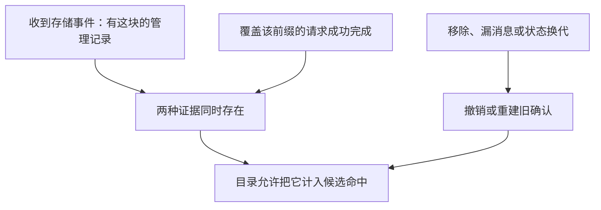

事件重放时先在一份未公开的临时状态中处理完，再一次性发布，避免重建到一半时对外暴露已经失效的旧块。

仍有事件传输延迟、重复物理副本身份等限制，**这本目录不是实时绝对真相**。但它只影响选路质量，不允许路由越过引擎检查直接伪造可复用KV。最后的匹配、引用计数和分配仍由vLLM负责。

两种目录是不同对照路径，不应理解成主要路由收益一定来自事件目录。本轮事件目录只有单轮筛选，没有稳定性能增益结论。代码见 [event_directory.py](./experiments_20261019/event_directory.py) 与 [events_router.py](./experiments_20261019/events_router.py)。

### 9.10 怎么验证这套估计有用？先分开“算得准”与“选得好”

前面所有计算最终服务于选卡。但要证明改造有价值，需要回答两个问题：

1. **时间估计是否更接近实际？** 这是预测问题。
2. **按这个估计选卡，整个负载是否运行更好？** 这是端到端服务问题。

两者有关，但不等价。

#### 第一项检查：预测误差到底在比较什么？

每次请求最终发到某个worker，也就是某个推理实例后，记录：

- 串行版本对该实例的预测：已有工作相加 + 新请求首响成本。
- 槽位/KV版本对同一实例的预测：模拟等待 + 相同的新请求首响成本。
- 实际从发出请求到首token的耗时，即TTFT。

例如一个教学请求真的用了2秒：串行预测3秒，误差1秒；新模型预测2.3秒，误差0.3秒。对很多请求都这样算，再把误差的绝对值平均，就是 **MAE，平均绝对误差**。它的单位仍是秒，越小表示预测越接近。

这里比较的是**首token时间估计**，并没有直接观测到引擎内部纯排队时间。因此不应把它简单说成“精确测出了排队误差”。

为什么强调“同次决策、同worker”？为了避免换了请求群体或实例，误差却被错误归因于模型。当前一次真实选路只发送一次，旁边同时记录另一种算法对同一目标的估计，这个旁边的记录叫**影子预测**，不额外改变请求去向。

三轮中，串行影子的TTFT MAE中位数约6.82秒，槽位/KV模型约1.66秒，按原始未四舍五入数下降75.69%。这支持“在该负载下估计更接近实际”，不是吞吐提高75.69%。

#### 第二项检查：最终请求真的跑得更好吗？

同一模型、双副本、eager、4K轨迹等配置固定，分别跑阈值基线和 `memory_remaining`：

| 观察项 | 阈值基线 | 新路由 | 说明 |
|---|---:|---:|---|
| 输出吞吐 | 95.42 tok/s | 101.67 tok/s | 同样负载更快完成，约+6.55% |
| TTFT P95 | 8.868s | 7.820s | 尾部首响改善约11.82% |

再换成不重叠的独立任务，吞吐+7.96%，TTFT P95降低35.63%，三组配对吞吐都为正。它说明改进不只发生在最初那32个任务上。

但阈值→新路由同时改变了负载表示和选择方式，不能把6.55%全部归为“单独加了一个KV公式”的因果收益。需要进一步看更接近的版本对照。

#### 为什么以前那版剩余工作模型有时没提升？

只按输出进度扣预算、仍把工作串行相加的 `work_remaining`，原任务约+0.51%，独立任务−1.96%，没有稳定吞吐增益。它解决了“进度没更新”，却没有解决并行服务与容量约束；也可能在不少请求上选卡没有改变。

#### 为什么预测更准，Graph下吞吐还是只多一点？

在Graph模式、使用同一份校准系数时，串行remaining→槽位/KV版本吞吐只+0.46%，虽然影子TTFT MAE仍下降49.57%。

可以用一个很小的例子理解：

```text
串行模型：GPU0预计3秒，GPU1预计1秒，选GPU1。
新模型：  GPU0预计2秒，GPU1预计0.8秒，还是选GPU1。
实际：    GPU1用了0.9秒。
```

新预测更准，却没有改变这个请求的选卡，当然不会仅因“数字更准”就让实际服务变快。执行速度更快、资源竞争不同，也会压缩进一步改进的空间。

Graph中阈值→新路由中位数+5.08%，但有一轮配对为负；而与更接近的串行模型比只有+0.46%。所以要同时报告预测和端到端，不能混成“算法稳定提高若干百分比”。

### 读完这一章，应该能连起来说出什么？

“我给每张卡估计新请求到首token需要多长时间。缓存决定新输入处理大概能省多少；已有请求的剩余输出决定还压着多少工作；但请求能组成batch，所以再按槽位和KV容量做一个小型假想排程，估计新请求何时能加入。最后把等待和首响处理成本相加选卡。它使用目录和单请求校准，因此是近似，需要用真实TTFT误差和端到端A/B分别验证。”

先理解这段，再回头看 `Q+P`、`remaining`、`memory_remaining`，它们就分别对应：**总估计、更新进度、把并行与容量加进等待估计**。

## 十、CPU KV Offload：为什么“能保存”之后，还要决定“值不值得保存”？

**先看问题：CPU保存空间有限。大段新KV不断写进来，可能把旧会话的KV挤掉；旧会话回来时又得重算。于是系统花了搬运时间，却没得到多少复用。**

**本项目的办法：确认缓存确实拥挤时，跳过大范围新保存，允许小增量续写；不拥挤时照常保存。**

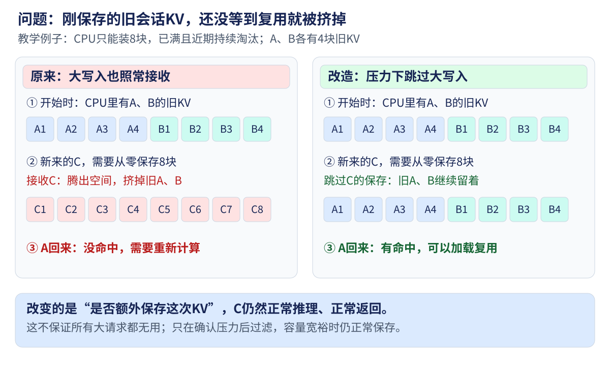

上图用8个块作为小型教学容量，不是正式实验的CPU大小。先看懂图中的A、B、C，再看判断怎样落实。实现入口是 [WriteAdmission](./experiments_20261019/policies.py) 和 [lmcache_adapter.py](./experiments_20261019/lmcache_adapter.py)。

### 10.1 先讲最原始的问题：GPU放不下，为什么会重复算？

假设Agent正在修代码：

1. 第一轮读了很多历史，模型在GPU里计算出对应KV。
2. 模型返回一个操作，Agent去等工具结果。
3. 等待期间其他请求进入，GPU空间有限，这份旧KV可能被回收或淘汰。
4. 工具返回，第二轮输入仍含相同历史；若没有可复用KV，模型又得处理一遍旧输入。

**CPU offload的基本作用：在GPU之外再保留一份，将来能加载回来，少算旧历史。** 保存的是模型中间张量，不是把上次答案文本存进数据库。

```mermaid
flowchart TB
    A["第1轮：GPU计算旧历史KV"] --> B["额外保存到CPU"]
    B --> C["Agent等工具，GPU可能回收旧KV"]
    C --> D["第2轮回来，GPU已找不到旧历史"]
    D --> E{"CPU还有这份KV吗？"}
    E -->|"有"| F["加载回GPU，复用旧历史"]
    E -->|"没有"| G["重新计算旧历史"]
```

CPU内存通常能提供额外空间，但保存、读取都要搬数据；因此“存在CPU命中”也不保证加载一定比重算快。第十节先解决写入竞争，没有实现对每次加载与重算的完整在线成本比较。

### 10.2 再讲新增的问题：CPU也会满，存进去未必能留到下次

沿用开头图：CPU只能装8块，当前存着A的4块和B的4块，并且近期已经持续发生容量淘汰。

现在来了C，需要从零保存8块。如果接收C，为了腾出空间，就可能把A、B的旧数据挤出去。过一会A回来，GPU旧KV已被回收，CPU也没了，只好重算。

| 时间 | 发生什么 | 代价在哪里 |
|---|---|---|
| 先前 | 保存A、B的旧KV | 已经付过GPU→CPU搬运成本 |
| 现在 | C又保存8块，覆盖旧A、B | 又付一次大范围保存成本 |
| 随后 | A回来，旧前缀没命中 | 再付重复计算成本 |

这就是要改的问题：**保存得多，不等于真正复用得多。** 特别是在Agent轮流等工具的场景，刚存完不一定马上再用，中间可能经过许多其他会话。

“CPU满”本身也不一定坏：如果里面都是会被反复命中的数据，满缓存很正常。真正要警惕的是**竞争量超过容量、实际已接近满、还在不断淘汰**。

### 10.3 解决办法先用一句话说完，再看三道检查

> 缓存确实拥挤时，不让每个大请求都大量写入；已经有大部分前缀、只需补一点的请求，仍允许正常保存。

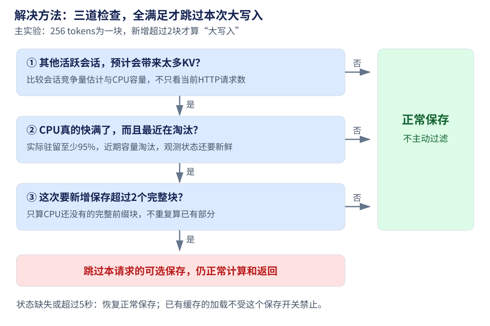

为什么不是“一律不存大请求”？因为大前缀也可能很有价值：当前没竞争，先保存它，下轮就能复用。所以本项目**只在压力条件成立时**过滤，不把所有大请求都判为无用。

为什么允许小增量？看两个人来申请空间：

| 请求 | 当前CPU里已有多少 | 这轮输入对应多少 | 需要新补多少 | 压力下怎样办 |
|---|---:|---:|---:|---|
| A继续下一轮 | 前4块 | 前5块 | 1块 | 允许，花较小空间延续前缀 |
| 新会话C | 0块 | 前8块 | 8块 | 跳过这次大范围保存 |

主实验把“新增超过2个完整块”作为过滤阈值：1块、2块不因此被过滤，3块及以上才可能被过滤。这个2是实验配置，不是所有模型都应该使用的常数。

**跳过的是额外保存，不是跳过模型推理。C仍正常计算、正常返回；已有CPU缓存也没有因为这个决定被主动清空。**

### 10.4 第一道检查：怎样判断“以后回来时，可能已经被别人挤掉”？

#### 先解释为什么看“近期活跃会话”，而不只看正在推理的请求

A正在等工具，暂时没有HTTP请求，但过一会它还会回来。若一返回就把A从统计里删掉，会忽略它跨轮保留缓存的需求。

本项目保留最近60秒出现过的会话，包含正在等工具的会话。每个会话保留最近一次输入长度，用这些长度估计近期每份上下文大概多大。

然后问：**一个会话等待期间，其他活跃会话的KV竞争量大概有多少？**

教学例子：

- 最近有5个活跃会话。
- 每个会话平均约4块KV。
- 看其中一个回来之前的竞争，就先估其他4个会话。
- 其他4个 × 每个4块 = **16块**。
- CPU只能放8块，说明可能有明显容量竞争。

```mermaid
flowchart LR
    A["5个近期会话"] --> B["先看其中一个之外的4个"]
    B --> C["每个平均4块，估计共16块"]
    C --> D["CPU只能装8块：可能留不住全部旧KV"]
```

这是一个便宜的竞争估计，不是预测每个人下一轮精确访问什么。共享前缀、长短差异、真实到达顺序都会让它不准确，所以还要第二道检查：看缓存是否真的已经在承受压力。

<details>
<summary>想对应代码公式时再看：把“块”换成真实字节</summary>

代码用输入token长度和每token KV字节数计算：

```text
预计竞争空间 = (活跃会话数 − 1) × 平均输入token数 × 每token KV字节
```

每一项为什么出现：

| 项 | 用途 |
|---|---|
| 会话数−1 | 粗略看其他会话在当前会话等待时带来的竞争 |
| 平均输入token数 | 估计一份上下文有多长 |
| 每token KV字节 | 把“多少token”换成“多少存储空间” |

例如17个活跃会话、平均2048 tokens，本模型BF16 KV每token为36KiB：

```text
其他会话约16个
16 × 2048 = 32768 tokens
32768 × 36KiB = 1152MiB = 1.125GiB
```

若CPU池为0.5GiB，也就是512MiB，估计的1152MiB大于512MiB，第一道检查通过。这里的工作集是“近期会话可能复用的KV竞争量”，不是模型的CUDA临时工作区。

</details>

### 10.5 第二道检查：估计说会挤，实际也真的在挤吗？

**不能只靠上一节的估计，就拒绝写入。** 比如会话共享了大量前缀，估计看着大，CPU实际却还很空。

因此本项目还查看三件事：

| 观察 | 为什么要看 | 当前配置 |
|---|---|---|
| 实际驻留占了多少容量 | 确认不是只有理论竞争，实际还没装满 | 至少95% |
| 近期有没有因容量不够而淘汰 | 确认确实发生“为了腾空间而挤掉旧数据” | 近期计数大于0 |
| 观察是不是足够新 | 昨天或很久前的“满”不能代表现在 | 状态不超过5秒 |

“驻留”就是现在确实存在目标缓存里的块；“容量淘汰”就是因为放不下而移走旧块。普通清理或主动删除不能全部冒充容量淘汰。CPU的hot cache提供实际驻留信息，适配器记录容量淘汰。

如果估计超容量，但CPU只有50%占用，就正常保存；没有新鲜状态，也恢复正常保存。**本策略宁可暂时沿用默认后端行为，也不拿一份过期“拥挤”记录长期拒绝后续请求。**

### 10.6 第三道检查：这次到底要“新写多少”？

这里不是问请求总共有多长，而是问：**CPU已保存的连续前缀之外，还需要补多少完整块？**

本次LMCache把256 tokens作为一个保存块。沿用A、C：

| 量 | A继续下一轮 | 冷会话C |
|---|---:|---:|
| 这轮输入长度 | 1280 tokens | 2048 tokens |
| 对应完整块数 | 1280÷256=5块 | 2048÷256=8块 |
| CPU已有连续前缀 | 1024 tokens，即4块 | 0块 |
| 要补的完整块 | 5−4=**1块** | 8−0=**8块** |
| 已确认压力时 | 1不超过2，允许正常保存 | 8超过2，跳过可选保存 |

原公式不过是把上表的减法写成代码：

```text
新增完整块数 = 输入里完整块的数量 − CPU已有连续前缀的完整块数量
```

不够256的尾部不当成一个完整块来计这个判断。例如输入1300 tokens，只有5个完整块，还剩20个尾部token；这条策略主要用完整块衡量“大写入程度”。它是请求首次查询时的保存准入估计，不等于精确预知最终所有输出、去重和真实写入次数。

这里必须用**CPU侧缓存查询模块返回的已有前缀**，代码中也称host前缀。GPU有1024 tokens，并不证明CPU也有1024：两边可能保存了不同内容。如果误用GPU命中，会把C需要从零写入的工作误判成只补一点。

最后三道检查合在一起才得出决定：

| 估计会竞争 | CPU实际满且在淘汰、状态新鲜 | 新补超过2块 | 决定 |
|---|---|---|---|
| 是 | 是 | 是 | 跳过这次可选保存 |
| 是 | 是 | 否 | 正常保存，小增量仍可补 |
| 是 | 否 | 是 | 正常保存，尚未确认真实压力 |
| 否 | 任意 | 任意 | 正常保存，容量看起来够用 |

代码里的`save=True`只是允许后端按正常流程处理，后端仍可能去重、因具体条件不写或受容量限制。它不是承诺必定新增某个数量的物理块。

### 10.7 一次请求经过好几个chunk，为什么不能每次重新决定？

一个长输入可能分几轮prefill，抢占恢复也可能再次进入连接器逻辑。如果同一次请求第一段“允许保存”、第二段“跳过”、第三段又“允许”，就会造成难以解释的行为与统计。

所以本项目**第一次查询前缀时决定一次，后续沿用，结束后清掉该请求的决定。**

```mermaid
flowchart LR
    A["第一次查询：给请求贴上允许或跳过的标签"] --> B["后续chunk：沿用标签"]
    B --> C["抢占恢复：仍沿用标签"]
    C --> D["结束或取消：删除该请求标签"]
    D --> E["会话历史仍暂留，等待下一轮"]
```

“冻结”只指冻结这个策略决定，不是冻结GPU或永久锁住CPU数据。当前请求结束，要清理请求标签；会话还可能等工具后继续，所以60秒会话历史不能也马上删掉。

这一机制借鉴EfficientAgent，但按当前vLLM/LMCache接口实现。它不代表复现了完整论文的未来访问预测或加载/重算决策。

### 10.8 读、算、写要分清：跳过保存会不会影响请求输出？

```mermaid
flowchart TB
    A["请求到来"] --> B["已有KV能否加载？由正常查询与恢复处理"]
    B --> C["缺少的部分正常计算，继续生成"]
    C --> D["正常返回模型输出"]
    C --> E{"这次允许额外保存到CPU吗？"}
    E -->|"允许"| F["交给LMCache按正常流程保存"]
    E -->|"跳过"| G["本请求不新增这次可选备份"]
```

图表示职责关系，不是所有异步复制的严格时间顺序。要记住：**决定是否为未来留备份，与当前请求是否正常服务是两件事。** 已有CPU数据仍可加载，不因`skip_save`而一概禁止读取。

如果这次不保存，未来会话回来时确实可能少一次命中。这是策略付出的代价；它用“大写入成本与挤出风险”换取有限空间中其他复用机会，不是免费收益。

### 10.9 哪些是现成功能，哪些是自己改的？

| 问题 | 现成基础 | 本项目具体工作 |
|---|---|---|
| GPU与CPU之间怎样搬KV | LMCache/vLLM已有连接器与复制能力 | 复用并适配当前版本，检查格式与初始化顺序 |
| 要不要跳过这次保存 | 已有`lmcache.skip_save`入口 | 实现三道检查，自动作决定 |
| 判断压力需要什么信息 | 后端已有缓存状态 | 接入真实驻留、容量淘汰、会话历史和状态新鲜度 |
| 同请求反复进入怎么办 | 多轮调用的框架生命周期 | 一次决定、后续沿用，完成/错误/取消时清理 |
| 怎样证明存取没错 | 不能只看HTTP返回成功 | 真实驱逐恢复、逐元素、概率与事实检查 |

本轮主实现选择LMCache；没有把所有native offload、MP/lazy-offload或其他淘汰方案全部比较。因此可以说在默认保存基线上实现了选择性准入，不能说已证明优于全部已有KV系统。

### 10.10 实验结果：少写有没有换来实际收益？

先区分四种实验，避免把名称看反：

| 组别 | 行为 | 为了回答什么 |
|---|---|---|
| 真正关闭offload | 不使用这套CPU保存/恢复路径 | 是否根本不该开offload |
| 默认保存，代码模式`none` | 启用offload，不主动筛掉大写入 | 原有保存行为如何 |
| 固定过滤，`fixed` | 不管CPU挤不挤，大写入就过滤 | 是否只要少写就够了 |
| 条件过滤，`conditioned` | 确认压力后才过滤大写入 | 压力判断是否能避免无条件少写的损失 |

主结果在相同decode Graph、相同0.5GiB CPU容量内比较，不把Graph本身当自己的改造：

| 指标 | 默认保存 | 条件化保存 | 怎么理解 |
|---|---:|---:|---|
| 输出吞吐 | 95.04 tok/s | 102.13 tok/s | 相同负载完成更快，+7.46% |
| TTFT P95 | 10.288s | 9.087s | 尾部首响降低11.68% |
| Stored tokens | 235520 | 20224 | 逻辑保存量少了91.41% |
| Retrieved tokens | 11264 | 33280 | 后续读取更多，符合旧前缀更有机会存活的解释 |

**为什么少写还可能多读？** 开头图里C不覆盖A之后，A回来能读到旧KV；若C把A全挤掉，之前写得再多，A回来也读不到。实际计数与这个机制一致，但不能据此说每个被拒绝的大请求都毫无价值。

同Graph下，条件化相对关闭offload也快4.02%，说明该格并非仅仅“把一个有害功能尽量关掉”。换成eager时，条件化比默认快3.63%，但比关闭offload慢约0.33%，所以并非所有执行模式都值得开。独立任务eager对照吞吐+3.64%，适用边界仍需保留。

Stored tokens是逻辑操作量，不是精确PCIe物理流量；不能把−91.41%直接写成总线带宽下降同一比例。会话窗固定60秒，执行速度也会改变窗口内观察到的活动，因此跨eager/Graph的计数不能只归因于GPU kernel。

**这一节面试可这样讲：先发现“存进去不等于留得住”，再根据会话竞争和真实淘汰确认压力，只在拥挤时拒绝大范围新保存，保留小增量，并用请求级固定决定保证一致性。**

## 十一、文件层KV：CPU仍然太小怎么办？加一层之后又要修什么？

**先看问题：第十节在有限CPU里选择“存谁”。但就算选择更合理，CPU容量仍可能不够，能留下的会话数量有限。**

**第一步解决容量：把部分KV保存到文件层。第二步解决代价：文件层也会满、读写也不免费，所以继续使用压力下的写入筛选，并确保读回的数据与报告的进度完全一致。**

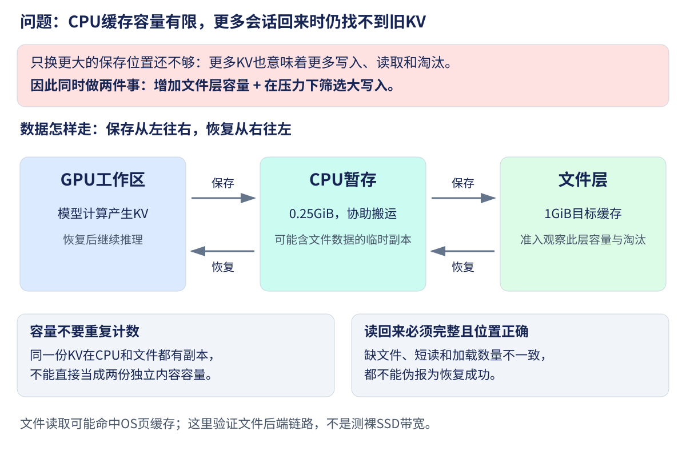

这里说的L2/L3是软件的KV存储层次，不是CPU芯片硬件缓存，也不是第八节L层调度。为避免混淆，本节直接叫 **GPU、CPU暂存、文件层**。实现见 [disk_adapter.py](./experiments_20261019/disk_adapter.py)。

### 11.1 为什么不能只靠第十节的“少写”？

假设有100份都值得复用的历史，但CPU只能装下其中一部分。筛选可以减少浪费，却不能把真实容量变成无限大。仍会有一些会话回来时找不到旧数据。

把KV放到更大文件空间，可以让更多旧前缀有机会留到下轮。这里先讨论“可容纳更多内容”，不是说文件读取一定快过重算；是否划算仍需测量。

| 方法 | 解决的问题 | 没有自动解决什么 |
|---|---|---|
| 第十节：筛选写入 | 少让低收益大写入反复覆盖缓存 | 没有增加真实存储容量 |
| 第十一节：加文件层 | 为更多KV提供保存空间 | 没有消除读写、淘汰和恢复正确性问题 |
| 两者结合 | 扩容，同时控制拥挤下的写入 | 仍须做性能与正确性对照 |

### 11.2 加了文件层后，一份KV实际怎样保存、怎样回来？

本次文件组配置为：**CPU暂存0.25GiB，文件层1GiB**。这些是实验人为设置的池，不代表机器只有这么多内存或硬盘。

保存时：

1. GPU计算出KV。
2. 在允许保存的情况下，借助CPU缓冲搬出数据。
3. 文件后端把对应数据写到该次运行的缓存目录。

恢复时：

1. 查询发现host后端有可用连续前缀。
2. 需要文件数据时，把文件内容完整读入CPU缓冲。
3. 按实际需要的区间恢复到GPU，复用这段历史。
4. 未覆盖的输入部分继续正常加载或计算。

```mermaid
sequenceDiagram
    participant G as GPU
    participant C as CPU暂存
    participant F as 文件缓存
    G->>C: 允许保存的KV搬出
    C->>F: 写入文件
    Note over G,F: 后续请求回来，GPU相应旧KV可能已不在
    F->>C: 完整读取需要的文件数据
    C->>G: 恢复实际需要的KV区间
    Note over G: 复用旧前缀，处理剩余输入与生成
```

图展示的是需要经过文件层时的链路；如果CPU已有可用数据，并非每次都必须再次读文件。

### 11.3 第一个容易搞错的地方：0.25GiB加1GiB，不就有1.25GiB了吗？

**不能直接把两处标称容量相加，作为不同KV内容的有效容量。** 因为CPU暂存和文件层可能同时持有同一份数据。

```text
CPU缓冲： [A的KV副本]
文件层：  [A的KV副本]

位置有两处，但不同内容仍只有A这一份。
```

这像搬箱子：同一箱货经过中转台再进入仓库，不能因为两个地方都出现过它，就算成两箱不同的库存。

所以本项目的文件准入策略，**压力容量和容量淘汰按目标文件层统计**，不把CPU暂存的重复副本再加一遍。已有前缀仍通过当前host后端查询，不能把“文件压力统计”和“查询可能从哪层命中”混成同一件事。

### 11.4 第二个问题：文件也会满，是否还要筛选保存？

需要。若不断把大段冷KV写进文件，仍可能挤掉更快复用的旧前缀，还多付文件IO开销。

第十节的方法可以迁移，但改为观察文件层：

| 第十节CPU策略看什么 | 文件层版本看什么 |
|---|---|
| 会话竞争量与CPU容量比较 | 会话竞争量与目标文件容量比较 |
| CPU实际驻留 | 文件后端已登记的驻留块 |
| CPU容量淘汰 | 文件层为腾空间发生的容量淘汰 |
| 状态新鲜度、新增块数、请求冻结 | 这些原则继续使用 |

```mermaid
flowchart LR
    A["文件容量尚宽裕"] --> B["正常保存，增加未来命中机会"]
    C["竞争超容量，文件层实际满且在淘汰"] --> D["新增少：正常补齐"]
    C --> E["新增多：跳过本请求的可选保存"]
```

这不是简单把CPU代码里的目录名改成磁盘目录：必须接到正确后端的容量与删除原因，避免拿CPU暂存是否满，替代文件层是否满。

### 11.5 第三个问题：文件“读过了”，不等于数据完整正确

假设应该恢复1000字节，文件被截断，只读到600字节。CPU缓冲中后400字节可能残留上一次的数据。

| 错误做法 | 正确做法 |
|---|---|
| 读函数没立即崩溃，就当1000字节都有效 | 检查实际读取长度是否等于目标长度 |
| 把前600新字节和后400旧残留拼起来恢复 | 缺文件、短读或EOF视为失败，不能使用残留 |
| 只看模型有没有输出一句正常话 | 同时检查字节内容与恢复后的模型概率/事实 |

```mermaid
flowchart TB
    A["需要完整读取1000字节"] --> B{"实际读到多少？"}
    B -->|"只有600"| C["报错：不能把旧缓冲残留当有效KV"]
    B -->|"完整1000"| D["正确性诊断再比对内容指纹"]
    D --> E["再验证真实恢复后的模型行为"]
```

正确性诊断会比较写入与读取内容的SHA256，可以理解为给数据生成一个“指纹”，检查搬运前后是否一致。正式性能运行关闭额外哈希，避免把诊断开销混进性能；完整长度检查仍保留。

字节一致也不替代模型语义检查：若张量布局本来解释错了，复制得一模一样仍可能错，所以还要第十五节的布局、概率与事实门禁。每轮有独立文件目录，不跨组偷偷复用旧缓存，也不据此宣称支持进程重启后的持久恢复。

### 11.6 第四个问题：GPU已经有一小段，为什么“最多加载2048”不等于“新增2048”？

先不看公式，看两件必须区分的事：

- **覆盖到哪里：** 当前GPU已有/已恢复的连续前缀终点。
- **这次增加多少：** 新终点减去原来已有的长度。

就像一本书原来读到第32页，现在读到第2048页，这次新读的是2016页，不能把2048页都说成新读。

本机出现的具体边界如下：

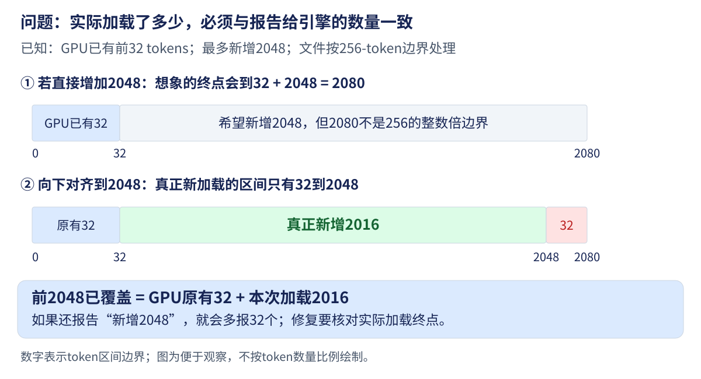

#### 为什么还要限制一次加载多少？

文件层可能很大，CPU暂存却有限。单次搬太多会占用缓冲和传输资源，所以配置每次加载上限。本次上限为2048 tokens；文件块粒度为256 tokens。

这个“256”是存储/传输块，不是chunked prefill每轮token budget。这里讨论的是恢复范围，不是调度器一轮计算多少。

#### 一步步算真实边界

| 步骤 | 本例数值 | 为什么这么做 |
|---|---:|---|
| GPU原来已有连续前缀 | 32 tokens | 这部分已经在GPU，不是本次新增 |
| 本次最多允许新增 | 2048 tokens | 限制一次恢复量 |
| 若直接加满，终点会到 | 32+2048=2080 | 先得到未经对齐的目标位置 |
| 文件范围按256对齐 | 2080不是256的整数倍 | 不能把任意位置当完整块终点 |
| 向下取最近合法终点 | 2048，因为256×8=2048 | 连接器实际加载范围记录，代码称LoadSpec |
| 本次GPU真正新增 | 2048−32=**2016** | 原来那32不能再报一次新增 |

**错误是：实际覆盖到2048，却还告诉引擎“新增了2048”。** 引擎再加上原有32，账面可能以为覆盖到2080，比真实状态多了32。这会破坏后续计算位置与实际KV的一致性。

本项目的修复是读取实际加载范围，用真实端点核对返回的新增量。只允许不足一个chunk的向下差异；方向不对或差太多就报错，不能随意吞掉异常。还要按原协议处理完全命中时的末token调整，并保留断言。

另外，**GPU新增2016，不表示文件IO一定只读取了2016-token的字节。** 文件后端可能按完整块读入，包括与GPU已有前缀重叠的部分；实际新增的模型进度与底层完整块IO量是两个口径。

专门构造GPU前缀0/32/288/512等边界，并用真实模型探针触发32前缀分支，检查文件读取内容、实际修正事件及概率。不是删掉检查让请求“看起来成功”。

### 11.7 实验最终证明了什么，又没有证明什么？

**这里+2.37%的比较，是在相同CPU暂存+文件配置下，“默认保存”对“条件化保存”；不是CPU升级成文件层就必然快2.37%。**

| 指标，三轮中位数 | 默认文件保存 | 条件化文件保存 | 变化 |
|---|---:|---:|---:|
| 吞吐 | 36.98 tok/s | 37.86 tok/s | +2.37% |
| TTFT P95 | 25.688s | 24.319s | −5.33% |
| Stored tokens | 192512 | 38912 | −79.79% |

在当前配置下，写入筛选减少了逻辑保存量，也改善了端到端指标。更早的小暂存配置有数值失败，旧开发轮保留并隔离，最终只用通过门禁的0.25GiB暂存/1GiB文件组。

还有三个边界：

1. 文件读取使用普通buffered IO，可能命中操作系统页缓存；不能当作裸SSD/NAND带宽实验。
2. LMCache的Stored/Retrieved日志包含CPU与文件相关操作，文件真实读取字节另看后端日志；逻辑token计数不直接等于磁盘写入量。
3. 增加文件容量是可用链路与空间扩展，性能是否比CPU单层更好需要另设同条件对照；本节不能替代那个结论。

### 11.8 把第十、十一节连起来，只记三件事

| 先遇到的问题 | 对应解决方法 | 本项目做到哪一步 |
|---|---|---|
| CPU不断写又不断挤，旧会话回来仍重算 | 确认真实压力后过滤大写入，保留小增量 | 条件化准入、状态反馈与请求级决定 |
| CPU容量还是有限 | 增加文件层，并把准入压力转向目标文件层 | 0.25GiB暂存+1GiB文件的真实链路与对照 |
| 数据可能没读完整，或恢复进度报多了 | 检查完整性，核对实际加载终点与新增量 | 短读/哈希/模型门禁、部分前缀边界修复 |

**面试可这样讲：CPU offload不是打开就有效，关键是KV能不能留到复用。我先控制拥挤时的大写入，再扩展文件层；扩容之外，重点保证数据完整、布局正确、GPU进度与真实加载范围一致。**

## 十二、PD分离：长输入和持续生成挤在一起，能不能分开做？

**先看问题：有的请求正在逐个输出token，另一个请求突然带来很长的输入。两类工作使用同一组资源，可能相互干扰：长输入处理让输出停顿，持续生成也会影响新输入获得资源。**

**解决思路：安排P角色专门处理输入、建立KV，D角色接过KV继续生成。代价是必须搬运KV，还要合理分配两类角色的GPU数量。**

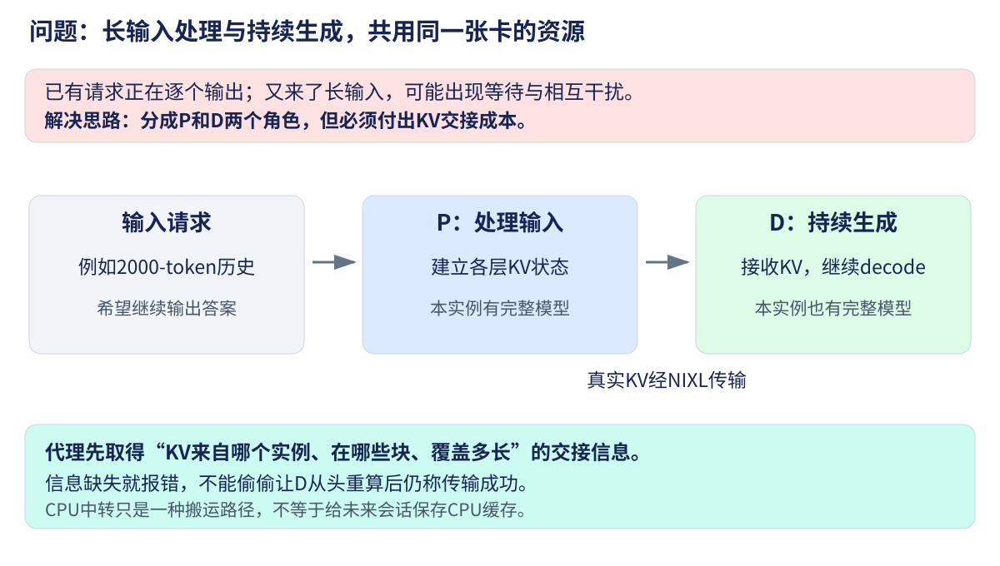

先记两个字母：**P是Prefill，处理输入；D是Decode，持续生成。** 这是角色分工，不是把模型的前半层和后半层拆开。以下先讲清单个请求怎么走，再看为什么本机四卡结果没有加速。

### 12.1 不分开时，具体会遇到什么？

假设A已经读完输入，正在输出代码。每过一段时间，用户就期待它再输出几个token。此时B带着2000-token输入进入。

- A还需要反复读取历史KV、执行模型、产生后续token。
- B需要处理长输入、建立大量KV。
- 两者共用GPU执行、内存带宽与KV空间，资源不能无限增加。

如果它们互相影响，可能表现为A的输出间隔拉长，或B很久才能出首token。实际影响取决于batch、预算与容量，不是所有长输入都会造成同样停顿。

PD的动机是让两类工作更容易独立安排：可以给P选择适合输入处理的资源，给D选择适合生成的资源，并调整数量。**它提供分工机会，不保证拆开就更快。**

### 12.2 一次请求拆开后，究竟传什么？

用“2000-token历史、最多生成64 tokens”作教学请求：

| 步骤 | 谁做 | 实际发生什么 |
|---|---|---|
| 1 | 代理 | 选择一个P实例，发送输入与准备交接的参数 |
| 2 | P | 处理输入，建立各层的KV状态 |
| 3 | P→代理 | 告诉代理KV来自哪个引擎、对应哪些块、覆盖多少token |
| 4 | 代理 | 选择D，把原请求及P确认的交接信息交给D |
| 5 | P/D连接器 | 用NIXL完成真实KV搬运，让D能访问所需状态 |
| 6 | D | 利用接收到的KV继续decode，把输出流返回客户端 |

**搬运的是各层K/V张量，不是把P的一段回答文本转给D。** 如果只把原输入文本发给D，让它重新处理2000-token输入，那没有省下D的完整输入计算，也没有证明KV交接成立。

代理主要传控制信息；真实数据搬运由vLLM连接器与NIXL完成，不是代理Python逐字节转发GPU内存。NIXL在这里可以理解为“协助不同实例交接KV的传输工具”。

两个实例都加载完整模型。P不是只装embedding，D也不是只装最后几层。P端的协议准备请求设置`max_tokens=1`，可能涉及首个采样步骤，不能把分工口号解释为“P绝不产生任何输出”。

### 12.3 为什么必须检查交接信息，而不能“失败就让D从头算”？

想象搬家：P不只要说“家具准备好了”，还要提供从哪里取、取哪些、取多少的清单。D才能接到正确东西。

项目检查的交接信息包括来源引擎、KV块和覆盖长度。代码对应`remote_engine_id`、`remote_block_ids`、`remote_num_tokens`等字段，具体以当前连接器协议为准。

```mermaid
flowchart TB
    A["P处理完准备请求"] --> B{"有完整且有效的KV交接信息？"}
    B -->|"有"| C["交给D，执行真实KV传输"]
    B -->|"没有"| D["明确失败，保留错误"]
    C --> E["检查D是否真正复用了交接状态"]
```

严格报错是为了让实验可解释。否则请求表面成功，背后可能走了D从头计算的另一条路径；此时“PD成功”这个结论没有证据。会话信息与可选CPU参数可以透传，但不能随意覆盖P已经确认的交接字段。

实现入口：[pd_proxy.py](./experiments_20261019/pd_proxy.py)。

### 12.4 1P1D、2P2D是什么意思？为什么要检查四种配对？

1P1D就是一个P、一个D：每类只有一个，没有“同角色该选谁”的问题。

2P2D则有P0/P1和D0/D1。一次请求先选P，再选D，因此有四种组合：

| 这次选谁处理输入 | 可交给谁生成 |
|---|---|
| P0 | D0或D1 |
| P1 | D0或D1 |

例如P0→D0可用，不代表P1→D0也可用。地址、连接和块元数据可能只有其中一路有问题，所以四对都要真实传输并检查模型结果。

D端的工作量选路可以先这样理解：D0还有很多输出没生成，D1更快结束，就倾向把新请求交给D1。当前使用可见输出预算等工作代理，没有实现新的D端缓存最优算法。

D收到的KV也不会自动变成“任何P下一轮都能用”的共享缓存。要让下一轮Agent输入利用D新增的历史，需额外的定位、迁移和一致性设计；本轮未实现双向P/D迁移。

### 12.5 四张卡都在用，为什么还可能比四副本慢？

先看资源分工，而不是先背结果：

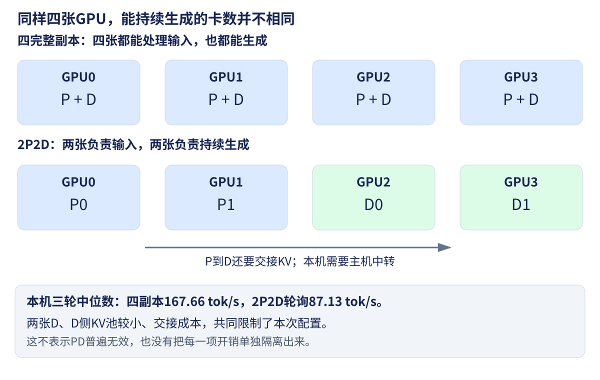

**四完整副本：** 四张卡各有完整引擎，每张都能完成一个请求的输入处理和生成。路由可以把请求送到四边。

**2P2D：** 两张卡固定做P，两张固定做D。生成阶段主要集中在两张D卡，角色不能因某一时刻另一侧空闲就自动变回完整副本。

由此多了三个限制：

1. **生成资源集中：** 四副本有四张卡能持续生成，2P2D只有两张D承担主要生成工作。
2. **D侧KV容量减少：** 若每实例同样8192-token池，四副本的生成请求分散在四份池，2P2D集中在两份D池，D侧更容易紧张。
3. **增加交接：** 每次请求要把KV交给另一角色。本机没有可用NVLink/P2P/RDMA，路径需要主机中转，不能把搬运当零成本。

所以本机如果主要缺D资源，增加P不一定帮忙。1P2D单轮约85.47 tok/s、2P1D约46.68，提供了“更需要D”的线索，但只是筛选，不是所有负载的配置定律。

### 12.6 PD的“必须搬一次”和CPU的“可选存一份”不是同一个决定

第十节是在问“为未来复用，要不要额外保存到CPU”。PD则是在问“这次请求能不能把P已经算出的状态交给D”。

```mermaid
flowchart TB
    A["P建立KV"] --> B["必需：交给D完成本次请求"]
    B --> C["D继续生成"]
    A --> D["可选：在CPU留一份，方便未来复用"]
    C --> D
```

保存策略可以拒绝一份可选备份，不能顺便取消P→D的交接。本项目在多连接器里把必需NIXL和可选LMCache分开处理，NIXL在前。

传输使用CPU中转，也不表示这份KV已作为未来缓存长期留下：中转缓冲像搬运途中的手推车，CPU缓存像准备反复取用的存货，职责不同。

### 12.7 怎样证明这次PD真的在工作？

不能只看服务启动或HTTP返回成功。逐项问：

| 要排除的假象 | 对应检查 |
|---|---|
| 只传了一些参数，没有真搬KV | NIXL实际传输字节大于0，成功/失败计数符合要求 |
| D悄悄从头处理了输入 | 检查D初始本地prefill为0 |
| 搬到了错误前缀或错误位置 | 比较模型概率、长前缀事实与代码行为 |
| 只有一条P/D路径正确 | 四种配对分别用独立诊断前缀检查 |

本轮2P2D每轮19项：原11项，加四对各2项。六个架构正式运行逐轮通过；性能回放每轮112次真实交接，零传输失败。

“D初始prefill为0”只排除从头处理输入的隐藏回退。D仍做attention与decode，也可能抢占后恢复重算；记录中D有6～21次抢占、130～504个恢复重算tokens，不能说D完全不计算。

验收实现见 [pd_fidelity.py](./experiments_20261019/pd_fidelity.py)。

### 12.8 最终速度怎样？为什么必须保留这个负结果？

四张卡、每实例同样固定KV池、`max-num-seqs=8`，三轮中位数：

| 配置 | 吞吐 | TTFT P95 | TPOT P95 | 怎么解释 |
|---|---:|---:|---:|---|
| 四完整副本 | 167.66 tok/s | 4.129s | 52.05ms | 本机这组更合适的部署 |
| 2P2D轮询 | 87.13 tok/s | 11.951s | 59.57ms | 相对四副本吞吐−48.03%，三轮都退化 |
| 2P2D，D按工作选路 | 90.36 tok/s | 10.739s | 54.27ms | 比PD轮询中位数好，但其中一轮配对为负 |

这些结果符合前面资源集中的解释，但没有单独测出每项占比，不能把全部退化都归给传输。性能回放每轮约交接8.79～9.37GB，只说明数据量与路径真实存在，不等于精确DMA耗时归因。

本轮的工程成果是接通严格交接、完成正确性与同GPU数对照，并识别当前边界。**没有获得PD架构加速，就如实讲架构未达目标，不能把“能跑”说成“更快”。**

### 12.9 PD里再加CPU保存，做到什么程度？

另有seq2配置：四实例各CPU0.25GiB，总CPU1GiB，只比较默认与条件化保存。成功配对1/3/4轮的吞吐66.49→68.18 tok/s，+2.55%；TTFT P95−7.81%，Stored tokens−87.53%。

但8次尝试中，一次在计时前诊断发生502，根因未定位。对应成功对照也随配对撤出，再补完整配对。诊断禁用可选CPU保存，因此不能把失败直接归因于保存策略；已补异常类型、repr和完整堆栈。

这是成功条件下的迁移证据，不证明生产稳定。它与上一节seq8的架构组不同，也没有再叠加L1，不说已经完成PD+R+O+L全组合。

**面试一句话：PD把输入与生成分工，自己做的是严格交接、角色实验和可选CPU适配；本机受D资源与主机中转限制，四副本实际更快。**

## 十三、Chunked Prefill：长输入占用太久，能不能分几轮做？

**问题：一个长输入如果一次处理很大一段，正在生成的请求可能较久得不到下一次推进机会，用户看到输出停顿。**

**解决方法：把长输入分成几轮处理，每轮留机会给decode继续推进。它调整的是输入处理节奏，不是把模型答案切成几段。**

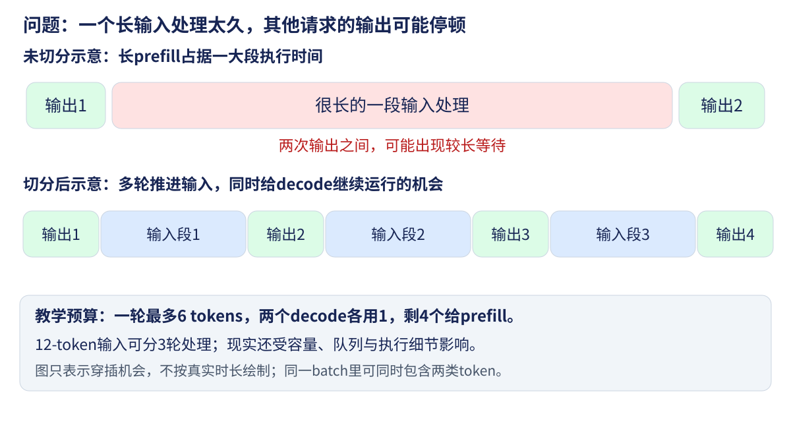

这是vLLM已有能力。本项目把它作为变量，检查与L/R/O的交互，不声称发明chunked prefill。[官方调优说明](https://docs.vllm.ai/en/stable/configuration/optimization/)。

### 13.1 先用12-token输入，算清一轮到底做什么

教学假设：每轮最多安排6个token；A、B正在decode，各要生成1个；新请求X还有12个输入token未处理，且其他资源足够。

| 轮次 | A的decode | B的decode | 给X处理输入 | X还剩输入 |
|---|---:|---:|---:|---:|
| 第1轮 | 1 | 1 | 4 | 8 |
| 第2轮 | 1 | 1 | 4 | 4 |
| 第3轮 | 1 | 1 | 4 | 0 |

为什么每轮给X的是4？因为总额度6，先给两个decode各1，剩下4。三轮后输入完成，X也可以进入后续生成。

这只是理解额度分配的例子：实际受队列、容量、对齐和调度规则影响，同一batch也可以包含decode与prefill。不能把图里的方块当成严格串行GPU kernel时间线。

### 13.2 真实配置512是什么意思？为什么不是越小越好？

`max-num-batched-tokens=512`可以先理解为本轮安排token的总额度。假设4个decode各占1，就约剩508给prefill；4096输入需要多轮。

**小额度：** 更频繁穿插，长输入单轮占用受限；但长请求需要更多轮，可能增加其首响和调度开销。

**大额度：** 长输入可能更快完成；但单轮工作量大，也可能拉长其他请求的输出间隔。

所以目标是权衡吞吐、长输入TTFT与生成流畅度，不是把某个参数拉到最小就好。

### 13.3 为什么GPU block、LMCache chunk、prefill budget不能混为一谈？

用一句话区分三者：**怎么放、怎么搬、这轮算多少。**

| 名称 | 要解决的问题 | 常见配置 | 一个具体理解 |
|---|---|---:|---|
| GPU KV block | 显存按什么小单位分配和共享 | 16 tokens | 一段256-token KV可能占16个GPU块 |
| LMCache chunk | CPU/文件按什么单位查询与保存 | 256 tokens | 这段KV可能对应一个host chunk |
| 每轮token budget | 本轮最多处理多少token | 512 | 多个请求共用这轮额度 |

因此把GPU block从16改256，不等于prefill每轮只算256。INT8里做GPU/host粒度对齐，也不等于重新发明了分块调度。

### 13.4 Top-W和分块各管哪一步？

```mermaid
flowchart LR
    A["等待队列"] --> B["Top-W：先让谁进入？"]
    B --> C["本轮budget：已选请求能算多少？"]
    C --> D["模型执行，没处理完的输入留待后续轮次"]
```

Top-W选择准入，chunked prefill控制执行量；它不会每轮把所有正在处理的输入片段重新按命中排序。

实验时应固定budget比较L0/L1，再改变budget看交互。若同时改两项，只看到更快，也分不清是哪项起作用。

### 13.5 “打开开关”为什么还不够？本轮怎样确认？

如果所有输入都能一轮装下，打开分块开关也可能没有任何请求真被拆开。

本轮读取实际调度诊断：

| 本轮budget | L0实际发生分块的请求 | L1实际发生分块的请求 |
|---|---:|---:|
| 512 | 111 | 110 |
| 2048 | 77 | 79 |
| 8192开/关对照 | 均为0 | 均为0 |

8192组最大输入约3802，没有实际切分，因此开关差异不能当成切分机制的证据。诊断日志本身有开销，诊断组也不替代正常性能组。

**面试一句话：我把分块作为控制变量，确认哪些请求真的拆了，再观察它与准入的交互；没有主张普适最优budget。**

## 十四、量化与Graph：显存紧、提交频繁，是两种不同问题

### 14.1 先看量化要解决什么：同一张卡里，不只有模型参数

**问题：模型权重、请求KV、临时缓冲与Graph等共同占显存。模型装得下，不代表能同时放下很多长会话。**

**解决方向有两个：压缩模型权重，或压缩每个token的KV。它们释放的是不同部分。**

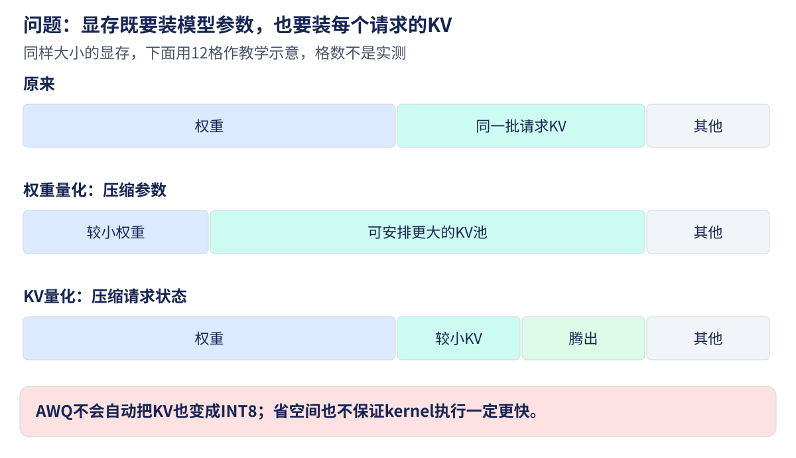

图用12格解释空间，不是本机实测占比。权重是模型学到的参数；KV是每个输入/会话产生的运行状态。一个模型的许多请求可共用权重，KV却随请求历史增长。

### 14.2 权重量化：模型变小后，为什么仍要测速度？

AWQ把权重用较少位数表示，再配合相应计算实现。可以腾出空间，也可能降低某些带宽需求，但涉及反量化和特定kernel。

所以有两个不同实验问题：

| 对照方式 | 想回答什么 | 不能混淆什么 |
|---|---|---|
| KV池大小固定 | 换精度/执行路径，服务表现怎样 | 不把更大缓存池当kernel收益 |
| 按自然可分配容量使用KV池 | 实际部署换量化模型后，整体空间与性能怎样 | 此时容量与执行一起变化 |

本次自然池BF16为111184 KV tokens，AWQ为224544。权重变小后能安排更大KV池，但容量更宽裕，也可能让原先缓存排序的额外收益变小。

AWQ自然容量L1相对L0吞吐−0.88%，TTFT P95约改善14.83%；固定池单轮AWQ也未必比BF16快。**省空间可以成立，速度提高仍要逐配置验证。** 本轮AWQ没有自动把KV也变成INT8。

### 14.3 KV量化：为什么scale也要跟着搬？

KV从BF16改为INT8等格式，是把运行状态中的数用更少位存储。为了恢复数值含义，还需相关scale信息。可以把scale理解为“这些小整数对应原来多大数值”的刻度。

只搬整数、不搬对刻度，就像只抄下“温度30”却丢了摄氏/华氏的解释，数据看似存在，含义可能错。真实量化更复杂，这个比喻只解释为什么元信息不能随意丢弃。

本模型BF16为36864 bytes/token；INT8实际载荷含内联scale，为19008 bytes/token，不是直接除二后的18432。容量和传输估计以真实格式检查，不能用权重精度猜KV大小。[vLLM KV量化说明](https://docs.vllm.ai/en/stable/features/quantization/quantized_kvcache/)。

### 14.4 为什么INT8需要重新做恢复正确性检查？

因为格式、scale和块边界共同决定加载后的模型状态。BF16恢复正确，不能直接推出INT8恢复也正确。

| 配置 | 实测验收 | 可以说什么 |
|---|---|---|
| GPU block16 / host chunk256 | 4/11项数值检查未过 | 该路径不能放行性能结论 |
| GPU block256 / host chunk256 | 11/11，另6项代码探测通过 | 该对齐配置可继续筛选 |
| 上述对齐配置准入对照 | 单轮+1.09% | 可用性/迁移线索，不能称稳定加速 |

总池均以8192 tokens设置，但保留一个block等开销因粒度不同而变化，因此不能说可用空间完全相同。对齐后可用，也没有证明原失败的全部根因都已定位。

FP8 KV被本机SM86的当前Triton路径拒绝，说明该组合不可用，不代表3080 Ti不能做任何量化。

### 14.5 再看Graph：显存够了，为什么CPU提交也会成为开销？

**问题：decode每次只向前推进少量token，却要反复提交很多GPU操作；提交本身也花时间。**

**办法：对适合的执行结构先记录，后续重放，减少CPU一次次逐项发起的开销。**

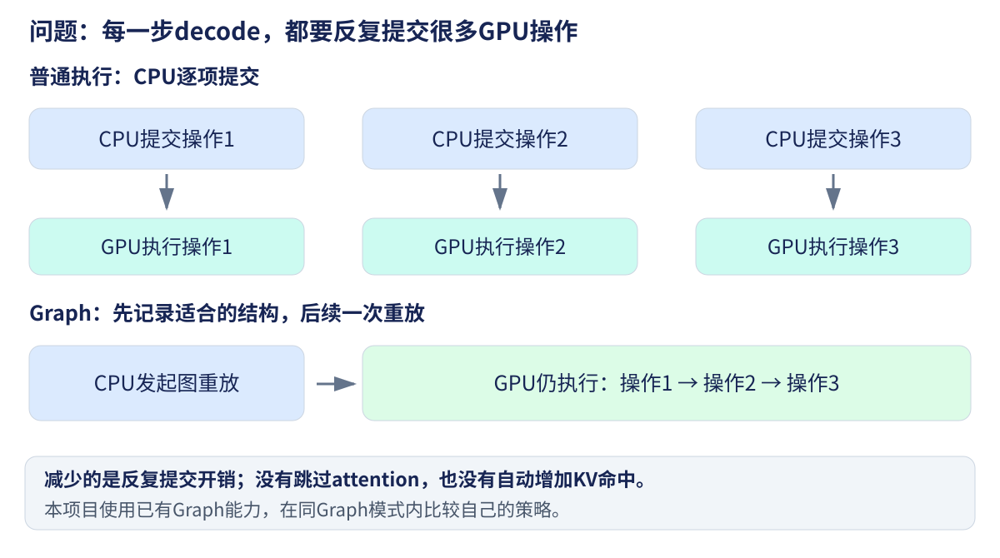

可以把它理解为把经常重复的操作流程预先组织好。GPU仍做attention和其他模型计算；Graph没有让输出token凭空出现，也没有自动提高前缀命中。

动态请求需要适合的形状与batch配置。本次使用已有decode Graph能力，常规捕获batch1/2/4/8，其他组按seq上限调整，并经过真实模型检查。Graph自身和新的融合kernel都不是本轮的原创贡献。

### 14.6 为什么一开Graph，还要重新校准路由和比较策略？

第九节的路由拿“每token大概几毫秒”等系数估计工作。执行模式变快，如果还用旧系数，就可能把工作估错；CPU搬运在总时间中的占比也可能变化。

所以每种模式独立校准、独立比较：

```mermaid
flowchart LR
    A["切换eager或Graph"] --> B["重新测本模式的执行系数"]
    B --> C["在同模式内跑原策略与新策略"]
    C --> D["只把这次A/B差异归给策略"]
```

例如“同Graph内，默认CPU→条件化CPU吞吐+7.46%”是策略对照；“eager换Graph后快很多”是执行模式变化，不能全部写到自己的O算法上。

**面试一句话：量化主要改变存储/执行特性，Graph主要减少重复提交；我把它们作为变量，分清容量、kernel和调度收益。**

## 十五、正确性：为什么输出看着正常，速度数据仍可能作废？

**问题：KV搬错了，模型不一定立刻崩溃。它仍可能回HTTP200、输出可读文字，甚至某个简单问题答对；如果把错误状态当有效缓存，速度可能很好看。**

**解决方法：先检查数据和坐标，再确保真走恢复，最后检查模型概率与行为。性能必须在这些检查通过后才算有效。**

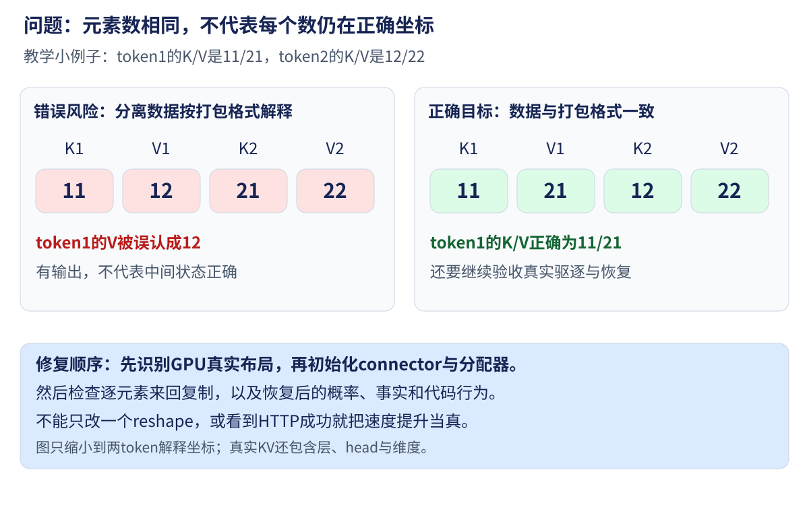

### 15.1 先用四个数，理解“复制的数量对了，位置却错了”

教学模型只看两个token，每个各有一个K和V：

| 坐标 | 正确值 |
|---|---:|
| token1的K | 11 |
| token2的K | 12 |
| token1的V | 21 |
| token2的V | 22 |

若先放全部K，再放全部V，内存顺序为：`11,12,21,22`。

若按token打包，希望每个token的K/V挨着，顺序应为：`11,21,12,22`。

**两边都只有4个元素，但不能直接按另一种格式解释。** 把第一种顺序当第二种读，token1的V会读成12，而正确应是21。

真实KV还带层数、head、维度，情况更复杂。图只解释坐标问题，不建议把任意张量改个reshape就能转换格式。

### 15.2 本次真实问题在哪里，修复为什么有先后顺序？

LMCache V2的分离缓冲与本机Triton打包KV不兼容。形状示意为：

```text
分离：[2, L, T, H*D]       打包：[1, L, T, H*2D]
```

L是层，T是token，H/D对应head数量与维度。这串形状不用背；关键是**存取双方对同一位置的解释必须一致**。

本项目让V3连接器在CPU分配器记录元数据前，先发现实际GPU布局并初始化指针/格式，再注册使用。像先确认货物怎么分格，再按那个规格准备箱子；箱子已经按错规格分配好，事后只改一个标签不够。

```mermaid
flowchart LR
    A["看真实GPU布局"] --> B["先初始化正确V3格式"]
    B --> C["再让CPU分配器记录形状"]
    C --> D["执行并检查来回复制"]
    D --> E["驱逐后恢复，再验模型"]
```

旧V2性能数字永久隔离，最终只用修复后的有效轮。根因属于当前组件组合的兼容问题，不扩大为所有V2或所有模型都不可用。

### 15.3 正确性为什么要一层层查？

| 层次 | 先问什么 | 举例 | 本次证据 |
|---|---|---|---|
| 数据复制 | 搬过去再搬回来，数是否一致？ | 11不能变12，scale也不能错 | V3逐元素20项通过，4项旧V2预期失败保留 |
| 路径真实性 | 是否真的从CPU/文件回来？ | GPU旧KV先驱逐，不能被APC命中绕过 | 检查实际host读取与驱逐过程 |
| 模型状态 | 恢复后对下一token的判断是否接近参考？ | 看logprob，即下一token的对数概率 | 8项Coding+3项长前缀事实，BF16 CPU等具体组11/11 |
| 行为 | 能否生成并执行小段代码？ | 不强制固定长度后检查代码输出 | 6项代码探测 |
| PD交接 | 是否真从P移给D？ | 有传输字节，D不重新完整prefill | 四配对和19项诊断 |

每一层排除不同问题。代码能执行不替代数值检查，复制字节正确也不替代模型检查。这些小型门禁不等于HumanEval或SWE-bench成功率，更不是证明所有模型/长度都正确。

BF16 CPU、decode Graph、HND布局三条路径分别11/11通过；文件层与部分GPU前缀边界也各11/11。HND在这里是被检查的一种内存排布标签，不是另一个调度算法。

### 15.4 除了KV内容，还会有哪些“状态没清干净”的错？

**例一：特征过期。** 路由/调度之前查到某块存在，之后该块被淘汰，却仍使用旧解析结果。L的generation失效负责处理这一类问题。

**例二：请求失败，预算没释放。** X被登记为180ms工作，实际网络失败了，账本却一直留着。后续路由总觉得那张卡忙，表现为不合理偏流。需要完成、异常、取消路径统一清理。

**例三：服务端口通了，但不是本轮进程。** 上轮进程没退出，新检查误连到它，配置与结果身份不一致。需要启动前查端口，并核验监听PID属于本轮进程树；只看健康端点返回成功不够。

本轮确有端口污染导致一组配对撤出并补干净轮。它与PD+CPU的未定位502不同，没有证据把两者混成一个故障。

### 15.5 最后哪些东西要留下，才方便别人复核？

不仅留一张速度表，还留：命令、配置、源码SHA256、模型revision、输入trace身份、逐请求结果、KV/传输计数和失败原因。SHA256可理解为文件/源码指纹，用于确认跑的是哪一份。

新增策略/适配/目录/编排43项针对性测试通过；核心调度此前31项回归通过。追加重跑的取消/错误4项是已有测试子集，不能再加成47项独立测试。

**面试一句话：我先排除“错误路径更快”的假象，再谈性能；最关键修复是打包布局初始化和加载范围守恒，不是只保证HTTP成功。**

## 十六、实验：看到“快了”，怎样确认是改造带来的？

**问题：B比A快，可能是策略好，也可能是换了模型、KV池更大、输出更短、GPU状态更好，甚至用了错误缓存。**

**方法：先固定可比较条件、过正确性检查，再交错运行原策略A与新策略B，同时看端到端指标和机制计数。**

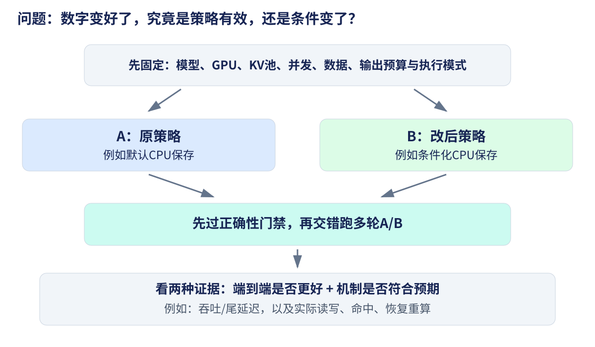

### 16.1 用一组小数字，分清“时间少了”和“吞吐多了”

教学假设：同一批请求，A/B都生成1000个输出token。

| 策略 | 完成这批的总时间 | 吞吐怎么算 | 结果 |
|---|---:|---|---:|
| A | 10秒 | 1000÷10 | 100 tok/s |
| B | 9秒 | 1000÷9 | 约111.11 tok/s |

B总时间少了1/10，即10%；吞吐从100到111.11，增加约11.11%。它们描述同一变化，但分母不同，百分比不必相同。

如果B只输出900 tokens，仍用9秒，就不能靠“更快结束”证明策略更高效。因此本轮主要性能组固定输出工作量、记录成功数与实际token数；质量另行检查。

### 16.2 为什么不能同时换几个条件后，说是一个算法生效？

假设A用小KV池、eager，B用大KV池、Graph，还顺便开新策略。即使B快了，也分不清是容量、Graph还是策略造成。

| 要测什么 | 应当怎么比 |
|---|---|
| CPU保存准入 | 同模型/Graph/容量/seq/数据，只切默认与条件化保存 |
| L的准入 | 同预算/执行模式/资源，比较L0/L1，并检查命中与抢占 |
| 路由 | 同两个实例和目录条件，比较阈值、串行工作、槽位/KV版本 |
| 四卡架构 | 相同卡数与清楚的资源设置，四副本对2P2D |

阈值→memory路由同时改变工作表示和选择方式，属于策略整体对照；不能把全部6.55%都归因于单独一个公式。想看独立增量，再找更接近的版本比较。

### 16.3 为什么要看“中间计数”，不能只看最终吞吐？

吞吐告诉你结果，计数帮助判断解释是否站得住：

| 你的解释 | 应寻找的机制证据 | 仍不能直接推出什么 |
|---|---|---|
| L促进缓存复用 | 命中增加、首prefill/重复计算变化 | 无抢占时不能证明victim策略有效 |
| O减少覆盖浪费 | 保存变少、读取增加、压力与淘汰记录 | 不能证明每个被拒绝请求都无价值 |
| R改善等待估计 | 同worker的预测误差下降 | 预测更准不一定改变选卡或提高吞吐 |
| PD真交接了KV | NIXL字节、D初始prefill、模型结果 | 真传输不等于比完整副本更快 |

例如L自然容量组吞吐+33.80%，命中增加，但两组都没抢占。合理解释是准入与复用，不能拿来证明抢占减少了重算。

### 16.4 为什么跑三轮、换顺序，还要另一批任务？

**多轮与交错：** GPU温度、启动状态、系统负载会漂移。把A/B交错、改变顺序，比先全跑A再全跑B更容易减少一部分时间偏差。三轮仍是小样本，不称统计显著。

**独立任务：** 原32个任务用于开发与筛选，再取不重叠32个任务检查效果；不根据独立任务结果继续调参。它类似换一套题检验方法，不是训练新模型，也不保证所有生产任务都有效。

**保留失败：** 不能只删掉失败或最慢轮，留下好看的数。本轮标记隔离原因，污染配对一起撤出，用新编号补完整配对，原文件不覆盖。

### 16.5 中位数、逐轮变化、P95分别在回答什么？

先拿简单数列理解中位数：三轮吞吐90、100、170，按大小排后中间的是100。不是把三项相加除三，也不是只挑最高170。

另一组100、105、180，中位数105。因此中位数从100到105，是+5%。如果逐轮一一比较，则约为+11.11%、+5%、+5.88%，与“中位数之比”不是同一统计。

本轮PD+CPU实际报告中位数之比+2.55%，有效配对为+7.21%/+2.43%/+5.00%，不要互相替换成“平均提升”。

P95又不同：它看请求分布中较慢的尾部，不是三轮里选一个中间值。例如TTFT P95=5秒，表示该口径下约95%的请求首响不超过5秒，仍可能有少量更慢。总体吞吐提高，也可能长请求排得更久、P95变差。

### 16.6 为什么预热、工具等待、诊断顺序也要写清楚？

本轮先重新启动服务，每backend两个短预热，再通过模型检查进入计时。诊断前缀与性能负载首块隔离，避免直接把同一请求提前暖好。

但诊断后未清空全部APC，不同架构历史不完全一致，因此架构结论限定这套预热流程。带大量调度日志的机制诊断也不直接当性能组。

吞吐用“全部输出tokens / 整批任务完成时间”。任务按会话依赖串行，工具间隔模拟0.2秒，这些都包含在闭环完成过程中。它不是外部持续按固定RPS发来的开环容量测试。

SLO是预先选的目标，本轮TTFT≤5秒、TPOT≤0.1秒，用于观察满足比例；不是算法保证所有请求都达到，也不是生产合同。

### 16.7 哪些成绩值得讲，应该一起带哪句边界？

| 方向 | 可以讲的结果 | 紧接着补一句 |
|---|---|---|
| L | 自然BF16吞吐+33.80%，独立+19.09% | TTFT尾部上升，且该格无抢占 |
| R | 双副本eager +6.55%，独立+7.96% | Graph下相对串行模型增量仅+0.46% |
| CPU O | 同Graph默认→条件化+7.46% | eager相对关闭offload略慢 |
| 文件O | 同文件配置条件化+2.37% | 不等于文件比CPU必快，IO可命中OS缓存 |
| R/O组合 | +4.98%，TTFT−15.43% | 再加L无额外吞吐收益，TTFT还退化 |
| PD | 真交接与四配对验收 | 四副本实际比2P2D快，联合CPU还有一次未明502 |

不能把不同配置里的百分比相加。R/O组合使用串行`work_remaining`，不是完整memory+O矩阵；PD+CPU只有L0。五格组合不是八种开关穷举。

### 16.8 别人要复核时，给什么？

本机产物累计305次尝试，289次completed，其中268次未隔离，16次失败保留。包含开发、筛选、诊断、重跑与共享基线，不能当作305次独立有效A/B。27项声明对照至少三次有效运行，5项仍是筛选。

复核者需要：配置、输入身份、代码身份、每轮原始值、隔离规则和正确性门禁。35407条HTTP成功响应也含隔离/失败轮的部分响应，不是准确率。

**面试一句话：我不只看最快一轮，而是让数字回到同条件对照、机制计数和原始记录；正收益与代价一起报告。**

## 十七、把所有内容串起来：一个Agent请求，究竟经过哪些决定？

**问题：单独理解R、L、O后，容易误以为它们都在重复决定“谁先算”。实际上它们分别决定去哪里、谁进入、是否给未来留备份。**

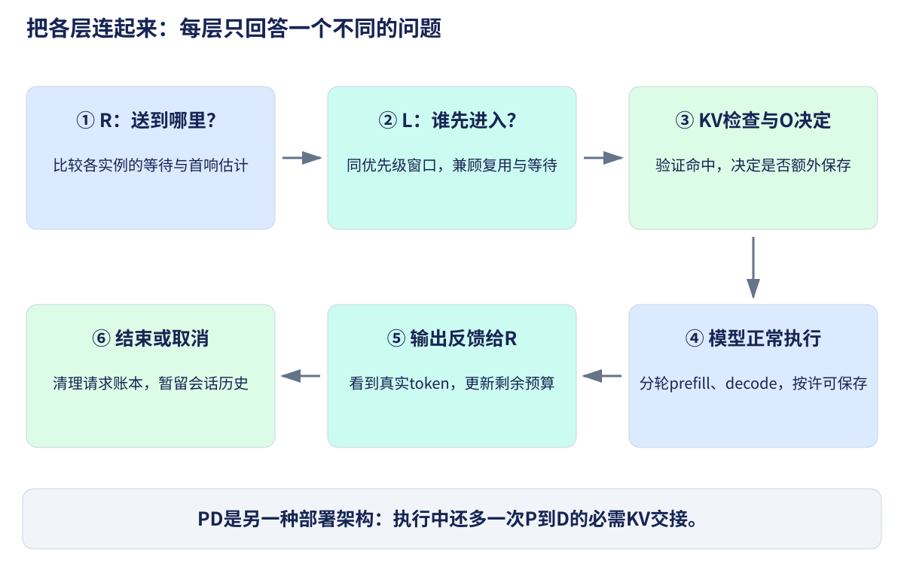

这张图是职责说明，不表示每个实验都全开，也不是所有异步回调的严格时刻表。用下面这个教学请求走一遍。

### 17.1 已知这次请求是什么？

Agent新一轮输入2048 tokens，最多输出64。假设选中实例GPU已有连续前512，CPU侧已有连续前1536；所有状态还需由真实查询验证。

| 阶段 | 它要回答的问题 | 本例怎样理解 |
|---|---|---|
| R | 送哪个实例预计更快？ | 比较各实例缓存、工作与容量近似，然后先登记预算再发送 |
| L | 这个实例等待队列里，先让谁进？ | 同优先级有限窗口，先保护aging/恢复，再比剩余输入 |
| KV检查 | 现在到底有哪些前缀能用？ | 不盲信路由目录，使用本地管理器与连接器正式检查 |
| O | 本次是否允许可选保存？ | host已有1536，即6块；输入2048即8块，估计补2块，压力下也不因超过阈值而过滤 |
| 执行 | 缺少的输入与后续输出怎样做？ | 若恢复到1536，剩下512输入正常处理，再持续生成 |
| 反馈 | 已有工作估计怎样跟进？ | 看到首token去掉初始处理预算，随后按真实输出更新 |
| 清理 | 请求走了，什么状态该留下？ | 删除请求预算与决定，暂留会话历史等待下一轮 |

CPU新增恢复前缀与GPU原有不能重复计：从512覆盖到1536，新增1024，不是新增1536。已有GPU、host、实际新增三者要分开。

如果没有host命中，O可能看到需从零补8块；真实压力成立时会跳过可选保存，但请求仍计算2048输入、正常输出。这个分支直接对应第十节的C。

### 17.2 输出过程中，时间预算和显存为什么朝不同方向变化？

假设观察到16个输出，最多64：未来还可能生成48，路由工作预算下降。已经输出的16个却成为历史KV，后续第17个还需要它们，不能据此释放16份空间。

所以R的时间账本跟进度更新，容量模型按完整需求保守预留直到结束。把两本账一起减，会误以为请求越长、显存反而越空。

### 17.3 如果换成PD，这条路径增加什么？

增加一次P的权威元数据交接和必需KV搬运到D，然后由D继续生成。P/D可以各有本地调度和可选CPU保存，`skip_save`不取消必需交接。

R还没有精确统一建模所有CPU读取、PD搬运和batch变化，因此路由预测存在误差。完整副本的教学流程也不能当成PD全部组合已经实测的证据。

**串讲时只记：先选目的地，再选进场顺序，再确认KV与保存决定；执行中更新进度，结束时清账。**

## 十八、面试怎么讲：先让人听懂问题，再展开算法

**常见问题：一开口就背Top-W、generation、working set，对方还不知道你为什么需要它们。**

用这条顺序讲：

```mermaid
flowchart LR
    A["问题：命中高仍可能慢"] --> B["拆成三种决定"]
    B --> C["讲一个具体算法与例子"]
    C --> D["给同配置数字"]
    D --> E["主动说明代价与边界"]
```

### 18.1 30秒版本：先建立主线

“我做的是Agent多轮推理的KV缓存优化。旧历史能复用，但放错实例会排队，CPU保存太多也会互相覆盖。所以我在vLLM里分别优化实例内排序、跨卡路由和CPU保存准入，用四张3080 Ti及公开Coding轨迹验证，并检查缓存恢复是否正确。”

### 18.2 三分钟版本：按四段展开

**第一段，先讲为什么。**

“Agent每轮会带着旧对话和代码回来，理论上能复用前缀KV。但命中率高仍可能很慢：那张卡已经排了很多工作；或者KV被挤掉，要重新算。开启CPU保存也不一定好，如果大冷请求不断覆盖旧缓存，就搬运了很多，却没留下多少有效复用。”

**第二段，讲自己改了什么。**

“我把决策分三层。实例内，有限窗口里兼顾恢复、等待时间和剩余输入；抢占用已计算上下文作代价代理。路由层先保留缓存优先、负载差大时均衡的基线，再记录真实输出进度，估计请求什么时候能拿到batch槽位和KV空间。CPU层则确认会话竞争与真实淘汰压力后，拒绝大范围新保存、允许小增量续写；同请求决定一次，避免分块时反复切换。”

**第三段，讲最能解释的两组结果。**

“双副本eager里，路由对阈值基线吞吐+6.55%，独立任务+7.96%；同Graph配置，CPU条件化保存比默认+7.46%，逻辑保存量明显下降。这些来自不同格，不能相加。本地准入也有吞吐收益，但TTFT尾部变差，而且自然容量那组没有抢占，所以不归因给victim策略。”

**第四段，讲工程深度和反例。**

“我发现打包KV的格式不兼容，先修初始化，再检查逐元素复制和真实驱逐后的模型概率；还修了GPU已有32、加载终点2048却误报新增2048的问题。PD也完成四配对真传输验收，但本机四副本更快，说明角色数量与互连环境很重要。我把负结果和失败记录保留，限定结论。”

论文启发可以在第二段补充一句：“路由借鉴Preble，条件保存借鉴EfficientAgent；我做的是当前系统上的具体策略和适配，不声称完整复现。”

### 18.3 面试官想深挖，怎样挑一个例子讲完整？

| 对方关注什么 | 选哪个例子 | 讲解顺序 |
|---|---|---|
| 调度与算法 | 第9.6节槽位/KV等待 | 400ms串行估计为何错 → 空位与空间共同约束 → 模拟300ms → 验证误差与吞吐 |
| 工程与正确性 | 第15节布局，或第11.6节加载边界 | 错误现象 → 坐标/进度为什么不一致 → 修复 → 字节与模型验收 |
| 多卡部署 | 第12节四副本对2P2D | 同四卡角色不同 → D资源与KV池 → 真交接验收 → 负结果 |
| 缓存策略 | 第10节A/B/C覆盖 | 旧KV被大写入挤掉 → 压力确认 → 小增量与冷写入区分 → 对照 |

别先背全部百分比。先把一个例子手算或画出来，再给相应实验条件，足够让对方继续追问。

## 十九、追问练习：先用一句话回答，再给一个例子

这一节用来检查理解，不要求背原句。先看“短答”，能解释后面的例子再继续；不熟的术语回到对应图。

### Q1：你做的是调度还是缓存？

**短答：用缓存状态帮助决定请求怎么运行、放哪里、是否保存。** 底层KV分配与搬运主要复用vLLM/LMCache，自己的重点是决定与状态管理。例如CPU会复制KV，自己的策略决定这次是否值得复制。

### Q2：所谓KV-aware，究竟知道了什么？

**短答：知道一些能影响成本的KV状态，且区分真值与估计。** L查本地前缀和计算进度；R看目录与在途工作近似；O看host已有前缀和真实驻留/淘汰。路由说“可能命中”，仍需引擎正式检查。

### Q3：为什么不总选命中率最高的请求？

**短答：比例高不等于剩余工作少。** 10000输入命中90%，还剩1000；1000输入命中80%，只剩200。还要防止低命中请求一直等，所以加有限窗口和aging。

### Q4：为什么只看Top-W？

**短答：少量候选中找复用机会，限制查询开销与重排范围。** 队列1000个请求，不必每次全查KV。W=8是当前参数，不是证明8对所有负载最优。

### Q5：Aging=10秒，是保证十秒内开始吗？

**短答：不是，是顺序保护。** 等过阈值者在当前可调度窗口中优先；若没显存或外部KV没就绪，仍不能强行运行，也没有严格全局时限保证。

### Q6：抢占为什么看已计算量，不看剩余输入？

**短答：暂停更可能损失的是已经做过的工作。** 已算3000的请求被暂停，潜在损失通常比已算500的大。仍只是代理，实际可能有APC或host可恢复，不能等同全部必重算。

### Q7：为什么保护曾被抢占的请求？

**短答：避免同一个请求刚恢复又被暂停。** 它的进度重置后可能再次显得“成本最低”，不断成为victim；先保护恢复者，换取连续进展，代价是放弃部分即时最小成本。

### Q8：Generation是不是又存了一份KV？

**短答：没有，缓存的是查询结果。** 例如“此请求可用哪些前缀块”在同一状态内少查几次；KV状态变化就清空。APC保存模型状态，generation memo保存调度派生信息。

### Q9：为什么分配失败也可能要清特征？

**短答：最后失败，不代表中途没改变状态。** 分配可能先清理一些块，再发现仍不够。如果继续用清理前的解析结果，就过期了，所以按可能修改状态的边界失效。

### Q10：路由偷看了未来会输出多少吗？

**短答：没有，只知道客户端输出上限，再观察已输出多少。** 上限64、已输出60，就估剩4；提前结束直接清账。固定64工作量是实验控制，不是预测生产中的精确回复长度。

### Q11：过去了一秒，为什么不直接减一秒工作？

**短答：等待时间不等于计算进度。** 请求可能这一秒都在排队，不能因此认定快算完；真实输出更能说明进展。但首token前仍看不见完整内部进度，所以是近似。

### Q12：共享前缀怎样算容量？

**短答：确认/估计相同的已缓存块合并算一次。** 两请求各有6块共同前缀、各需3块私有，合计12而非18。新后缀不提前假定共享，实际物理pin等细节未精确模拟。

### Q13：为什么有真实事件，还说目录不是绝对真相？

**短答：事件有时序与丢失问题。** Stored可能只是分配，数据还没写完；移除消息也可能延迟。因此结合成功完成确认，遇缺口/换代撤销旧状态，最后由引擎判定复用。

### Q14：预测更准为什么有时不更快？

**短答：两模型可能仍选同一张卡。** 原来预测3秒对1秒，新预测2秒对0.8秒，都选后者；数字更接近实际，并没改变服务去向。Graph里相对串行模型增量仅+0.46%，需分别报告。

### Q15：有LRU淘汰，为什么还需要保存准入？

**短答：淘汰解决“留下谁”，准入先问“值不值得接收”。** 大冷写入先搬进来再挤掉旧KV，搬运成本已发生。压力下先拒绝一部分写入，尝试减少这种覆盖。

### Q16：那为什么不永远只存小增量？

**短答：新大前缀也可能下轮反复用。** 容量宽裕时拒绝它，就永远没有基础缓存。条件策略只在确认拥挤时过滤，仍可能判断不完美，需要A/B验证。

### Q17：为什么统计活跃会话，而不只统计HTTP请求？

**短答：Agent等工具时也希望保留缓存。** HTTP结束后，任务还没结束；近期窗口暂留会话，估计跨轮竞争。窗口与均值是启发式，不是精确未来访问预测。

### Q18：状态过期了，为什么恢复正常保存？

**短答：避免旧压力一直误拒绝新请求。** 当前选择回到后端默认行为，代价是观测缺失期间可能多写。这是自己的回退选择，与论文作者实现不完全相同。

### Q19：回答正常，为什么不能证明offload正确？

**短答：简单问题可能碰巧答对，或根本没触发恢复。** 所以先驱逐GPU、确认host真读，再看概率与长前缀事实；还要检查布局和字节，不能只看HTTP200。

### Q20：PD最后更慢，面试怎么说？

**短答：架构加速没有达成，如实讲原因与证据。** 四副本四张可生成，2P2D两张D且多交接；本机结果支持当前配置不适合。工程上完成严格交接与验收，不把路径可用冒充性能收益。

### Q21：借鉴论文，那自己的价值是什么？

**短答：把思路变成当前系统可运行、可验证的策略。** 例如真实输出账本、槽位/KV等待近似、同worker影子误差、保存决定生命周期与布局/边界适配。论文思想归作者，不声称学术原创或完整复现。

### Q22：为什么不用更大模型和真实在线Agent？

**短答：先在现有四张12GB卡上控制变量，验证机制。** 公开历史保留真实输入结构，但不执行工具、新输出不回填历史，固定预算也限制外推。后续需补真实工具、开放到达与更多模型，而不是声称已覆盖生产。

### Q23：所有优化全开，整体一定更好吗？

**短答：不一定，实测也没有。** 双副本R/O组合有收益，再加L没有额外吞吐、TTFT还退化；PD+CPU只有L0。各层会改变彼此瓶颈，百分比不能相加。

### Q24：接下来最值得做什么？

**短答：先补最影响当前结论的模型与稳定性。** 路由加入batch条件服务时间与可观察传输成本；O再比较加载/重算，而非仅保存；PD先定位502并调角色比例。完整栈距离、动态跳读、双向迁移尚未实现。

### Q25：Chunked prefill是不是把KV block改小？

**短答：不是，一个管计算节奏，一个管显存分配。** 本轮512-token额度和GPU16-token块可以同时存在。LMCache256-token chunk又是搬运单位，三者不能混叫同一个块。

### Q26：AWQ和INT8 KV能当一个开关理解吗？

**短答：不能，一个压参数，一个压请求状态。** AWQ省权重空间后可给更大KV池，但KV仍可能BF16；INT8 KV还需scale和恢复验收。省空间不保证所有kernel更快。

### Q27：Graph是不是跳过了某些模型计算？

**短答：不是，主要少做重复提交。** GPU仍执行相应操作。自己的策略要在同Graph内A/B，不能把切换执行模式的总加速算成策略贡献。

### Q28：KV布局错了，为什么不能改个reshape就好？

**短答：改形状标签不一定改变元素与坐标的真实对应。** `11,12,21,22`不会因换个标签就自动变成`11,21,12,22`。必须按实际格式初始化与搬运，再做复制和模型验收。

## 二十、想看代码和证据：从一个问题出发，不用把目录全部背下来

**问题：文件很多，直接从上千行代码读起，容易只看到接口名。**

**办法：先挑一个你能手算的问题，找到决策函数，再追输入从哪来、状态在哪更新，最后核对一组实验。**

### 20.1 用“路由为什么选GPU1”练一遍

1. 先用第九节的440ms/120ms例子说明选择理由。
2. 到`policies.py`的`choose`，找各实例分数和实际选择分支。
3. 到`observe_output`，看新输出怎样更新预算；到`finish`，看完成时删什么。
4. 到`router.py`，看什么时候收发、出现异常时怎样清理。
5. 最后找对应实验的配置与结果，而不是只证明代码里有这个类。

```mermaid
flowchart LR
    A["能手算的例子"] --> B["实际决策函数"]
    B --> C["输入与状态更新来源"]
    C --> D["某轮manifest确认配置"]
    D --> E["逐请求结果与计数验证"]
```

### 20.2 按问题选入口

| 你要弄清的问题 | 文件 | 先找什么 |
|---|---|---|
| 谁先进、谁被暂停 | [policy.py](../vllm/v1/core/sched/policy.py) | 准入与抢占的比较顺序 |
| 分配失败后谁改状态 | [scheduler.py](../vllm/v1/core/sched/scheduler.py) | 策略调用、allocate/free、失效 |
| 同状态怎样少查KV | [feature_context.py](../vllm/v1/core/sched/feature_context.py) | 查询复用、对象身份、清空 |
| 查询为何不能影响引用计数 | [kv_cache_manager.py](../vllm/v1/core/kv_cache_manager.py) | 只读peek与正式查询区别 |
| 请求送哪里、CPU存不存 | [policies.py](./experiments_20261019/policies.py) | `choose`、`memory_queue_wait`、`WriteAdmission.decide` |
| 请求失败后账本如何清 | [router.py](./experiments_20261019/router.py) | reserve、输出观察、finish/取消 |
| 冷/热时间怎么得到 | [calibration.py](./experiments_20261019/calibration.py) | 测量记录、长度桶、prefill_cost |
| 保存决定如何进入连接器 | [lmcache_adapter.py](./experiments_20261019/lmcache_adapter.py) | 首查、host命中、skip_save、请求完成 |
| 文件为什么要查短读和端点 | [disk_adapter.py](./experiments_20261019/disk_adapter.py) | read、目标层状态、加载量核对 |
| 事件目录怎样撤销旧确认 | [event_directory.py](./experiments_20261019/event_directory.py)、[events_router.py](./experiments_20261019/events_router.py) | Stored/Removed、完成确认、缺口 |
| P怎样把状态交给D | [pd_proxy.py](./experiments_20261019/pd_proxy.py) | P响应字段、D请求、错误分支 |
| 如何排除假恢复 | [correctness_suite.py](./experiments_20261019/correctness_suite.py)、[check_kv_transfer.py](./experiments_20261019/check_kv_transfer.py) | 实际驱逐、读取、数值与字节 |
| 四配对怎样检查 | [pd_fidelity.py](./experiments_20261019/pd_fidelity.py) | 配对前缀、传输字节、D计算 |
| 历史请求怎样变成回放 | [build_trace.py](./experiments_20261019/build_trace.py)、[replay_client.py](./experiments_20261019/replay_client.py) | 过滤、顺序、工具等待、token计数 |
| 最终保留哪些对照 | [evidence.py](./experiments_20261019/evidence.py) | 配对、隔离、复验与筛选 |

L主要来自前期分支，这轮换硬件与负载复验；`experiments_20261019`是本轮扩展的原型/适配/实验工具。它们在个人分支上，不是已经合入vLLM上游的生产路由器。

### 20.3 看一个结果，需要哪几个文件？

| 文件/材料 | 它回答什么 |
|---|---|
| [最终实验报告](./20261019实验报告.md) | 最终数字、条件与负结果 |
| 本机[evidence.md](/root/autodl-tmp/outputs/kv_aware_20261019/summary/evidence.md) | 哪几轮构成明确对照，每轮是多少 |
| 本机[evidence.json](/root/autodl-tmp/outputs/kv_aware_20261019/summary/evidence.json) | 机器可读的同一组证据 |
| `runs/<ID>/manifest.json` | 当轮到底用了什么命令、配置、模型和代码 |
| 该轮`replay/result.json`、请求记录、metrics、`details.json` | 是否成功、实际耗时及命中/恢复/交接计数 |

manifest就是“本轮实验身份单”，不用把它当成新算法。原始根目录为`/root/autodl-tmp/outputs/kv_aware_20261019`，大型日志未全部提交Git，绝对路径只在本机可用。

[验收进度](./20261019任务验收进度.md)看已完成范围；[过程记录](./20261019实验过程与排查记录.md)看历史失败；[规划](./20261019任务规划.md)含更广候选。计划提过不等于已经实现。

### 20.4 时间有限时，怎样读？

| 可用时间 | 路线 | 读完应能做到 |
|---|---|---|
| 20分钟 | 第1节 → 第9.2/9.6 → 第10节开头图和10.3/10.6 → 第18.2 | 讲清三层各解决什么，手算一个例子 |
| 60分钟 | 再看第4～7节、第8节、第12节两图 | 讲清数据、论文借鉴、单机与多卡区别 |
| 90分钟以上 | 第13～17节图文 → 第19节逐题自测 → 选两份代码 | 能解释变量、正确性与负结果，而非只背指标 |

## 二十一、术语与参考：先换成中文，再对应技术名

### 21.1 容易混淆的三组词

**第一组：复用什么？**

| 技术词 | 可以先怎样理解 | 例子 |
|---|---|---|
| Prefix / 前缀 | 输入从开头连续一致的部分 | 先前1024 tokens没变，就有复用机会 |
| Suffix / 后缀 | 前缀之后新增加/未命中的部分 | 工具新返回的代码 |
| APC | GPU上的自动前缀复用机制 | 命中旧块，不从头算 |
| Offload | 把KV放到GPU外，再按需恢复 | CPU或文件保存 |
| Host | GPU之外的主机缓存侧 | 本文按配置为CPU/文件后端 |

**第二组：决定什么？**

| 技术词 | 可以先怎样理解 | 不要混为 |
|---|---|---|
| Routing | 送到哪个实例 | 实例内部谁先运行 |
| Admission | 允许谁进入，或允许哪次写入 | 所有地方都同一类准入；L与O对象不同 |
| Preemption | 暂停运行请求，之后恢复 | 请求已经完成 |
| Aging | 老请求获得顺序保护 | 严格十秒服务保证 |
| Reservation | 先记一份未完成工作预算 | GPU已经预先执行了那些工作 |
| Generation | KV派生特征的状态版本 | 输出第几个token |
| Eviction | 移除旧缓存 | 所有删除都因为容量压力 |
| Resident / Pin | 实际驻留 / 暂时不能自由回收 | 两个比例完全等价 |

**第三组：怎样部署、怎样观察？**

| 技术词 | 可以先怎样理解 | 例子或边界 |
|---|---|---|
| Replica | 一份独立引擎副本 | 两副本各完成各自请求 |
| TP | 多卡协同执行同一模型 | TP2不同于两独立副本 |
| PD | 输入处理与持续生成分角色 | 2P2D是两P两D |
| H2D / D2H | CPU→GPU / GPU→CPU搬运 | 需要数据传输时间 |
| Host staging | 经过主机缓冲中转 | 不自动留下长期CPU缓存 |
| Eager / Graph | 常规提交 / 对适合结构记录重放 | Graph仍做模型计算 |
| MAE | 预测与实际差多少，取绝对值再平均 | 本文主要是TTFT预测误差 |
| Shadow prediction | 不改变实际去向，旁边多算一种预测 | 同次请求同worker比较 |
| Holdout | 不重叠、未继续调参的验证任务 | 不是又训练一遍模型 |
| SLO | 预先设定的服务目标 | 用达标比例观察，不是算法保证 |
| Stack distance | 两次复用中间插进多少不同缓存对象 | 帮助理解是否会被挤掉 |

遇到词时先问“它在决定什么、记录什么、测什么”，再回到图中的具体对象，不必先记全部英文。

### 21.2 论文和官方资料分别看什么？

| 资料 | 阅读目的 |
|---|---|
| [Preble论文](https://arxiv.org/html/2407.00023v2) | 理解缓存收益与负载为何需要一起考虑 |
| [Preble作者仓库](https://github.com/WukLab/preble)、[调度实现](https://raw.githubusercontent.com/WukLab/preble/multi_modal_main/preble/global_scheduler_with_time.py) | 区分原始E2实现与本项目简化策略 |
| [EfficientAgent论文](https://arxiv.org/html/2609.33762v1) | 理解命中收益、存活与Agent跨轮竞争 |
| [作者仓库](https://github.com/KunmingSHAO/efficientagent_release)、[固定版本说明](https://raw.githubusercontent.com/KunmingSHAO/efficientagent_release/b21b12a07a3ccf473c82acf00820b1aa2073044b/README.md) | 核对原运行时与回放机制，避免说成完整复现 |
| [公开Coding轨迹](https://github.com/john-b-yang/20260901_mini-v2.4.2_gemini-3-5-flash) | 理解历史输入来源，选取身份见trace manifest |
| [vLLM PD文档](https://docs.vllm.ai/en/latest/features/disagg_prefill/) | 理解现有连接器/PD基础 |
| [vLLM调优文档](https://docs.vllm.ai/en/stable/configuration/optimization/) | 理解分块与预算变量 |
| [vLLM KV量化文档](https://docs.vllm.ai/en/stable/features/quantization/quantized_kvcache/) | 区分权重与状态精度及其支持边界 |

动态文档可能晚于本地分支，最终行为以固定代码和manifest为准。论文作者的性能数字不当作本项目结果；自己的每个数字都应能回到具体配置、原始运行和正确性检查。
