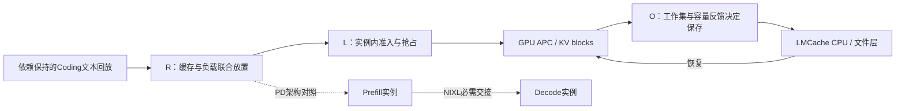

# 面试阅读路线

面试：2026年10月19日北京时间20:00。闭环交付按北京时间14:00截止，争取13:00。
实验最终数字以《20261019实验报告.md》与 outputs/summary/evidence.json 为准。

需要从头理解项目时，优先阅读新整理的[《20261019最终面试向理解文档》](./20261019最终面试向理解文档.md)。
其中包含完整项目描述、基础概念、Preble/EfficientAgent、逐层算法、手算例子、Mermaid、实验边界与面试问答。
本页作为简短阅读清单保留。

R/L/O是三种不同决策；PD是架构变量。框图不表示全部配置同时启用，
也不表示CPU与文件层可跨所有实例全局共享。每个对照的实际连接以manifest为准。

## 先用30分钟掌握主线

1. 用5分钟读《20261019项目描述.md》的四点贡献和使用边界。先记住三个问题：
   实例内先运行谁、跨实例放到哪里、哪些KV值得保存到CPU。它们分别对应L、R、O。
2. 用10分钟看报告开头和evidence.md，挑三个能够解释机制的结果。
   本地调度吞吐提高但TTFT可能变差；路由必须考虑工作量与批处理；CPU准入减少无效写入。
   三个百分比来自不同配置，不能相加，也不能包装成一个总提升。
3. 用10分钟读《20261019面试讲解提纲.md》的设计追问，重点理解状态一致性和实验反证。
4. 用5分钟自己口述一次：背景→基线问题→修改→正确性→A/B→局限。避免先背一串指标。

## 再用60分钟看代码

| 时间 | 入口 | 应能回答 |
|---|---|---|
| 15分钟 | vLLM原分支Scheduler/KVCacheManager的KV-aware改动 | Top-W为何限制开销；generation如何失效；抢占重算成本为何不同于剩余输入长度 |
| 15分钟 | experiments_20261019/policies.py、router.py | 为什么请求数不是工作量；真实输出如何更新剩余预算；FIFO槽位/KV预算近似哪些约束 |
| 15分钟 | lmcache_adapter.py、disk_adapter.py | CPU驻留与pin有何区别；请求决定何时冻结/清理；遥测过期如何恢复正常保存 |
| 10分钟 | correctness_suite.py、check_kv_transfer.py | 字节正确和模型概率正确各排除什么问题；为什么保留旧失败数据 |
| 5分钟 | pd_proxy.py、pd_fidelity.py | P返回什么元数据；四种P/D配对如何证明真传输；为什么要看D本地prefill计数 |

## 三个值得深入讲的故障

**打包KV布局错误。** vLLM Triton打包K/V与LMCache V2默认分离K/V，元素总量相同仍可能复制错位。
修复必须在CPU allocator捕获形状前初始化V3元数据。证据分两层：逐元素round-trip，
再对真实GPU驱逐→CPU恢复做next-token概率和长前缀事实检查。旧V2速度结果永久隔离。

**部分GPU前缀与host加载上限。** GPU已有32 tokens、host原本可加载2304 tokens，
上限2048并不意味着本轮新增2048：端点按256对齐后只有2016。适配修正返回值与实际LoadSpec一致，
只接受小于一个chunk的向下调整，其他不一致报错。模型门禁实际触发这一分支，并核对文件读取哈希。
这里不是伪造已计算token，也不是跳过断言。

**INT8的粒度边界。** 原block16/chunk256组合数值门禁失败，即使简单事实回答正确也不能放行。
对齐256/256后11项检查通过，只能说明这个版本和配置下的可用边界；尚不能据此证明原失败的全部根因，
也不能称所有INT8恢复都无损。GPU总token池保持8192，null block的保留粒度仍不同。

## 面试中最容易被追问的边界

- Preble提供缓存/负载共同优化思路，EfficientAgent启发工作集条件化保存。论文思想不是自己的原创。
  本项目的贡献是具体评分/队列近似、在线进度、状态生命周期适配、故障修复与可复核消融。
- Graph、AWQ、APC、NIXL、LMCache存取是已有能力。自己的策略必须在相同执行模式、容量与精度内比较。
- 本地吞吐提升主要由准入/复用解释；无抢占的对照不能拿来证明抢占算法有效。
- “Stored tokens少”不等于物理写带宽下降同样百分比；文件buffered read可能命中OS页缓存，不能当NAND性能。
- 公开轨迹是真实历史文本，但回放固定输出预算、模拟工具间隔、过滤超长输入；不运行工具，
  不评价SWE-bench修复成功率，也不是生产到达率测试。
- 三轮交错运行比单轮可靠，仍是小样本。给每轮值、范围和负结果，不称统计显著。
- 本机没有NVLink/P2P/RDMA，UCX配置允许host staging。PD是否划算必须与同GPU数完整副本比较。
- 默认预编译算子本机异常；native RMSNorm/Triton是经过验收的工作路径，绝对性能不代表健康默认配置。

## 口述模板

“我先发现命中率不能单独代表完成时间，所以把问题分成实例内排序、跨实例放置和分层缓存写入。
在路由层保留缓存优先/负载阈值基线，新增基于真实输出进度的剩余工作，以及受batch槽位和KV预算约束的排队近似；
在CPU层，根据会话工作集、真实驻留和容量淘汰选择性保存。之后用公开Coding轨迹和独立任务集做交错对照。
我也保留了不适用的场景：部分策略吞吐提高而尾延迟退化，PD和量化并非总能加速。
最有价值的工程问题是跨组件KV形状和加载边界：仅仅请求成功远远不足以证明缓存恢复正确。”

最后按最终项目描述填入两到三个数字。不能解释条件的数字，面试时先不主动讲。
