# vLLM KV-Aware Scheduling 面试向项目准备文档（0917）

> 目标：让没有系统读过代码的人，在 3～4 小时内形成一条能讲、能画、能经受追问的项目主线。
>
> 事实口径：以当前 `project/kv-aware-scheduling` 最终代码、P1～P8 阶段报告和最终 A/B 数据为准。文中会主动区分“最终结论”“机制证据”“负结果”和“未验证猜想”。

## 🧭 怎么使用这份文档

建议按下面顺序准备，不要一上来背代码行号。

| 时间 | 学习目标 | 对应章节 |
|---|---|---|
| 0～60 分钟 | 先看懂一次请求怎样排队、运行、被抢占和恢复 | 文档开头的“面试速成章” |
| 60～90 分钟 | 能说清项目为何存在、自己做了什么、结果是什么 | STAR、90 秒版本 |
| 90～180 分钟 | 逐条吃透四条简历描述和关键算法 | 四个“简历要点”章节 |
| 180～220 分钟 | 理解实验可信度、失败实验、结果边界 | 性能与归因、阶段演进 |
| 220～240 分钟 | 快速了解 PD 分离，背数字与高频问答 | PD 分离、追问、速记卡 |

面试时遵守三个原则：

1. 先讲问题和约束，再讲算法名。
2. 先讲可验证的最终结果，再讲机制解释。
3. 不把微基准收益冒充端到端收益，不把相关性冒充唯一因果。

## 🎯 面试速成章：先把整个故事看懂，再背策略名

这一章专门解决一个问题：看到 `recompute-aware`、`Top-W cache-affinity admission`、`aging`、`KV generation` 时，知道它们分别在系统的哪里、回答什么问题，以及为什么需要它们。

先不要背英文名。整个项目其实只围绕下面三个问题：

1. **等候区里有很多请求，下一个让谁进 GPU？**——这是 admission（准入）。
2. **显存里的 KV block 不够了，正在运行的请求里暂停谁？**——这是 preemption（抢占）。
3. **为了做前两个决定而查询了缓存状态，怎样保证查询结果既不贵、又不过期？**——这是 lazy feature（懒加载特征）与 KV generation（一致性版本号）。

你的三个主要答案分别是：

| 系统问题 | 你的主要答案 | 最朴素的中文 |
|---|---|---|
| waiting 中先接纳谁 | Top-W cache-affinity admission + aging | 只在队头附近小范围内，优先接纳“恢复请求”或“剩余输入计算更少”的请求；等太久的人不许继续被插队 |
| KV 不够时抢占谁 | recompute-aware preemption | 先守住用户优先级，再尽量暂停“丢掉的已完成计算较少”的请求，同时保护刚恢复过的请求不要反复受伤 |
| 查询到的 prefix 信息怎样安全复用 | generation-scoped lazy feature context | 只给真正参与比较的少量候选查缓存；只要 KV 状态可能变化，就把版本号加一并清空旧查询结果 |

### 三分钟前置知识：KV Cache、Paged KV 与 APC 各自做什么

大模型生成分成两段：

- **Prefill**：读取整段 prompt，计算每个 token 的 K/V；长 prompt 的这一步比较重。
- **Decode**：之后一次生成一个新 token，并反复读取之前 token 的 K/V。

如果每次 decode 都重新计算整个历史，成本会非常高，所以系统把历史 token 的 K/V 保存下来，这就是 **KV Cache**。

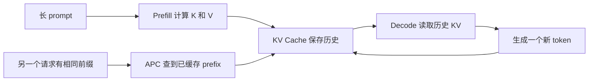

三个概念的分工如下：

| 概念 | 它解决什么 | 它没有解决什么 |
|---|---|---|
| KV Cache | 保存已经算过的 K/V，避免 decode 每步从头计算历史 | 显存容量仍有限 |
| Paged KV Cache | 把大块 KV 空间切成固定大小 blocks，按需分配、共享和回收，减少连续预留造成的浪费 | 不自动决定多个请求谁先运行、抢占谁 |
| Automatic Prefix Caching（APC） | 用 token block 的 hash 找到其他请求已经算过的相同前缀，复用这些 blocks，跳过重复 prefill | 只回答“某请求能命中什么”，不替 Scheduler 比较多个候选 |

这就是项目真正的矛盾：**底层已经会存、会共享、会查命中，但上层调度仍可能在错误的时机运行冷请求，或者抢占一个恢复代价很大的请求。**

为什么高并发时矛盾才明显：很多请求同时拥有长 prompt 和长输出，running 请求的 KV 会随 decode 持续增长；显存有限时，它们会竞争固定数量的物理 blocks。此时系统不仅要“找到缓存”，还必须不断决定谁进场、谁暂停、哪些旧缓存被覆盖。

在线服务又比离线批处理更难。离线任务通常提前知道整批请求，可以先按相同前缀分组；在线请求持续到达，Scheduler 只能看见此刻的 waiting/running 请求，还要对 TTFT、流式卡顿与公平性负责。因此你的策略只做有界 Top-W 重排，而不是把整个队列按 prefix 重新洗牌。

### 先看一条请求从出生到结束

假设用户发来一句很长的 prompt。它不会立刻独占 GPU 跑到底，而是在 vLLM 的连续批处理中经历很多轮 Scheduler 排班。

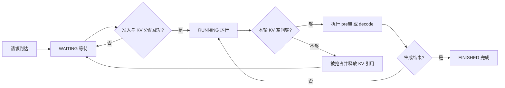

把图翻译成人话：

1. 请求先进入 `WAITING`，相当于在候诊区排队。
2. Scheduler 选择一个 waiting 请求，并成功为它分配 KV blocks，这一步叫 **admission（准入）**；它随后进入 `RUNNING`。
3. running 请求并不是一次运行到结束。每一轮可能做一段 prefill，也可能只 decode 一个或几个 token，然后下一轮重新排班。
4. 请求继续增长时还要申请新 KV block。如果申请失败，说明当前可用 KV 空间不足，Scheduler 必须从 running 请求里挑一个 **victim（牺牲者）**。
5. victim 被 **preempt（抢占）**：它暂时停止，释放自己持有的 KV 引用，`num_computed_tokens` 被重置，并回到 waiting。
6. 它以后再次被选中并分配成功，叫 **resumed admission（恢复准入）**。此时 APC 会复用还存在的完整 prefix blocks，缺失部分重新做 prefill，这就是 **recompute（恢复重算）**。

所以“恢复请求”不是另一种业务请求。它就是一个普通请求，只是以前已经运行过、又被抢占过，`num_preemptions > 0`。

### 一轮 schedule 到底在做什么

“一轮 schedule”不是“完整处理一个请求”，而是 CPU Scheduler 给下一次 GPU forward 排一张很短的值班表。顺序可以先记成两半：

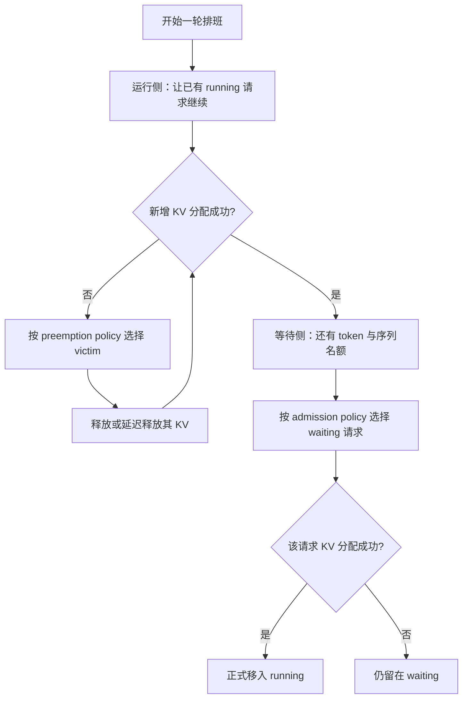

这里有两个完全不同的“选择”，一定不要混：

- **preemption policy** 回答：allocation 失败后，running 里抢占谁？
- **admission policy** 回答：还有资源时，waiting 里先尝试接纳谁？

`aging` 是 admission 内部的公平性刹车；`Top-W` 是 admission 最多查看多少人。二者都不是新的全局 Scheduler。

### 先认识最常用的十个词

| 名词 | 保姆级解释 | 面试时可以怎么说 |
|---|---|---|
| `waiting queue` | 等候区，新请求和被抢占请求都可能在里面 | 还没获得本轮 GPU 执行资格的请求队列 |
| `running` | 已经进场、目前由引擎持续服务的请求集合 | 可能正在 prefill，也可能正在 decode |
| `admission` | 从 waiting 选一个请求，KV 分配成功后让它进入 running | “准入”不是鉴权，而是调度上的进场 |
| `allocation` | 给某请求本轮新增 token 找 KV 物理 blocks | 选中候选不等于 allocation 一定成功 |
| `victim` | KV 不够时，被暂时请出 running 的请求 | 抢占对象 |
| `preemption` | 暂停 running 请求、释放它的 KV 引用、放回 waiting | 中文通常叫“抢占” |
| `resume` | 被抢占的请求后来又获得运行机会 | 恢复运行；重新进场叫 resumed admission |
| `recompute` | 恢复时，把 APC 没保住的上下文重新跑一遍 | 恢复重算，不是从头生成最终答案 |
| `eviction` | 从“无人占用但还保留内容”的缓存 block 中淘汰旧内容 | 中文叫“缓存淘汰”，不会直接暂停 running 请求 |
| `aging` | 等得越久，越不能继续被缓存更热的请求插队 | 防饥饿机制 |

特别注意 `preemption` 和 `eviction`：

| 比较 | Preemption 抢占 | Eviction 缓存淘汰 |
|---|---|---|
| 操作对象 | 正在运行的请求 | `ref_cnt=0`、无人当前占用但仍记着 prefix 的 cached block |
| 直接后果 | 请求暂停并回 waiting | block 中旧 prefix 身份被丢弃，物理块可改作他用 |
| 是否让用户请求停下来 | 会 | 不会直接让 running 请求停下 |
| 你的相关策略 | recompute-aware / reclaimable-aware | waiting-queue-aware / priority-aware retention 实验 |

### 原系统到底有哪些策略，你新增的策略属于哪一层

先看这张“配置地图”。`--scheduling-policy` 是 vLLM 已有的基础排队规则；其余几组是你为了实验显式抽出来或新增的可选策略，默认值都保持原行为。

| 决策层 | 配置参数 | 可选值 | 原来的默认行为 | 你的主线选择 |
|---|---|---|---|---|
| 基础排队 | `--scheduling-policy` | `fcfs` / `priority` | FCFS 按到达先后；priority 先看用户优先级，数值越小越重要 | 不改其硬语义，只在同优先级内优化 |
| 等待准入 | `--admission-policy` | `default` / `cache_affinity` | `default` 取基础队列最前面的可调度请求，不为重排提前查 prefix | Treatment 用 `cache_affinity` |
| 准入观察范围 | `--kv-aware-candidate-window` | 正整数 W | 原系统没有为 cache-affinity 扫描窗口 | 最终 `W=8`，只看同优先级队头附近最多 8 个 |
| 公平性保护 | `--kv-aware-aging-threshold-s` | 非负秒数 | 原基础队列自然按 arrival 排序；没有“缓存插队”也就不需要这个刹车 | 最终 10 秒；超过后恢复基础队列顺序 |
| 抢占与恢复 | `--preemption-policy` | `default` / `recompute_aware` / `reclaimable_aware` | 原 victim 行为和基础调度耦合：FCFS 通常抢 running 中最新者；priority 抢最低用户优先级者 | 最终用 `recompute_aware` |
| 空闲缓存淘汰 | `--prefix-cache-eviction-policy` | `lru` / `waiting_queue_aware` / `priority_aware` | LRU：优先淘汰最久未使用的 free cached block | 最终 A/B 仍用 LRU，避免混入 retention 变量 |

还有两个常见参数不属于上述“谁先、抢谁”的策略：

- `--enable-prefix-caching`：控制 APC 是否可用。它提供“这个请求能命中多少前缀”的事实，不替 Scheduler 决定先运行谁。
- `--num-gpu-blocks-override=1250`：控制实验中的 KV 容量，用来稳定复现资源竞争；它不是调度算法。

把简历里的三个词放回配置层级，就不会再混乱：

```text
recompute-aware 抢占
└─ 属于 preemption_policy：allocation 失败后从 running 里选 victim

Top-W cache-affinity admission
├─ 属于 admission_policy=cache_affinity：从 waiting 里选谁先尝试进场
└─ W 属于 kv_aware_candidate_window：最多比较多少个候选

aging 公平性机制
└─ 属于 cache-affinity admission 的防饿规则：等太久时停止按缓存插队
```

### 为什么会想到做这个：材料给线索，源码和压测把问题坐实

这个题目不是“先写了一个算法，再找场景证明它”。更可信的来源链是：**业务重复前缀 → 文献说明排队顺序影响复用 → vLLM 文档说明抢占恢复有重算代价 → 社区 RFC 指出 V1 admission 看不到 cache affinity → 源码审计与本机压测复现具体问题。**

| 材料 | 初学者只需要理解什么 | 它给你的启发，而不是直接给你的答案 |
|---|---|---|
| PagedAttention / vLLM | KV Cache 很占显存；分页能减少浪费并支持共享，但显存仍有限，压力大时仍需抢占[^pagedattention] | 内存管理做得更好，不等于 victim 选择已经考虑恢复成本 |
| SGLang / RadixAttention | 前缀不仅可以缓存，请求执行顺序也会影响缓存能否及时被复用；其运行时包含 cache-aware scheduling[^sglang] | waiting order 应该看 locality，但不能照搬 radix tree 到 vLLM block-hash APC |
| Preble | 真实 prompt 中有系统指令、工具说明、长文档等重复部分；分布式调度要同时考虑 KV reuse 与计算负载[^preble] | 纯 prefix-first 不是万能答案，还要顾负载、公平性和在线到达 |
| vLLM 官方 preemption 文档 | V1 默认用 recompute 恢复被抢占请求；重算会伤害端到端延迟[^vllm-preemption] | “抢占谁”不能只看队列位置，也应该关心丢失计算 |
| vLLM cache-affinity RFC #42185 | V1 的 priority + FCFS 会把有大量 cached prefix 的请求与零命中请求同样对待，并讨论 priority 边界与 anti-starvation[^cache-affinity-rfc] | 社区确认了 admission 的信号缺口，但你的实现仍需处理本分支的 allocation、deferred free 和可观测性 |

然后你做了两步自己的验证：

1. **读代码。** 当前基础 waiting order 主要由 FCFS/priority 决定；默认 victim 也不比较 `num_computed_tokens`。APC 在真正处理请求时能找 prefix，但没有自动把这个信息变成“同优先级内谁先准入”的排序信号。
2. **做压力诊断。** 早期 workload 中 prefix hit 已有 91.5%，却仍出现 135 次抢占和 1.345 秒 ITL P99。也就是说“缓存存在”与“恢复不卡顿”可以同时不成立，问题确实落在调度组合而非单纯有没有 APC。

这时问题才被拆成两个可以验证的假设：

- waiting 侧：只在一个小窗口内利用已有 prefix，能否减少本地上下文计算，同时不破坏 priority 与公平性？
- running 侧：KV 不足时优先抢占潜在重算损失较小的请求，能否减少恢复重算与流式停顿？

面试时可以这样讲“问题来源”：

> 我不是从一个生产事故反推项目，也不是先想了算法再造靶子。SGLang 和 Preble 让我看到共享前缀同时是缓存和调度问题，vLLM 官方文档又说明 V1 在 KV 不足时使用 recompute preemption；社区 RFC 进一步指出 priority/FCFS admission 看不到 cached-prefix 的差异。我随后读当前 V1 分支，确认 waiting 侧和 running victim 侧确实缺少这两个成本信号，再用 prefix-repetition 压测复现了“91.5% 命中但仍有 135 次抢占和明显尾部卡顿”。所以我的切入点是把已有 KV 状态安全地反馈给调度器，而不是重新发明 KV Cache。

### 策略一：recompute-aware 抢占，逐层决定抢谁

先理解触发条件：**只有 running 请求申请新增 KV 失败，才需要挑 victim。**它不是每轮都主动抢占，也不是 waiting 中来了一个热请求就随意踢走 running 请求。

基础策略有什么不足：

- FCFS 模式通常抢 running 列表中最新进入者；
- priority 模式先抢用户优先级最低者，若同级再偏向较晚到达者；
- 它们能保持队列语义，但同一优先级的两个请求中，不知道谁已经计算了 100 tokens、谁已经计算了 1000 tokens。

你的 `recompute_aware` 不是“从所有请求里直接找 `num_computed_tokens` 最小值”，而是四层规则：

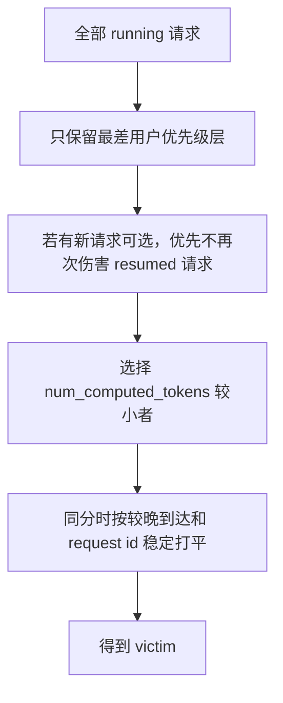

逐层解释：

1. **priority 是硬约束。**数值越大表示用户优先级越低；只从当前最差优先级层挑 victim，不能为了省一点重算去抢更重要的用户。
2. **保护 resumed request。**一个请求刚被抢占时 `num_computed_tokens` 会重置为 0。如果它一恢复就因为“0 最小”再次被抢，会形成 victim thrashing：同一用户反复暂停，流式输出长期卡住。因此在同级中有从未被抢占过的候选时，优先从这些 fresh request 里选 victim。
3. **再比较 `num_computed_tokens`。**它表示请求当前已经推进了多少 token。值越小，通常意味着把它打断后潜在丢失的计算越少。
4. **最后稳定打平。**相同成本时按到达时间与 request id 决定，避免选择随 running 列表偶然位置抖动。

看一个例子。三者用户优先级相同：

| running 请求 | 是否曾被抢占 | `num_computed_tokens` | 选择结果 |
|---|---:|---:|---|
| A | 否 | 1100 | 已做很多计算，不优先牺牲 |
| B | 否 | 300 | 在 fresh 候选中损失较小，选 B |
| C | 是 | 80 | 虽然数值更小，但先保护它，避免反复抢占 |

如果只有 A 和 C，策略仍可能抢 C；“保护”是同优先级内的排序偏好，不是永远禁止抢恢复请求。

为什么只说“重算成本近似”：`num_computed_tokens=800` 只说明请求曾推进到 800 token。它恢复时，APC 也许还能命中 560 token，于是真正重复计算约 240 token；也可能命中更少。它还是一个便宜且稳定的 proxy，但不等于精确 GPU 时间，也不等于释放该请求后能马上得到多少物理 block。

`recompute_aware` 还改了恢复顺序：同一用户优先级内，`num_preemptions>0` 的请求先于 fresh request 重新准入。于是它从两头减少反复受伤：

- **挑 victim 时**尽量不再次抢 resumed request；
- **回到 waiting 后**又让 resumed request 更早恢复。

一句话口播：

> recompute-aware 属于 preemption policy，只在 KV allocation 失败后决定 running 里抢谁。我先把用户 priority 当硬约束，再保护已经被抢占过的请求，随后用 num_computed_tokens 近似潜在重算损失，尽量选择损失较小的 victim；同时让被抢占请求在同优先级内优先恢复，避免 victim thrashing。

### 策略二：Top-W cache-affinity admission，逐层决定谁进场

`admission` 的对象是 waiting 请求，不是 running victim。基础 `default admission` 直接遵循基础队列顺序；它不会为了比较候选而提前逐个查询 APC prefix。

你的策略也不是扫描整个 waiting queue，而只取：

- 当前基础队头所属的同一用户优先级；
- 其中最靠前、状态允许调度的最多 W 个请求；
- 最终实验 `W=8`。

这叫 **bounded Top-W**。好处是用户 priority 不被跨越，CPU 工作量上界也是 O(W)，不会随着整条队列无限增长。

候选形成后，选择顺序如下：

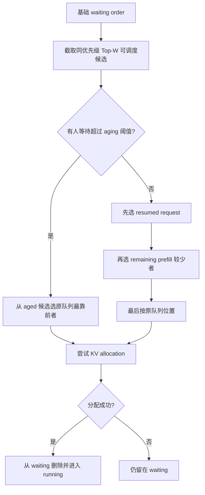

先把图里最容易卡住的两个词彻底拆开。

#### `resumed request`：不是新请求，而是“被系统打断后回来续跑”的请求

一个请求刚进入系统、还没有被抢占过时，叫 **fresh request（新请求）**。如果它已经运行了一段时间，却因为 KV 空间不足被选成 victim，Scheduler 会释放它占用的 KV blocks，把它放回 waiting queue；它下一次再次被准入时，就是 **resumed request（恢复请求）**。

```text
请求 R 第一次进入 running
→ 已经算到 600 token
→ 其他请求申请 KV 时空间不够
→ R 被选为 victim，KV 引用被释放，并回到 waiting
→ 之后 R 再次被选中进入 running
→ 这一次准入就是 resumed admission，R 就是 resumed request
```

代码里可用 `num_preemptions > 0` 判断它曾经被抢占过。这里的 resumed 只表示“它是回来续跑的”，**不表示旧 KV 一定还完整保留，也不表示它已经自动恢复完成**。被释放的 blocks 如果尚未被其他请求复用或淘汰，APC 仍可能重新命中其中一部分；具体能命中多少，要在当前 KV 状态下重新 peek。

为什么把 resumed request 放在 fresh request 前面？因为系统已经打断过它一次。如果每轮都让新来的热缓存请求插队，它可能反复“运行一点—被抢占—重算—再被抢占”，造成尾延迟和重复计算。resumed protection 可以理解为：**在同一用户优先级、且没有人触发 aging 时，先偿还被打断请求的服务债。**

#### `remaining prefill`：真正还要在 GPU 上补算多少上下文

`prefill` 是把一段上下文送过模型、建立 K/V 的计算。APC 命中的 prefix 已经有 KV，不必再算；没有命中的部分仍要计算。因此这里比较的不是“原始 prompt 谁更短”，而是：

```text
remaining prefill
= 请求当前需要建立 KV 的上下文 token 数
  - 当前已经计算或可从本地 APC 复用的 prefix token 数
```

在实现里可以近似记成：

```text
remaining_prefill = request.num_tokens - local_cached_tokens
```

- `request.num_tokens`：请求当前上下文的长度。对 fresh request，主要是 prompt；对 resumed request，还可能包括抢占前已经生成、现在需要恢复上下文的 token。
- `local_cached_tokens`：当前机器的 KV Cache 里已经可直接利用的连续前缀；正在运行且已有进度时，也可由当前已计算 token 数提供这个信息。
- `remaining_prefill` 越小，表示把它送回可继续 decode 的状态所需补算工作越少。

例如 X 的当前上下文有 900 token，本地可复用 700 个，那么它还要补算 `900 - 700 = 200` 个；Y 只有 500 token，但一个也不能复用，那么还要补算 500 个。虽然 Y 的原始上下文更短，X 反而更快达到可继续生成的状态。

例如三者同优先级、都没超过 aging：

| waiting 请求 | 身份 | 总输入 | 可复用/已计算 | 剩余 prefill | 结果 |
|---|---|---:|---:|---:|---|
| A（原队头） | fresh | 900 | 100 | 800 | 暂不选 |
| B | resumed | 900 | 300 | 600 | 先选 B，因为 resumed protection 高于剩余 prefill比较 |
| C | fresh | 900 | 800 | 100 | 若无 resumed 候选，会优先于 A |

这张表有一个看似反直觉的地方：C 只剩 100 token，B 还剩 600 token，策略仍先选 B。原因是排序不是把所有指标混成一个分数，而是**逐层打破平局**：

```text
第 1 层：有人达到 aging 阈值吗？有就先救等太久的人
第 2 层：否则先分 resumed 与 fresh，resumed 在前
第 3 层：只在同类请求之间比较 remaining prefill，越小越先
第 4 层：仍相同就回到原 waiting queue 位置
```

所以 Top-W cache-affinity 不是简单的“谁命中缓存最多谁先”，而是：**只在同优先级的小窗口里，先守公平性，再保护恢复请求，然后用剩余补算量选择更容易推进的请求。**

为什么“选中”后还不能立即从队列删除：prefix 热不代表一定有足够 block、token budget、encoder budget 或其他资源。只有 `allocate_slots()` 成功后才能正式 commit admission；失败就保留原请求，避免“策略比较了一下就把请求弄丢”。

### 策略三：aging 为什么不是可有可无

假设冷请求 A 在队头，但每轮后面都不断到来能命中大量 prefix 的热请求。如果永远按 cache affinity，A 可能一直被插队，这叫 **starvation（饥饿）**。

aging 的规则很简单：候选等待时间达到阈值后，停止让缓存收益压过等待时间，从这些超时候选里选择原队列位置最靠前者。最终实验使用 10 秒。

```text
未超时：resumed → remaining prefill 少 → 原队列位置
已超时：直接从超时候选中选原队列最靠前者
```

它不是“每等一秒给分数加一”的复杂算法，而是一道明确的安全阀。面试时不要说“aging 保证所有请求恰好 10 秒内完成”；它只保证 cache-affinity 到阈值后不再继续压过基础顺序，实际准入仍受 KV、token budget 等资源限制。

### KV 状态一致性：为什么不能把第一次查到的 prefix 永远记住

cache-affinity 要比较“候选能复用多少本地 KV”。这个数不是请求的永久属性，而是随物理 KV Cache 变化的瞬时结果。

例如 10:00 时请求 A 能命中 800 tokens；10:01 时某次 allocation 可能拿走并淘汰其中的 free cached blocks，或者其他请求 free 后又让一些 block 变得可共享。此时继续使用旧的“800”就可能排错顺序，严重时还会把已经无效的 block 视为可用。

最直接但昂贵的做法是每次比较都重新解析 prefix；最精细但复杂的做法是追踪每个 memo 依赖了哪些 block。你的折中是：

> 不追踪每个 block 的依赖图，只维护一个全局 KV 状态版本号。版本不变时允许复用查询结果；只要发生可能改变 KV 视图的操作，就推进版本并整体清空 memo。

#### generation 的真实实现

`SchedulingFeatureContext` 内部核心状态可以简化成：

```python
self._kv_generation = 0
self._local_prefix = {}  # request -> 本 generation 的 prefix 查询结果

def invalidate_kv_features():
    self._kv_generation += 1
    self._local_prefix.clear()
```

注意：字典 key 实际使用 `id(request)`，命中后还会再次检查保存的对象就是同一个 request，避免 Python 复用对象 id 时误命中。memo 中没有另外保存 generation，因为每次 generation 变化都会把整个字典清空。

看一个具体过程：

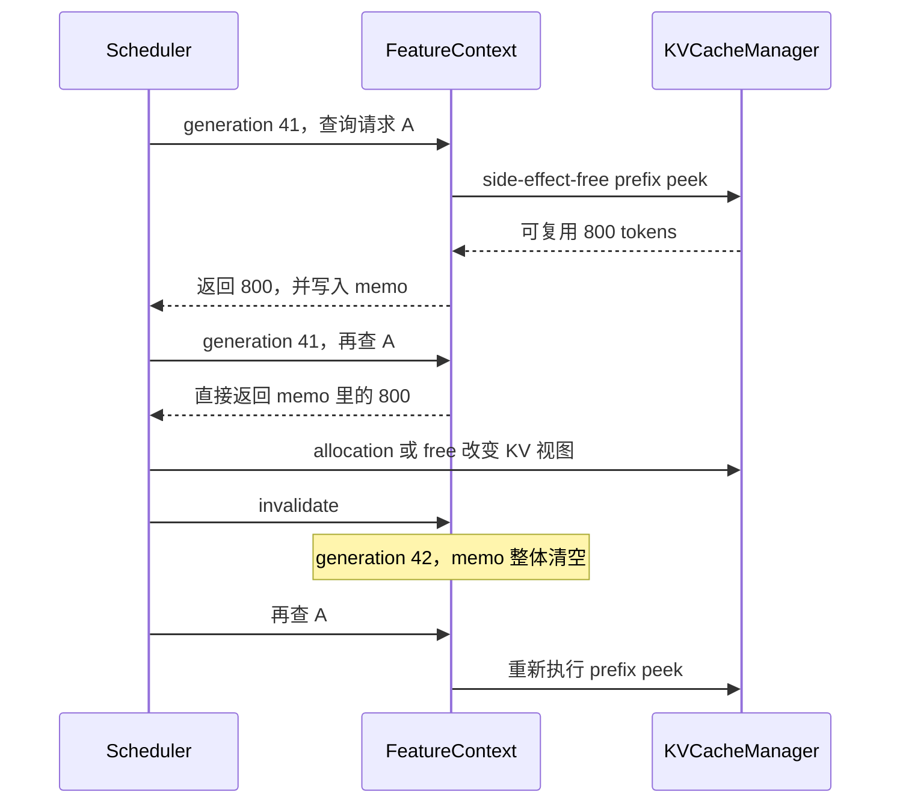

这叫 **generation-scoped memo**：查询结果的保质期就是“从现在到下一次 KV mutation 之前”。它是保守失效——某次 mutation 即使没有影响 A，也会清掉 A；最坏只是多查一次，但不会把旧状态当真。

#### lazy 到底懒在哪里

候选特征分两类：

| 特征 | 是否查询 KV Cache | 例子 |
|---|---|---|
| Cheap features | 否，直接读 Request 字段 | priority、arrival time、`num_preemptions`、`num_computed_tokens` |
| KV-derived features | 是，需要解析当前 APC/blocks | local cached tokens、matched blocks、shared prefix boundary |

Scheduler 先用 priority、状态、LoRA 限制等便宜条件，把范围限制为同优先级 Top-W；只有启用 cache-affinity 且确实进入比较的候选，才解析 local prefix。Top-W 外的请求这轮完全不查。

这就是“懒加载”：**不是请求一进队就预先维护全部缓存特征，而是策略此刻真的需要时才算。**

#### side-effect-free peek 是什么

`peek` 可以翻译成“只看库存，不下单”。为了给候选排序，Scheduler 只需要知道“如果选 A，它大约能命中多少 prefix”，此时不能把 A 当成已经正式准入。

side-effect-free 表示这次查询：

- 不增加 block ref count；
- 不修改 Request 的正式计算状态；
- 不记录一次正式 cache hit；
- 不发送 connector/缓存事件；
- 只返回用于比较的只读结果。

假如 Top-W 有 8 个候选，最终只会接纳 1 个。若比较时对 8 个请求都产生正式副作用，就会出现 7 次“假命中”、错误引用或事件污染。真正选中请求后，正式 admission 路径再使用同 generation 的预计算结果完成分配和记账。

#### 四种失效边界为什么都要覆盖

| KV 边界 | 到底变了什么 | 为什么旧 prefix 特征可能失效 |
|---|---|---|
| `allocation` 分配 | block 被某请求占有；拿 free cached block 时也可能淘汰旧内容 | 原来可命中的 prefix 可能被覆盖，可用空间与引用关系也变了 |
| `free` 释放 | 请求引用减少，某些 block 可能变为 `ref_cnt=0` 的 free cached block | 可回收性、可淘汰性与共享关系变化 |
| `eviction` 淘汰 | 物理 block 保存的旧 prefix 身份被删除或替换 | 旧 memo 记录的 matched block 已不再代表原内容 |
| `deferred free` 延迟释放 | 逻辑上已决定 free，但 GPU fence 完成前 block 仍不能复用；之后真正归还 block pool | “将来会空闲”与“现在能分配”不同，真正归还时必须再次失效 |

`deferred free` 最容易被追问。可以类比酒店退房：客人已经说要走，相当于逻辑 free；但保洁尚未完成、房间还不能给下一位，相当于 GPU 工作仍可能访问 block。只有 fence 完成并把 block 真正放回 pool，才算立即可用。

完整一致性链可以记成：

```text
Top-W 缩小候选
→ cheap features 先过滤
→ side-effect-free peek 只读查询
→ 同 generation 用 memo 避免重复查
→ allocation/free/eviction/deferred-free 改变视图
→ generation += 1 并清 memo
→ 下一次按新状态重查
```

一句话口播：

> cache-affinity 需要本地 prefix 特征，但它们会随 block 分配、释放、淘汰和 GPU fence 后的延迟释放而变化。我把 cheap request metadata 和昂贵 KV 特征分开，只对同优先级 Top-W 做无副作用 peek；查询结果只在当前 KV generation 内 memoize，一旦任何相关 KV mutation 发生就 generation 加一并整体清空。这个设计宁可保守多查一次，也不使用陈旧 block 状态。

### 简历第四条速成：两个 CUDA 算子优化到底做了什么

前面的调度策略决定“谁先算、抢谁”；算子优化解决的是“某一步 GPU 工作怎样执行得更轻”。这部分是项目补充，不要和端到端调度收益混在一起。

#### 1. 分页 KV Cache 写入：为什么能把 512 个线程降到 64 个

模型算出当前 token 的 K、V 后，`reshape_and_cache_flash` 要把它们写到 Paged KV Cache 指定的物理位置。Qwen 代表 shape 有 4 个 KV heads，每个 head 128 个 BF16/FP16 元素：

```text
标量元素数 = 4 × 128 = 512
每个 BF16/FP16 = 2 byte
一次 16-byte vector copy = 16 / 2 = 8 个元素
真正的向量任务数 = 512 / 8 = 64
```

旧 launcher 按 512 个“标量元素”配置线程，但 kernel 实际早已一次搬 8 个元素，于是约 64 个线程完成有效 vector work，其余线程很快退出。我的改动是在 dtype、布局和对齐等安全条件满足时，按 64 个向量任务配置线程；不满足就保留原路径。

```text
旧：512 threads → 64 个线程有有效向量任务，其余大多空转
新： 64 threads → 64 个线程分别完成一个 16-byte 向量任务
```

它不是少写了数据，也没有改模型结果；收益来自减少空转线程和每个 CTA 的资源占用。CUPTI 测得 Qwen 代表 shape、1024 tokens 时 kernel device time 从 `9.569 μs` 降到 `6.592 μs`，即 `1.452x`。**这表示该 kernel 快约 1.45 倍，不表示整个服务吞吐提升 45%。**

#### 2. RoPE 快路径：16-byte、alignment gate 和双并行分别是什么

RoPE 会根据 token 位置，用 `sin/cos` 对 Q、K 的成对维度做旋转。我的改动没有改变公式，而是让满足条件的数据一次成组搬运和计算：

- **16-byte 向量化：** BF16/FP16 每个元素 2 byte，所以一个线程一次处理 8 个半精度元素。这里不是 8 个 FP32。
- **alignment-gated：** 只有 Q、K、`sin/cos` 的 dtype、地址、stride、head size 和 rotary 形式都满足快路径契约时，才把内存解释成 16-byte 向量；任意条件不满足就回退原 scalar kernel。gate 既保证性能，也保证访问正确。
- **真实 fused-QKV layout：** QKV projection 常先生成一个合并 tensor，再切出 Q、K、V view。Q/K 不一定是人工测试里的整块连续 tensor，所以 gate 会检查真实 stride，而不是只优化理想输入。
- **双并行：** 进入向量快路径后，小 token 数用 head-parallel，把 Q/K heads 也展开来制造足够多 CTA；token 足够多时用 token-parallel，不再把 head 维重复展开，减少过大的 grid 和调度开销。

最容易说错的是：**4096 只决定选哪一种并行方式，不决定是否向量化。**

| 条件 | 是否 16-byte 向量化 | 并行方式 |
|---|---|---|
| gate 不满足 | 否，走原通用路径 | scalar fallback |
| gate 满足且 tokens < 4096 | 是 | head-parallel |
| gate 满足且 tokens ≥ 4096 | 是 | token-parallel |

为什么是 4096：它不是通用理论常数，而是当前 GPU 与 Qwen 代表 shape 上的实测交叉点。早期在 256 tokens 就切到 token-parallel，反而慢约 52%；继续检查 1024、2048、4096 后，直到约 4096，token 本身提供的 CTA 数才足以喂饱 GPU，两条路径的性能曲线才接近。

最终 `1.13x～1.84x` 同样是具体 Qwen shape 下的 RoPE kernel 微基准范围。其他 dtype、layout 或 rotary 变体仍然正确运行，只是通过 fallback 使用原通用实现。

一句话口播：

> 算子侧我做了两类受 gate 保护的专用化：KV 写入本来已经按 16 byte 搬运，我让 launcher 从按 512 个标量错误配线程改为按 64 个向量任务配线程，代表 shape 的 kernel 加速 1.45x；RoPE 则针对真实 fused-QKV stride 增加 16-byte 对齐快路径，小 token 展开 head 并行、大 token 使用 token 并行，不满足条件就 fallback，微基准加速 1.13x～1.84x。

### 把四条简历描述连成一段，而不是四个孤立名词

面试开场可以先讲下面这段 2 分钟版本，之后再根据追问展开：

> 我的项目研究的是 vLLM 在线高并发下，已有 KV Cache 怎样真正参与调度。请求一边在 waiting 排队，一边有 running 请求持续申请新的 KV blocks；所以我把问题拆成等待侧准入和运行侧抢占。运行侧 allocation 失败时，我增加 recompute-aware preemption：先守住用户 priority，再保护已经被抢占过的请求，最后用 num_computed_tokens 近似恢复重算成本，选择损失较小的 victim，并让 resumed request 在同优先级内优先恢复。等待侧我没有扫描全队列，而是在同优先级 Top-W 内做 cache-affinity admission，优先 resumed 或 remaining prefill 更少的请求；aging 超时后恢复基础队列顺序，避免冷请求饥饿。因为 prefix 命中是会随 allocation、free、eviction 和 deferred free 变化的动态状态，我又实现了 side-effect-free peek 与 generation-scoped lazy memo，只查真正参与比较的候选，KV 一变就整体失效。最终调度收益来自更少的恢复重算和本地上下文计算，而不是声称 APC 命中率本身一定上升。算子侧作为补充，我让分页 KV 写入的线程配置匹配 16-byte vector work，并为 Qwen 的真实 fused-QKV layout 增加带对齐 gate 的 RoPE 向量快路径；前者 1.45x、后者 1.13x～1.84x 都是 kernel 微基准，不是端到端服务加速比。

如果这段仍然容易卡壳，只记五句骨架：

1. **背景：** APC 会缓存，但它只回答“能复用什么”，不替 Scheduler 回答“谁先、抢谁”。
2. **运行侧：** KV 不够时，用 recompute-aware 降低 victim 的潜在重算损失并保护恢复请求。
3. **等待侧：** 只在同优先级 Top-W 内利用 cache affinity，用 aging 防止饥饿。
4. **工程侧：** 用 side-effect-free peek、lazy feature 和 generation 失效保证查询便宜且一致。
5. **算子侧：** 让线程数匹配真实 vector work，并用 alignment gate 为常见 Qwen RoPE layout 提供安全快路径；只报告 kernel 微基准。

## 📚 立项背景与实际项目边界

### 原立项书真正研究什么

孵化中心立项书的项目名称是《面向微架构的矩阵运算建模加速研究》。它属于东南大学与华为共建的鲲鹏昇腾科教创新孵化中心项目，原定主线是：

- 面向昇腾 NPU 和达芬奇架构建立微架构级矩阵计算仿真框架；
- 研究大矩阵乘法的多级分块、存储与计算协同、数据通路和并行度；
- 搜索符合硬件约束的 FP16 矩阵乘法分块方案；
- 预期交付矩阵计算仿真工具，而不是 vLLM Scheduler 改造。

立项书与本项目真正共享的是更上层的问题意识：**大模型性能不只取决于模型算法，还取决于存储层次、数据复用、并行映射和软硬件协同。**

### 我的实际项目与立项书是什么关系

本简历项目不是原立项书中“昇腾矩阵分块仿真工具”的直接实现，也没有在昇腾硬件上完成交付。更准确的定位是：

> 在东南大学—华为鲲鹏昇腾科教创新孵化中心的计算系统平台创新背景下，我独立选择了一个大模型推理系统方向的衍生课题：研究 vLLM 高并发服务中的 KV Cache、调度与数据路径优化。

两者的关系和边界如下：

| 维度 | 原立项书 | 我的实际项目 |
|---|---|---|
| 共同方向 | 大模型计算效率、存储计算协同、并行效率 | 同左 |
| 核心对象 | 昇腾 NPU 矩阵乘法和微架构仿真 | vLLM V1 Scheduler、Paged KV Cache、APC |
| 主要产出 | 矩阵分块寻优与仿真工具 | KV-aware 调度策略、指标体系和 CUDA 数据面实验 |
| 验证环境 | 立项目标为鲲鹏/昇腾 | 实际主要在 RTX 4090、Qwen2.5-7B 上验证 |
| 可以声称 | 依托孵化中心背景开展个人研究 | 独立完成代码、实验和分析 |
| 不能声称 | vLLM 项目就是原立项书内容 | 已为昇腾交付这套 CUDA 实现 |

简历里的推荐背景写法是：

> **项目背景：** 依托东南大学—华为鲲鹏昇腾科教创新孵化中心的计算系统平台创新研究背景，围绕大模型推理中的存储计算协同、缓存复用与并行效率，我独立选取 vLLM 高并发推理作为工程研究对象，针对共享前缀场景下的 KV Cache 竞争、抢占恢复重算和调度开销开展优化与验证。

如果没有华为正式实习、华为员工岗位或该 vLLM 项目的正式华为交付关系，不建议把标题写成类似雇主经历的“华为·ICT·计算产品线”。更准确、也更容易通过追问核验的标题是：

```text
东南大学—华为鲲鹏昇腾科教创新孵化中心｜个人研究项目
vLLM KV-Aware Scheduling：大模型推理调度与 KV Cache 优化｜独立开发
```

如果面试官追问“立项书和简历项目为什么不一样”，直接回答：

> 原立项书的正式方向是面向昇腾 NPU 的矩阵运算建模，我的 vLLM 工作不是它原定的矩阵仿真交付，而是我在同一计算系统创新背景下独立开展的推理系统子课题。两者都关心数据复用、存储计算协同和并行效率，但技术对象与验证平台不同，所以我在简历中使用“依托”和“独立开发”，不会把两者说成同一个项目。

这个口径比把 CUDA 工作硬说成昇腾成果更安全，也更经得住对立项书内容的核对。

## 🎤 先形成一条完整的 STAR 主线

### 90 秒版本

> 孵化中心原立项方向关注昇腾 NPU 上大模型计算的存储计算协同和并行效率；我在这个计算系统优化背景下，独立选择了 vLLM 在线推理作为实际研究对象。真实服务中，系统提示词、RAG 文档和多轮对话会产生大量共享前缀，而高并发、长上下文和有限显存又会带来排队与抢占。当前分支对 Qwen 这类受支持模型默认启用 APC，因此“已经存在可复用 KV，但调度是否真正利用这些状态”不是人为制造的问题。
>
> 我先用普通负载验证功能，再通过受控 KV budget 稳定复现资源竞争。早期 192 请求诊断中，APC prefix hit 已达 91.5%，却仍记录到 135 次抢占和 1.345 秒的 ITL P99：这说明问题不是“没有缓存”，而是高缓存命中与恢复卡顿可以同时存在。代码上，等待侧主要按 FCFS/priority 排队，运行侧默认 victim 选择也不比较恢复重算成本。于是我分阶段实现 recompute-aware 抢占、Top-W cache-affinity admission、aging 公平性和 generation 级懒失效。最终在 16 类共享前缀、1250 KV blocks 的成对反序 A/B 中，output throughput 提升 4.20%，总耗时下降 4.00%，TTFT P99 下降 2.24%，TPOT P99 下降 15.43%；归因实验支持主要收益来自更少的恢复重算和本地上下文计算。CUDA 算子优化是后续补充，不是项目主线。

### STAR 展开版

| STAR | 应该怎么讲 |
|---|---|
| Situation | 孵化中心课题关注大模型计算中的存储计算协同；我的实际切入点是 vLLM 在线服务。在共享系统提示词、RAG 文档和多轮对话中，APC 已保存大量可复用 KV，但显存压力下仍会出现排队、抢占和恢复卡顿。早期诊断出现“91.5% prefix hit 与 135 次抢占并存”的矛盾。 |
| Task | 找出高命中仍卡顿的调度原因，在不破坏用户优先级、默认语义和分配可行性的前提下，减少无效 prefill/recompute，并把 CPU 决策成本限制在可控范围；算子优化只作为数据面的补充。 |
| Action | 建压测与指标体系；实现 recompute-aware victim、Top-W cache-affinity admission、aging、公平性和 retention/reclaimable 实验；实现 side-effect-free prefix peek 与 generation-scoped memo；补齐 allocation/free/eviction/deferred-free/remote-KV 等失效边界；用 CUPTI 微基准优化 kernel launch 和 RoPE 向量化快路径。 |
| Result | 最终成对 A/B：吞吐 +4.20%、总耗时 -4.00%、TTFT P99 -2.24%、TPOT P99 -15.43%；resume recompute -5.52%、local context compute -3.37%；prefix resolver 调用 -7.94%，cache-affinity admission CPU 估算约占 serving wall time 0.41%；KV 写入 1.45x，RoPE 1.13x～1.84x。 |

### 这个问题是怎么发现的

不要回答“我先想了个 KV-aware 算法”。真正可信的发现过程是从业务负载、异常现象再追到代码原因。

#### 第一步：先问线上为什么会有重复前缀

大模型服务天然存在重复上下文：

- 同一应用的请求携带相同 system prompt；
- RAG 用户围绕同一份长文档提出不同问题；
- 多轮对话的前几轮历史完全相同；
- Agent 或代码助手重复携带工具说明、仓库规则和长上下文。

这些场景会产生大量完全相同的 prefix blocks。APC 可以让后来的请求直接复用其 KV，因此研究 APC 下的调度不是“为了策略专门造靶子”，而是从真实长上下文服务中已有的共享状态出发。

#### 第二步：普通负载没暴露问题，不代表问题不存在

单卡显存足够、并发较低或输出较短时，所有请求可能顺利获得 KV blocks，此时不会触发抢占，任何 victim 策略都近似 no-op。为了稳定研究“资源不够时调度器怎么选”，实验使用 `num_gpu_blocks_override=1250` 固定 KV budget。

它不是构造现实中不可能出现的状态。这个配置项本来就用于测试 preemption；它等价模拟了小显存卡、更长上下文、更高并发、较低 `gpu_memory_utilization`，或者同卡还有其他任务占用显存时的资源压力。它的作用是控制变量和稳定复现，不能据此声称所有线上负载都会得到相同收益。

#### 第三步：真正触发研究的是“命中很高，仍然卡顿”

早期可复现诊断 workload 为 48 并发、192 请求、8 类约 900-token 共享前缀和混合长输出。它同时出现：

| 早期诊断信号 | 观察值 | 暴露的矛盾 |
|---|---:|---|
| Prefix hit ratio | 91.5% | APC 确实在工作，不是没有缓存 |
| Scheduler preemptions | 135 次 | KV 压力下仍频繁打断运行请求 |
| ITL P99 | 1.345 s | 少数请求在恢复重算时出现明显流式卡顿 |
| Output throughput | 1705 tok/s | 系统总体仍在工作，问题集中于重复工作与尾部停顿 |

这些是发现问题的早期诊断数据，不是最终性能结论。关键启发是：**APC 命中率高，只证明缓存中存在可复用内容；它不证明调度顺序合理，也不证明抢占代价小。**

这里的早期 `ITL P99` 是压测脚本汇总的请求级尾部指标，不是所有 token 间隔的全局 P99；最终简历结论仍以之后的官方 `vllm bench serve` 成对 A/B 为准。

#### 第四步：沿代码路径找到两个具体卡点

1. **等待侧卡点：** waiting queue 主要按 FCFS 或用户 priority 取请求。APC 会在请求真正被处理时查询前缀，但默认 admission 不会因为候选已有更多本地 KV 就允许它在同优先级小窗口内提前。因此一个只剩少量 prefill 的热请求可能排在冷请求后面。
2. **运行侧卡点：** KV allocation 失败后必须抢占一个 running request。默认 FCFS 行为抢最新进入运行集的请求；priority 模式先看用户优先级，再按到达时间处理，但两者都不比较“这个请求已经计算了多少、恢复时可能重算多少”。同样释放一个请求，可能丢掉几十个 token，也可能丢掉上千个 token。

APC、等待准入和抢占恢复原本是三个分别正确的机制，组合在高压下却缺少统一的成本信号。这才是“缓存存在，但调度没有充分利用缓存价值”的具体含义。

#### 第五步：把现象变成可证伪假设

1. 抢占时，在相同用户优先级内优先牺牲恢复成本较低的请求。
2. 准入时，只在同优先级 Top-W 内偏向已恢复或剩余 prefill 更少的请求。
3. 用 aging 限制请求被越过的时间，不能拿吞吐换永久饥饿。
4. prefix 特征必须懒解析并随 KV generation 失效，否则 CPU 开销和陈旧状态会抵消收益。
5. 用 resume recompute、local context compute 和 activation counters 验证机制，而不是只看 APC hit 或抢占次数。


### 这个问题的来源：不是凭空发明，也不是线上事故

最稳妥的口径是：**这是一个文献和社区已经确认的问题方向，我通过 vLLM V1 源码审计与本机压测，定位了它在当前实现中的具体落点。**不要编造成“我在华为生产集群上发现了故障”，本项目没有这样的生产数据。

来源链可以分成四步：

1. **业务现象**：system prompt、RAG 长文档、多轮对话和 Agent 工具说明会让不同请求共享长前缀。
2. **论文依据**：已有工作已经证明，缓存能否复用不只取决于“有没有缓存”，还取决于请求调度顺序。
3. **vLLM 具体缺口**：APC 能查到已有前缀，但当前 V1 waiting admission 仍主要遵循 priority/FCFS；KV 不足时采用 recompute preemption，恢复会产生重复计算。
4. **我的验证**：用官方 `prefix_repetition` workload 建压，观察到 91.5% prefix hit 与 135 次抢占、ITL 尾部卡顿同时存在，再沿源码把问题拆成 waiting admission 和 running victim 两个决策点。

#### 哪些论文或资料直接提到了相近问题

| 来源 | 原文解决的问题 | 与本项目的关系 |
|---|---|---|
| PagedAttention / vLLM | KV Cache 是吞吐瓶颈；用分页、共享和抢占调度提高内存利用率[^pagedattention] | 提供 Paged KV、refcount、allocation 和 preemption 的系统基础，不等于已经实现 KV-aware 排序 |
| SGLang / RadixAttention | waiting order 会影响 cache hit；优先运行 matched prefix 更长的请求，在线场景允许有限重排[^sglang] | 直接支持 cache-affinity admission 的上层动机，但它基于 radix tree，不是 vLLM 的 block-hash APC |
| Preble | 长 prompt 在请求间重复；FCFS 忽略共享会增加重复计算，而纯 prefix-first 又可能造成饥饿，因此需要同时考虑 locality、负载和公平性[^preble] | 与“缓存价值 + remaining prefill + aging”最接近，但 Preble 主线是多 GPU routing 和层次化调度 |
| vLLM 官方文档 | KV 空间不足时 V1 会抢占请求；默认恢复方式是 recompute，并明确说明它可能损害端到端延迟[^vllm-preemption] | 证明抢占恢复成本是 vLLM 官方承认的实际开销，不是为了实验人为定义的成本 |
| CacheOPT | KV 竞争会恶化尾部 TTFT/TBT；victim 选择和 swap/recompute 方式应考虑抢占时间[^cacheopt] | 直接支持“不同 victim 的抢占代价不同”，但本项目只用 `num_computed_tokens` 做轻量 proxy |

还有一个更直接的社区证据：vLLM 的 **Cache-affinity-aware request ordering RFC #42185** 明确写到，V1 以 priority + FCFS 准入时，“已有数千 cached prefix tokens 的请求”和“零命中的请求”会被同等对待，并讨论 cache-affinity、priority 边界和 anti-starvation。该 RFC 于 2026 年 5 月提出，后来以 `not planned` 关闭，所以它只能证明社区看到了这个缺口，不能说该方案已经成为 vLLM 官方功能。[^cache-affinity-rfc]

#### 那我的工作还剩下什么

上层问题有先例并不等于你的实现没有价值。面试时应主动划清边界：

- **不是首创 cache-aware scheduling**：SGLang、Preble 已经提出过这类思想。
- **不是照搬完整论文系统**：没有实现 radix tree、多 GPU E2 routing、MLFQ 或 CPU KV offload。
- **你的工作对象更窄**：在 vLLM V1 单卡、block-hash APC 和既有 priority 语义内寻找最小改动点。
- **你的具体工程设计**：只检查同优先级 Top-W，用 aging 防饥饿；分配成功后才提交 reorder；优先保护 resumed request；用 generation-scoped memo、side-effect-free peek 和完整失效边界控制状态正确性与 CPU 成本。
- **你的实证工作**：不是只展示吞吐数字，还记录 activation counters、resume recompute、local context compute、反事实 victim 选择和失败配置。

如果面试官问“是不是照搬 vLLM RFC”，可以回答：

> RFC 和我的项目指向同一个社区缺口，它是我确认选题有现实意义的依据之一，但我没有把 RFC 代码复制进来。RFC 讨论的是 scheduler plugin 和 waiting queue 排序；我在冻结的 V1 分支里重新审计 allocation、preemption、APC 查询和 deferred-free 状态机，最终采用同优先级 Top-W、allocation-success commit、resumed protection 与 generation-scoped lazy features，并另外完成 recompute-aware victim 和机制归因。所以上层思想有前人依据，具体实现与实验结论是我在这个版本上完成的。

#### 推荐的“问题来源”口播

> 这个题目不是来自生产事故，也不是我先拍脑袋设计了算法。选题时我看到 SGLang 和 Preble 已经证明共享前缀不仅是缓存问题，也是调度问题；vLLM 自己的文档又明确说明显存不足会触发 recompute preemption，社区 RFC 也指出 V1 的 priority/FCFS waiting order 看不到 cached-prefix 价值。我随后审计当前分支源码，并用官方 prefix-repetition workload 做可控复现，发现 prefix hit 很高时抢占和流式尾延迟仍然存在。于是我把问题缩小成两个可验证的问题：等待侧能否在不破坏 priority 和公平性的前提下利用本地 KV，运行侧能否避免抢占恢复成本过高的请求。我的贡献不是首创这个研究方向，而是把它在 vLLM V1 的 block-hash APC、状态失效和 deferred-free 边界内做成可运行、可回退、可观测的实现。

### “16 类共享前缀”到底是什么

先拆开这个短语：

- **共享前缀**：多条请求开头有一段完全相同的 token。例如同一份 system prompt、同一篇 RAG 文档或相同的历史对话。
- **一类前缀**：共享同一段开头的一组请求。不同类之间的前缀内容不同。
- **16 类**：压测一共生成 16 段彼此不同的公共前缀，并把请求分成 16 组；不是一个请求有 16 个前缀，也不是 16 个 KV block。

可以把它类比成“用户围绕 16 篇不同的长文档提问”：

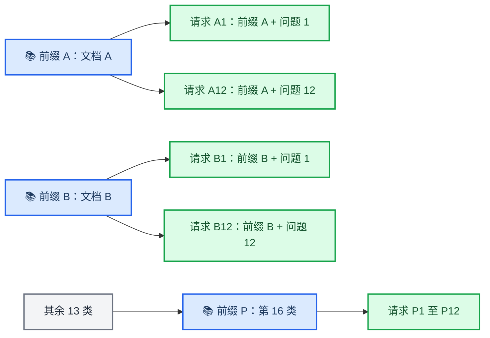

最终实验使用 vLLM 官方 `prefix_repetition` 数据生成器，具体构成是：

| 配置 | 数值 | 初学者理解 |
|---|---:|---|
| 公共前缀种类 | 16 | 模拟 16 份不同文档或 16 套 system prompt |
| 每段公共前缀 | 900 tokens | 同组请求完全相同、可被 APC 复用的长开头 |
| 每个请求的后缀 | 64 tokens | 模拟针对同一上下文提出的不同问题 |
| 正式请求数 | 192 | 每类正好 `192 / 16 = 12` 条，生成后整体打乱 |
| 最大并发 | 48 | 同时最多有 48 条请求处于客户端并发窗口 |
| 每条输出 | 1024 tokens | 制造足够长的 decode 和持续 KV 占用 |

这里的 token 是随机生成的，所以它是**可控的共享前缀压力模型**，不是自然语言 RAG 数据集。这样做的好处是每轮的长度、复用结构和输出工作量一致，便于只比较调度策略；局限是不能把结果直接外推到所有真实业务语义和到达分布。

为什么从 8 类又做到 16 类？8 类时每个前缀平均被复用得更频繁，可能对 cache-affinity 特别有利。把种类增加到 16，相当于把相同前缀的请求“摊薄”，检验策略是否只在极高重复率下才有效。结果表明，在同一 RTX 4090、Qwen2.5-7B、1250-block 条件下，8 类和 16 类都得到正向吞吐结果；但这只是一项 **prefix diversity 检查**，不是跨模型、跨显存预算的完整泛化证明。

> **面试一句话：** 16 类共享前缀是 16 个不同的 900-token 前缀池，192 个正式请求每池 12 条，每条再拼接独立的 64-token 后缀并整体打乱；它模拟多份文档或多套 system prompt 被并发复用，用于降低单一前缀的复用密度并检查策略是否仍能生效。

### 在线服务和离线推理有什么不同

二者不一定使用两套完全不同的 vLLM 内核。vLLM 的在线 API 服务和离线 `LLM.generate()` 都可以使用同一套模型执行、Paged KV Cache 和 Scheduler。真正的区别主要是：**请求什么时候出现，以及系统必须对用户保证什么。**

| 维度 | 离线批处理 | 在线服务 |
|---|---|---|
| 请求到达 | 通常开始前已拿到整批数据 | 用户请求持续、不可预测地到达 |
| 调度视野 | 可以看到整批任务，容易预先分组 | 只能根据当前 waiting/running 请求逐轮决策 |
| 返回方式 | 常在整批或单条完成后收集结果 | 常通过 API 逐 token 流式返回 |
| 主要目标 | 总吞吐、总完成时间和单位成本 | 吞吐之外还要控制 TTFT、TPOT/ITL、尾延迟和 SLO |
| 公平性 | 可以提前排序，单条等待通常不直接面对用户 | 不能让冷请求为了缓存局部性一直被热请求插队 |
| 资源变化 | 批次较稳定，较容易提前规划 | 并发和序列长度动态变化，更容易出现排队与抢占 |
| APC 价值 | 复用同一批数据中的重复前缀 | 复用先前或当前请求留下的公共上下文 |

用本实验举例：如果是离线任务，192 条请求一开始就全部已知，最直接的办法甚至可以先按 16 个前缀分组再运行。但在线服务不能预知下一位用户会问哪篇文档，也不能为了等同类请求而无限期扣住当前请求。Scheduler 只能在每一轮从已经到达的请求中做有限重排，所以本项目才使用 **Top-W** 限制观察范围，并用 **aging** 保证等待过久的请求最终优先。

本项目的最终测试属于**在线服务形态的受控压测**：先启动 OpenAI-compatible server，再由 `vllm bench serve` 并发发送请求并统计 TTFT、TPOT、ITL 和 throughput。它比单纯调用离线 `LLM.generate()` 更贴合 admission、流式延迟和公平性问题；但它仍是固定构成的合成 workload，不等同于生产环境的全天流量回放。

> **面试一句话：** 离线推理通常提前知道整批请求，重点是整批跑得快；在线服务面对持续到达的未知请求，除了吞吐，还必须兼顾首 token、流式卡顿、尾延迟和公平性。我的策略解决的是后者：在当前队列的一个小窗口里利用 KV locality，而不是预先把全量数据按前缀分组。

### 一句话创新点

> 不是重做 KV Cache，而是在 vLLM 已有 Paged KV Cache/APC 之上，把“缓存价值、恢复成本和公平性”变成可控、可失效、可观测的调度信号。

## 🧱 必须先懂的 vLLM 基础

### 一次生成为什么分 prefill 和 decode

设 prompt 长度为 `L`，输出长度为 `T`：

- **Prefill**：一次处理 prompt，计算量随 `L` 较大，通常更偏 compute-bound；为每层每个 token 生成 K/V。
- **Decode**：每步生成一个 token，但要读取历史 K/V，反复执行 `T` 次，通常更偏 memory-bandwidth/latency-bound。
- **KV Cache**：缓存历史 token 的 Key/Value，让 decode 不必每步重新计算完整上下文。

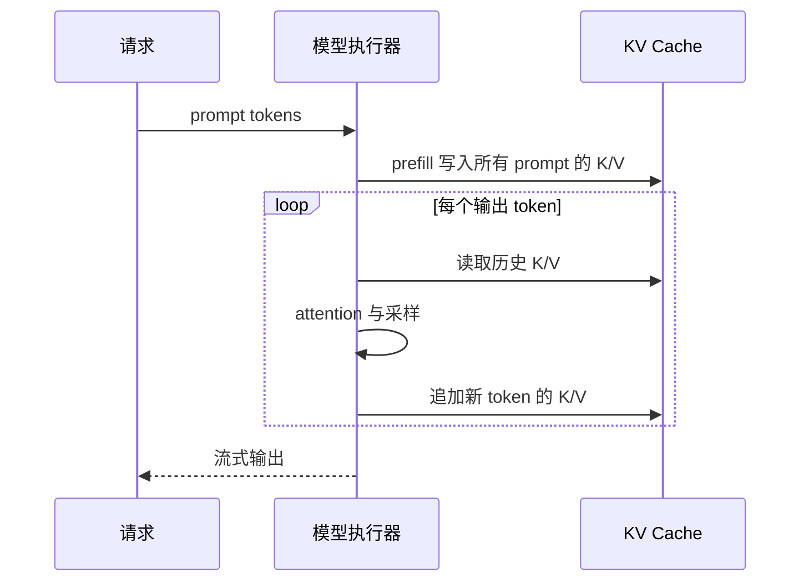

### Paged KV Cache 是什么

连续为每个请求预留最大长度会造成大量空洞。Paged KV Cache 把 KV 空间切成固定大小的 block，通过逻辑 block 到物理 block 的映射按需分配，思想类似虚拟内存分页。

本项目实验中 block size 为 16 token，1250 blocks 可理解为约 20,000 个逻辑 token 槽位。注意这只是该 KV group 下的 token 容量口径，不等于“1250 个字节块”。

它带来三件关键事情：

- **按需分配**：请求增长时逐块拿空间。
- **共享**：相同完整 prefix block 可以由多个请求引用。
- **可淘汰**：ref count 为 0 的 cached block 可从 free queue 中被复用。

### APC 是不是默认开启，为什么在 APC 下研究

先给版本相关的准确答案：**在本项目所基于的当前 vLLM V1 分支中，对支持 prefix caching 的普通生成模型，APC 会默认开启。**代码链路是：

```text
EngineArgs.enable_prefix_caching 默认是 None
        ↓
初始化时读取 model_config.is_prefix_caching_supported
        ↓
Qwen2.5-7B-Instruct 等受支持生成模型解析为 True
        ↓
CacheConfig.enable_prefix_caching = True
```

不是所有模型和平台都一定开启。例如不支持 prefix caching 的模型、部分 pooling/attention-free 场景、纯多模态 encoder 实例和某些平台会禁用；旧版本 vLLM 也曾要求用户显式打开。因此面试时不要脱离版本说“vLLM 永远默认开启 APC”。

本实验仍显式传入 `--enable-prefix-caching`，不是为了人为制造一个原本不存在的场景，而是为了：

- 固定实验条件，避免不同版本的默认值变化；
- 确认 Control 和 Treatment 都在同样的 APC 环境下运行；
- 研究共享 system prompt、RAG 文档和多轮历史这类真实重复前缀负载；
- 让实验只比较调度策略，不把“APC 开关不同”混进结果。

为什么不在关闭 APC 的环境中研究 cache affinity：关闭 APC 后，等待请求没有可复用的本地 prefix blocks，“谁的缓存更热”这个信号不存在，cache-affinity admission 自然退化为普通排队。recompute-aware 抢占仍可能减少已完成计算损失，但项目最核心的“缓存状态如何反馈给调度”必须在 APC 存在时才有研究对象。

因此正确逻辑不是“我先设计了 cache-affinity，所以专门开启 APC 配合它”，而是：

> 当前 vLLM 和真实长上下文负载已经产生了可复用 KV 状态；我观察到 APC 只负责识别和复用前缀，并不负责在多个竞争请求之间安排顺序，于是研究如何让 Scheduler 安全、有限度地使用这些已有状态。

### APC 是什么，为什么 APC 不等于 KV-aware scheduling

Automatic Prefix Caching（APC）对完整 token block 做 hash。新请求到来时，若最长前缀的 hash 已在缓存中，就复用对应物理 block，跳过那段 prefill。

APC 解决的是：**“这个请求有哪些前缀已经算过？”**

本项目解决的是：**“多个请求竞争计算与 KV 空间时，谁先运行、谁被抢占、哪些缓存更值得保留？”**

因此即使 APC 命中率很高，也可能出现：

- 热请求排在冷请求后面，已有 KV 暂时用不上；
- 刚恢复的请求再次被抢占，形成 victim thrashing；
- 为了读所有候选的 KV 状态，调度器 CPU 成本过高；
- 物理 block 被共享，逻辑上 free 一个请求却未必立刻释放空间。

### 请求的关键状态

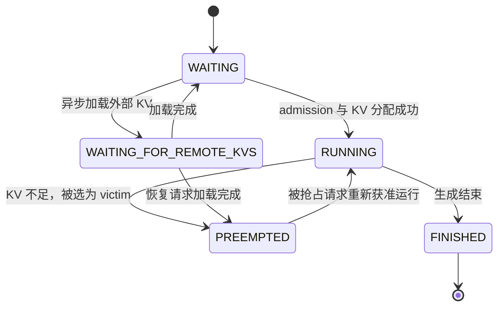

图中的主流程如下：

1. 新请求先进入 `WAITING`，等待 Scheduler 选择。
2. Scheduler 选中请求且 KV block 分配成功，这次从等待到运行的过程叫 **admission（准入）**，请求进入 `RUNNING`。
3. 请求在每个调度步继续 prefill 或 decode，同时为新增 token 申请 KV block。
4. 如果 KV 不足，Scheduler 从 `RUNNING` 请求中选择一个 victim。victim 不会失败或结束，而是释放自己持有的 KV 引用、把 `num_computed_tokens` 重置为 0，并以 `PREEMPTED` 状态回到 waiting queue。
5. 之后 Scheduler 再次选中这个被抢占的请求，且重新分配 KV 成功，就叫 **resumed admission（恢复准入）**，也就是“被抢占请求重新获准运行”。
6. 恢复时先查询 APC：仍然存在的完整 prefix blocks 可以直接复用；已经被淘汰或不满足共享条件的部分重新执行 prefill，这就是 **recompute（恢复重算）**。
7. 请求完成全部输出后进入 `FINISHED`。`WAITING_FOR_REMOTE_KVS` 是 PD 分离或外部 KV Connector 使用的支路，表示本地 block 已准备，但还在等待远端 KV 数据到达。

`num_computed_tokens`、实际重算量和可回收 block 数是三个不同概念。假设 block size 为 16，一个请求被抢占前已经计算 800 tokens：

```text
被抢占前：num_computed_tokens = 800
折算逻辑上下文：约 800 / 16 = 50 blocks

其中 30 个物理 blocks 仍被其他请求共享
只有 20 个 blocks 是该请求独占
因此释放该请求后，最多只有约 20 个物理 blocks 能变成可用空间

请求稍后恢复时，假设 APC 仍能命中 560 tokens
实际需要恢复重算：约 800 - 560 = 240 tokens
```

因此：

- `num_computed_tokens = 800` 表示“这个请求已经推进到了哪里”，可作为被抢占后潜在计算损失的低成本近似；
- `240 tokens` 才是这个例子中恢复时真正重复执行的计算量，取决于恢复时还能命中多少 APC；
- `20 blocks` 是释放请求所有权后可能回收的物理空间，取决于 block 共享、ref count 和 deferred free；
- 三者相关，但不能相互直接换算。项目的 recompute-aware 策略主要优化第一项，reclaimable-aware 实验则尝试优化第三项。

### 四个容易混淆的指标

| 指标 | 含义 | 更受什么影响 |
|---|---|---|
| TTFT | 请求到第一个 token 的时间 | 排队、prefill、cache hit、batching |
| TPOT | 首 token 后，平均每个输出 token 的时间 | decode 效率、batch 形态、engine steps |
| ITL | 相邻流式 token 的间隔分布 | 调度抖动、抢占、单步延迟 |
| Throughput | 单位时间完成的 output tokens | 重复计算、GPU 利用率、总执行步数 |

TPOT 和 ITL 相关但不相同：TPOT 常是请求级平均，ITL 是逐 token 间隔分布。因此最终实验中 TPOT P99 下降，但 ITL P99 仍可能上升 4.21%，不能说“所有尾延迟都改善”。

## 🗺 系统全景与代码地图

### 改动放在什么位置

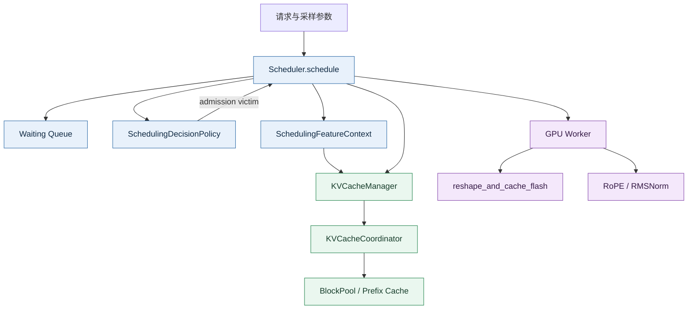

### 最值得记住的源码入口

| 文件 | 面试时一句话说明 |
|---|---|
| [`vllm/v1/core/sched/scheduler.py`](../vllm/v1/core/sched/scheduler.py) | 主调度循环；把等待准入、KV 分配、抢占、状态失效和指标串起来。 |
| [`vllm/v1/core/sched/policy.py`](../vllm/v1/core/sched/policy.py) | 纯只读决策层；默认、recompute-aware、reclaimable-aware 与 cache-affinity。 |
| [`vllm/v1/core/sched/feature_context.py`](../vllm/v1/core/sched/feature_context.py) | cheap features 与 generation-scoped prefix memo。 |
| [`vllm/v1/core/sched/request_queue.py`](../vllm/v1/core/sched/request_queue.py) | FCFS/priority 队列的 Top-W 查看和 O(log N) 任意删除。 |
| [`vllm/v1/core/kv_cache_manager.py`](../vllm/v1/core/kv_cache_manager.py) | 无副作用 prefix peek、真正分配、短缺量和可回收量估算。 |
| [`vllm/v1/core/kv_cache_utils.py`](../vllm/v1/core/kv_cache_utils.py) | retention tier 和 tier-aware LRU。 |
| [`vllm/v1/core/block_pool.py`](../vllm/v1/core/block_pool.py) | 物理 block 分配、free queue、淘汰。 |
| [`vllm/config/scheduler.py`](../vllm/config/scheduler.py) | 策略开关、Top-W 与 aging 配置。 |
| [`csrc/libtorch_stable/cache_kernels.cu`](../csrc/libtorch_stable/cache_kernels.cu) | 分页 KV 写入 kernel 与 launch configuration。 |
| [`csrc/libtorch_stable/pos_encoding_kernels.cu`](../csrc/libtorch_stable/pos_encoding_kernels.cu) | RoPE 16-byte 向量化双并行快路径。 |

策略全部是 opt-in，CLI 与配置一一对应：

| CLI | 关键取值 | 默认值/最终实验 |
|---|---|---|
| `--preemption-policy` | `default` / `recompute_aware` / `reclaimable_aware` | 默认 `default`；最终实验用 recompute-aware |
| `--prefix-cache-eviction-policy` | `lru` / `waiting_queue_aware` / `priority_aware` | 默认与最终实验均用 `lru`，避免混入 retention 变量 |
| `--admission-policy` | `default` / `cache_affinity` | Treatment 用 cache-affinity |
| `--kv-aware-candidate-window` | 正整数 | 代码默认 8；最终实验为 8 |
| `--kv-aware-aging-threshold-s` | 非负秒数 | 代码默认 30；最终实验经 sweep 选 10 |

这里要区分“代码默认值”和“最终实验值”：项目没有悄悄改变 vLLM 默认调度行为。

### 一轮 schedule 的关键调用链

先明确“一轮 schedule”是什么：它不是完成一个请求，而是 Scheduler 在 CPU 上做的一次排班。它决定本轮让哪些已有请求继续计算、是否接纳新请求，以及每个请求计算多少 token。GPU 执行完这一批后，下一轮再重新决策。

#### 先认识名词

| 名词 | 初学者解释 |
|---|---|
| `waiting queue` | 等候区。新请求和被抢占的请求都在这里排队，还没有占用本轮 GPU 计算名额。 |
| `running` | 正在服务的请求集合。它们可能正在 prefill，也可能正在逐 token decode。 |
| `admission` | 准入。把一个 waiting 请求变成 running 请求。 |
| `candidate` | 候选请求。Scheduler 本轮可能从这些请求中选择一个准入。 |
| `Top-W` | 只查看队头附近最多 W 个候选；最终实验 `W=8`，避免扫描整个等待队列。 |
| `priority` | 用户优先级。数值越小越优先；KV-aware 策略不能让低优先级跨过高优先级。 |
| `arrival time` | 请求到达时间，用于 FCFS、等待时长和稳定 tie-break。 |
| `preemption count` | 请求以前被抢占过多少次；大于 0 表示它是 resumed request。 |
| `cheap features` | 不查询 KV Cache 就能直接读取的便宜信息，如优先级、到达时间、已计算 token 数和抢占次数。 |
| `LoRA constraint` | 一个 batch 能同时激活的 LoRA adapter 数量有限；某候选会超出限制时，本轮先跳过它。普通单模型、无 LoRA 面试场景可以先忽略。 |
| `cache-affinity` | 缓存亲和准入。在同优先级 Top-W 内，偏向已恢复请求和剩余 prefill 更少的请求。 |
| `local prefix` | 当前 GPU 的 APC 中，与请求开头连续匹配的 KV 前缀。 |
| `peek` | 只查看结果，不正式占有或修改它，类似“看一眼库存”。 |
| `side-effect-free` | 这次 peek 不改 ref count、不记正式 cache hit、不发事件，也不修改 Request。 |
| `KV allocation` | 从 Paged KV Cache 中给请求分配本轮需要的物理 blocks。 |
| `admitted_reordered` | 被成功准入的不是原队头，而是 Top-W 中靠后的请求；只有分配成功才计数。 |
| `victim` | KV 不足时被暂停、用来释放资源的 running 请求。 |
| `free` | 取消该请求对 KV blocks 的占有引用；共享或被 GPU 使用中的 block 不一定立刻变成空闲。 |
| `GPU fence` | “此前提交的 GPU 工作已经结束”的完成标记。fence 未完成时，相关 block 仍可能被 GPU 访问，不能立即复用。 |
| `deferred free` | 逻辑上决定释放，但为了等待 GPU fence，把真正释放推迟到之后。 |
| `KV view` | Scheduler 当前看到的 KV 状态：哪些 prefix 存在、哪些 blocks 被占用、哪些可以分配。 |
| `memo` | 在同一 KV generation 内临时记住 prefix 查询结果，避免对同一请求重复查 APC；不是模型的 KV Cache。 |
| `kv_generation` | KV 状态版本号。allocation、free、eviction 等可能改变 KV view 时版本加一，并丢弃旧 memo。 |

#### 正确的执行顺序

真实顺序要拆成两段：先照顾已经在运行的请求，再尝试从等待队列接纳新请求。

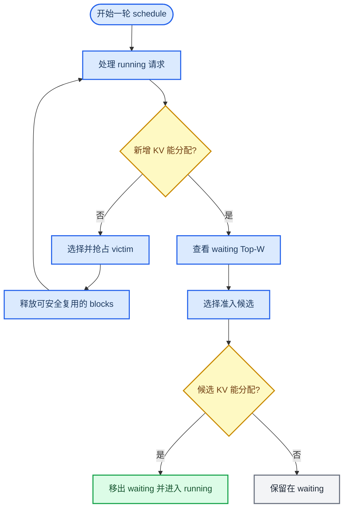

把图翻译成人话：

1. **先处理 `running`。** A、B 已经在执行，A 可能需要为下一个 decode token 申请新 block，B 可能需要为下一段 prefill chunk 申请 blocks。
2. **running 分配失败才触发抢占。** 如果 B 需要 2 个 blocks、当前只有 1 个，Scheduler 从 running 集合选择 victim，释放它能够安全释放的 KV，然后重试 B。若部分 block 仍受 GPU fence 保护，就不能假装它们已经可用，可能还要继续抢占或等下一轮。
3. **再查看 `waiting`。** 处理完已有请求后，如果本轮还有 token budget、请求数名额和 KV 空间，Scheduler 才考虑接纳新请求。
4. **先用便宜信息缩小范围。** 它只看队头同一优先级附近的 Top-W，并排除状态不允许或会超过 LoRA 限制的请求；读取 priority、arrival time、preemption count 不需要访问 KV Cache。
5. **需要时才查 prefix。** 默认 admission 直接取原队头，不做 speculative prefix peek；只有启用 cache-affinity，才对真正参与比较的少量候选查询 local prefix，计算各自还剩多少 prefill。
6. **选择不等于成功准入。** 候选选出来后还要尝试 KV allocation。成功后才从 waiting queue 删除并进入 running；如果它越过了原队头，才记一次 `admitted_reordered`。分配失败时，它仍留在 waiting，不能丢请求，也不会仅仅为了接纳它就立即抢占 running 请求。
7. **KV 一变，旧查询结果作废。** allocation、free、eviction、deferred free 真正完成等操作会改变 KV view，所以推进 `kv_generation` 并清空旧 memo；下一次需要 prefix 特征时重新查询。

#### 用三个等待请求举例

假设 A、B 正在运行，waiting queue 前面是 C、D、E，三者用户优先级相同：

| 请求 | 状态 | APC 可复用 | 剩余 prefill |
|---|---|---:|---:|
| C | 新请求、原队头 | 100 tokens | 800 tokens |
| D | 被抢占后等待恢复 | 700 tokens | 200 tokens |
| E | 新请求 | 500 tokens | 400 tokens |

这一轮先保证 A、B 能继续运行；之后 cache-affinity 才比较 C、D、E。在没有请求触发 aging 的情况下，D 因为是 resumed request 且剩余 prefill 最少，会被选中。若 D 的 KV allocation 成功，它越过原队头 C，记录一次 `admitted_reordered`；若分配失败，D 仍然留在 waiting queue，下一轮再试。

一句话记忆：**running 侧解决“谁能继续、缺空间时牺牲谁”，waiting 侧解决“有空位后先接纳谁”，`kv_generation` 负责保证两边看到的缓存信息没有过期。**

## 🧠 简历要点一：KV 感知调度

简历原话的核心是：**在硬约束不变的前提下，改变软排序目标。** 用户 priority、分配可行性、LoRA 上限等是硬约束；缓存亲和、重算成本是软优化。

### P1：recompute-aware 抢占

默认策略：

- PRIORITY 模式从最差用户优先级中选最新到达者；
- FCFS 模式通常牺牲 running 列表最后的请求。

新策略分层选择：

1. 只在**最差用户优先级层**中选 victim，绝不跨越用户优先级。
2. 优先牺牲从未被抢占过的请求，保护已恢复请求，避免同一请求反复被打断。
3. 再选择 `num_computed_tokens` 最小者，把丢失计算量当作恢复重算成本近似。
4. 用 arrival time 和 request id 做稳定 tie-break，避免依赖列表偶然顺序。

可以把目标写成：

```text
victim = argmin(
    是否已经被抢占过,
    num_computed_tokens,
    -arrival_time,
    request_id
)
```

这里的“保护恢复请求”容易说反。代码 key 中 `num_preemptions > 0` 对已恢复请求为真，而 `min` 会先选假，也就是先牺牲 fresh request。

#### num_computed_tokens 是怎么计算的

`num_computed_tokens` 不是在选择 victim 时临时套公式计算的，也不是 KV block 数。它是每个 `Request` 上持续维护的一个 token 计数器，表示：**Scheduler 认为这个请求从位置 0 开始，已经连续计算到多少个 token。**

初学时可以先记住下面这个简化更新式：

```text
本轮结束后的 num_computed_tokens
= 本轮开始前的 num_computed_tokens
 + 本轮调度计算的 token 数
 - speculative decoding 最终被拒绝的 token 数
```

它的完整生命周期如下：

| 时机 | `num_computed_tokens` 如何变化 |
|---|---|
| Request 刚创建 | 初始化为 0 |
| 第一次 admission | 先查询 APC；设置为本地命中 token 数 + 外部 KV 命中 token 数 |
| 没有任何 prefix hit | 仍从 0 开始 |
| 本轮调度了 N 个 token | 加 N，例如从 640 增加到 896 |
| speculative tokens 被拒绝 | 减去被拒绝的数量，回滚到真正有效的位置 |
| 外部 KV 某个 block 加载失败 | 截断到第一个无效 block 之前 |
| 请求被 preempt | 先记录抢占前的计算前沿，然后重置为 0 |
| 请求 resumed admission | 再做一次 APC 查询；还能命中的 token 成为新的起点，其余部分重新计算 |

APC 全命中时也通常不能直接设成完整 prompt 长度，因为模型仍需重新计算最后一个 prompt token 来获得下一 token 的 logits。因此本地 prefix lookup 的最大命中位置通常是 `prompt_length - 1`。

举一个不含 speculative decoding 的例子：prompt 有 1000 tokens，APC 命中前 640 tokens。

```text
Request 创建：                 num_computed_tokens = 0
APC 命中 640：                 num_computed_tokens = 640
第一轮 prefill 计算 256：      num_computed_tokens = 896
第二轮 prefill 计算 104：      num_computed_tokens = 1000
之后每轮 decode 再处理 1 token：1000 → 1001 → 1002 → ...
```

假设同一最差优先级层内有两个从未被抢占的请求：

```text
请求 A：num_computed_tokens = 1100
请求 B：num_computed_tokens = 300
```

recompute-aware 会优先选 B 当 victim，因为 B 当前只推进了 300 tokens，丢掉的潜在计算量通常比 A 的 1100 tokens 少。这个比较只发生在用户优先级和 resumed protection 等更高层约束已经相同之后，不是从所有 running 请求中无条件选最小值。

为什么它只是近似：

- 抢占后仍留在 APC 中的完整 blocks 可以复用，实际重算 token 可能小于该计数；
- 不同 batch shape 下，每个 token 的真实 GPU 时间并不相同；
- 异步调度会在工作提交后先乐观增加计数，再用 `num_in_flight_tokens` 跟踪尚未完成的部分；
- speculative decoding 可能在结果返回后回滚被拒绝的 draft tokens。

所以 P1 使用的是“已经推进多少 token”这个便宜、单调且随手可读的 proxy，而不是声称它等于精确重算耗时。具体维护位置可看 [`request.py`](../vllm/v1/request.py) 中的初始化，以及 [`scheduler.py`](../vllm/v1/core/sched/scheduler.py) 中的 admission、`_update_after_schedule()`、speculative rollback 和 `_preempt_request()`。

为什么不用“占 block 最多”直接做 P1？因为 block 可能与其他请求共享，free 一个逻辑请求不等于释放同样多物理 block；P1 先优化计算损失，保持规则简单可解释。

### P3/P6：Top-W cache-affinity admission

目标不是把整个等待队列按 cache hit 重排，而是在一个很小的局部窗口内挑“更快完成 prefill 的请求”。

最终选择规则：

1. 只比较同一用户优先级、当前可调度的前 `W` 个请求，默认 `W=8`。
2. 任一候选等待超过 aging threshold 后，从 aged 候选中选原始位置最靠前者，恢复近似 FCFS。
3. 否则优先 resumed request。
4. 再选 `remaining_prefill = num_tokens - local_cached_tokens` 最小者。
5. 最后按原队列位置 tie-break。

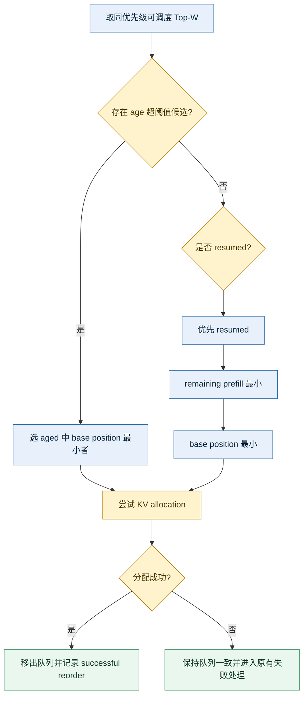

为什么是 bounded Top-W：

- 扫全队列是 O(N)，高 QPS 时调度 CPU 成本不可控；
- 全局按 cache 排序会破坏公平性；
- W=8 把复杂度限制在 O(W log W)，并让策略退化边界清晰。

priority heap 不能直接改对象字段后继续使用，因为 heap key 必须稳定。实现中入队时冻结 immutable key；`peek_n_with_keys` 用 heap frontier 取前 W，任意候选删除通过 request identity 定位并维持 O(log N)。这是很好的数据结构追问点。

### Aging 如何防饥饿

cache-affinity 会持续偏爱短剩余 prefill/热 prefix。如果热请求不断到来，冷长请求可能一直被越过。Aging 把等待时间变成硬保护：超过阈值后不再比 cache score，而回到原队列位置。

最终配置使用 10 秒，而不是简单说“阈值越小越公平”：

- 5 秒：公平性强，但吞吐收益几乎消失；
- 30 秒：吞吐明显，但早期 8-prefix 场景 TTFT 尾延迟恶化；
- 10 秒：在最终 16-prefix 场景中取得吞吐和 TTFT 的平衡。

这不是普适最优常数，而是该 workload 下的经验点，生产环境应按 SLO/负载调参。

### P2/P5a：retention 的思路与边界

等待队列中即将使用的 prefix block 更值得晚淘汰。实现从二元 hint 演进为 tier：

```text
NONE < NORMAL < RESUMED < HIGH_PRIORITY
```

free queue 淘汰时先选低 tier，tier 内仍保持 LRU；如果高 tier block 是满足分配的唯一选择，必须继续淘汰，不能为了命中率破坏 allocation feasibility。

为什么简历不把 retention 当最终主结果：P2 在修正 benchmark 后只带来 576 个额外 hit tokens、4 次更少抢占，单次吞吐约 +0.83%，信号不足；P5a 两组成对均值约 +1.97%，但 prefix/preemption/TTFT 方向混合。它是完成过的工程探索，不是最终稳定主张。

### P5b/P5c：reclaimable-aware 为什么最后没有成为卖点

#### 先翻译：什么是 reclaimable-aware

`reclaimable` 是“**真正可以回收到空闲池中的**”，`aware` 是“**做决策时把这个信息考虑进去**”。因此，`reclaimable-aware preemption` 可以翻译为：

> **物理 KV 可回收量感知的抢占策略**：发生 KV 分配失败时，不只看“抢占谁的重算代价小”，还看“抢占谁能为这次失败立刻腾出足够的物理 block”。

它与 `recompute-aware` 关注的问题不同：

| 策略 | 它首先问什么 | 主要指标 |
| --- | --- | --- |
| **recompute-aware** | 抢占谁，恢复时需要重算的内容较少？ | `num_computed_tokens` |
| **reclaimable-aware** | 抢占谁，能让失败的 KV 分配取得最大进展？ | 立即可回收 block 数、当前缺口 |

两者都先遵守用户优先级这个硬约束。`reclaimable-aware` 只有在可回收量打平后，才退回 `recompute-aware` 的规则选择。

#### 为什么“请求占了 10 个 block”不等于“抢占后能腾出 10 个 block”

APC 允许不同请求共享同一段 prefix 对应的物理 KV block。抢占某个请求时，只会删除**该请求持有的引用**；只要其他请求仍然引用这个 block，物理页就不能回到 free block pool。

先理解两个量：

- `block.ref_cnt`：这个物理 block 当前一共有多少个引用，可能来自多个请求，也可能包含临时保护引用
- `owned_refs`：待抢占请求自己对这个物理 block 持有多少个引用

因此，一个物理 block 能被该请求最终回收，当且仅当：

```text
block.ref_cnt == owned_refs
```

因为等式成立表示：这个 block 的全部引用都属于该请求。释放该请求的所有引用后，`ref_cnt` 才会降到 0，物理页才真正回到空闲池。

假设准备抢占请求 A：

| 物理 block | 总引用 `ref_cnt` | A 的 `owned_refs` | 释放 A 后 | 算作可回收吗 |
| --- | ---: | ---: | ---: | --- |
| `B0` | 1 | 1 | 0 | 是，真正腾出 1 个物理 block |
| `B1` | 2 | 1 | 1 | 否，另一个请求仍在共享它 |
| `B2` | 2 | 2 | 0 | 是，但按物理 block 只计 1 个 |

`B2` 中的两个引用都属于 A，可能是同一物理 block 在多个 KV group 或内部 bookkeeping 中重复出现。虽然释放时会减掉两个引用，但最终只腾出一块物理内存，所以不能算成两个 block。

估算器还要处理三个边界：

- **null block**：只是占位符，不是真正可归还的物理页，必须排除
- **partial-tail pin**：请求为了保护未满 block 的尾部而额外持有的引用，会随请求一起释放，因此要计入该请求的 `owned_refs`
- **operation retention / 外部引用**：例如仍有异步操作保护这个 block，这类引用不属于请求；即使释放请求，物理页也不会归零

这里得到的是 **eventual reclaimable**，即走完正式 free 流程后最终能回收多少。若 GPU 还在使用这些页，vLLM 会通过 deferred free 延迟真正归还；此时本次分配重试的 **immediately reclaimable** 是 0，不能把“以后会释放”误当成“现在可用”。

#### 策略到底怎样选择 victim

`allocation_shortfall_blocks` 是本次 allocation 失败时还缺少的精确物理 block 数。策略为每个候选计算：

```text
progress = min(immediately_reclaimable_blocks,
               allocation_shortfall_blocks)
```

之所以取 `min`，是因为多释放的容量对**解决当前这一次失败**没有额外价值。例如当前缺 3 个 block：

| 候选 victim | 立即可回收 | `progress` | 含义 |
| --- | ---: | ---: | --- |
| A | 5 | 3 | 一次抢占就足以补齐缺口，多出的 2 块不额外加分 |
| B | 2 | 2 | 有进展，但仍缺 1 块，可能还要继续抢占 |
| C | 0 | 0 | 本轮不能给 allocation retry 提供空间 |

所以这时优先选 A。完整选择顺序是：先限定在最差用户优先级层级，再最大化 `progress`；若多个候选的 `progress` 相同，再用 resume protection、`num_computed_tokens` 和稳定 tie-break 选择。

#### 为什么实验里“退化”成了 recompute-aware

先把 `progress` 忘掉公式，只记一句人话：

> `progress` 表示“抢占这个候选以后，能补上当前缺少的几个 block”。它的单位是 **block**，不是速度，也不是性能提升百分比。

可以把 KV 空间想成停车场。现在来了一个请求，但停车场满了：

- `allocation shortfall`：新请求还缺几个车位
- `reclaimable blocks`：赶走某辆车后，实际能空出几个车位
- `progress`：这些空位中，有几个能用于补上当前缺口

例如当前缺 3 个车位：

| 候选 | 抢占后能空出的车位 | 对当前缺口的 `progress` |
| --- | ---: | ---: |
| A | 5 | 3 |
| B | 2 | 2 |
| C | 0 | 0 |

A 虽然能空出 5 个车位，但当前只缺 3 个，所以对解决**这一次分配失败**来说，有用的进展最多就是 3。公式才因此写成：

```text
progress = min(能立即回收几块, 当前还缺几块)
```

现在再看 P6b。三个压测中，每次 allocation 失败都只缺 **1 个 block**，相当于停车场每次只缺 1 个车位：

| 候选 | 抢占后能回收 | 当前缺口 | `progress` |
| --- | ---: | ---: | ---: |
| A | 20 | 1 | 1 |
| B | 5 | 1 | 1 |
| C | 1 | 1 | 1 |

为什么三者都是 1？因为当前只需要解决“缺 1 块”这个问题：

- 抢占 A，可以补上这 1 块
- 抢占 B，也可以补上这 1 块
- 抢占 C，仍然可以补上这 1 块

虽然 A 会额外释放很多空间，但这些额外空间对**当前这次 allocation retry 能否成功**没有区别。A、B、C 都可以让它成功，因此 reclaimable-aware 看不出谁更好。

看不出差别后，策略就使用下一条规则：选择重算代价较小的请求，也就是退回 `recompute-aware`。所以这里的“退化”不是程序坏了，而是：

> 新增规则在这批数据上全部打平，最后只能继续使用旧规则，因而新旧策略选择完全相同。

如果候选中存在 D，它被抢占后一个 block 都不能立即释放，那么 D 的 `progress=0`，新策略就可以排除 D。但 P6b 中原 `recompute-aware` 选中的请求每次都能释放至少 1 块，连这种情况也没有出现。

`changed_selections` 只是一个计数器，回答的问题是：

> 同一次分配失败中，新策略选的请求和旧策略选的请求不同吗？

- 不同：计数加 1
- 相同：计数不变

最终三个 workload 共发生 1,922 次抢占决策，`changed_selections=0`，意思是 **1,922 次中新策略一次也没有改选其他请求**。

既然实际抢占行为完全没变，之前观察到的约 2% 吞吐差异就不能说是新策略带来的，只能当作不同压测轮次之间的波动。因此，reclaimable-aware 没有被包装成性能卖点。

它什么时候可能有用？例如当前缺 4 块：

- 候选 A 重算便宜，但只能真正释放 1 块，抢占后仍然不够
- 候选 B 重算稍贵，但能真正释放 4 块，一次就能解决分配失败

这时 A 的 `progress=1`，B 的 `progress=4`，新策略会改选 B。也就是说，它需要“缺口大于 1，且不同候选的真实可回收量有明显差异”才更可能发挥作用。

正确面试说法是：

> reclaimable-aware 的目标，是优先抢占能补足当前 KV 缺口的请求。但实测每次只缺 1 个 block，而原 recompute-aware 选择的请求都能释放至少 1 个，所以新指标无法区分候选。1,922 次决策中两种策略 0 次选出不同 victim，因此约 2% 的吞吐差异不能归因于它，我没有把这个结果写成性能收益。

## 🔄 简历要点二：KV 状态一致性与懒加载特征

### 为什么不能直接给每个 Request 永久缓存 prefix hit

本地 prefix 结果依赖全局 KV 状态，而 KV 状态会因 allocation、free、eviction、copy-on-write、异步 transfer 等变化。若缓存过久，会拿着旧 block id 做准入判断；若完全不缓存，同一轮失败重试又会反复遍历 hash chain。

本项目的解法是：**memo 不跟踪每个 block 的复杂依赖，只保证在同一 KV generation 内有效。**

```text
cache key   = id(request)，并再次校验对象 identity
cache value = blocks + cached_tokens + shared_prefix_boundary
valid when  = 当前 kv_generation 未变化
mutation    = generation += 1，整体清空 memo
```

#### 先理解 generation 是什么

这里的 `generation` 可以直接理解为 **KV 状态版本号**，也可以叫 epoch。它不是 GPU 的 generation，也不是模型生成了多少 token，只是 Scheduler 内部用来表示“KV Cache 的全局视图是否可能发生过变化”的一个整数。

它实现在 `SchedulingFeatureContext` 中，核心状态只有三个：

```python
self._kv_generation = 0
self._local_prefix = {}
self._local_prefix_resolver = peek_computed_blocks_with_boundary
```

- `_kv_generation`：当前 KV 状态版本号
- `_local_prefix`：本版本内已经查询过的 prefix 特征 memo
- `_local_prefix_resolver`：memo 未命中时，真正执行只读 prefix 查询的函数

注意：实现并没有给每条 memo 再保存一个 generation。它采用了更简单的规则：**只要字典里还有这条记录，它就一定属于当前 generation；一旦 generation 改变，整个字典立即清空。**

失效函数的逻辑可以简化成：

```python
def invalidate_kv_features():
    self._kv_generation += 1
    self._local_prefix.clear()
```

例如：

1. 当前 `generation=17`，第一次查询请求 A，得到“命中 256 tokens”，存进 memo
2. 同一 generation 再查 A，直接复用 memo，不重复遍历 prefix hash
3. Scheduler 随后执行了一次 KV allocation，KV 视图可能变化
4. 调用 invalidate，变成 `generation=18`，并清空全部 memo
5. 再查 A 时不能复用旧结果，必须根据新 KV 状态重新解析

这就是“只在同一 KV generation 内有效”的具体含义。它是一种**保守失效**：某次操作可能没有真正改变 A 的 prefix，但仍然把 A 的 memo 清掉；代价只是多查一次，收益是不会误用已经过期的 block id。

#### memo 如何查询和写入

`local_prefix(request)` 的逻辑可以简化为：

```python
key = id(request)
cached = memo.get(key)

if cached is not None and cached.request is request:
    return cached.feature

feature = side_effect_free_prefix_peek(request)
memo[key] = (request, feature)
return feature
```

除了用 `id(request)` 做字典 key，还保存并检查 `cached.request is request`，是为了防止旧 Request 销毁后 Python 重用相同的对象 ID，导致另一个请求误拿旧特征。

### Cheap first，expensive lazy

候选特征分两层：

- Cheap：priority、arrival time、preemption count、num computed tokens；不访问 KV。
- Expensive：本地最长 prefix blocks、cached tokens、shared prefix boundary；只对 Top-W 中确实需要比较的候选解析。

`remaining_prefill_tokens()` 会先读取 Cheap 的 `num_computed_tokens`：如果它大于 0，就直接把它当作已计算长度；只有等于 0、确实需要判断 APC 命中时，才懒加载 local prefix。这样避免“为了决定要不要运行，先把全队列 cache 都查一遍”。

### Side-effect-free peek 为什么重要

先回答最容易混淆的地方：

> `side-effect-free peek` **不是 Cheap 特征**。它仍然需要遍历本地 prefix cache，因此属于 Expensive 特征；`side-effect-free` 只表示“查询过程中只读，不修改系统状态”。

这里的 `peek` 可以翻译成“偷看一下”。Scheduler 为了比较 Top-W 候选，需要提前知道“如果选择这个请求，它能命中多少本地 prefix”，但此时请求还没有真正被 admission。

三者的区别如下：

| 操作 | 读取什么 | 是否访问 KV | 是否改变正式状态 |
| --- | --- | --- | --- |
| Cheap feature | Request 已有字段 | 否 | 否 |
| Side-effect-free prefix peek | 本地 APC prefix | 是 | 否 |
| 正式 admission 查询 | 本地 KV，并继续 connector/allocation 流程 | 是 | 会按正式路径记录状态和统计 |

实际调用链是：

```text
SchedulingFeatureContext.local_prefix(request)
    ├─ memo 命中：直接返回
    └─ memo 未命中：
       KVCacheManager.peek_computed_blocks_with_boundary(request)
           └─ _lookup_computed_blocks(request)
               └─ coordinator.find_longest_cache_hit(...)
```

peek 得到三项 Expensive 特征：

- `blocks`：本地能复用哪些 KV blocks
- `cached_tokens`：这些 blocks 对应多少个已计算 token
- `shared_prefix_boundary`：混合 KV 布局下共享 prefix 的边界

为什么一定要无副作用？Top-W 中可能有 8 个候选，但最终只会选择其中一个。如果只是比较候选就把 8 个请求都记成“正式命中”，会导致假统计、重复事件甚至 Request 状态污染。

因此，peek 只允许读取 prefix hash 和 block 信息，并保证：

- 不增加或减少 block ref count
- 不记录正式 APC hit 统计
- 不发送 KV cache event
- 不修改 `request.shared_prefix_boundary`
- 不调用外部 KV connector

真正选中请求后，Scheduler 再进入正式 admission 路径。此时可以把同一 generation 中 peek 得到的结果作为 `precomputed` 传给 `get_computed_blocks()`，避免重复遍历 prefix；正式事件、统计以及 connector 逻辑仍然只在真正 admission 时执行。

还有一个同名但不同层次的概念：`peek_n_with_keys()` 是**队列 peek**，表示查看 waiting queue 前 W 个请求但不把它们移出队列；`peek_computed_blocks_with_boundary()` 是**KV prefix peek**，表示查询 prefix 但不修改 KV 或 Request。前者解决队列一致性，后者解决 KV 状态与统计一致性。

### 哪些边界必须 invalidate

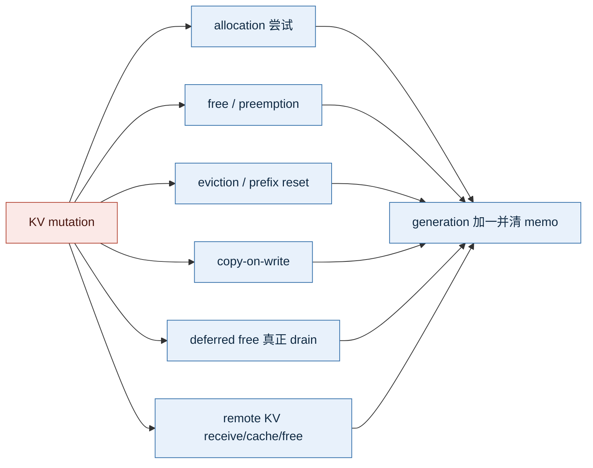

为什么 allocation 失败也保守失效：调用链内部可能已触发 eviction、CoW 或部分状态变化；宁可多解析一次，也不能依赖“失败一定无副作用”的脆弱假设。

### Deferred free 与共享 ref count 不是一回事

- **共享 ref count**：多个逻辑请求引用同一物理 block；free 一个请求后 ref count 仍大于 0，所以该 block 不能回收。
- **deferred free**：请求逻辑上已释放，但相关 GPU 异步写/step 尚未完成；由 outstanding fence（代码里的 scheduler/processed sequence）延迟真正 free。

因此 reclaimable-aware 还要区分 eventual reclaimable 与 immediate reclaimable。若 free 仍被 fence 延迟，本轮调度不能把那批 block 当成可立即满足 allocation 的空间。

### 7.94% 和 0.41% 是怎么来的

#### 先解释“cache-affinity admission CPU 开销占 serving wall time 0.41%”

先分别理解三个词：

- **Admission 策略 CPU 开销**：CPU 执行 cache-affinity admission 决策所花的时间，例如查看 Top-W 候选、读取特征并选出一个请求
- **serving wall time**：一整轮 serving 压测从开始到结束，现实世界钟表实际走过的时间
- **占比 0.41%**：估算出的策略累计 CPU 时间，除以整轮 serving 的墙钟时间

可以把它理解成：这轮服务总共运行了约 180 秒，把其中每次 cache-affinity 决策的 CPU 时间全部加起来，估算约为 0.731 秒：

```text
整轮 serving wall time          = 180.271 秒
累计 admission decision CPU 时间 =   0.731 秒

0.731 / 180.271 = 0.00406 = 0.406% ≈ 0.41%
```

换成更直观的话：

> 服务每运行 100 秒，cache-affinity admission 决策大约累计占用 0.41 秒的单核 CPU 时间。

但这句话有明确边界。`0.41%` **不是**下面这些含义：

- 不是 GPU kernel 时间占比
- 不是整个 vLLM Scheduler 的 CPU 占比，只是新增 admission 决策路径
- 不是每个请求的延迟增加了 0.41%
- 不是端到端吞吐损失了 0.41%
- 不是直接用端到端 profiler 测出的精确值，而是“局部微基准 × 真实调用次数”的估算

这个指标回答的问题是：**为了做 cache-affinity admission，CPU Scheduler 额外执行的候选比较是否贵到可能抵消 GPU 侧收益？** 结果约为 wall time 的 0.41%，说明在当前 W=8 workload 下，它是可控的局部 CPU 成本；不能据此声称所有 workload 下都固定为 0.41%。

#### 0.41% 具体怎样估算

P6e 先做 isolated microbenchmark，也就是把 admission 选择函数单独拿出来，测一次决策需要多少 CPU 时间。在 W=8 时：

| 路径 | 每次 decision 的 CPU 时间 | 含义 |
| --- | ---: | --- |
| 默认 admission | 0.172 μs | 不进入 cache-affinity 候选比较 |
| Cache-affinity，generation hot | 30.433 μs | prefix 特征已在当前 generation 的 memo 中 |
| Cache-affinity，generation cold | 78.466 μs | memo 已失效，需要重新解析候选 prefix |

真实 serving run 中记录了 `9,322` 次 cache-affinity selection call。按较保守的方式，假设每次都采用 W=8 的 cold 成本：

```text
9,322 次 × 78.466 μs/次 = 0.731 秒
0.731 秒 / 180.271 秒 = 0.406% ≈ 0.41%
```

这里的 `decision` 或 `selection call`，就是 Scheduler 在一次 admission 中比较 Top-W 候选并选出一个请求。原口径不是“成功 admitted 请求数”，而是策略选择函数真实被调用的次数。

#### 为什么 0.41% 没有包含 recompute-aware 抢占

因为 `0.41%` 从一开始测量的就不是“所有调度策略的总 CPU 开销”，而是 **waiting-side 的 cache-affinity admission 决策成本**。原简历中写成“策略 CPU 开销”范围太宽，更准确的说法应该是“cache-affinity admission CPU 开销约占 wall time 0.41%”。

两条策略不应直接混在一个外推公式中：

| 策略 | 什么时候触发 | 候选是谁 | CPU 主要做什么 |
| --- | --- | --- | --- |
| Cache-affinity admission | 从 waiting queue 选择新请求时 | 同优先级 Top-W waiting 请求 | 队列 peek、Cheap 特征、必要时解析 prefix |
| Recompute-aware preemption | running 请求 KV allocation 失败时 | 最差用户优先级层中的 running 请求 | 扫描已有字段并比较 `num_preemptions`、`num_computed_tokens` 等 |

recompute-aware 并不是完全没有测。P6 的独立单核 microbenchmark 得到：

| Running 候选数 | Default victim | Recompute-aware victim |
| ---: | ---: | ---: |
| 8 | 0.127 μs | 2.274 μs |
| 16 | 0.127 μs | 3.539 μs |
| 64 | 0.127 μs | 12.184 μs |
| 256 | 0.128 μs | 47.189 μs |

它只读取 Request 已有字段，不解析 prefix，也不扫描每个请求的 KV block table，所以单次开销明显小于 W=8、cold 状态下约 78.466 μs 的 cache-affinity admission。

之所以没有再给出“recompute-aware 占 serving wall time X%”，主要有三个原因：

1. **缺少对应外推口径。** 要换算 wall-time 占比，需要同一轮 serving 中每次抢占的 running 候选数分布和真实 victim-decision 调用次数；现有报告保留了单次微基准，但没有为最终 16-prefix run 保存完整分布
2. **它不是最终 admission A/B 的新增变量。** Control 和 Treatment 都使用 recompute-aware preemption，因此这部分是两边共同承担的成本，不解释 Treatment 相对 Control 的吞吐差异
3. **不能和 0.41% 机械相加。** admission 每次从 waiting 侧选请求时触发；preemption 只在 allocation failure 时触发，两者调用频率完全不同

所以正确说法是：

> 我分别微基准了 admission 和 preemption 决策。0.41% 只表示 W=8 cache-affinity admission 的局部 CPU 成本估算；recompute-aware 单次决策也测过，在 8～64 个 running 候选时约为 2.274～12.184 μs，但由于没有为最终 run 保存完整候选规模分布，我没有编造一个 wall-time 百分比。它同时也是 Control 和 Treatment 的共有成本。

#### 7.94% 又表示什么

`7.94%` 衡量的是 generation 内 memo 避免了多少次重复 prefix 解析，不是端到端加速比例。

P4 统计：

- prefix feature requests：154,192 次，即代码总共向特征上下文索要了多少次 prefix 特征
- 真正 resolver calls：141,943 次，即 memo 未命中、实际遍历 APC prefix 的次数
- generation 内 memo hits：12,249 次，即直接复用结果、没有再次解析 prefix 的次数

```text
12,249 / 154,192 = 7.94%
```

因此正确解释是：**所有 prefix 特征请求中，有 7.94% 在同一 KV generation 内直接命中 memo，避免了重复 resolver 调用。** 它证明 memo 确实减少了重复查询，但不能说端到端性能因此提升了 7.94%。

两个指标合起来表达的是：generation memo 减少了 7.94% 的重复 prefix 解析；即使采用 W=8 的 cache-affinity，估算的 admission 决策 CPU 时间也只约占该轮 serving wall time 的 0.41%。其价值在于证明该策略没有通过不可控的全队列扫描换取吞吐。

## 📊 简历要点三：端到端性能与机制归因

### 最终实验怎么做

| 项目 | 最终口径 |
|---|---|
| 模型/设备 | Qwen2.5-7B / RTX 4090 |
| 工作负载 | 16 类共享 prefix，固定请求集合 |
| KV 压力 | 1250 blocks，block size 16 |
| 并发与请求 | concurrency 48，192 个正式请求，另有 warmup |
| 策略对照 | Control：default admission；Treatment：W=8、aging=10s cache-affinity |
| 其他主要策略 | recompute-aware preemption，LRU retention，确保只改变 admission 变量 |
| 降噪 | `ignore_eos`、usage token 计数、warmup、每轮 fresh process、C→T 与 T→C 反序配对 |

为什么要反序配对：GPU 温度、频率、服务启动状态可能让“后跑的总是更快/更慢”。一组先 C 后 T，另一组先 T 后 C，取两组相对变化均值，减弱运行顺序偏差。

早期脚本曾用 SSE chunk 数估 token，且随机输出可能提前 EOS；这些数据只用于发现问题，不进入最终简历结论。修正后使用 `ignore_eos` 和服务端 usage token。

### 最终 A/B 结果

| 指标 | Treatment 相对 Control | 面试解释 |
|---|---:|---|
| Output throughput | **+4.20%** | 单位时间完成更多输出 token |
| 总耗时 | **-4.00%** | 固定请求集更快完成 |
| TTFT mean / P50 / P99 | -0.68% / -5.01% / **-2.24%** | 最终 16-prefix 场景没有用吞吐换 TTFT |
| TPOT mean / P99 | -4.07% / **-15.43%** | decode 阶段平均与尾部效率改善 |
| ITL P99 | +4.21% | 仍有局部逐 token 抖动，不能声称全面改善 |
| Successful reorders | 163 | 策略确实被激活，而非配置未生效 |

所有百分比应说“在该受限 KV、共享前缀 workload 下”，不要外推成所有模型和所有流量都提升 4.2%。

### 收益不是简单来自“命中更多”

最终成对结果中，prefix hit tokens 和 preemption 次数方向并不稳定。独立 attribution pair 的关键计数是：

| 机制指标 | 变化 | 含义 |
|---|---:|---|
| Resume recompute tokens | **-5.52%** | 抢占恢复后重复计算的上下文更少 |
| Total local context compute | **-3.37%** | first local prefill + resume recompute 的总 token 计算更少 |
| Engine outputs / steps | -6.42% | 完成同等工作所需调度/执行步更少 |
| Compute tokens per engine output | +4.96% | batch/step 形态更饱满 |
| Queue time mean | -6.88% | admission 顺序改善了流水 |
| First local compute | +2.32% | 新请求首次本地计算反而略增，说明机制不是单一 hit rate 上升 |

因此最严谨的机制表述是：

> cache-affinity 改变了请求进入执行的顺序，使恢复请求和较短剩余 prefill 更容易形成有效批次；在该归因对中，重复恢复计算和总本地上下文计算下降，同时每个 engine output 承载更多计算 token。它支持收益来自更好的工作编排，而不是单纯提高 APC 命中率。该 attribution 是一组成对证据，不宣称已证明唯一因果。

### 失败实验为什么反而是加分项

| 实验 | 结果 | 决策 |
|---|---|---|
| P2 binary retention | 信号很弱，命中仅小幅增加 | 不作为主结论 |
| P5c reclaimable-aware | 初看有收益，诊断后 1922 次选择零变化 | 判定目标函数退化，停止包装 |
| P6c aging 30s | 吞吐约 +4.29%，但 8-prefix TTFT P99 大幅恶化 | 不接受单目标最优 |
| P6f 1000 blocks | throughput -0.60% | 说明对 KV budget 敏感 |
| P6g W=4 | TTFT P99 好转但吞吐 -0.96% | 不继续靠缩窗调参 |
| P6h 16-prefix W8/10s | 吞吐与 TTFT 同时改善 | 作为最终主结果 |

#### “不是调参碰巧”到底能证明到什么程度

先承认边界：**本项目目前不能证明跨模型、跨 GPU、跨 KV budget 和真实流量的普适泛化。** 1000-block 下吞吐转负，已经说明策略对资源压力和 workload 分布敏感。

原问题实际上混合了三个不同层次：

| 面试官可能在问什么 | 当前有什么证据 | 能得出什么结论 |
| --- | --- | --- |
| 是否只是某一轮运行碰巧更快 | 固定请求/token、fresh process、C→T 与 T→C 两对反序实验，两对吞吐都为正 | 降低运行顺序和单轮波动解释，但不能声称完全消除噪声 |
| 策略是否真的改变了行为 | 两轮 Treatment 共 163 次 successful reordered admission | 开关确实激活，不是“配置打开但执行路径没变化” |
| 为什么可能变快 | 独立归因对中 resume recompute -5.52%、local context compute -3.37%、engine steps -6.42% | 存在与设计目标一致的机制证据，但不是唯一因果证明 |
| 换模型、GPU、KV budget 是否仍有效 | 只覆盖 RTX 4090、Qwen2.5-7B；1000-block 外推失败 | 泛化尚未证明，不能回答“一定有效” |

因此，对照、反序配对和 activation counters 证明的是**内部有效性**：在规定的 1250-block、Qwen2.5-7B、RTX 4090、共享前缀 workload 中，Treatment 确实改变了 admission，而且两对反序 A/B 都观察到正向吞吐变化。

它们不能证明**外部有效性**：换成另一模型、另一张 GPU、真实线上 trace 或更紧的 1000-block budget 后，收益是否仍然存在。公开 W=4、1000-block 和 retention 负结果，只能说明实验过程没有隐藏失败边界、结论是可证伪的；不能反过来当成“已经证明泛化”。

面试官如果问“是不是针对这一个 benchmark 调出来的”，不要硬顶，建议回答：

> 目前确实不能排除 workload-specific tuning。我能证明的是，在固定 W=8、aging=10s 后，我停止继续扫描参数，并在相同硬件、模型和 KV budget 下把 prefix 种类从 8 扩到 16；两种 prefix diversity 下的两对反序 A/B 吞吐方向都为正，说明结果不只依赖“恰好 8 类 prefix”。但 1000-block 外推失败，所以我只把 4.20% 限定在最终 16-prefix、1250-block workload，不声称普适收益。

面试官如果继续问“那你的结果还有什么价值”，可以回答：

> 项目价值不只是一组 4.20% 数字。代码层面实现了有界 Top-W、aging、公平队列操作、generation 失效和可观测性；实验层面确定了策略在什么条件下被激活、可能通过减少恢复重算获益，以及在更紧 KV budget 下可能失效。对生产系统来说，这说明它应该保持 opt-in，并根据在线 prefix reuse、KV 压力和 SLO 自适应启用，而不是作为固定全局默认值。

最重要的表达是：

> 我没有证明它普遍泛化；我证明了它在明确实验边界内具有可重复的正向结果和相符的机制信号，同时用负结果标出了外推失败的边界。

## 📈 调度与 KV Cache 的后续优化空间

### 当前结果不是“策略已经做完了”

本项目最重要的下一步不是继续优化第三、第四个 CUDA kernel，而是让 KV-aware 调度从**固定实验策略**演进为**能根据负载自适应启停和选择参数的系统机制**。

当前结果已经明确暴露了优化空间：1250-block、16-prefix workload 为正，但 1000-block 外推转负；W=4、不同 aging 和 retention 也出现负结果。这并不说明 KV-aware 没有价值，而是说明同一套固定参数不能覆盖所有 KV 压力和流量分布。已有的 generation、Top-W、counterfactual 和 telemetry 恰好提供了继续演进所需的基础。

### 方向一：从固定 W 和 aging 变成负载自适应

当前最终配置固定使用 `W=8`、`aging=10s`。生产环境可以在线观察：

- 最近一段时间的 prefix reuse 和平均 cached tokens；
- free KV blocks、allocation shortfall 和 preemption rate；
- resume recompute tokens 与本地上下文计算量；
- waiting queue 长度、请求年龄和 TTFT SLO；
- 策略真正改选请求的 activation counters。

然后动态选择模式：

```text
几乎没有共享前缀或没有 KV 压力
→ 直接使用默认调度，不支付 cache-affinity 成本

存在共享前缀且压力适中
→ 开启有界 Top-W cache-affinity

TTFT 尾部接近 SLO 或冷请求等待过久
→ 缩小 W、提高 aging 保护或暂时回到队列顺序

压力极高且策略历史收益转负
→ 自动降级默认策略，而不是继续强行重排
```

这一步最直接解决当前“1250 blocks 有效、1000 blocks 失效”的泛化问题：不要求一个 heuristic 在所有负载下都赢，而是让系统识别何时值得启用。

### 方向二：从 token proxy 变成时间成本模型

当前 recompute-aware 用 `num_computed_tokens` 近似恢复损失，优点是便宜、稳定，但它不是精确 GPU 时间。后续可以把 victim 和 admission 都统一为“预计节省或损失多少执行时间”：

| 当前近似 | 可继续优化成 |
|---|---|
| 已计算 token 越少，越适合被抢占 | 预计无法由 APC 恢复的 token × 当前 prefill 单位成本 |
| cached tokens 越多，剩余 prefill 越少 | 预计节省的 prefill 时间，同时扣除排队和 SLO 惩罚 |
| 只看本次请求 | 同时估计它对 batch 形态、engine steps 和其他请求的影响 |
| 所有 token 近似同价 | 根据模型、batch、prefill/decode 阶段用在线 EMA 校准成本 |

成本模型不需要一开始就使用复杂机器学习。可以先用运行时 telemetry 建立分段线性估计，并继续保持 Top-W 有界计算；只有反事实指标证明新模型确实改变选择且机制指标改善，才扩大复杂度。

### 方向三：让 reclaimable 和 retention 在真正会生效时才参与

当前 reclaimable-aware 在 1,922 次 one-block shortfall 中 0 次改选，不代表它永远无用，而是当前 workload 没有给它区分候选的机会。后续应先检测激活条件：

- 出现 multi-block shortfall；
- 候选请求之间的独占/共享 block 比例差异明显；
- deferred free 不会让“逻辑释放”暂时无法转化为物理空间。

只有这些条件满足时，才把物理可回收量加入 victim 选择；否则直接走更简单的 recompute-aware。

retention 也类似。Phase 2 的负结果说明“等待队列可能需要某 block”还不够，还要同时知道它是否即将被淘汰、再次命中的概率、能节省多少 prefill，以及保护它占用多少 block。可以用下面的单位空间价值做软排序：

```text
block value ≈ 预计复用概率 × 可节省计算时间 / 占用 blocks
```

仍然只调整 free cached blocks 的淘汰顺序，不永久 pin；空间不足时必须完整 fallback，不能为了命中率破坏 allocation feasibility。

### 方向四：从单卡局部排序扩展到多实例放置

单卡内只能决定“本实例先跑谁”。在多 GPU 或 PD 分离场景，更大的优化空间是先决定请求应该去哪个实例：

```text
placement cost = 目标实例排队时间
               + 缺失 KV 的重算时间
               + 远端 KV 传输时间
               + 本地显存短缺风险
```

如果实例 A 已缓存 80% 前缀但排队较长，实例 B 空闲却没有 KV，Router 应比较等待、重算和传输三种成本，而不是只做最短队列。这会把本项目的 local cache affinity 扩展为 placement-aware routing，也是与 PD 分离最自然的连接点。

### 方向五：用验证矩阵证明适用边界

泛化不能靠继续讲故事，必须补实验：

| 验证维度 | 至少要覆盖什么 |
|---|---|
| 模型 | 不同参数规模、KV head 数、上下文长度 |
| 硬件 | 不同显存容量和 GPU 架构 |
| KV budget | 宽松、中等、高压，而不是只测 1250 blocks |
| 流量 | system prompt、RAG、多轮对话、冷热混合与真实 trace |
| SLO | 吞吐、TTFT、TPOT/ITL、公平性和单请求最大越过次数 |
| 机制 | activation、resume recompute、local compute、shortfall 分布 |

建议的推进顺序是：


面试官质疑“这个策略是不是已经没有优化空间”时，可以回答：

> 当前版本完成的是策略框架、正确性边界和单卡代表 workload 的机制验证，不是宣布固定 W=8、aging=10s 已经普适最优。1000-block 和 retention 的负结果反而指出了下一步：先用在线 prefix reuse、KV shortfall、resume recompute 和 TTFT SLO 判断策略是否值得启用，再把 token 数近似校准为时间成本，并仅在 multi-block shortfall 等激活条件出现时启用 reclaimable/retention。最后把单卡 cache affinity 扩展到多 GPU 或 PD 分离的 placement-aware routing。算子可以继续泛化，但调度与 KV 策略才是主线。

## ⚙️ 简历要点四：CUDA 算子优化

### 先把 CUDA 名词翻译成人话

这一章先记住三个结论，后面的细节都围绕它们展开：

1. **P7 没有改 KV Cache 的计算结果，只让启动的线程数匹配真正的向量任务数。**
2. **P8 一边把标量访存改成 16-byte 向量访存，一边根据 token 数选择更合适的并行维度。**
3. **两项优化都有严格 gate；条件不满足就回退旧 kernel，所以不是拿通用性换一个特定 shape 的速度。**

| 名词 | 初学者解释 | 在本项目里对应什么 |
|---|---|---|
| kernel | 在 GPU 上执行的函数 | KV 写入 kernel、RoPE kernel |
| thread | GPU 执行工作的最小逻辑单位 | 一个线程负责一个或多个 vector task |
| warp | NVIDIA GPU 每 32 个线程组成一个调度组 | 64 threads = 2 warps；512 threads = 16 warps |
| CTA / thread block | 一组一起启动、驻留在同一个 SM 上的线程 | P7 中一个 CTA 负责一个 token 的 KV 写入 |
| grid | 一次 kernel launch 启动的全部 CTA | P7 的 grid 有 `num_tokens` 个 CTA |
| SM | GPU 上真正容纳并调度 CTA 的计算单元 | RTX 4090 有 128 个 SM |
| launch configuration | `grid`、`block` 等启动参数 | P7 把 `block.x` 从 512 调到 64 |
| register | 每个线程私有的高速片上存储 | ptxas 报告 26 registers/thread |
| spill | register 不够时溢出到更慢的 local memory | 本实验为 0，说明加速不是消除 spill 得来的 |
| layout / stride | 数据在内存里的排列方式 / 跨到下一个位置要跳多少元素 | gate 要确认每个 head 连续且行起点仍对齐 |
| alignment | 地址按某个字节数整除对齐 | 16-byte load 要求地址和相关 stride 保持 16-byte 对齐 |
| device time | kernel 真正在 GPU 上执行的时间 | CUPTI 测得的 μs，不含 Python 端大部分等待 |

`gate` 可以理解成快路径门口的检查清单：**全部满足才走快路径，任意一项不满足就走原来的通用实现。**

### P7：分页 KV Cache 写入 launch configuration

#### 先理解它在做什么

模型算出当前 token 的 K、V 后，`reshape_and_cache_flash` 要把它们写到 Paged KV Cache 指定的物理 slot。Qwen2.5-7B 的代表 shape 是 4 个 KV head、每个 head 128 个 BF16 元素，所以一个 token 的 K 或 V 一共有：

```text
num_heads × head_size = 4 × 128 = 512 个半精度元素
```

kernel 本来就按 16 byte 做向量 copy。BF16/FP16 每个元素 2 byte，所以一次能搬 8 个元素；真正需要的向量任务只有：

```text
512 个元素 / 8 个元素每组 = 64 个 vector tasks
```

理想映射就是一个线程处理一个 vector task，也就是 64 个线程。旧 launcher 却把“512 个标量元素”误当成“需要 512 个线程”，造成大量线程只做边界判断后退出。

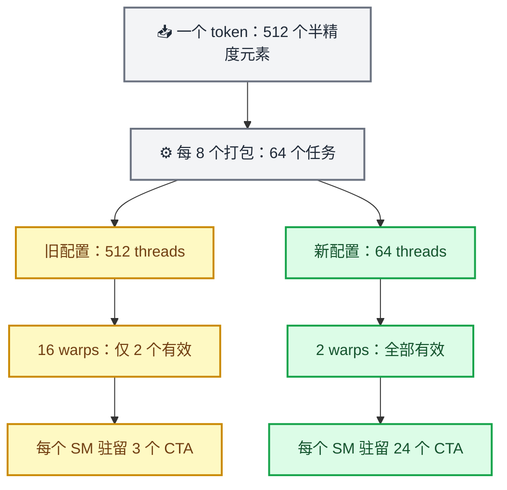

**图怎么读：** CUDA 以 32 个线程的 warp 为调度单位。旧配置每个 CTA 有 16 个 warp，但只有前 2 个 warp 真正搬数据；后 14 个 warp 很快退出。新配置正好启动 2 个 warp，两者完成的 K/V 数据搬运量完全相同。

这里“每个 SM 驻留 3 个或 24 个 CTA”不是说一个 kernel 总共只有这么多 CTA，而是说**同一时刻一个 SM 能容纳多少个 token block**。每个 CTA 从 512 threads 缩到 64 threads 后，同一个 SM 可以并行等待和执行更多独立 token 的 CTA，更容易隐藏内存访问延迟。

#### 代码怎么改

新配置只在安全条件满足时，按 vector task 数选择 block size，并向上对齐到完整 warp；Qwen 代表 shape 最终取 64 threads。通用路径保持原逻辑。

快路径 gate 包括：

- `kv_cache_dtype == auto`；
- NHD 风格的连续 head layout，`head_stride == head_size`；
- scalar scale；
- 指针和相关 stride 满足 16-byte alignment；
- vector task 数至少 64，避免小 shape 因额外分支吃亏。

这些条件是在确认：数据确实能以 16 byte 连续、安全地搬运，而且缩小线程块值得做。FP8、HND、per-head scale、非对齐数据等情况仍走旧逻辑。

为什么会快：主要不是“少算了”，而是减少空转 warp 和每 CTA 占用的 resident-thread 配额，使同一 SM 可驻留更多 CTA。ptxas 报告 26 registers/thread、无 spill；按有效 warp 数计算，有效 warp 比例从 `2 / 16 = 12.5%` 提到 `2 / 2 = 100%`。这里的 12.5% 和 100% 是**有用 warp 占比**，不是传统 occupancy 指标；两种配置的理论 occupancy 都可以是 100%。

代表 shape 的 device-time：

| token 数 | 旧配置 | 新配置 | 加速 |
|---:|---:|---:|---:|
| 512 | 6.177 μs | 5.088 μs | 1.214x |
| 1024 | 9.569 μs | 6.592 μs | **1.452x** |
| 2048 | 16.495 μs | 11.871 μs | 1.390x |
| 4096 | 30.333 μs | 28.446 μs | 1.066x |

简历中的 1.45x 对应 Qwen 代表 shape、1024 tokens 的 kernel 微基准，不等于服务吞吐 +45%。该 kernel 占端到端比例有限，Amdahl 上界预计低于 1%。

**面试一句话：** 原 kernel 已经向量化，但 launcher 仍按标量元素数分配线程。我让 launch configuration 与 16-byte vector work 对齐，在不改计算和访存语义的情况下，把 Qwen 代表 shape 的 16 个 warp 缩到 2 个有效 warp。

### P8：alignment-gated 16-byte RoPE 双并行快路径

#### RoPE 到底在算什么

RoPE 给 Q、K 注入位置信息。它把 head 中两个对应维度看成二维坐标，再根据当前位置的 `cos`、`sin` 做旋转：

```text
y1 = x1 * cos - x2 * sin
y2 = x2 * cos + x1 * sin
```

NeoX 形式不是 `x[0]` 和 `x[1]` 相邻配对。head size 为 128 时，它是前后两半对应配对：

```text
x[0]  ↔ x[64]
x[1]  ↔ x[65]
...
x[63] ↔ x[127]
```

新快路径针对 Qwen 常见真实 fused-QKV layout：BF16/FP16、head size 128、rotary dim 128、NeoX、offset 0。下面这张图只放大看**一个线程负责的 8 个输出**：

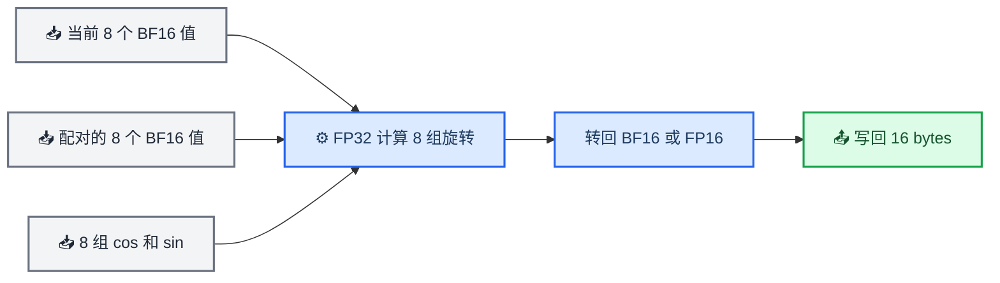

`AlignedVector<T, 8>` 表示把 8 个连续的 `T` 当作一个 16-byte 对齐向量来 load/store。对一个 128 维 head，`128 / 8 = 16` 个线程分别写回自己的 8 个输出，因此 16 个线程可以覆盖完整 head。每个线程会读取当前 8 个值、另一半对应的 8 个值以及对应的 cos/sin，在 FP32 中做乘加，再转回原 dtype。

这里一定要说对：**16 byte = 8 个 BF16/FP16 元素，不是 8 个 float。**

`fused-QKV layout` 是指 QKV projection 先产出一个合并的大 tensor，再切出 Q、K、V view。切分后的 Q/K 在 token 方向未必整体连续，但一个 head 内仍可连续且 16-byte 对齐；新路径的 stride 检查就是为了兼容这种真实布局，而不是只在人工构造的 contiguous tensor 上变快。

#### 先分清两个互不相同的开关

这里最容易误解的是：**4096 不决定是否向量化。**完整选择过程有两层：

1. 先检查数据是否满足 fast-path gate，决定用 16-byte vector kernel，还是退回 scalar kernel。
2. 如果已经进入 vector kernel，再根据 token 数选择 head-parallel 或 token-parallel。

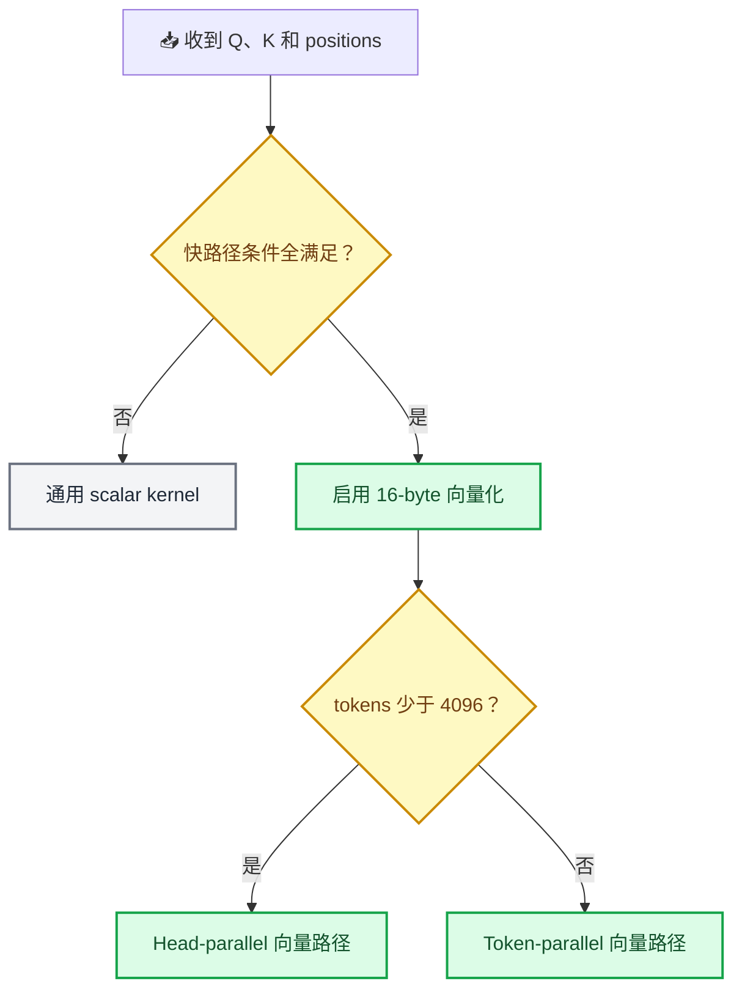

所以答案非常明确：

| 情况 | 是否使用 16-byte 向量化 | 并行方式 |
|---|---|---|
| gate 不满足 | 否，回退 scalar kernel | 原通用实现 |
| gate 满足且 tokens < 4096 | 是 | head-parallel |
| gate 满足且 tokens ≥ 4096 | 是 | token-parallel |

**小于和大于等于 4096 的两条新路径都用了向量化。**4096 只是在两个已经向量化的 kernel 之间切换。

#### `(16, 8)` 到底表示什么

两条向量路径的 `block` 都是 `(16, 8)`，一个 CTA 总共有 `16 × 8 = 128` 个线程：

- `threadIdx.x` 有 16 个位置。每个线程处理 8 个半精度元素，所以 `16 × 8 = 128`，正好覆盖一个 head 的 128 维。
- `threadIdx.y` 有 8 个位置。可以把它想成 8 个 token 工位，因此一个 CTA 最多同时覆盖 8 个 token。

```text
一个 CTA = 8 个 token 工位
每个 token 工位 = 16 个线程
每个线程 = 8 个半精度元素

16 threads × 8 elements = 一个 128 维 head
```

两条路径的区别不是线程块大小，也不是是否向量化，而是：**一个 CTA 只负责一个 head，还是在 CTA 内循环处理全部 32 个 heads。**

#### Head-parallel：token 少时，把 heads 拆开并行

Qwen2.5-7B 有 28 个 Q heads 和 4 个 K heads，共 32 个需要做 RoPE 的 heads。head-parallel 把这 32 个 heads 分给不同 CTA：

```text
一个 CTA = 一个 head × 最多 8 个 token
CTA 数量 = ceil(tokens / 8) × 32
```

例如只有 1 个 token：

```text
ceil(1 / 8) × 32 = 32 个 CTA
```

如果不展开 head，只能启动 1 个 CTA；RTX 4090 有 128 个 SM，大部分 SM 都没活干。展开后虽然 32 个 CTA 仍不能完全填满 128 个 SM，但已经比 1 个 CTA 好得多。

#### Token-parallel：token 多时，一个 CTA 循环 heads

token-parallel 不再为 32 个 heads 分别创建 CTA：

```text
一个 CTA = 最多 8 个 token，并依次处理每个 token 的 32 个 heads
CTA 数量 = ceil(tokens / 8)
```

它的单个 CTA 工作更重，因为内部要循环 32 个 heads；但 token 足够多时，即使不展开 head，也已经有足够多 CTA 分给各个 SM。同时，它避免把 CTA 数再乘以 32，并让同一线程组连续处理同一批 token 的 Q/K heads，具有更好的 cos/sin 访问局部性。

#### 为什么分界点实测是 4096

先看两种路径会分别启动多少 CTA：

| token 数 | token 分组 `ceil(tokens / 8)` | head-parallel CTA 数 `分组 × 32` | token-parallel CTA 数 `分组` |
|---:|---:|---:|---:|
| 1 | 1 | 32 | 1 |
| 256 | 32 | 1,024 | 32 |
| 1,024 | 128 | 4,096 | 128 |
| 2,048 | 256 | 8,192 | 256 |
| 4,096 | 512 | 16,384 | 512 |

这张表揭示了两种相反的问题：

- token 少时，token-parallel 的 CTA 太少。例如 256 tokens 只有 32 个 CTA，放到 128 个 SM 上并行度不足，而且每个 CTA 还要串行循环 32 个 heads。
- token 很多时，token-parallel 自己已经有大量 CTA。例如 4096 tokens 有 512 个 CTA，粗略相当于每个 SM 有 4 个 CTA 可调度；此时再用 head-parallel 膨胀到 16,384 个较小 CTA，增加的并行度价值下降，调度规模却更大。

`4096` 不是由某条 CUDA 公式直接算出来的万能常数，而是 RTX 4090、Qwen2.5-7B 这个 shape 上的**实测交叉点**：

1. 最初假设 256 tokens 就切换 token-parallel，但 256 点反而慢约 52%，因为只有 32 个 CTA，GPU 没被喂饱。
2. 把切换点后移后，1024 和 2048 tokens 仍是 head-parallel 更快。
3. 到 4096 tokens，token-parallel 已有 512 个 CTA，两条性能曲线才接近，因此最终选择在这里切换。

换一张 GPU、换一个 head 数或 rotary dim，交叉点可能改变。所以严谨说法是“4096 是当前硬件和代表 shape 的经验阈值”，不能说它对所有模型都成立。

#### alignment gate 每一项是什么意思

快路径 gate 包括：

- **key tensor 存在：** 这个快路径按生产中的 Q、K 联合 RoPE 设计；只有 Q 的情况交给通用 kernel。
- **positions 是连续一维数组：** 可以用 `positions[token_idx]` 直接找到每个 token 的位置。
- **NeoX、128 维、offset 为 0：** 快路径固定采用前 64 维与后 64 维配对，并旋转完整 head。
- **Q、K、cos/sin 都是 2-byte dtype：** 只有这样 8 个 BF16/FP16 元素才正好是 16 bytes。
- **地址和 stride 都满足 16-byte alignment：** 不仅第一行的起点要对齐，跳到下一个 token 或 head 后的新起点也必须继续对齐。

全部满足时，`reinterpret_cast<AlignedVector<T, 8>>` 才能按照设计安全访问 16 bytes。任意一项不满足就回退原 scalar kernel。因此“兼容其他 dtype、layout 和 rotary 变体”的意思是：**它们仍能正确运行，但不会使用这条 16-byte 快路径。**

最终 1～4096 tokens 的加速约 1.13x～1.84x。6 个 Qwen fast-path case 来自 `FP16/BF16 × 1/257/4096 tokens`，分别覆盖 head-parallel 和 token-parallel；另外 384 个通用 RoPE 组合用于确认 fallback 没有回归。

**面试一句话：** 我没有改 RoPE 数学公式，而是针对 Qwen 的真实 fused-QKV stride，在严格对齐条件下让每个线程一次处理 8 个半精度元素；小 token 展开 head 并行，大 token 改用 token 并行，并通过 fallback 保留通用布局和 rotary 变体。

### RMSNorm 为什么没写进简历主结果

同一阶段也把 Qwen hidden size 3584 的 RMSNorm 线程数从 1024 调到 448 个 16-byte vector tasks，但实测小 token 只约 1.01x～1.04x，大 token 接近 1.0x。工程上保留正确优化，叙事上不把弱信号凑成亮点。

### 算子微基准怎样才可信

微基准的目标是只回答“这个 kernel 本身是否变快”，而不是直接回答“整个服务是否变快”。测量流程如下：


- **同一工具链：** old/new 使用相同源码环境、编译器和构建参数生成 `.so`，尽量让唯一变量就是本次 kernel 改动。
- **先测正确性：** 随机输入与 reference 对比通过后才谈性能，避免“算错了所以更快”。
- **25 次 warmup：** 先消除首次调用、lazy initialization 等一次性成本。
- **cold L2：** 每轮按同一规则控制 L2 cache 状态，避免某一版本碰巧吃到热缓存。
- **CUDA Graph：** 重放固定工作，降低 Python 和 host launch 抖动；它不是加速结论本身。
- **CUPTI device duration：** 直接测 GPU kernel 的起止时间，不用 Python wall time 冒充 kernel time。
- **多次取中位数：** P7 每个 shape 做 3 个 trial，P8 做 5 个 trial，降低偶发抖动影响。
- **限定结论边界：** 必须同时报告 shape、dtype、layout、GPU 和 gate；因此简历说“Qwen 代表 shape 下 1.45x”，不能说“vLLM 整体快 45%”。

从 kernel 微基准到服务收益还要经过 Amdahl 定律：如果这个 kernel 只占端到端时间的 1%，即使 kernel 快 2 倍，理论上的整体加速也只有约 `1 / (99% + 1% / 2) ≈ 1.005x`。这就是为什么本项目把算子加速与调度层 4.20% 的端到端吞吐收益分开陈述。

## 📚 缓存压力到底发生在哪个阶段

### 先给结论：不只 decode 会缺 KV

KV block 不只在 decode 时分配。一次请求需要在三个位置考虑 KV：

| 位置 | Scheduler 在做什么 | KV 不足后的行为 |
|---|---|---|
| waiting 请求首次准入 | 查已有 prefix，计算本轮 prefill 工作并尝试分配 | 本次不准入，继续留在 waiting；这里不会立刻挑 running victim |
| running 请求继续 prefill | 为下一个 prefill chunk 分配 block | 分配失败时可以抢占 running victim |
| running 请求继续 decode | 为新增 token/推测 token 分配 block | 分配失败时可以抢占 running victim |

源码依据是 [`scheduler.py`](../vllm/v1/core/sched/scheduler.py)：waiting 路径在 `980～1249` 行查询 prefix、计算 `num_new_tokens` 并调用 `allocate_slots()`；running 路径在 `658～866` 行对所有运行请求分配新 slots，失败后才进入 victim 选择。running 请求既可能处于 decode，也可能是尚未完成的 chunked prefill。

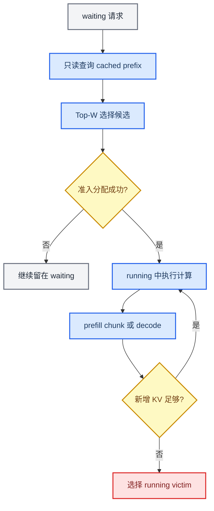

因此面试时不要说“只有 decode 才会触发抢占”。更准确的说法是：

> running 请求每轮都要为新增 token 申请 KV，因此正在继续的 prefill chunk 和 decode 都可能遇到 allocation failure。只是当前版本默认在新请求准入时先做完整输入可容纳检查，降低了 prefill 过度准入；而生成长度事先无法完全占住，decode 的 KV 会持续增长，所以实验里 decode 更容易成为稳定的压力来源。

### “按完整输入检查”不是提前占满，也不是 GPU 仿真

`scheduler_reserve_full_isl=True` 时，waiting 请求准入前会调用 block 计数逻辑，检查“以当前空闲量看，完整输入在考虑 APC 命中后是否放得下”。[`kv_cache_manager.py`](../vllm/v1/core/kv_cache_manager.py) `539～558` 行是这个检查。

这里有三个必须分清的概念：

1. 它是基于 block 数的 **dry-run 容量检查**，不是在 GPU 上把 prefill 仿真执行一遍。
2. 它只判断此刻是否可容纳，不会提前把未来 chunk 所需的所有物理 blocks 永久预留给该请求。
3. 真正分配的仍是当前 chunk 需要的 blocks，代码在同一文件 `560～627` 行；以后 KV 状态变化时，后续 chunk 仍可能分配失败。

初次准入时 `request.num_tokens` 基本就是已有 prompt 长度，因此完整输入检查主要保护 prompt。未来会生成多少 output token 尚未真正发生，也不会一次性把整个最大输出全部变成已占用 KV；decode 继续推进时仍要逐步申请空间。

所以可以把它想成订酒店前问“现在看起来能否容纳这个团队”，而不是已经把这个团队未来每天需要的全部房间锁死。

### 为什么 Top-W 在 prefill 之前就要算 prefix

这里的“算 prefix”容易产生歧义。Top-W 做的不是运行 Transformer 重新计算 prefix，而是：

```text
把请求 token 按 block 求 hash
→ 在 APC 的 block hash table 中只读查找连续命中
→ 得到 local_cached_tokens
→ 推出 remaining_prefill
```

它是 CPU 侧的缓存元数据查询，发生在真正 prefill forward 之前。目的恰恰是回答：**哪些 prefix 已经算过，这次可以少做多少 prefill。**

例如两个 waiting 请求：

| 请求 | 当前上下文 | APC 命中 | 仍需 prefill |
|---|---:|---:|---:|
| A | 1,000 tokens | 0 | 1,000 tokens |
| B | 1,500 tokens | 1,300 | 200 tokens |

如果只看 prompt 长度，会认为 A 更短；如果先查缓存，就知道 B 只需补算 200 token，更容易快速推进。Top-W cache-affinity 就是在同优先级、未触发 aging 的小窗口内利用这个差别。

这和 P/D 是否分离没有因果关系：

- 不分离时，Scheduler 查询本实例的本地 APC。
- P/D 分离时，P、D 各自仍有本地 KV 池，还可能通过 KV Connector 查询或加载远端 KV。
- 真正的区别是：当前 Top-W 排名只使用本地 prefix；分布式情况下还需要把远端命中、传输时间和目标实例排队一起纳入成本。

### Chunked prefill 是什么

普通 prefill 会尝试一次处理整个未缓存 prompt；chunked prefill 则受 `max_num_batched_tokens` 等预算约束，把长 prompt 拆成多轮。这样每个调度 step 可以把 decode 和一部分 prefill 混合，避免一个超长 prompt 独占整轮计算。

假设 prompt 有 6,000 token，APC 已命中前 2,000 个，本轮最多安排 1,024 个 prefill token：

```mermaid
flowchart LR
    accTitle: Chunked Prefill 示例
    accDescr: 六千 token 的 prompt 先跳过两千个已缓存 token，再把剩余四千 token 拆成多个调度 chunk；chunk 之间可以穿插已有请求的 decode。

    full_prompt[6,000 token prompt] --> cached_prefix[跳过 2,000 cached tokens]
    cached_prefix --> first_chunk[补算 chunk 1: 1,024]
    first_chunk --> mixed_decode[穿插其他请求 decode]
    mixed_decode --> second_chunk[补算 chunk 2: 1,024]
    second_chunk --> later_chunks[继续后续 chunks]
    later_chunks --> start_decode[本请求开始 decode]

    classDef cache_style fill:#dcfce7,stroke:#16a34a,stroke-width:2px,color:#14532d
    classDef compute_style fill:#dbeafe,stroke:#2563eb,stroke-width:2px,color:#1e3a5f
    classDef decode_style fill:#ede9fe,stroke:#7c3aed,stroke-width:2px,color:#3b0764

    class cached_prefix cache_style
    class full_prompt,first_chunk,second_chunk,later_chunks compute_style
    class mixed_decode,start_decode decode_style
```

这里 Top-W 比较的 `remaining_prefill=4,000`，用于决定这个 waiting 请求是否先被准入；请求一旦进入 running，后面的 chunk 由 running 调度循环继续推进，Top-W 不会在每个 chunk 之间重新给它排一次 waiting 名次。

所以三种策略的作用点不同：

| 策略 | 对 chunked prefill 的作用 |
|---|---|
| Top-W cache-affinity | 准入前利用 APC 命中估计剩余 prefill；不负责 running chunk 间排序 |
| Aging | 防止缓存较冷的长 prompt 永远无法首次准入 |
| Recompute-aware | running 的 prefill chunk 或 decode 分配失败时，选择重算损失较小的 victim |

## 🔀 PD 分离：面试需要掌握到什么程度

本项目**没有实现 PD 分离**。你只需要讲清架构、vLLM 接口和它与本项目的关系，不要把它说成自己的改动。

### 什么是 Prefill-Decode disaggregation

Prefill 和 decode 的资源特征不同：prefill 更重计算，decode 更看重低时延和显存带宽。PD 分离把它们放在不同 vLLM 实例/节点，分别扩缩容：

1. Proxy/Router 选择一个 P 实例和一个 D 实例。
2. P 实例执行 prompt prefill，产生 KV Cache，并通过 connector 发布/发送。
3. D 实例为该请求分配本地 block，从远端加载 KV。
4. KV 到达后 D 从最后一个 prompt token 附近继续 decode，并向客户端流式返回。

```mermaid
sequenceDiagram
  accTitle: vLLM PD 分离的简化数据流
  accDescr: 路由器先把请求送到 prefill 实例生成 KV，再把同一请求送到 decode 实例；KV Connector 独立传输 KV，decode 调度器等待远端 KV 到达后开始生成。
  participant C as Client
  participant R as Router
  participant P as Prefill vLLM
  participant X as KV Connector/Store
  participant D as Decode vLLM
  C->>R: prompt + sampling params
  R->>P: prefill request，max_tokens 很小
  P->>X: 写出 KV / transfer metadata
  P-->>R: prefill 完成
  R->>D: 原始 decode request
  D->>X: 查询并异步加载 KV
  X-->>D: KV blocks ready
  D-->>R: streaming tokens
  R-->>C: streaming response
```

### vLLM 里的三层抽象

仓库 [`distributed/kv_transfer/README.md`](../vllm/distributed/kv_transfer/README.md) 把传输分为：

| 层 | 作用 |
|---|---|
| KV pipe | FIFO tensor send/recv 数据通道 |
| KV lookup buffer | 用 token/request key 查 KV，解决 P 和 D 处理顺序不一致，不能只靠 FIFO 的问题 |
| KV connector | 接入 scheduler/worker，负责查询命中、分配后绑定、逐层加载/保存和完成通知 |

`KVTransferConfig` 用 `kv_producer`、`kv_consumer`、`kv_both` 区分角色；connector 可以是 NIXL、Mooncake、LMCache 等，具体数据面可能走 GPU P2P、RDMA、CPU/外部存储。

### Decode 侧调度状态

Connector 的 scheduler-side 主接口是：

1. `get_num_new_matched_tokens()`：无副作用查询远端还命中多少 token，可能返回“暂时未知”。
2. `update_state_after_alloc()`：D 侧分配本地 block 后，把目标 block 和外部 token 数交给 connector。
3. `build_connector_meta()`：把本轮传输元数据交给 worker。
4. worker 异步 `start_load_kv()`，逐层等待/加载。
5. 请求处于 `WAITING_FOR_REMOTE_KVS`，收到 `finished_recving` 后缓存成功加载的 block，再恢复 `WAITING/PREEMPTED`。
6. 加载失败按配置 `recompute` 或 `fail`。

### PD 分离的收益和代价

| 收益 | 代价/难点 |
|---|---|
| P/D 独立扩容和硬件配比 | KV 传输带宽与额外时延 |
| 长 prefill 不直接阻塞低时延 decode | P/D 路由一致性、请求标识与生命周期 |
| 可分别优化 compute-bound 与 memory-bound 阶段 | decode 侧要预留本地 KV，可能双份占用 |
| 更容易隔离 SLO | backpressure、传输失败、超时、重算与清理 |

### 与本项目的联系

- Top-W/cache-affinity 可用于单个 P 或 D 实例内部，但当前实现只按本地 prefix 排名。源码是在候选选完后才调用 KV Connector 查询 external hit，因此远端缓存很多的请求可能在 Top-W 排名时没有体现这个优势。
- generation invalidation 已覆盖 remote KV receive/cache/free 等本地状态边界，但它仍是单个 Scheduler 的本地版本号，不是跨集群的一致性协议。
- PD 场景中“远端有 KV”不代表 D 可以立刻运行；D 还要分配本地 blocks、完成传输并等待 fence。
- recompute-aware 的思想仍成立，但成本函数要从 `num_computed_tokens` 扩展成 `min(重新计算时间, 远端加载时间)`，并考虑网络拥塞和远端 KV 是否仍然存在。
- 如果继续做，可把 score 扩展为：`目标实例排队时间 + 缺失 KV 重算时间 + KV 传输时间 + 本地显存风险 + SLO age`，但需要先建跨节点 telemetry。

### 多机多卡下，这个项目还有没有用

不能笼统回答“完全适用”，也不能回答“PD 一分离就没用了”。要按部署层次拆开：

| 场景 | 当前改造是否直接可用 | 应该怎样理解 |
|---|---|---|
| 单卡单实例 | 是，已实验验证 | 一个 Scheduler 管一个本地 KV 池 |
| 单实例 TP/PP 多卡 | 调度思想基本直接适用 | Scheduler 仍对逻辑请求做一次排序；worker ranks 执行同一批次，KV/权重在 ranks 间分片。但显存容量和通信改变后必须重测收益 |
| Chunked prefill | 代码路径兼容 | Top-W 管首次准入；running prefill chunk 与 decode 都可能进入 allocation/preemption；还可继续增加 chunk-aware cost |
| 多个独立 DP 实例 | 只在单实例内部适用 | 还需要 Router 决定把请求送到哪个实例，local affinity 应升级为 placement affinity |
| P/D 分离 | 思想有用，当前成本模型不完整 | 要联合本地命中、远端命中、传输、P/D 两侧显存和排队；不能直接把单卡结果外推 |

张量并行本身主要改变“一个逻辑请求如何在多个 GPU 上执行”，不必然把 Scheduler 的 waiting/running 决策复制成多份。因此 Top-W、aging 和 victim 选择仍有明确作用点。真正需要较大改造的是多个独立实例或 P/D 分离，因为此时系统不只决定“队列中谁先”，还要决定“请求去哪里、KV 从哪里来”。

### 面试官追问时的推荐回答

可以用下面这段 60 秒版本：

> 这个问题不能简单说成只在 decode 阶段存在。vLLM 对 running 请求每轮都会调用 KV allocation，正在进行的 prefill chunk 和 decode 都可能失败并触发抢占；只是默认的 full-input fit gate 会在首次准入时先检查完整 prompt 能否容纳，所以它抑制了 prefill 过度准入，而 decode 的 KV 会随生成继续增长，实验里更容易稳定触发压力。Top-W 查 prefix 也不是执行 prefill，而是在准入前对 APC hash table 做无副作用查询，用来估计还剩多少 prefill 和要占多少 KV。
>
> 对多机多卡我会分层看。TP/PP 下仍是对逻辑请求做调度，策略思想基本保留，但需要重新测通信和容量变化后的收益；chunked prefill 下，Top-W 负责首次准入，recompute-aware 仍覆盖运行中的 prefill chunk 和 decode。PD 分离后问题没有消失，而是从单机“谁先、抢谁”扩展成“请求去哪个 P/D、KV 本地命中还是远端传输”。当前实现只使用本地 prefix 做 Top-W，所以我不会声称它原样支持分布式；下一步要把远端命中、传输时间、目标实例排队和显存风险纳入 placement-aware cost，并把 generation 从单池版本扩展成 per-worker 或 per-cache-tier 的版本信息。

如果面试官继续问“所以你的单卡结果能证明分布式也有效吗”，要直接回答：

> 不能。单卡 A/B 证明的是在这个本地 KV 压力 workload 下，策略被激活且机制指标与收益一致；它证明了框架和局部机制，不证明跨 GPU、跨节点或 P/D 配置的收益。分布式是有明确迁移路径的后续工作，需要单独做 TP 规模、chunk size、远端命中率、网络带宽和 P/D 队列组合的验证矩阵。

## 🔗 三组策略的关键代码追问

下面的行号对应当前工作树；以后代码变化时优先记住函数名，而不是死背行号。代码块是从真实实现中截取的关键分支，少量统计、类型标注和无关参数被省略，完整实现以链接文件为准。所有策略开关定义在 [`vllm/config/scheduler.py`](../vllm/config/scheduler.py) `112～160` 行：`preemption_policy`、`admission_policy`、`kv_aware_candidate_window` 和 `kv_aware_aging_threshold_s`。

### Top-W cache-affinity admission 与 aging

第一处是 [`policy.py`](../vllm/v1/core/sched/policy.py) `35～45` 行：候选只保存请求、原始位置和本地缓存 token 数，剩余 prefill 是派生值。

```python
@dataclass(frozen=True)
class AdmissionCandidate:
    request: Request
    base_position: int
    local_cached_tokens: int

    @property
    def remaining_prefill_tokens(self) -> int:
        return max(self.request.num_tokens - self.local_cached_tokens, 0)
```

第二处是 [`scheduler.py`](../vllm/v1/core/sched/scheduler.py) `2480～2547` 行：只查看有界窗口、禁止跨越队头用户优先级、过滤状态/LoRA 不可调度者，然后才懒查询 prefix。

```python
for base_position, (queue, request) in enumerate(
    self._peek_waiting_candidates(
        self.scheduler_config.kv_aware_candidate_window
    )
):
    if request.priority != base_request.priority:
        break
    if self._is_blocked_waiting_status(request.status):
        continue
    if not self._can_schedule_lora(request, scheduled_loras):
        continue
    eligible.append((queue, request, base_position))

for queue, request, base_position in eligible:
    cheap = feature_context.cheap(request)
    if cheap.num_computed_tokens > 0:
        local_cached_tokens = cheap.num_computed_tokens
    else:
        prefix, was_cached = feature_context.local_prefix(request)
        local_cached_tokens = prefix.cached_tokens
```

这段体现三个设计约束：

1. `kv_aware_candidate_window` 把查询上界限制为 `W`，最终实验是 `W=8`。
2. 遇到不同用户 priority 立即 `break`，cache affinity 不能跨越用户优先级。
3. cheap metadata 直接读；只有确实进入候选比较的请求才调用 `local_prefix()`。

真正的排序在 [`policy.py`](../vllm/v1/core/sched/policy.py) `99～126` 行：

```python
aged = [
    candidate
    for candidate in candidates
    if now_s - candidate.request.arrival_time >= aging_threshold_s
]
if aged:
    return min(aged, key=lambda candidate: candidate.base_position)

return min(
    candidates,
    key=lambda candidate: (
        candidate.request.num_preemptions == 0,
        candidate.remaining_prefill_tokens,
        candidate.base_position,
    ),
)
```

Python 的 tuple 从左到右比较，而且 `False < True`：

- 有 aged 请求时，直接选原队列位置最靠前者，停止让缓存收益继续插队。
- 没有 aged 时，`num_preemptions == 0` 对 resumed request 为 `False`，因此 resumed 排在 fresh 前面。
- 同为 resumed 或同为 fresh 时，才比较 `remaining_prefill_tokens`。
- 最后用 `base_position` 保持稳定性。

最后，[`scheduler.py`](../vllm/v1/core/sched/scheduler.py) `1223～1249` 和 `1291` 行保证先 `allocate_slots()`，成功后才 `_remove_waiting_request()`。所以策略只是“建议选谁”，不会在资源分配失败时误删请求。

面试一句话：

> Scheduler 先从真实 waiting 顺序截取同优先级 Top-W，过滤状态和 LoRA 约束，只对这些候选懒查本地 prefix；策略先执行 aging 安全阀，再保护 resumed request，再最小化 remaining prefill，实际 KV allocation 成功后才提交队列删除。

### Recompute-aware preemption

victim 排序的核心在 [`policy.py`](../vllm/v1/core/sched/policy.py) `149～177` 行：

```python
@staticmethod
def _worst_priority_candidates(running: list[Request]) -> list[Request]:
    worst_tier = max(r.priority for r in running)
    return [r for r in running if r.priority == worst_tier]

@staticmethod
def _select_by_recompute_cost(candidates: list[Request]) -> Request:
    return min(
        candidates,
        key=lambda r: (
            r.num_preemptions > 0,
            r.num_computed_tokens,
            -r.arrival_time,
            r.request_id,
        ),
    )
```

逐层解释：

1. 先只保留最差用户优先级 tier，保证系统 priority 是硬约束。
2. `num_preemptions > 0` 对 fresh request 为 `False`，因此抢占时优先选择还没被抢过的请求，保护 resumed request，避免 victim thrashing。
3. 再选择 `num_computed_tokens` 较小者，把它作为潜在恢复重算成本的便宜 proxy。
4. 最后用较晚到达时间和 request ID 稳定打平。

策略真正被调用的位置是 [`scheduler.py`](../vllm/v1/core/sched/scheduler.py) `777～858` 行：

```python
new_blocks = self.kv_cache_manager.allocate_slots(
    request,
    num_new_tokens,
    num_lookahead_tokens=self.num_lookahead_tokens,
)
if new_blocks is not None:
    break

preempted_req = self.decision_policy.select_preemption_victim(
    self.running
)
victim_index = self.running.index(preempted_req)
del self.running[victim_index]
self._preempt_request(preempted_req, scheduled_timestamp)
```

最后 [`scheduler.py`](../vllm/v1/core/sched/scheduler.py) `1553～1601` 行执行状态变化：

```python
self._free_request_blocks(request)
request.status = RequestStatus.PREEMPTED
request.num_computed_tokens = 0
request.num_preemptions += 1
self.waiting.prepend_request(request)
```

这说明 `policy.py` 只做只读选择；释放 blocks、重置进度、增加抢占次数和重新入队仍由 Scheduler 统一执行。

面试一句话：

> recompute-aware 不是主动扫描 waiting，也不是提前清缓存；它只在 running request 的真实 allocation failure 后触发，先守用户 priority，再保护已经受伤的 resumed request，最后用已计算 token 数选择潜在恢复损失较小的 victim。

### Generation-scoped lazy feature context

核心 memo 在 [`feature_context.py`](../vllm/v1/core/sched/feature_context.py) `44～100` 行：

```python
class SchedulingFeatureContext:
    def __init__(self, local_prefix_resolver):
        self._local_prefix_resolver = local_prefix_resolver
        self._local_prefix = {}
        self._kv_generation = 0

    def local_prefix(self, request: Request):
        key = id(request)
        cached = self._local_prefix.get(key)
        if cached is not None and cached[0] is request:
            return cached[1], True

        blocks, cached_tokens, boundary = self._local_prefix_resolver(request)
        feature = LocalPrefixFeature(blocks, cached_tokens, boundary)
        self._local_prefix[key] = (request, feature)
        return feature, False

    def invalidate_kv_features(self) -> None:
        self._kv_generation += 1
        self._local_prefix.clear()
```

这里的 `id(request)` 是快速 key，同时保存并检查原 request 对象 identity，避免 Python 重用旧 ID 时误命中。`kv_generation` 没有参与复杂的逐 block 依赖计算；它表达的是“只要 KV 视图发生过变化，本代全部派生结果都不再可信”。

resolver 在 [`scheduler.py`](../vllm/v1/core/sched/scheduler.py) `322～335` 行绑定到 `KVCacheManager.peek_computed_blocks_with_boundary()`。真正的只读查询在 [`kv_cache_manager.py`](../vllm/v1/core/kv_cache_manager.py) `238～300` 行：

```python
def peek_computed_blocks_with_boundary(self, request: Request):
    return self._lookup_computed_blocks(request)
```

`_lookup_computed_blocks()` 只通过 block hashes 查最长命中，返回 `blocks`、`cached_tokens` 和共享边界；peek 不记录正式命中统计、不增加 refcount、不发送 cache event，也不修改 request，所以比较一个候选不会改变后一个候选看到的状态。

统一失效入口在 [`scheduler.py`](../vllm/v1/core/sched/scheduler.py) `526～528` 行：

```python
def _invalidate_scheduling_features(self) -> None:
    if self.scheduling_feature_context is not None:
        self.scheduling_feature_context.invalidate_kv_features()
```

主要调用边界包括：

| KV 变化 | 代码位置 | 为什么失效 |
|---|---|---|
| running allocation | `scheduler.py:781～789` | 新 blocks 被占用，也可能淘汰 free cached blocks |
| waiting admission allocation | `scheduler.py:1223～1240` | 候选正式采用 cached blocks 并分配新 blocks |
| immediate/deferred free | `scheduler.py:2965～3004` | refcount/free queue 与可复用视图发生变化 |
| remote KV receive/cache | `scheduler.py:3290～3314` | connector 到达后，本地可命中 prefix 改变 |
| explicit eviction | `scheduler.py:3535～3538` | cached block 被移除 |

严格说，当前实现每次 allocation 尝试后都会保守失效，包括失败的尝试，因此可能多清一次；这是用少量额外查询换简单可靠的一致性边界，而不是冒险使用陈旧 prefix 特征。

面试一句话：

> 我把 request metadata 和 KV 派生特征分开：priority、arrival、抢占次数直接读，prefix 只对 Top-W 懒查询；同一 KV generation 内按 request identity memoize，一旦 allocation、free、eviction、deferred free 或 remote receive 可能改变本地 KV 视图，就 generation 加一并整体清空。它不是分布式一致性协议，而是单个 Scheduler 内保守、易审计的缓存失效机制。

## 🧪 从 P1 到 P8 的工程演进

当前分支相对 main 有 20 个 commit，其中核心工作按下面阶段推进。面试不必背 hash，记住“假设—实现—证据—决策”。

| 阶段 | 做了什么 | 得到什么认识 |
|---|---|---|
| Baseline | 构造共享 prefix + 受限 block 压测 | 不限制 block 时很难触发真实抢占；早期统计只能用于发现问题 |
| P1 | recompute-aware victim + resumed protection | 先降低丢失计算，保持 priority 为硬约束 |
| P2 | waiting-aware retention + telemetry | “保护热 block”信号弱，不能只看理论 |
| P3 | Top-W cache-affinity + heap 任意删除 | 局部重排能提高吞吐，但必须补公平性 |
| P4 | side-effect-free peek + KV generation memo | resolver 调用 -7.94%，状态一致性成为独立工程问题 |
| P5a | retention tier | 高优先级/resumed 可分层，但效果仍不稳定 |
| P5b | physical reclaimable estimator | 正确处理共享 ref count、null、跨 group 与 tail pin |
| P5c/P6b | reclaimable-aware + counterfactual | 1922 次选择零变化，确认当前 shortfall 下策略退化 |
| P6c～P6i | aging/window/budget/16-prefix A/B 与归因 | 锁定 W8/10s；最终 +4.20%，机制指向更少重复上下文计算 |
| P7 | KV 写 kernel launch | 代表 shape 64 有效线程替代 512，1.45x 微基准 |
| P8 | RMSNorm 与 RoPE | RoPE 对齐快路径 1.13～1.84x；RMSNorm 收益弱，不夸大 |

这个过程最值得强调的工程方法：每加一层复杂度，都补 activation counter 和 counterfactual。否则“开关打开了”和“策略真的改变决策”是两回事。

## ❓ 高频追问与参考回答

### 为什么 `num_computed_tokens` 能代表重算成本

抢占释放 KV 后，这些已完成但未被 prefix cache 保留下来的 token 需要恢复计算，所以它是简单、单调、低成本的 proxy。它不等于精确 GPU 时间：不同 batch、层、cache hit、chunked prefill 会改变成本，因此代码把它当排序信号，不冒充精确 cost model。

### 为什么 admission 比单纯提升 cache hit 更有效

因为调度顺序会同时改变排队、批次形态、抢占恢复和 engine steps。最终 attribution 中 first local compute 还略增，但 resume recompute、总 local context compute 和 engine outputs 下降，说明收益来自更少重复工作和更好的编排，而非命中率单指标。

### 为什么 resumed request 要优先

它已经承受过一次抢占。若恢复后因 `num_computed_tokens` 被重置为 0 又成为最便宜 victim，会出现 victim thrashing，用户流式输出长期停顿。保护 resumed request 是避免重复伤害；仍然受用户 priority 和 aging 约束。

### 为什么只有 allocation 成功才算 reorder

候选被策略选中不代表它能拿到 KV/encoder/LoRA 等资源。若选择后失败就先从 heap 删除，会丢请求或破坏顺序；若把 attempted 当 successful，会误判策略激活。因此先尝试 allocation，成功后再 remove，并分别统计 attempted/successful。

### prefix peek 为什么必须无副作用

Top-W 候选会被反复比较，很多并不会真正执行。有副作用的查询会虚增 cache hit、重复发事件、改变 ref count 或污染 connector 状态，造成“测量本身改变系统”。正式 admission 才能提交这些副作用。

### generation 全局失效会不会太粗

会牺牲一部分命中率，但实现简单、正确性边界明确。P4 仍减少 7.94% resolver 调用，且 cache-affinity admission CPU 估算仅约占 wall time 0.41%。更细粒度依赖图可能进一步省 CPU，但会显著增加漏失效风险，当前没有必要。

### 1250 blocks 是怎么来的

它是实验中的受限 KV budget，用于稳定制造 contention，而不是模型的天然固定值。block size 16 时约对应 20k token slots。外部有效性实验把预算压到 1000 后吞吐转负，说明策略必须按显存预算和流量分布验证。

### 为什么最终结果里抢占次数可能增加，性能却更好

抢占次数不含每次丢掉多少工作。多几次低成本抢占，可能好过少数高成本抢占。更应看 resume recompute tokens、local context compute、queue time 和 engine step 形态。

### 怎样证明默认行为没有被破坏

所有新策略都是 opt-in；默认 policy 返回原 victim/queue 行为。无副作用 peek 与正式 query 分离；retention 必须 fallback 以保证分配成功；快路径 gate 不满足就回退通用 kernel。单测覆盖 policy、heap、失效、共享 block、deferred free、prefix events 和 fast-path/fallback correctness。

### 如果让你继续做，会做什么

优先继续调度与 KV Cache 主线，而不是先堆更多 kernel：

1. 先用多模型、多 KV budget 和真实 trace 验证策略在哪些压力区间有效。
2. 再根据在线 prefix reuse、shortfall、resume recompute 和 TTFT SLO 自适应启停 cache-affinity，并动态选择 W/aging。
3. 把 `num_computed_tokens` 近似逐步校准为预计恢复时间；只在 multi-block shortfall 等条件出现时启用 reclaimable/retention。
4. 最后在多 GPU/PD 分离中把本地 cache affinity 扩展为同时考虑排队、重算、KV 传输和显存风险的 placement-aware routing。

算子侧可以把 KV write 和 RoPE 快路径参数化、跨 GPU 重测并做完整 serving A/B，但它是补充，不取代前面的调度与 KV 策略研究。

### 你是怎么使用 AI 辅助的

如果被直接问，建议诚实而不自我贬低：

> 我使用 AI 辅助做代码检索、实现草稿和测试补全，但我把工作拆成了可证伪阶段，负责定义问题、限定默认语义、检查最终调用链、设计 A/B 和判断哪些结果不能写进简历。比如 reclaimable-aware 初看有提升，但 counterfactual 显示 1922 次决策没有一次改变 victim，我最终没有把它当贡献点。现在我可以从状态边界、算法退化条件和实验口径解释每个核心改动。

只在这确实符合你的实际参与时使用。不要声称“每行都是手写”，也不要说“代码能跑所以我懂”；面试官更看重你能否解释约束、证据和取舍。

## 🧾 面试前最后速记

### 必背数字

| 类别 | 数字 |
|---|---|
| 最终配置 | 16 prefixes，1250 blocks，W=8，aging=10s |
| 端到端 | throughput +4.20%，duration -4.00% |
| 时延 | TTFT P99 -2.24%，TPOT P99 -15.43%，ITL P99 +4.21% |
| 机制 | resume recompute -5.52%，local context compute -3.37% |
| CPU | prefix resolver -7.94%，cache-affinity admission CPU 估算约 0.41% wall |
| KV kernel | 512 → 64 threads，1024-token shape 1.45x |
| RoPE | 16-byte = 8 BF16/FP16，1.13x～1.84x |
| 负结果 | reclaimable-aware 1922 次决策，changed=0 |

### 十个名词的一句话定义

| 名词 | 一句话 |
|---|---|
| PagedAttention | 以 block 管理非连续 KV，并让 attention 按映射访问它们 |
| APC | 对完整 prefix block 做 hash，跨请求复用已计算 KV |
| Prefix hit | 新请求最长连续前缀在本地/外部 KV 中可用 |
| Preemption | KV 不足时暂停某运行请求并释放资源 |
| Recompute | 被抢占请求恢复时重新计算丢失上下文 |
| Admission | 从等待队列选择本轮进入执行的请求 |
| Cache affinity | 在有界候选内偏向剩余 prefill 更少/已恢复的请求 |
| Aging | 等待超过阈值后恢复队列公平性的保护机制 |
| KV generation | 任意相关 KV mutation 后推进的全局失效版本号 |
| Reclaimable | free 一个请求后真正能成为可用空间的物理 block 数 |

### 五句话千万不要说

| 不准确说法 | 改成 |
|---|---|
| “APC 命中率提高，所以吞吐提升” | 最终命中方向不稳定；归因支持更少 resume recompute 和更好的 batch/step 形态 |
| “本地上下文计算 -3.37% 是 CPU 开销下降” | 它是本地 context token compute；cache-affinity admission CPU 估算约占 0.41% wall |
| “KV kernel 让服务快了 45%” | 代表 shape 的 kernel device-time 1.45x，端到端占比有限 |
| “16 byte 一次处理 8 个 float” | 快路径是 8 个 BF16/FP16；8 个 FP32 是 32 byte |
| “TPOT 就是 ITL” | 两者相关；TPOT 是请求级平均口径，ITL 是相邻 token 间隔分布 |

### 白板时只画这张图

```mermaid
flowchart LR
  accTitle: 项目白板最小图
  accDescr: 等待侧在 Top-W 内根据恢复状态、剩余 prefill 和 aging 选择请求；运行侧在分配失败时按优先级和重算成本选择 victim；两者共同访问由 generation 保护的 KV 特征。
  WQ[Waiting Queue] --> TW[同优先级 Top-W]
  TW --> AF[resumed + remaining prefill + aging]
  AF --> ALLOC{KV allocation}
  ALLOC -->|成功| GPU[GPU batch]
  ALLOC -->|失败| VIC[worst priority 内选低重算 victim]
  VIC --> FREE[free / deferred free]
  FREE --> ALLOC
  KV[KVCacheManager + APC] --> GEN[generation-scoped features]
  GEN --> AF
  GEN --> VIC
  classDef queue fill:#e8f1fb,stroke:#3973ac,color:#102a43
  classDef cache fill:#eaf7ef,stroke:#2e8b57,color:#173d2b
  classDef guard fill:#fff3cd,stroke:#b58105,color:#4a3700
  class WQ,TW,AF,VIC queue
  class KV,GEN,FREE cache
  class ALLOC,GPU guard
```

## 📚 证据索引与延伸阅读

### 本项目阶段报告

- [`PHASE1_IMPLEMENTATION_REPORT.md`](PHASE1_IMPLEMENTATION_REPORT.md)：recompute-aware 基础实现。
- [`PHASE2_REVIEW_CODEX.md`](PHASE2_REVIEW_CODEX.md)：修正 benchmark 后的 retention 复核。
- [`PHASE3_IMPLEMENTATION_REPORT_CODEX.md`](PHASE3_IMPLEMENTATION_REPORT_CODEX.md)：bounded admission 与队列结构。
- [`PHASE4_IMPLEMENTATION_REPORT_CODEX.md`](PHASE4_IMPLEMENTATION_REPORT_CODEX.md)：generation-scoped feature context。
- [`PHASE5A_IMPLEMENTATION_REPORT_CODEX.md`](PHASE5A_IMPLEMENTATION_REPORT_CODEX.md)：retention tier。
- [`PHASE5B_IMPLEMENTATION_REPORT_CODEX.md`](PHASE5B_IMPLEMENTATION_REPORT_CODEX.md)：reclaimable estimator。
- [`PHASE6B_CAUSAL_DIAGNOSTIC_REPORT_CODEX.md`](PHASE6B_CAUSAL_DIAGNOSTIC_REPORT_CODEX.md)：counterfactual 与策略退化。
- [`PHASE6H_PREFIX_DIVERSITY_REPORT_CODEX.md`](PHASE6H_PREFIX_DIVERSITY_REPORT_CODEX.md)：最终 16-prefix 成对 A/B。
- [`PHASE6I_MECHANISM_ATTRIBUTION_REPORT_CODEX.md`](PHASE6I_MECHANISM_ATTRIBUTION_REPORT_CODEX.md)：机制归因。
- [`PHASE7_KERNEL_OPTIMIZATION_REPORT_CODEX.md`](PHASE7_KERNEL_OPTIMIZATION_REPORT_CODEX.md)：KV 写入 launch 优化。
- [`PHASE8_OPERATOR_OPTIMIZATION_REPORT_CODEX.md`](PHASE8_OPERATOR_OPTIMIZATION_REPORT_CODEX.md)：RMSNorm/RoPE 优化。

### 关键测试

- [`tests/v1/core/test_preemption_policy.py`](../tests/v1/core/test_preemption_policy.py)：victim/admission/reclaimable 策略。
- [`tests/v1/core/test_scheduler.py`](../tests/v1/core/test_scheduler.py)：Top-W、aging、状态失效、指标激活。
- [`tests/v1/core/test_prefix_caching.py`](../tests/v1/core/test_prefix_caching.py)：prefix peek、retention、共享 block 与事件语义。
- [`tests/v1/core/test_deferred_block_free.py`](../tests/v1/core/test_deferred_block_free.py)：GPU fence 延迟释放。
- [`tests/kernels/core/test_pos_encoding.py`](../tests/kernels/core/test_pos_encoding.py)：RoPE 快路径与通用回退。

### 外部概念

- Kwon et al., “Efficient Memory Management for Large Language Model Serving with PagedAttention”[^pagedattention]
- Zheng et al., “SGLang: Efficient Execution of Structured Language Model Programs”[^sglang]
- Wu et al., “Fast Distributed Inference Serving for Large Language Models”[^fastserve]
- Srivatsa et al., “Preble: Efficient Distributed Prompt Scheduling for LLM Serving”[^preble]
- Shen and Sen, “Mitigating KV Cache Competition to Enhance User Experience in LLM Inference”[^cacheopt]
- vLLM 官方文档，“Optimization and Tuning — Preemption”[^vllm-preemption]
- vLLM RFC #42185，“Cache-affinity-aware request ordering for the V1 scheduler”[^cache-affinity-rfc]
- Su et al., “RoFormer: Enhanced Transformer with Rotary Position Embedding”[^roformer]

[^pagedattention]: https://arxiv.org/abs/2309.06180
[^sglang]: https://arxiv.org/abs/2312.07104
[^fastserve]: https://arxiv.org/abs/2305.05920
[^preble]: https://arxiv.org/abs/2407.00023
[^cacheopt]: https://arxiv.org/abs/2503.13773
[^vllm-preemption]: https://docs.vllm.ai/en/v0.9.0/performance/optimization.html#preemption
[^cache-affinity-rfc]: https://github.com/vllm-project/vllm/issues/42185
[^roformer]: https://arxiv.org/abs/2104.09864

---

最后只记一条主线：**默认 vLLM 已经会缓存，但调度不知道缓存和恢复的价值；我用有界、可失效、可观测的信号把两者连接起来，并用成对 A/B、机制计数和负结果证明哪里有效、哪里没有。**

## 🎓 Transformer 常见八股 30 分钟速通

这一节不是让你推导整篇论文，而是保证面试官从 vLLM 项目追问到模型结构时，你能先讲清全貌，再回答最常见的“为什么”。建议按下面的时间过一遍：

| 时间 | 内容 | 至少要会什么 |
|---:|---|---|
| 0～5 分钟 | Transformer 全貌 | 能画出一个 decoder block |
| 5～11 分钟 | Self-Attention、MHA/GQA | 会说 Q/K/V、mask 和 KV Cache |
| 11～16 分钟 | FlashAttention | 会说它省的是 HBM IO，不是把精确 attention 改成近似算法 |
| 16～20 分钟 | FFN 与 SwiGLU | 会区分 token mixing 与 channel mixing |
| 20～24 分钟 | MoE | 会说 router、Top-K experts、负载均衡与通信代价 |
| 24～27 分钟 | RoPE、RMSNorm、残差 | 会说位置如何进入 Q/K、为什么用 pre-norm |
| 27～30 分钟 | 推理链路与快问快答 | 能把这些概念重新连回 vLLM 项目 |

### Transformer 架构：先分清原版与大模型常用版

原始 Transformer 是 **Encoder–Decoder** 架构：Encoder 读取源序列，Decoder 一边看 Encoder 输出，一边自回归生成目标序列[^transformer]。GPT、Llama、Qwen 这类生成式大模型通常使用 **decoder-only Transformer**：去掉 Encoder 和 cross-attention，只保留带 causal mask 的 self-attention。

一个现代 decoder-only 模型可以简化成：

```mermaid
flowchart TB
  accTitle: Decoder Only Transformer 结构
  accDescr: Token 经过词嵌入和多个 Decoder Block，每个 Block 包含归一化、自注意力、残差连接与 FFN 或 MoE，最后经归一化和语言模型头得到下一个 token 的概率。
  tokens[输入 token ids] --> embedding[Token embedding]
  embedding --> norm_attn[RMSNorm]
  norm_attn --> attention[Causal self-attention]
  attention --> residual_one[第一次残差相加]
  residual_one --> norm_ffn[RMSNorm]
  norm_ffn --> ffn[FFN 或 MoE]
  ffn --> residual_two[第二次残差相加]
  residual_two --> repeat[重复多个 Decoder Block]
  repeat --> final_head[Final norm 与 LM head]
  final_head --> logits[下一个 token logits]
```

把一个 block 记成两大子层即可：

```text
x = x + Attention(Norm(x))
x = x + FFN(Norm(x))
```

这叫 **Pre-Norm**：先归一化，再进入 attention/FFN，最后与残差相加。残差连接给信息和梯度提供一条短路径，使深层网络更容易训练。

面试一句话：

> Decoder-only Transformer 是多层相同 block 的堆叠；每层先用 masked self-attention 让 token 读取历史上下文，再用逐 token 的 FFN 做非线性特征变换，两部分都配合 pre-norm 和 residual，最后由 LM head 输出词表 logits。

### Self-Attention：Q、K、V 到底是什么

输入隐藏状态记为 `X`，经过三个线性投影得到：

```text
Q = XW_Q    当前 token 想查询什么
K = XW_K    每个历史 token 提供什么匹配标签
V = XW_V    匹配后真正取回什么内容
```

单个 attention head 的核心公式是：

```text
Attention(Q, K, V) = softmax(QKᵀ / √d_head + causal_mask) V
```

按步骤解释：

1. `QKᵀ` 计算每个 query 与各个 key 的相关程度。
2. 除以 `√d_head`，避免维度增大后点积过大、softmax 过于饱和。
3. `causal_mask` 把未来位置遮住，保证第 `t` 个 token 只能看见 `0...t`。
4. softmax 把分数变成权重，再对 `V` 做加权求和。

**Multi-Head Attention（MHA）**不是重复算同一件事，而是把隐藏维度拆成多个 head，让不同 head 学习不同关系；各 head 输出拼接后再做一次线性投影。

#### MHA、MQA、GQA 的区别

| 结构 | Q heads | KV heads | 优点 | 代价 |
|---|---:|---:|---|---|
| MHA | 多个 | 与 Q 一样多 | 表达能力强、结构对称 | KV Cache 最大 |
| MQA | 多个 | 1 组 | KV Cache 和读取量最小 | 共享过强，可能影响质量 |
| GQA | 多个 | 少量分组 | 在质量与 KV 成本间折中 | 实现比 MHA 多一层 head 映射 |

GQA 中多个 Q heads 共用一组 K/V heads。你项目里的 Qwen2.5-7B 配置是 28 个 Q heads、4 个 KV heads，也就是平均 7 个 Q heads 共享一组 K/V。GQA 的关键收益是：**KV Cache 只按 KV heads 保存，不按 Q heads 保存。**GQA 正是为了在接近 MHA 质量的同时获得接近 MQA 的推理速度与缓存成本而提出的折中[^gqa]。

#### 为什么缓存 K/V，不缓存 Q

- 历史 token 的 K/V 会被以后每个新 token 重复读取，所以值得保存。
- 每一步只有当前新 token 需要新的 Q；过去的 Q 不再参与后续 attention，因此没有长期缓存价值。

忽略 batch 与张量并行后，一条序列的 KV Cache 大小可粗略写成：

```text
KV bytes ≈ 2 × num_layers × num_kv_heads × head_dim × tokens × bytes_per_element
           ↑ K 和 V
```

这也解释了为什么你的项目关心 GQA、Paged KV Cache 和 block 数：上下文越长、并发越高，KV 显存就近似线性增长。

### FlashAttention：数学没变，数据搬运方式变了

普通 attention 若直接实现，会把大小约为 `sequence_length × sequence_length` 的 score/probability 矩阵写入 GPU HBM，再读回来做 softmax 和乘 V。长序列时，中间矩阵与 HBM 读写非常昂贵。

FlashAttention 的核心是 **IO-aware tiling**：把 Q、K、V 分块搬进片上 SRAM/共享内存，在片上完成局部矩阵乘和 online softmax，只把最终输出写回 HBM，而不落盘完整的 `N×N` attention 矩阵[^flashattention]。

```mermaid
flowchart LR
  accTitle: 普通 Attention 与 FlashAttention
  accDescr: 普通实现会在 HBM 中物化完整注意力矩阵；FlashAttention 分块读取 Q K V，在片上维护 online softmax 状态并直接累计输出，从而减少 HBM 往返。
  qkv[Q K V 位于 HBM] --> naive_scores[普通实现写完整 scores]
  naive_scores --> naive_softmax[再读回做 softmax]
  naive_softmax --> naive_output[乘 V 得输出]
  qkv --> tiled_load[FlashAttention 分块加载]
  tiled_load --> online_softmax[片上 online softmax]
  online_softmax --> tiled_output[直接累计最终输出]
```

online softmax 为什么可行：遍历新的 K/V tile 时，维护每一行当前的最大值 `m`、指数和 `l` 与输出累积值；如果遇到更大的新最大值，就按比例修正旧累积结果。这样无需一次拿到整行 scores，也能得到与普通 softmax 等价的结果。

最容易答错的四点：

| 问题 | 正确回答 |
|---|---|
| FlashAttention 是近似 attention 吗 | 不是；数学目标仍是精确 attention，差别主要来自浮点运算次序 |
| 它把时间复杂度从 `O(N²)` 降了吗 | 没有消除 dense attention 的二次计算量，主要减少中间存储与 HBM IO |
| 它为什么更快 | GPU 片上计算很快，反复访问 HBM 更贵；tiling 提高数据复用并减少读写 |
| 它和 PagedAttention 是一回事吗 | 不是；FA 优化一个 attention 算子的计算与 IO，PagedAttention 管理并访问非连续分页 KV Cache，两者可以同时使用 |

版本一句话：FlashAttention-1 建立 IO-aware tiling 与 online softmax；FlashAttention-2 改进工作划分、并行度和非矩阵乘开销[^flashattention2]；后续版本进一步针对新 GPU 架构与低精度指令优化。面试没有追问时不必背 kernel 细节。

### FFN：Attention 后面为什么还要两三层线性层

Attention 主要负责 **token mixing**：让一个位置读取其他位置的信息。FFN 负责 **channel mixing**：对每个 token 的隐藏维度独立做非线性变换。

原始 Transformer 的 FFN 是：

```text
FFN(x) = W_down · activation(W_up · x)
```

通常先把 hidden size 扩大，再投影回原维度。不同 token 使用同一套 FFN 权重，但互相不交流，所以它可以对所有 token 并行执行。

Llama/Qwen 类模型常用 **SwiGLU**：

```text
SwiGLU(x) = W_down · (SiLU(W_gate · x) ⊙ (W_up · x))
```

其中 `⊙` 是逐元素乘法。可以理解为一条分支生成内容，另一条 gate 决定哪些通道应该通过，再投影回 hidden size。

| 模块 | 主要混合什么 | 最典型的大矩阵乘 |
|---|---|---|
| Self-Attention | 序列位置之间的信息 | `QKᵀ` 与 `PV` |
| FFN | 单个 token 内部的特征通道 | up/gate/down projections |

面试一句话：

> Attention 负责在 token 之间搬信息，FFN 负责对每个 token 的通道做非线性加工；SwiGLU 比普通两层 MLP 多一条 gate 分支，用逐元素乘法控制特征通过。

### MoE：把一个 FFN 换成多个专家

Mixture of Experts 通常不替换 Attention，而是把某些或全部 dense FFN 换成多个独立 FFN experts。每个 token 先经过 router 打分，只发送给 Top-K 个专家，再把专家输出按 router 权重合并；Switch Transformer 的 Top-1 routing 可以看作 `K=1` 的特例[^switchtransformer]。

```mermaid
flowchart TB
  accTitle: MoE 层的 Token 路由
  accDescr: 每个 token 由 router 计算专家分数，只进入 Top-K 个 FFN 专家，专家并行计算后按门控权重合并输出，同时需要容量与负载均衡机制避免少数专家过载。
  token[输入 token hidden state] --> router[Router 计算专家分数]
  router --> top_k[选择 Top-K experts]
  top_k --> expert_one[Expert 1 FFN]
  top_k --> expert_two[Expert 2 FFN]
  top_k --> expert_other[其他被选专家]
  expert_one --> combine[按 gate 权重合并]
  expert_two --> combine
  expert_other --> combine
  combine --> output[MoE 输出]
```

为什么 MoE 能“大参数、相对少计算”：模型可以有很多 experts，因此总参数量很大；但一个 token 只激活 Top-K 个 experts，所以每 token 的活跃参数和计算量远小于总参数量。

MoE 的典型难点：

- **负载不均衡**：router 可能把大量 token 发给少数热门专家
- **容量限制**：某个 expert 的 token buffer 满时需要丢弃、重路由或增加容量
- **通信开销**：专家分布在多卡时，token 需要 all-to-all 发送和收回
- **推理访存**：虽然每 token 只算少数专家，但不同 token 可能激活不同权重，权重访问和 batching 更碎
- **负载均衡损失**：训练时常加入辅助目标，让专家使用更均匀

面试一句话：

> MoE 通常把 dense FFN 替换成多个专家 FFN，router 为每个 token 选 Top-K experts，所以总参数可以很大而单 token 只激活一小部分；它的核心工程难点不是公式，而是路由不均、expert capacity 和跨卡 all-to-all。

### RoPE：不直接加位置向量，而是旋转 Q/K

Self-Attention 本身只看内容，若没有位置信息，“我爱你”和“你爱我”会难以区分。RoPE 为不同位置的 Q/K 二维通道对施加不同角度的旋转[^roformer]。

对第 `i` 组二维通道，可以写成：

```text
[x'₂ᵢ    ]   [ cos(pθᵢ)  -sin(pθᵢ) ] [x₂ᵢ    ]
[x'₂ᵢ₊₁ ] = [ sin(pθᵢ)   cos(pθᵢ) ] [x₂ᵢ₊₁ ]
```

其中 `p` 是 token 位置，`θᵢ` 是该维度的频率。不同位置旋转不同角度，使旋转后 Q 与 K 的点积自然包含相对位置差。

常见追问：

- **为什么只转 Q/K，不转 V？**位置影响的是“query 与 key 应该如何匹配”；V 是匹配后取回的内容。
- **RoPE 是绝对还是相对位置编码？**输入使用绝对位置 `p` 产生旋转，但 Q/K 点积表现出相对位置差的性质。
- **RoPE 会增加 hidden size 吗？**不会，只在原有二维通道对上做旋转。
- **为什么你的 kernel 可以向量化？**旋转是规则的成对逐元素计算；在 dtype、head size、layout 与 16-byte alignment 满足时，一个线程可批量装载多个半精度元素。
- **4096 阈值决定是否用向量化吗？**不是。满足 gate 时两条路径都用 16-byte 向量化；4096 只决定采用 head-parallel 还是 token-parallel 的任务划分。

### RMSNorm、LayerNorm 与残差连接

LayerNorm 会减去均值，再按方差归一化；RMSNorm 不减均值，只使用均方根缩放，因此形式更简单：

```text
RMSNorm(x) = x / sqrt(mean(x²) + ε) ⊙ weight
```

| 概念 | 作用 | 一句话记忆 |
|---|---|---|
| LayerNorm | 去均值并缩放方差 | 同时做 re-center 与 re-scale |
| RMSNorm | 只按均方根缩放 | 更简单，不减均值 |
| Residual | 子层输出加回输入 | 保留原信息并提供短梯度路径 |
| Pre-Norm | 子层前先做 Norm | 现代深层 LLM 常见，训练更稳定 |

不要说 RMSNorm “没有可学习参数”：它通常仍有一个可学习的逐通道 `weight`，只是没有 LayerNorm 那样的均值处理，很多实现也不使用 bias。

### 训练、prefill 与 decode 的区别

| 阶段 | 能否并行处理多个位置 | 是否使用 KV Cache | 主要特点 |
|---|---|---|---|
| 训练 | 可以，整段序列在 causal mask 下并行 | 通常不使用推理式持久 KV Cache | 还要保存激活并做反向传播 |
| Prefill | 可以，一次处理 prompt 的很多 token | 计算并写入 KV Cache | 大矩阵乘较多，通常更偏 compute-bound |
| Decode | 时间维基本串行，每步产生新 token | 每步读取历史 KV，并追加一个位置 | 单步矩阵较小、KV 读取多，通常更偏 memory/latency-bound |

“decode 串行”指同一条序列的第 `t+1` 个 token 依赖第 `t` 个采样结果；服务系统仍可把多条请求的 decode token 连续批处理，所以 GPU 不是只能一次服务一个请求。

从 logits 到 token 的最后几步是：

```text
hidden state → LM head → vocabulary logits
→ temperature / top-k / top-p 等处理
→ sampling 或 greedy → 新 token
```

### 高频快问快答

| 面试问题 | 20 秒回答 |
|---|---|
| Transformer 为什么比 RNN 更容易并行 | 训练/prefill 时各位置的 Q/K/V 与 FFN 可并行计算，不必像 RNN 那样严格逐位置传递 hidden state；causal mask 负责阻止看未来 |
| Self-attention 最大瓶颈是什么 | 长序列下 dense attention 的计算量约随 `N²` 增长；朴素实现还会物化 `N×N` 中间矩阵并产生大量 HBM IO |
| 为什么除以 `√d_head` | 控制点积尺度，避免 head dimension 增大时 softmax 饱和、梯度变差 |
| MHA 和 GQA 的核心区别 | GQA 让多个 Q heads 共享较少的 KV heads，主要减少 KV Cache 与 decode 读取量 |
| FlashAttention 与 PagedAttention 区别 | FA 优化 attention kernel 内的 tiling/IO；PagedAttention 优化服务系统中 KV 的分页存储、共享与寻址 |
| FFN 为什么不能删 | Attention 主要做 token 间加权聚合，FFN 提供逐 token 的非线性通道变换和大量模型容量 |
| MoE 为什么参数多但 FLOPs 不一定同比增加 | 每个 token 只激活 Top-K experts，而不是运行全部专家 |
| RoPE 加在哪里 | Attention 的 Q 和 K 上，不是 V，也不是直接把位置向量加到 hidden state |
| 为什么推理需要 KV Cache | 历史 K/V 会被每个后续 token 重复使用；缓存后无需每步重新计算全部历史 |
| 为什么 KV Cache 会成为显存瓶颈 | 它随层数、KV heads、head dimension、序列长度、并发数和 dtype 字节数增长 |
| prefill 和 decode 谁更慢 | 不能脱离长度和 batch 绝对判断；prefill 通常计算密集，decode 单步延迟与内存带宽敏感且要串行重复很多次 |
| BF16 相比 FP16 的常见优势 | BF16 指数范围更接近 FP32，溢出风险更低；但二者同为 2 bytes，BF16 有效尾数精度更少 |

### 最后用一条链把八股和项目连起来

```text
Transformer 每层产生 K/V
→ 自回归 decode 反复读取历史 K/V
→ 长上下文与高并发让 KV Cache 成为稀缺资源
→ GQA 减少每 token 的 KV 体积
→ Paged KV Cache 负责分页、共享和回收
→ APC 复用相同 prompt prefix
→ Scheduler 决定谁先使用这些资源、KV 不足时抢占谁
→ FlashAttention / RoPE / KV-write kernel 优化单次执行的数据路径
```

30 秒收尾口播：

> Transformer 的 decoder block 主要由 masked self-attention 和 FFN 组成，配合 RoPE、RMSNorm 与 residual。推理时 prefill 为 prompt 生成每层 K/V，decode 每步读取历史 K/V，因此长上下文、高并发下 KV Cache 会成为核心显存与带宽资源。FlashAttention 优化 attention 内部的 IO，GQA 减少 KV heads，PagedAttention/APC 管理和复用 KV，而我的工作是在这些机制之上优化 waiting admission、running preemption 和缓存状态一致性。

[^transformer]: Vaswani et al. (2017). “Attention Is All You Need.” https://arxiv.org/abs/1706.03762
[^gqa]: Ainslie et al. (2023). “GQA: Training Generalized Multi-Query Transformer Models from Multi-Head Checkpoints.” https://arxiv.org/abs/2305.13245
[^flashattention]: Dao et al. (2022). “FlashAttention: Fast and Memory-Efficient Exact Attention with IO-Awareness.” https://arxiv.org/abs/2205.14135
[^flashattention2]: Dao (2023). “FlashAttention-2: Faster Attention with Better Parallelism and Work Partitioning.” https://arxiv.org/abs/2307.08691
[^switchtransformer]: Fedus et al. (2021). “Switch Transformers: Scaling to Trillion Parameter Models with Simple and Efficient Sparsity.” https://arxiv.org/abs/2101.03961
