# vLLM 面试问题与回复 060928

_初学者面试准备版；依据当前 `project/kv-aware-scheduling` 代码、Phase 6h/6i/7/8 报告整理。第一次看先读下面的“项目概览”，不懂的术语再看“入门”，最后按题号查后面的追问。_

---

## 项目概览：先把这段讲给面试官

**遇到的问题。**很多请求共享 system prompt 或文档开头。vLLM 的 APC 能保留、复用已经算好的前缀 KV，但它只回答“这条请求能命中多少”，不会自动让 waiting 队列里**更值得先处理的请求**先运行。高并发时 GPU KV block 紧张，运行中的请求还可能被抢占；如果选错抢占对象，恢复时又要重算大段上下文。我的项目在**单机、单实例、仅 GPU KV** 条件下，分别改了 waiting 准入和 running 缺块时的抢占决策。[^policy][^scheduler]

**准入：决定“先让谁进来”。**每轮先调度 running；有剩余预算、请求槽位且本轮未发生抢占时，才尝试 waiting。我的 `cache_affinity` 只看**同一用户优先级、队头最多 W 个**可调度候选：①若有人等超过 aging 阈值，先选其中原队列最靠前的，防止饿死；②否则先选曾被抢占、正在等待恢复的请求；③再比较 `当前上下文 token 数 - 本地已命中/已算 token 数`，让剩余上下文工作较少者先试；④相同则按原队列顺序。**选中不等于准入成功**，还要由 `allocate_slots()` 真正检查并分配 KV。比如 A、B 都命中前 800 token，A 还需算 100、B 还需算 400，在同优先级、均未超时且恢复状态相同时倾向 A。[^policy][^scheduler]

**抢占：决定“缺块时先暂停谁”。**当 running 请求下一轮申请 KV 失败，`recompute_aware` 先只在**用户优先级最低的一层**找 victim；在这一层先避免反复抢占已经被抢过的请求，再偏向 `num_computed_tokens` 较小者，最后用到达时间等稳定打破平局。这里的已算 token 是上下文进度，**包含 APC 复用的部分**，只是恢复重算成本的粗代理。另一个可选的 `reclaimable_aware` 变体还先看“抢占后立刻能释放的独占物理块”能否填补当前缺口，再按重算代价选。抢占后释放请求引用、进度清零、回 waiting；恢复时重新查仍在的 APC 前缀，不能保证原来全部 KV 都保留。[^policy][^scheduler][^kvmgr]

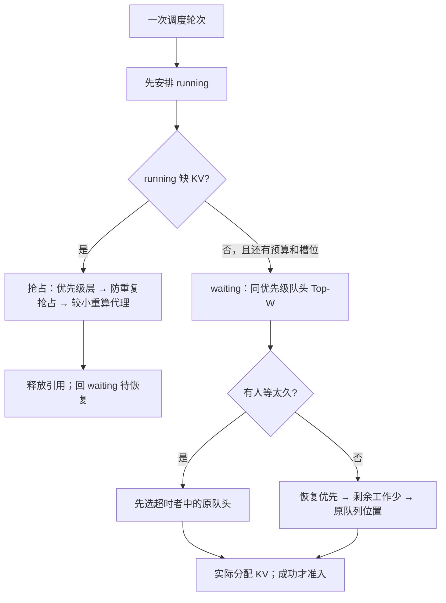

**CUDA 算子是另一条优化线。**模型每轮产生 K/V 后，要按物理槽位写进分页 KV；Q/K 还要做 RoPE 位置旋转。KV 写入的代表形状原本已经按 16 byte 向量搬运，真正需要约 64 个有效线程，却启动了 512 个；我在对齐、dtype、布局满足条件时把线程配置调到 64，不满足则走原通用路径。RoPE 保留原数学公式，满足对齐和真实 QKV stride 条件时用 16-byte 向量化，并让短序列按 head、长序列按 token 并行；其他布局和 rotary 变体回退。**两项都是 kernel 微基准优化，不要把 1.45x 或 1.13～1.84x 当作服务吞吐提升。**[^phase7][^phase8]

**RoPE 原本怎么做？**优化前的通用 CUDA kernel 是**一个 token 分配一个 CTA**：`grid(num_tokens)`；该 CTA 的线程遍历这个 token 的所有 Q heads，再遍历 K heads，对每对旋转元素逐个读取、计算和写回，线程数为 `min(Q heads × 半个 rotary dim, 512)`。它用同一套实现兼容不同 dtype、NeoX/非 NeoX、各种形状和 stride，结果正确；问题是**只有 1 个 decode token 时总共只启动 1 个 CTA**，GPU 上大量计算单元无活可干。短序列先按 head 拆成更多 CTA，可以让它们同时干活。[^ropekernel][^phase8]

**我怎么改？**满足 NeoX、128 维、2-byte dtype 和地址/stride 16-byte 对齐等条件时，每次处理 **8 个 BF16/FP16 元素（16 byte）**：`num_tokens < 4096` 时，一个 CTA 管一个 Q 或 K head、最多 8 个 token，让短序列产生更多 CTA；`num_tokens >= 4096` 时，一个 CTA 管最多 8 个 token、循环处理各 head，避免长序列拆出过多 CTA 和重复读取位置表。**4096 是本次机器/形状实测的切换阈值，不是 RoPE 的固定规则。**条件不符就继续走上面的原通用 kernel；新路径改变数据搬运和任务分配，不改变旋转公式。[^ropekernel][^phase8]

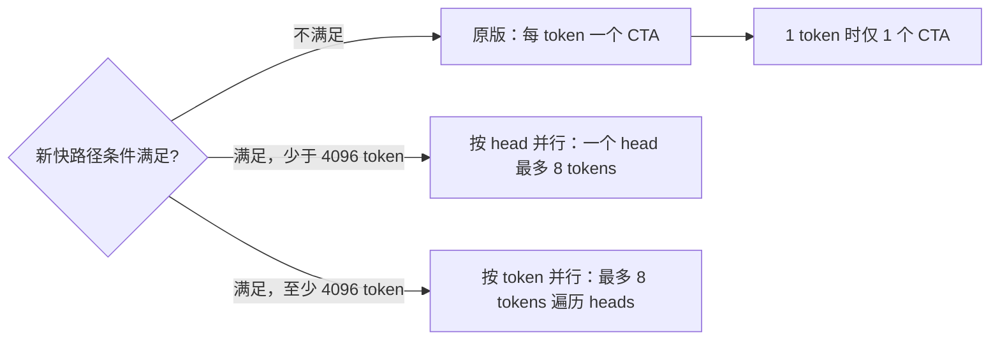

**面试一句话：**“原版 RoPE 是一 token 一个 CUDA block，块里的线程逐元素扫完 Q/K 所有 heads；decode 只有一个 token 时 GPU 只得到一个 block。我在对齐且布局符合的 Qwen 形状下把工作向量化，短序列拆到不同 head 并行，长序列改按 token 分组；不符合条件继续用原版。”

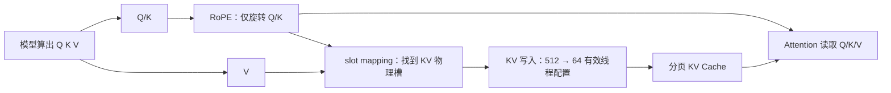

**面试开场可直接说：**“我的工作分两层。调度层利用 vLLM 已有的 APC：准入时只在同优先级队头小窗口内选择，先防等待过久，再优先恢复请求和剩余 prefill 工作少的请求；运行中 KV 不够时，抢占策略先守用户优先级，再尽量选恢复代价较小的人，恢复时重新检查缓存。算子层则优化分页 KV 写入的线程配置，以及 RoPE 的对齐向量化和并行方式。16 类共享前缀、1250 blocks 的单机 A/B 中，准入策略带来输出吞吐平均 +4.20%；算子加速来自独立微基准，不能相加，也没有验证多实例或 offload。”[^phase6h][^phase7][^phase8]

**结果归因提醒：**上述 +4.20% 对比两侧都使用 `recompute_aware` 抢占和 LRU 保留，唯一变化是 `default` 对 `cache_affinity` 准入；它不是“准入、抢占、算子三项叠加”的收益。`reclaimable_aware` 是另一个实现选项，不是这组 A/B 的配置。[^phase6h]

## 入门：先建立一幅脑中的画面

把一次生成理解成“先读题，再逐字写答案”：

1. **Token** 是模型处理文字的单位，不等于一个汉字，也不一定等于一个英文单词。
2. **Prefill** 是模型把已有的整段输入读一遍。例如 system prompt 加用户问题一共 1000 token，模型要先处理这 1000 个 token；处理过程中产生各层的 Key/Value，简称 **KV**。
3. **Decode** 是开始生成答案。通常每步只产生约一个新 token；下一步仍需参考之前的 prompt 和已生成内容。因此既要读旧 KV，也要把新位置的 KV 追加进去。
4. **KV Cache** 是这些已经算好的 K/V 的存储，不是生成文字的缓存。用户看见 token 被流式输出，不代表 GPU 可以扔掉它对应的历史信息。
5. **KV block** 是放 KV 的固定大小页。可把它想成“每页能装 16 个 token 的 KV”。逻辑上请求持有一串页，物理页由 `BlockPool` 复用、回收。
6. **APC（Automatic Prefix Caching）** 是“重复开头免重算”：两个请求的开头若是同样的完整 block，且这些 block 还在缓存里，后一个请求可以复用前一个请求已经算过的 KV。
7. **Admission（准入）** 是从 waiting 队列挑请求，分配它需要的 KV 空间，让它进入 running。**Preemption（抢占）** 是 KV 不够时暂停一个 running 请求、释放其引用，再放回 waiting。**Resume（恢复）** 是日后再次准入，命中还存在的 APC 前缀并重算丢失的部分。

一个最小例子：block 大小 16，公共 system prompt 为 64 token，即 4 个 block。A 和 B 都带这段开头；A 完成后，完整、可缓存的 4 个 block 没被覆盖，B 再来就可能复用它们。若 B 的私有问题还有 32 token，它仍需计算后面 2 个 block。若公共 block 后来被其他请求覆盖，B 就必须重算。**“两个请求文字看起来有公共前缀”与“准入时 GPU 上真有可命中的 KV”是两回事。**[^kvmgr][^blockpool]

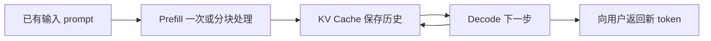

**记住三个不同的限制：** 算力/时间限制决定本轮最多能算多少 token；KV 容量限制决定已算历史能放多少物理块；服务 SLO 决定用户最多愿意等多久。我的项目在等待侧优化“先让谁算”，在运行侧处理“KV 不够时暂停谁”，它们并不是同一个问题。

### 新追问：vLLM 的前缀缓存只有 APC 吗？PagedAttention 论文不止一种机制吧？

**你记得论文里有好几种“共享前缀”的情况，这是对的。我前一版没有把它们逐个说出来。**准确说，那是**多个请求/输出怎样共享已经算出的前缀 KV**的场景与内存机制，不是“把同一段前缀重新计算好几遍”的几种数学算法。PagedAttention 先让 KV 按页存放，用 block table 将多个逻辑序列指向同一物理页；共享页用引用计数管理，分叉后需要改写共享页时使用 copy-on-write。APC 则处理**独立请求后来再次带来相同 token 前缀时，怎样自动找到并复用还保留的页**。它们同属“少算重复前缀”的大方向，解决的识别和生命周期问题不同。[^pagedpaper][^historical][^prefixdesign]

| 容易被记成“几种前缀算法”的场景 | 具体发生什么 | 前缀怎么省计算？和 APC 的区别 |
|---|---|---|
| **Parallel sampling（并行采样）** | 同一个 prompt 要一次生成多个不同答案，例如 `n=3` | 3 条输出从同一个已知父序列分叉；前缀 KV 可共享物理页，分叉部分各自增长。共享关系由“同一次请求的分支”直接知道，不必等另一个独立请求到来再按 hash 搜索 |
| **Beam search（束搜索）** | 每一步保留若干候选答案，候选会扩展、淘汰和再次分叉 | 很多 beam 有相同祖先 token；可共享祖先页，发生写入分叉时再复制需要改写的页。这里的 copy-on-write 是**实现共享的机制**，不是第三种前缀匹配算法；不要把论文时代的 beam/SequenceGroup 实现当作当前 V1 默认调度路径[^historical] |
| **Shared prefix（不同请求共享前缀；用来对照 APC）** | 多条请求都以同一份 system prompt/文档开头，后面各问各的 | 理论上能共享前面的 KV 页，但系统必须识别“前缀相同”，并且页还在。**当前 vLLM 的 APC 是这类跨独立请求复用的一种自动实现**：按父 block hash + 当前 block token 等身份查最长连续命中；请求结束后零引用的完整页也可暂留，供后续请求复用[^prefixdesign] |

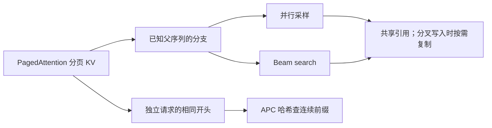

**最容易混的地方：**“共享前缀”说的是**可复用的对象**；“PagedAttention”说的是**怎么分页存放和引用**；“copy-on-write”说的是**分叉写入时怎么保护共享数据**；“APC”说的是**后来来了另一个独立请求，怎么自动发现同一段前缀还在缓存里**。前缀本身仍需要至少计算一次；命中后省的是重复 prefill。若页已被驱逐、token/模型/LoRA/salt 身份不同，就不能命中。APC 的 `sha256` 等选项是 hash 实现选择，不是论文里的几类共享场景。[^prefixdesign][^cacheconfig]

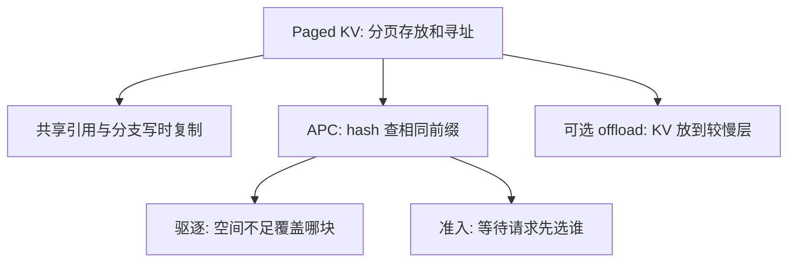

最容易懂的两个例子：

- **分支共享，不必等 APC：** 一条 prompt 要生成 3 个不同答案。3 个分支最初的历史一样，可以指向同一批物理 KV block；当它们开始生成不同的后续内容时，再按需为分叉部分分配或复制。原论文讲的共享/写时复制主要在这里发挥作用。
- **APC 跨独立请求：** A 今天问“同一份长文档 + 问题 1”，B 过会儿问“同一份长文档 + 问题 2”。它们不是同一个分支任务；APC 用链式 block hash 找到还在的相同文档前缀，让 B 跳过重复 prefill。V1 的基础设计以完整 block 的 hash 复用为主；当前代码还针对特定前缀边界提供 partial-block 处理，别把“只支持完整 block”说成所有路径的绝对限制。[^prefixdesign][^blockpool]

| 你可能想到的名称 | 它实际回答的问题 | 本地代码/版本口径 |
|---|---|---|
| PagedAttention / Paged KV | KV 不必连续摆放，attention 如何按 block table 找到它？ | 底层内存与算子基础；不是“命中谁”的打分策略 |
| 共享引用、copy-on-write | 同一历史分成多个生成分支时，如何避免一开始复制所有 KV？ | 原论文的重要机制；不要把历史 `SequenceGroup` 实现直接说成当前 V1 代码[^historical] |
| APC | 两个独立请求有相同前缀时，能否直接复用已算的 KV？ | 当前 V1 的内建前缀复用主要是 hash-based APC；`enable_prefix_caching` 控制开关[^prefixdesign][^cacheconfig] |
| `sha256` / `sha256_cbor` / `xxhash` | 同一前缀的**身份怎么计算**？ | 是 APC hash 算法选项，不是四种缓存调度策略[^prefixdesign][^cacheconfig] |
| `lru` / `waiting_queue_aware` / `priority_aware` | 缓存页需要被覆盖时，**先牺牲哪一块**？ | 是这个项目分支的 `prefix_cache_eviction_policy`；后两者是软保留，容量不足仍可驱逐[^config] |
| `default` / `cache_affinity` | waiting 队列中，**先准入哪个请求**？ | 是本项目的 `admission_policy`，不会改变 APC 的 hash 匹配规则[^config][^policy] |
| recompute / CPU swap / offload | 显存不够时，怎样恢复请求或把 KV 放在其他层？ | 历史 V0 的 swap 和当前 V1 可选 KV offload/connector 不能混为一谈[^historical][^cacheconfig] |

**回答“只有 APC 一种吗”要分两层：** 若问“当前 vLLM V1 怎样自动复用独立请求的相同前缀”，主要答案是**基于 hash 的 APC**；若问“论文里有哪些利用前缀共享 KV 的例子”，重点讲**并行采样和 beam search 的共同祖先页共享**，再用**不同请求共享前缀**引出 APC。这些不是三个可以互换的 APC 开关。分页、引用共享、copy-on-write 是支撑机制；LRU/本项目保留策略管驱逐，准入策略管谁先运行。我的项目改的是 APC 之上的**准入、抢占和部分驱逐偏好**，不是发明了另一种 APC 匹配机制。

**面试可直接说：** “论文里重点用并行采样和 beam search 说明多条序列怎样共享祖先 KV：它们知道共同父序列，可分页共享并按需 copy-on-write。另一个需要区分的场景是后来独立请求带着相同前缀进来；当前 vLLM 用 block hash 的 APC 自动发现可复用的缓存。它们不是几种前缀计算公式。我的调度策略在 APC 查命中的基础上决定谁先准入、KV 紧张时抢占谁。”

## 1. 面试开场：90 秒说清项目

### 先打开哪些代码：原有机制和我的改动

以下路径都相对于 `F:/Projects/vllm`。**“原有”指本项目新增策略前的基础能力；“我的改动”指当前项目分支的实现，不代表每一行都是我首次发明。**面试时先沿前五行看调度主链，再按追问打开后面的文件。`git log` 中 P1～P5 的提交可核对这些策略的演进。

| 文件和位置 | 原有的相关能力/参数 | 本项目分支增加或接入的东西 |
|---|---|---|
| [`vllm/config/scheduler.py`](../vllm/config/scheduler.py) `policy`、`preemption_policy` 等 | `policy=fcfs/priority`、chunked prefill 的 token budget、`scheduler_reserve_full_isl`、watermark 是基础约束 | `preemption_policy=default/recompute_aware/reclaimable_aware`，`admission_policy=default/cache_affinity`，`prefix_cache_eviction_policy=lru/waiting_queue_aware/priority_aware`，`kv_aware_candidate_window` 和 aging 阈值；这些项目开关默认仍选 `default`/`lru`，要显式开启实验策略 |
| [`vllm/engine/arg_utils.py`](../vllm/engine/arg_utils.py) `EngineArgs`/CLI | 将调度配置暴露为启动参数并传入 engine | 给上述项目开关加 CLI 参数和传递，不在此计算排序 |
| [`vllm/v1/core/sched/scheduler.py`](../vllm/v1/core/sched/scheduler.py) `schedule()`、`_select_cache_affinity_request()` | 管 waiting/running、逐轮 token budget、`allocate_slots()` 真实分配和抢占状态变更 | 在 waiting 的同优先级队头 Top-W 探测本地前缀并选择候选；在分配失败处调用新的 victim 策略；接入等待需求保留提示、KV 特征失效和归因计数。**选择只是建议，能否准入仍由真实分配决定** |
| [`vllm/v1/core/sched/policy.py`](../vllm/v1/core/sched/policy.py) `choose_admission()`/`select_preemption_victim()` | 基线 FCFS/priority 的队列与 victim 顺序 | 项目新增只读策略对象：aging、恢复优先、剩余上下文工作量排序；抢占时在最差用户优先级层内比较重算量，`reclaimable_aware` 再比较当前缺口可释放多少块 |
| [`vllm/v1/core/sched/feature_context.py`](../vllm/v1/core/sched/feature_context.py) | 基线调度无需独立的本地 KV 特征缓存 | 项目新增 `cheap()`、`local_prefix()` 和 KV generation 失效；同一 generation 内避免重复 prefix peek |
| [`vllm/v1/core/kv_cache_manager.py`](../vllm/v1/core/kv_cache_manager.py) `peek_computed_blocks*()`、`allocate_slots()`、`free()`、`estimate_reclaimable_blocks()` | APC 查命中、分配和释放 KV；`allocate_slots()` 做真正容量检查 | 项目加入无副作用的前缀探测和可回收物理块估计，供排序/抢占使用；共享引用与延迟释放会使“持有块数”大于“马上能用的块数” |
| [`vllm/v1/core/block_pool.py`](../vllm/v1/core/block_pool.py) `get_new_blocks()` | 空闲队列、block hash、LRU 式复用/驱逐 | 项目接入按 waiting 需求的软保留 tier；不改变最终容量可行性，必要时仍按层级回退驱逐 |
| [`vllm/v1/metrics/stats.py`](../vllm/v1/metrics/stats.py) 与 [`loggers.py`](../vllm/v1/metrics/loggers.py) | 常规 serving 指标 | 项目加入 admission、preemption、retention 与特征探测统计，支撑 A/B 归因 |
| [`csrc/libtorch_stable/cache_kernels.cu`](../csrc/libtorch_stable/cache_kernels.cu) `reshape_and_cache_flash` | 将 K/V 按 slot mapping 写入分页缓存的 CUDA kernel | 对 Qwen 代表 shape 调整线程配置；算子路径与 Python 准入策略是两项独立优化 |
| [`csrc/libtorch_stable/pos_encoding_kernels.cu`](../csrc/libtorch_stable/pos_encoding_kernels.cu) `rotary_embedding` | 通用 RoPE kernel | 对满足 dtype、布局和 16-byte 对齐条件的形状启用向量化快路径及 head/token 双并行，其余回退通用实现 |

**最短定位顺序：** `config/scheduler.py` 看开关 → `scheduler.py:_select_cache_affinity_request` 看“从谁里面选” → `policy.py:choose_admission` 看“按什么顺序选” → `kv_cache_manager.py:allocate_slots` 看“最后能不能分配” → `scheduler.py:_select_reclaimable_preemption_victim` 看“缺块时抢占谁”。别把“配置了某策略”和“基线默认就启用”说成同一回事。

**先用 30 秒说给没有读过 vLLM 的人：** “很多推理请求有同一段开头，比如相同的 system prompt。vLLM 能把这段开头已经算出的 KV 留在显存里，但原始队列未必优先让能复用它的请求运行。我做了一个局部调度策略：在队头少量请求中比较谁还需计算多少，并限制等待时间；显存紧张时还比较暂停谁的代价。只在单机特定高压负载验证到约 4.2% 的输出吞吐提升，多实例和 offload 仍是后续工作。”

下面是面试官继续追问时的完整版本：

> 我做的是单实例、GPU KV block 条件下的 vLLM V1 调度扩展。APC 负责“某个完整前缀 block 是否还在”，Scheduler 负责“谁先运行、KV 不够时抢占谁”。原始 FCFS 不考虑等待请求的本地缓存价值；我在同优先级队头的 Top-W 窗口内，通过无副作用 prefix 查询比较**剩余上下文计算量**，对已抢占请求优先恢复，并用 aging 防饥饿。抢占侧首先尊重用户优先级，再考虑恢复重算成本；另有 reclaimable-aware 变体考虑是否真能释放足够物理块。KV 状态变化时用 generation 失效懒加载特征。16 类共享前缀、1250 blocks、RTX 4090/Qwen2.5-7B 的两对反向 A/B 中，输出吞吐均值 +4.20%，总耗时 -4.00%；归因 A/B 显示恢复重算 token -5.52%。**这是特定负载下的单机结果，未验证 offload、多实例、PD 分离。**[^phase6h][^phase6i]

面试官说“只看前缀命中比例”时，温和纠正：当前代码没有用单一的 `hit / prompt_len` 排序。`AdmissionCandidate.remaining_prefill_tokens = max(request.num_tokens - local_cached_tokens, 0)`；选择顺序是同优先级 Top-W、超时 aging、恢复请求、剩余 token、原队列位置。它仍然是简化的成本代理，尚未纳入传输、负载和 SLO。[^policy]

一句话分层：**nano-vLLM 帮我理解请求、Scheduler、BlockManager、ModelRunner 的最短闭环；真正的实验与回答证据在本仓 vLLM V1 实现。**

## 2. 用图和例子看懂本项目

### 请求从进入到恢复

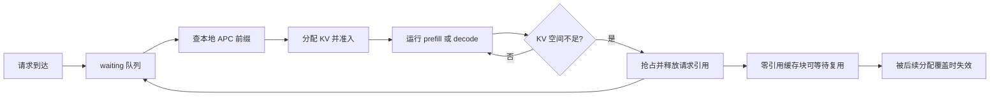

`ref_cnt > 0` 表示仍被请求占用；请求释放后的**完整且已哈希** block 可以处于 `ref_cnt = 0`、仍在 APC 哈希表中的状态，直到被复用或驱逐。抢占不是“把全部 KV 永久保存”，也不是“立刻清空所有 KV 字节”。部分尾块、共享块、延迟释放、外部 connector 都让“释放引用”和“立即可回收物理块”不同。`BlockPool` 管理 free queue 与 hash map；`KVCacheManager.free()` 释放请求引用；恢复时重新查还存在的最长连续前缀。[^blockpool][^kvmgr][^scheduler]

### 本项目实际的决策位置

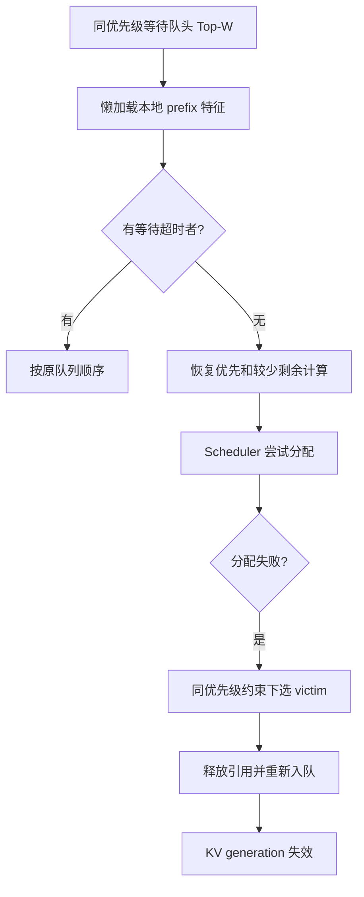

APC 的哈希链只匹配**从第一个 block 起的连续前缀**。例如公共 system prompt 命中 50 blocks、后面用户历史的第 51 个 block 丢失，即使第 52 个 block 的内容还在，也不能直接把它当成连续命中跳过去。匹配通常受完整 block 粒度和“最后 token 还需算 logits”等边界约束；同样文本若 tokenization、模型版本、LoRA、salt 等身份不同，也不能盲目共享。[^kvmgr][^hash]

### Offload、PD 分离、多实例是不同层次

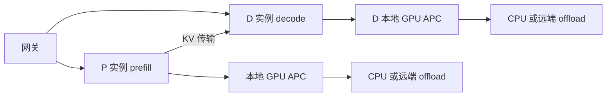

注意两个区别：**PD 分离**是计算角色拆分，prefill 产出的 KV 要交给 decode；**offload**是把 KV 放到较慢层以提高保留容量，读回有额外延迟。它们都可能用 KV connector，但不能把“查到外部缓存”和“本地 GPU 已命中”当成相同成本。跨实例物理 block ID 没有全局意义，必须用模型/适配器/租户等身份、block hash 与实例位置做路由或传输。当前代码的候选探测明确是 *local* prefix peek，不查询 connector；所以原打分不能原封不动用于多级缓存。[^connector][^kvmgr]

### nano-vLLM 与正式 vLLM 对照

| 概念 | nano-vLLM 最短入口 | 本项目 vLLM V1 对照 |
|---|---|---|
| 请求流 | `LLMEngine.add_request/step/generate` | `AsyncLLM` / `EngineCore` / `Scheduler.schedule` |
| 等待与运行 | `Scheduler.waiting/running/schedule` | `Scheduler.schedule`、`RequestQueue`、`policy.py` |
| KV 分配/复用 | `BlockManager.allocate/deallocate` | `KVCacheManager` + `BlockPool` |
| 前向和缓存写入 | `ModelRunner.prepare_prefill/decode/run`、`Attention.forward` | `GPUModelRunner`、attention backend、CUDA op |
| nano 的用途 | 看懂机制与状态变化 | 不用 nano 的简化语义推断生产版所有边界 |

对应代码：[`nano engine`](../../nano_vllm_xxy/nanovllm/engine/llm_engine.py)、[`nano scheduler`](../../nano_vllm_xxy/nanovllm/engine/scheduler.py)、[`nano block manager`](../../nano_vllm_xxy/nanovllm/engine/block_manager.py)、[`vLLM scheduler`](../vllm/v1/core/sched/scheduler.py)。注意以上 nano 链接跨仓库时需从 `Documents_xxy` 上溯两级；面试时直接打开本机路径更快。[^nano]

### 你刚问的第一个问题：大家前缀一样，还优化什么？

先用数字看：A 和 B 都命中同样的 800 token 公共前缀。A 总上下文是 900 token，尚需处理约 100；B 总上下文是 1200 token，尚需处理约 400。若其他条件相同，当前策略会倾向 A，因为它能用更少剩余计算先进入服务。此时优化已从“谁的命中更多”退化为“谁的剩余上下文更短”，很像短作业优先。它可能降低平均完成时间，却也可能让长请求等待，因而必须保留队头窗口和 aging。[^policy]

但**不是只看总 token 数**：若 A 曾被抢占而 B 没有，当前代码先考虑恢复 A；若窗口内有人超过 aging 阈值，先选最靠前的超时请求；不同用户优先级不会跨层比较；即使被选中，KV 分配失败也不会真正准入。更细一点，所有请求都有同样的 system prompt，并不保证私有历史的命中也完全相同。如果命中量、恢复状态、剩余长度都一样，最后按原队列位置，策略没有重排收益却仍可能付出探测成本。面试可以主动承认这个退化条件。

#### 改进思路：先判断“相同”到哪一步

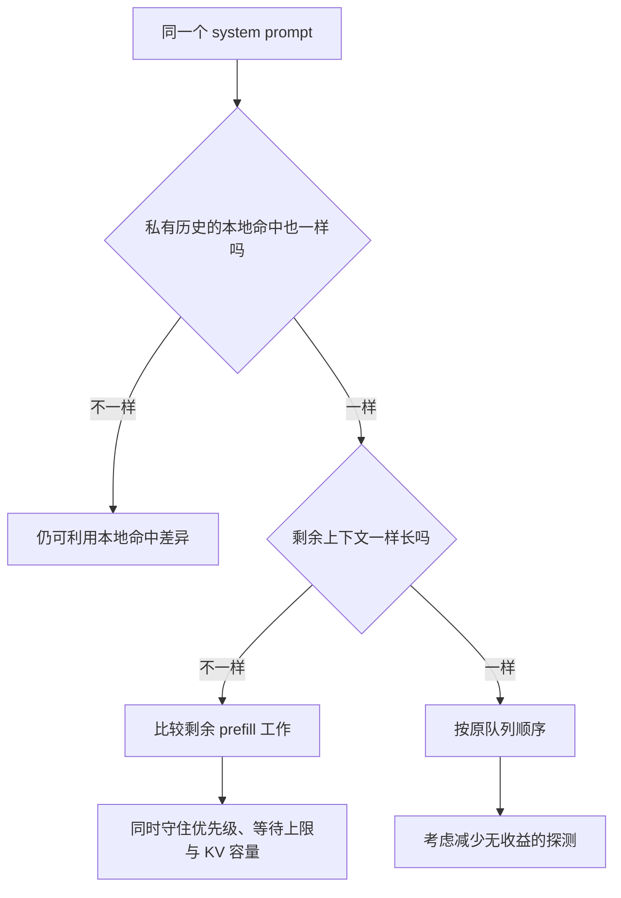

**第一种：都命中 800 token，但 A 还需算 100 token、B 还需算 400 token。**当前代码优先 A，本质上是利用“剩余工作量”的差异，而非继续利用“公共前缀”的差异。下一版可以把“能否真正放进 KV”也纳入准入判断：例如估算本轮新增多少 KV blocks、当前空闲多少、运行中的 decode 还会继续增长多少。这样可避免只因 A 的 prefill 短就选 A，却发现 KV 不够，或挤压正在 decode 的请求。未来输出长度只能做粗估，不能当成已知值，更不能声称当前实现已有这套打分。长请求可能被短请求反复插队，所以继续保留同优先级的有限窗口和 aging 等待上限。[^policy][^scheduler]

**第二种：连本地命中、剩余长度、恢复状态都一样。**这时当前排序按原队列位置选人，确实没有“谁先算更省”的收益。可尝试一个廉价的等价性检查：若候选在这些关键特征上都相同，就直接按原顺序，减少不必要的前缀探测或打分开销。但只看“大家的 system prompt 一样”不能跳过探测，因为有人可能还命中私有会话历史。这个提前返回是**待实现、待验证的优化建议**，不是现有代码行为。

**怎么证明改进有用？**构造“公共前缀相同、私有后缀长度不同”和“完全等价”两组请求，再变化输出长度与 KV 压力；对照原版 FCFS、当前策略和改进版。一起看吞吐、TTFT/TPOT P99、长请求最长等待、实际成功准入/重排次数、调度器 CPU 时间和前缀探测次数。如果候选完全等价，理想结果是性能接近原版、调度开销更小；这目前是实验目标，不是已有结论。

**面试短答：**“同一个公共前缀不代表命中量相同，因为私有历史可能留在缓存里。若命中真相同，我的策略会比较剩余 prefill 工作；若连这个也相同，就退回队列顺序，缓存感知没有额外收益。我会在 KV 紧张时补充新增 block 需求，并对等价候选减少探测；用同前缀压测检验收益与长请求公平性。”

### 你刚问的第二个问题：大家都 aging，能不能轮转？

当前 `choose_admission` 的意思是：只要前 `W` 个同优先级候选里有达到等待阈值的人，就先从这些人中选原队列最靠前的。若人人都超时，局部选择基本回到原队列顺序，相当于公平性规则盖过缓存收益。这是有意设置的饥饿保护，不是性能优化。1000-block 实验中 93.7% 的候选选择因 aging 回退，说明 KV 极紧时这种保护也会显著压缩重排空间。[^policy][^phase6f]

你提出的“时间片轮转”**可以作为下一版实验**，但这里轮转的是**准入机会**，不是把正在 decode 的请求每隔几毫秒强行切走。一个初版设计：设一个绝不能超过的最大等待期限；未触及期限时，每 K 个**成功准入**中留一部分给最老请求，其余给剩余计算量较小的请求；超过期限时立即优先最老请求。为什么数“成功准入”而不是数 `schedule()` 次数？KV 满时可能连续选择十几次却一次也没分配成功，按尝试次数轮转就会产生虚假的公平。再进一步，长 prefill 与短 prefill 占用的 GPU 时间不同，按“token/计算预算份额”比按请求个数更公平。需要用 TTFT P99、长请求等待时间、吞吐和抢占重算 A/B，不能先宣称轮转会更快。

### 你刚问的第三个问题：为什么 decode 每次只吐一个 token，KV 反而会满？

**先直接回答你的四个判断：**

1. “Prefill 前模拟预占，所以以后不会受限？”**不对。**模拟/检查的是可用容量或当前输入能否放下，不是把未来全部输出长度的 KV 页永久划给该请求。
2. “一般是 decode 才把 KV 用满？”**在长输出、高并发场景很常见，但不是必然。**长 prompt、低命中率、大量同时到达的请求，prefill 准入也会受限。
3. “我的准入策略主要管 prefill？”**基本对，但更准确叫 waiting 侧准入。**新请求通常准备做 prefill；被抢占的请求也回到 waiting，它可能是在原来的 decode 过程中被抢占，现在需要恢复一段上下文。当前策略不负责给正在 running 的每个 decode token 重新排序。
4. “PD 分离后就不会 KV 受限？”**仍会。**P 端要存正在计算的 prompt KV；D 端接收这些 KV 后，还要持续追加输出历史。只是 prefill/decode 的计算干扰被分到不同实例，容量瓶颈和路由问题没有消失。

#### 你说的“预占”究竟是哪一步？

| 容易被叫作“模拟预占”的动作 | 实际做了什么 | 没有保证什么 |
|---|---|---|
| 引擎启动时的 `profile_run()` | 测模型运行需要多少显存，据此确定整台 GPU 可提供多少 KV blocks，例如本次压测人为限制为 1250 blocks | 不为每条未来请求预留 blocks，也不知道未来会到多少请求 |
| waiting 请求准入时的 `scheduler_reserve_full_isl=True` | 检查**当前请求已有的输入序列**整体能否装下，避免 chunked prefill 只看第一小段就过量准入；计算时考虑已有前缀命中 | 不按 `max_tokens` 把未来可能输出的所有 KV 一次性占住；通过检查后，其他请求仍可能使用剩余空间 |
| 实际 `allocate_slots()` | 为这**一轮将处理的 token**及必要 lookahead 分配物理位置 | 不承诺后续所有 decode step 都能继续拿到新块 |

代码证据：`Scheduler.schedule()` 的 waiting 路径把 `full_sequence_must_fit=self.scheduler_reserve_full_isl` 传给 `KVCacheManager.allocate_slots()`；它检查的 `full_num_tokens` 来自当时的 `request.num_tokens`，随后又按本轮 `num_new_tokens` 算实际需要分配的块。未来尚未生成的输出 token 不在这个当前长度里。恢复请求的 `num_tokens` 会包含此前已生成的输出，但仍不包含更远的未来。[^scheduler][^kvmgr][^config]

#### 单机混部：一次请求怎样从 prefill 走到 decode 缺块？

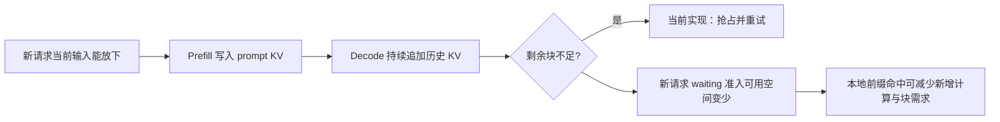

用简化数字走一遍：block 大小 16，10 个请求共享 64-token 公共前缀（约 4 个共享 block），每人另有 16-token 私有输入（各约 1 个 block）。初次 prefill 后大约需要 `4 + 10×1 = 14` 个物理 block。若 GPU 预算只有 40 blocks，**当前输入的 prefill 都可以通过容量检查**。每人后续再生成约 64 token，历史还会增加约 4 个 block，总需求量级为 `4 + 10×(1+4) = 54`；增长过程中就可能碰到 40-block 上限。真实数值还受共享引用、APC 驱逐、部分页、滑动窗口和提前完成影响，这只是说明“先能准入、后续仍可能满”的模型。

“吐给用户”也不等于“删除 KV”：prefill 算出 prompt 的 KV 并采样首 token；下一轮把首 token 当输入，算它的 K/V，再采样下一个。只有请求完成/被抢占等情况下才释放请求引用。一个 block 可放多个 token，所以 decode 不是每吐一个 token 就新建一整块，而是页填满时再要下一块。[^scheduler][^blockpool]

#### 一定要抢占吗？不抢占会怎样、在哪里设置？

**原理上不一定。**假设 40 个 block 只剩 0 个，运行中的 A 下一步 decode 恰好要开新 block：可以抢占某个运行请求释放 KV，让 A 继续；也可以让 A **暂停并保留原有 KV**，等别的请求完成后再继续；还可以在准入时就少收请求，预留更多 decode 余量。后两种都可能减少重算，但如果所有运行请求都缺块、谁也无法完成，仅仅“等”会卡住，需要容量上限、超时拒绝、offload 或其他释放空间的办法。无限等待不是可用的 no-preempt 策略。

**这份 vLLM 分支没有现成的“完全禁用抢占”开关。**`vllm/config/scheduler.py` 的 `preemption_policy` 可选 `default`、`recompute_aware`、`reclaimable_aware`，改变的是**发生缺块时选谁被抢占**，不是开/关。`default` 在 FCFS 下倾向抢占最新的 running 请求；`recompute_aware` 在用户优先级约束下考虑恢复重算量和避免同一请求反复被抢占；`reclaimable_aware` 再看谁能立刻释放更多真正可用的物理块。`Scheduler.schedule()` 的 running 路径在 `allocate_slots()` 返回失败后，仍会按所选策略调用 `_preempt_request()` 并重试；因此设 `--preemption-policy default` **仍会抢占**。waiting 侧的新请求若分配失败，则本轮不准入、继续等待，不会仅为它立即抢占一个 running 请求。[^config][^policy][^scheduler]

| 想做的事 | 当前可用的设置/做法 | 边界 |
|---|---|---|
| 改变抢占对象 | `--preemption-policy default` / `recompute_aware` / `reclaimable_aware` | 三者都不是禁用抢占 |
| 减少抢占出现频率 | 降低 `--max-num-seqs`、提高 `--watermark` 留出 KV 空间；也可减小输出上限或增加 KV 容量 | 降低并发可能损失吞吐；未来输出与真实 block 需求仍不确定，**不能保证零抢占** |
| 真正不抢占 | 需新增 `no_preempt` 策略和“缺块时安全暂停/稍后重试”状态管理，或在准入时为每个请求保守预留可达的最大 KV 需求 | 要证明所有 running 请求至少有一条可完成路径；否则会死锁或必须超时/拒绝。当前项目没实现这个模式 |

**我目前到底选了什么？**项目代码提供上述三种 victim 策略，但简历里的 16 类前缀、1250-block、输出吞吐 +4.20% 那组 A/B 中，**对照组和实验组共同设 `preemption_policy=recompute_aware`、`prefix_cache_eviction_policy=lru`**；对照用 `admission_policy=default`，实验用 `admission_policy=cache_affinity`、`window=8`、`aging=10s`。所以 +4.20% 是这个共同抢占条件下**准入策略的对比结果**，不能说是“启用抢占”带来的，也不能说这组实验用了 `reclaimable_aware`。`reclaimable_aware` 是项目另一个可选实现。[^phase6h][^config]

**面试短答：**“抢占不是理论上必须，但当前 vLLM 在 running 请求拿不到下一轮 KV 时会抢占并重试；`preemption_policy=default` 也不是关闭抢占。我这组核心 A/B 两侧都用了 recompute-aware 抢占，只比较准入排序。不抢占需要更保守的容量预留，或安全暂停并保证系统最终能腾出块，否则长输出高并发时可能无限等。降低并发和设 watermark 能减少抢占，但不等于禁用。”

#### 什么时候尝试准入？“每轮”到底是多久？

**一轮 = engine 调用一次 `Scheduler.schedule()` 来组织下一次模型执行的 batch。**`EngineCore.step()` 在有未完成请求时先 `schedule()`，再执行模型并处理输出；异步 batch queue 路径也会调用 `schedule()`。它不是“每隔固定 10 毫秒响一次闹钟”，也不是“整批只生成一个 token”。同一轮里，每个 decode 请求通常安排下一 token，而 prefill 请求可能安排一整段 chunk；轮耗时随 batch 大小、prefill 长度、模型前向、GPU 负载、传输及异步流水而变。**TPOT 是用户看到的平均输出 token 间隔，不等于严格的 `schedule()` 调用间隔**；本项目报告里的约 30 ms TPOT 不能说成“每轮固定 30 ms”。[^enginecore][^scheduler][^phase6h]

**每轮都会“有机会检查 waiting”，但不是每轮都有新请求成功准入。**当前顺序是先安排 `running`，再看 `waiting`/`skipped_waiting`。只有本轮没有发生抢占、调度器没有暂停、waiting 队列非空，而且还有 token/input budget 与 `max_num_seqs` 槽位，才进入 waiting 选择循环。候选还可能因 LoRA/状态限制暂不能运行，或者最终 `allocate_slots()` 分配 KV 失败。满足条件时，同一轮可连续准入**多条** waiting 请求，直到预算、槽位或容量用完；`cache_affinity` 是在这个循环中比较同优先级队头候选，不是每轮必选一条。[^scheduler]

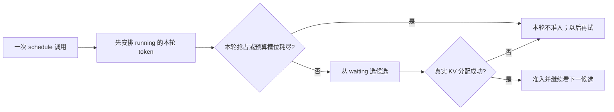

**三轮例子：**第 1 轮运行中的 A、B 各安排一次 decode，仍有预算和 KV，于是 waiting 的 C 获得准入、做一段 prefill；第 2 轮 A 扩张到新 block 时缺块，调度器抢占了 B，这轮不再接纳新 waiting；第 3 轮空间恢复且无抢占，才可能考虑等待中的 D 或恢复中的 B。这里“第 3 轮”不是固定在第 2 轮后多少毫秒，具体时间取决于前一轮计算与流水执行。单机普通 `EngineCore` 不主动按 `prefill_schedule_interval` 节流；该参数默认 1，主要给特定 DP 协调路径使用。[^enginecore][^scheduler][^config]

**面试短答：**“每个 engine step 都重新做一次调度决策，但只有 running 排完且未发生抢占、还剩预算/槽位/KV 时才尝试 waiting 准入；一轮可以准入零条或多条。step 是一次 batch 调度和执行，不是固定时长，也不能把 TPOT 直接叫一轮耗时。”

#### 你的 cache-affinity 在哪里发挥作用？

同一个 V1 Scheduler 的一轮调度里，先服务 **running** 请求（它们可能正在做剩余 prefill chunk，也可能在 decode）。如果 running 侧申请 KV 失败，会尝试抢占；**本轮发生抢占时，waiting 侧通常不再继续准入新请求**。若还有 token 预算、请求槽位和 KV 容量，才进入 waiting 侧，从同优先级队头 Top-W 候选里比较本地 APC 命中、恢复状态、剩余上下文量与 aging，并尝试真正分配。[^scheduler][^policy]

所以更准确的因果链是：**decode 增长消耗 KV → 可用于新请求的空间变少、可能触发 running 侧抢占 → waiting 请求以后准入或恢复时，cache-affinity 比较谁能复用仍在的本地前缀，以及还需重算多少**。前缀命中会降低新增计算，并可能减少新增物理块需求，但不保证“命中高者一定能准入”：共享块仍占显存，实际分配还要再次检查容量。你的策略作用于 waiting 请求，主要影响新请求 prefill 和抢占后的恢复；它不直接解决所有 running decode 的容量增长。

**不能把本次实验直接说成“抢占都发生于 decode”。** 16-prefix、约 900-token 共享前缀、每请求 1024 输出、并发 48、1250-block 的形状使 decode 累积压力看起来很重要，但汇总报告没有逐次记录抢占阶段。要验证，就在 allocation failure/抢占时记录该请求的 `num_computed_tokens`、`num_prompt_tokens`、本轮 `num_new_tokens` 和剩余 blocks，再按 prefill/恢复/decode 统计。[^phase6h]

#### PD 分离以后，这条链变成什么？

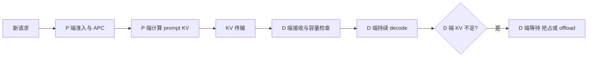

P 与 D 是不同的实例，各有自己的 GPU block pool。P 端忙于多个大 prompt 时仍会缺块；P 端完成的 KV 要传走，传输/释放未完成时也要占空间。D 端收到 prompt KV 后，还会随生成增长，照样可能在 decode 受限。**改变的是隔离关系：D 端的 decode 块不会直接占用独立 P 端的物理 KV pool，因此不会像单机混部那样直接挤压 P 端本地 prefill 准入；但 P→D 交接会被 D 端容量、传输和排队反压。**[^connector][^kvmgr]

当前 `cache_affinity` 的 prefix peek 只看**调用它的 engine 的本地 GPU APC**。若部署在 P 端，它可以优化 P 端待做 prefill 的本地前缀命中；不能据此认定 D 端也有相同前缀 KV，更不能替 D 端解决 decode 空间不足。若要进一步做 PD 调度，需要网关/P/D 协同考虑“P 哪个实例命中、D 哪个实例有容量、传 KV 要多久、失败如何回退”。这部分没有在本项目做实验。[^kvmgr][^connector]

**面试可直接说：** “启动 profile 只是算总 KV 容量，准入的 full-ISL 检查只针对当前已有上下文，不为未来输出永久预留空间。因此 prefill 可能通过，decode 增长后仍会抢占。我的 cache-affinity 在 waiting 侧选新请求或恢复请求，主要降低前缀重算，并非控制每一步 decode。PD 分离让 P/D 不再争同一块 GPU pool，但各自仍可能缺 KV，尤其 D 端长输出依然会增长。”

## 3. 质疑 1～6：缓存与算法

### 1. 接入 CPU/磁盘 offload 后还有效吗？

#### 先答追问：vLLM 默认开启 offload 吗？L1/L2 等于 GPU/NPU 吗？

**这份代码默认不开 KV offload。** `CacheConfig.kv_offloading_size=None` 表示不启用；显式设置这项容量后，才按 `kv_offloading_backend` 选后端。后端字段虽然默认是 `native`，但**“默认后端是 native”不等于“默认开启 offload”**：开启后，native 路径配置 CPU KV offload connector。另一种 `lmcache` 后端需要对应的外部服务配置，不能凭一个参数推断它已经在运行。`cpu_offload_gb=0` 则是**模型权重** offload 的默认设置，不是 KV offload；不要把两者混说。其他显式 KV connector 也可能提供传输或外部缓存，但并非默认打开。[^cacheconfig][^vllmconfig][^weightoffload]

**收益看“省掉的重算”能否覆盖“搬回来的成本”。**例如长的 system prompt 或多轮历史刚从 GPU 淘汰、很快又被访问，CPU 中还留着它的 KV：读回可能比重新做长 prefill 快，并让有限 GPU 显存容纳更多可复用内容。若几乎没有重复前缀、缓存已丢失，或者 PCIe/网络传输与查询排队比重算还慢，TTFT 反而可能变差；CPU 内存、带宽和管理开销也会上升。正在 GPU 上连续 decode 的请求仍要不断追加 KV，offload 不等于把 GPU KV 容量限制消除，更不能保证吞吐或 P99 一定改善。我的 A/B 没开 offload，因此**没有可报告的 offload 收益百分比**。[^cacheconfig][^connector]

**L1/L2 是“快层/慢层”的逻辑叫法，不是硬件名字。**在这次单机 GPU 项目里，可简称“本地 GPU 显存 KV = L1；若额外配置 CPU 内存 KV = L2”；再加磁盘或远端存储时可以有更多层。换成 NPU 平台，快层通常是 **NPU 自身的设备内存**，慢层可能仍是 CPU 内存或其他显式配置的存储。GPU 与 NPU 都是计算设备，不能说“GPU 是 L1、NPU 是 L2”；把 KV 从 GPU 搬到另一块 NPU，也只有在对应硬件、互联和软件传输路径实际实现时才成立。这些层级是解释成本的比喻，不保证不同后端的缓存一致性、驱逐规则和带宽相同。

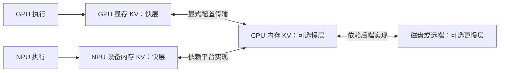

**面试短答：**“我这版 vLLM 默认不开 KV offload，`kv_offloading_size` 要显式配置。打开后是否有收益，取决于外部 KV 的重复命中率及读回和重算哪个更快；我的项目没测，不能报收益数字。L1/L2 表示相对的快慢存储层，不是 GPU/NPU 两种设备的固定对应关系。NPU 上的 L1 也可以是它自己的设备内存。”

**速答：** 原理上“少做重复计算”仍有价值，但本地 GPU 命中不等于 CPU/磁盘命中。当前实现只为本地 APC 排序，直接迁移会算错收益。我会先把每个候选分成 `GPU hit / 外部可恢复 / 必须重算` 三段，比较预计完成时间，而不是只比缓存 token 数。

**白话理解：** GPU 缓存像桌面上的材料，拿起来就用；CPU 内存像隔壁柜子，省掉重新制作的工夫，但还要走过去搬；磁盘或远端像仓库，容量大、搬运更慢。若甲有 800 个 token 在远端、乙有 400 个 token 已在本地 GPU，“甲缓存更多”不一定表示甲先完成。还要看远端读回占多少网络带宽、GPU 有没有空位、乙是否已经等太久。

直观成本：`T_gpu_hit≈0`；`T_external≈查询+排队+传输字节/有效带宽+同步`；`T_recompute≈剩余 token 的模型计算`。仅当外部读回的预计收益超过传输和等待开销，才把它计入调度分值。还要避免同一 token 同时算作本地和外部命中；处理异步查询结果过期、读回失败回退重算、GPU 目标块不足、跨模型/LoRA 错配。具体改造点是 connector 的 `get_num_new_matched_tokens`/加载状态与 Scheduler 的准入路径；当前 `peek_computed_blocks` 明确不咨询 connector。**没有做这项实验，不能承诺吞吐仍 +4.2%。**[^connector][^kvmgr]

**面试可直接说：** “我的策略当前只知道 L1 GPU 的命中长度。引入 L2 后，我先分清命中发生在哪一层，再把传输时间与重算时间换成同一个时间单位比较；正式准入时让 connector 复核，失败回退重算。当前单机结果不能直接外推。”

### 2. 多轮会话的私有历史被 LRU 驱逐怎么办？

**速答：** 这个判断成立。公共 system prompt 热、易共享；用户私有长历史重用间隔长，零引用后在容量压力下容易被驱逐。不能说 APC 会自动保护整段会话。

例如十个用户每人聊天十轮：十个人都共用前 500 token 的 system prompt，但各自的问题和回答逐渐分叉。这个公共前缀被频繁用到，很容易保持“热”；某个用户半小时才回来一次，他独有的 3000-token 历史即使曾缓存，也可能早已被新请求占用的 blocks 覆盖。APC 只会发现**还在的最长连续前缀**，不是会话数据库，也没有“用户回来时还原全部记忆”的承诺。

可做四级改进：先用会话/前缀感知的实例粘性降低跨实例丢失；在可控预算内给“即将继续的会话”短 TTL 或软保留，而不是无限 pin；超出 GPU 容量再考虑 CPU/offload；长历史业务还可通过摘要、窗口化降低 KV 需求。策略应区分**活跃引用**与**可驱逐缓存**，并设置每租户上限，避免热用户挤占别人。现有 `waiting_queue_aware`/`priority_aware` 只是对队头需求的**软**保留，容量不够仍会驱逐；它不等于会话级持久化。[^blockpool][^config]

**取舍一定要讲：** 如果永久 pin 每个会话，活跃请求反而没有 KV 空间。因此保护要有预算、TTL、租户配额，且在极端压力下允许驱逐；offload 扩大可保存容量，却额外消耗内存、带宽和恢复时间。

### 3. 抢占时缓存何时保留、何时失效？恢复如何干扰策略？

**速答：** 抢占把运行请求放回 waiting，释放引用，并把 `num_computed_tokens` 置零。完整缓存块在无其他占用时可能作为 APC 候选暂留；被复用、驱逐、清缓存或模型身份变化后不能再命中。恢复时重新查**当时实际存在**的连续前缀，未命中部分重算。不能把抢占前的估计当作恢复时的真值。[^scheduler][^kvmgr]

想象请求已算到第 1000 个 token，却因 KV 不够被暂停：

1. Scheduler 先记录旧的已算边界 1000，释放该请求持有的 block 引用，标记 `PREEMPTED`，把 `num_computed_tokens` 归零并放回 waiting。
2. 若其中 800 token 的完整前缀 block 在缓存里没有被后续分配覆盖，恢复时可直接命中前 800，再计算剩余约 200；若只剩前 400，就要多算约 600。
3. 若这些 block 还被其他运行请求引用，抢占当前请求也未必立刻产生同样数量的空闲物理块；这就是“牺牲一个请求”不等于“释放它看起来持有的所有块”。

#### 追问：抢占时的“当前已算 tokens”到底怎么算？

它在代码里叫 `request.num_computed_tokens`，可理解为**当前请求的上下文已经建立到第几个 token**，单位是 token，不是 block，也不是已输出给用户的字数。请求刚创建时为 0；waiting 请求准入时，若 APC 命中前 800 token，Scheduler 先把它设为 800（若有外部 KV，还会加上已恢复的外部部分）；本轮再安排计算 200 token，就在调度更新时加 200，变成 1000。下一轮若拿新生成的 token 做一次 decode，又加 1。公式可记为：`新边界 = 已复用/已恢复的连续前缀 token + 此后已安排计算的 token`。[^scheduler][^kvmgr]

**例子：**prompt 为 1000 token，命中前 800，实际 prefill 算后 200。此时 `num_computed_tokens≈1000`，但“本次真正做过的 prefill”只有约 200，所以**它不是纯粹的 GPU 计算工作量累计值**。prefill 后采样得到第 1 个输出 token；这个输出 token 通常要到下一次 decode 才作为输入计算并增加其 KV。因此若已向用户输出 100 个 token，且还没处理最后一个，边界通常约为 `1000+99=1099`，不是简单的 `1000+100`；异步/推测解码时还可能有在途或回滚。[^scheduler][^request]

**抢占瞬间怎么用？**`recompute_aware` 在最差用户优先级层内，先避免反复抢占已经被抢占过的请求，再偏向 `num_computed_tokens` 较小的 victim：边界较短，假设缓存全丢时最多需要重建的上下文通常也较少。但这只是**重算成本代理**，因为其中可能有共享/APC 命中的 token，抢占后缓存也可能仍在；真正恢复代价要在重新准入时查当时还存在的连续前缀，大致是 `恢复时上下文长度 - 恢复时命中长度`。`reclaimable_aware` 则先比较物理块能否填补当前缺口，再以这套重算顺序打破平局。[^policy][^kvmgr]

`_preempt_request()` 在清零之前读取这个旧边界，用于 `preempted_computed_tokens` 和恢复重算归因，然后释放 KV 引用、设 `num_computed_tokens=0` 并移回 waiting。注意调度器会**乐观地**在模型结果回来前先增加已安排的 token；推测 token 被拒绝、异步在途结果等情形还会校正，所以它不是每一瞬间都严格等于“GPU 已确认算完”的数量。面试可说：**“这是 Scheduler 的已建立上下文边界；抢占选择拿它近似重建代价，真实重算量取决于恢复时还能命中的 KV。”**[^scheduler][^request]

常见干扰：刚被抢占的请求 `num_computed_tokens=0`，若单纯“抢占最少已算 token”，它会反复成为 victim，形成 thrashing。所以当前 `recompute_aware` 在同一用户优先级内先保护已抢占者；恢复准入也倾向先处理它。共享 block 可能仍被其他请求占用，抢占不一定立即腾出足够物理块；`reclaimable_aware` 才进一步估计即时可回收块数。KV 变化后 `SchedulingFeatureContext.invalidate_kv_features()` 清除旧 prefix 特征，避免使用过期打分。[^policy][^feature]

**面试可直接说：** “抢占释放的是请求对 KV 的引用；APC 能否恢复取决于完整块是否仍在。恢复时重新查，不相信抢占前的命中估计。策略还要防止同一个请求被连续抢占。”

### 4. 打分维度是否过于单一？

**先纠正再承认：** 当前不是只用相对命中率，已考虑硬优先级、有界队头、aging、恢复状态和剩余 prefill token。它仍没有完整刻画真实服务目标：请求等待时间/SLO、decode 流式稳定性、剩余输出长度估计、可回收物理块、GPU 负载、offload 传输、会话复用概率、租户公平性。[^policy]

举例：A 命中了 900/1000 token（90%），还要算 100；B 命中了 1000/2000（50%），还要算 1000。仅看百分比会偏向 A，这次看起来没错；但若 A 在远端、B 的 1000 token 在本机 GPU，或 A 已严重超时而 B 是新请求，百分比根本不足以说明谁应先做。再如 A、B 都命中 800，剩余分别为 100 和 400，纯命中长度完全分不出高下，当前的剩余计算量可以区分。**打分前先问清它要优化的目标：平均吞吐、TTFT P99、流式稳定，还是租户公平？**

改进应先定硬约束（优先级、最大等待、内存可行性），再在允许的候选中比较 `预计节省的计算/传输时间 - 增加的排队和 decode 干扰`。线上权重不能凭感觉堆公式，要用 trace 与消融 A/B 决定；默认策略保留回退，负收益时自动降级。尤其**命中 token 最多**不必然最快：800 个外部命中 token 的传输可能慢于本地重算 200 token。

**面试可直接说：** “我的当前排序是一个成本代理，不是完整线上效用函数。优先级和 aging 是硬边界；下一步引入 SLO、真实可回收块与多级传输成本，再做消融验证每个特征是否带来净收益。”

#### 这些指标分别解决什么问题？先分清“可量到”和“要猜”

| 指标 | 白话例子与用途 | 本项目现在能从哪里拿？下一步缺什么？ |
|---|---|---|
| 等待时间 / TTFT SLO | 用户要求首 token 在 2 秒内到达；已经等 1.8 秒的请求比刚到的更紧急。SLO 是目标时限，不是平均耗时 | `Request.arrival_time` 可算从到达至今多久；当前 aging 用的是到达时间。要做准入 SLO，需从网关/请求参数传入 deadline 或服务等级，并记录**每次进入 waiting 的时间**，否则恢复请求会把运行过的时间也算作排队时间 |
| decode 流式稳定性 | 正在输出的用户若突然 2 秒没新 token，体验差，即使总吞吐不错 | 需要上一 token 输出/调度时间和约定的 TPOT/ITL 上限；`max_tokens` 是上限，不是“还会生成这么多”的保证。第一版可只设 KV headroom 和保护已开始输出者，先不预测完整未来 |
| 剩余输出长度估计 | 长回答可能持续占 KV；短 prefill 也可能马上带来很长 decode | `Request.max_tokens - num_output_tokens` 仅是**最多还可能输出**，不能作为精确预测；若要估计，用同模型、同业务类的历史分位数，并设置保守上限、随实际输出更新 |
| 真正可回收的物理块 | 两个请求都“持有 20 块”，但其中一个与别人共享 15 块，抢占它可能只腾出 5 块 | **抢占侧已有实现**：`estimate_reclaimable_blocks()` 只计该请求独占的物理块，`scheduler.py` 再排除延迟释放，并拿分配缺口比较。准入侧还需区分空闲块、可驱逐的零引用缓存块、共享块和异步加载的占位，不能简单把它们相加[^kvmgr][^scheduler] |
| GPU 负载 | GPU 正在忙着长 prefill，给新请求排到前面也未必能快出首 token | 本地可先用 running 数、本轮 token budget、KV 空闲/水位及最近几轮 step 时长作粗信号；跨实例选路才需要比较别的 GPU。不要在每次调度时同步查询硬件计数器 |
| offload 传输 | CPU 有 800 token 的 KV，但搬回来可能比重算 200 token 更慢 | 当前只探本地前缀。需要 connector 提供**只读、低成本的可用性/预计字节数**；再从监控估计查询、排队、传输与同步时间。实际准入仍要复核；不能把正式 `get_num_new_matched_tokens()` 当作无副作用的候选探测接口[^connector] |
| 会话复用概率 | 用户可能马上发下一轮，留住其 KV 有价值；一次性请求则未必 | 需业务层提供匿名会话标识和近期再次到达统计。它主要影响**驱逐/保留**，不应单凭“某人可能回来”无限推迟当前 waiting 请求；还要限制每租户占用 |
| 租户公平性 | 一个租户发很多短请求，可能把其他租户长请求一直挤在后面 | 需可信的 tenant ID、配额/权重和每租户已用预算；目前的 `priority`、队头窗口、aging 不能替代租户公平。第一版先保留硬优先级和最大等待，再按租户配额做软约束 |

#### 我这份代码下一步可以怎样加：一个分阶段的 `slo_capacity_aware` 策略

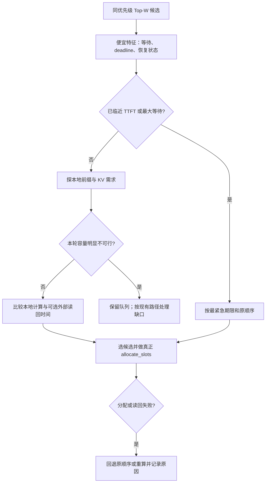

**一个能先实现的 MVP 规则（建议，不是当前代码）：**候选仍限同优先级队头 8 个；设 `urgent_margin_s=0.2` 秒作为实验初值，业务传入 `deadline` 时，计算 `slack = deadline - now - estimated_prefill_s`。`estimated_prefill_s` 先由现有压测按 token 长度分桶测出的时间表给出，不能直接把 token 数当秒数。若有人 `slack <= 0.2` 秒，选 deadline 最早者；否则，先排除明显无法满足当前 KV 预算的候选，再沿用“恢复优先、剩余 prefill 少、原队列靠前”。`estimated_prefill_s` 未校准或 deadline 缺失时，沿用当前 `cache_affinity`。这 0.2 秒只是待调实验参数，不是线上通用阈值；还要有现有 aging 的最大等待兜底。**例如** A 剩 100 token 但还有 5 秒期限，B 剩 300 token 却仅剩 0.1 秒期限：先让 B；若二者都不紧急，再倾向 A。即使选择了 B，也可能因真实 KV 分配失败而不能准入。[^policy][^scheduler]

```text
候选 = 同优先级队头 Top-W 中当前可调度的请求
若没有可靠 deadline/耗时估计：使用现有 cache_affinity
否则先选等待超上限或 deadline 即将到期者
再对其余候选做本地 KV 命中与本轮 block 需求的低成本预估
明显不可行者保留原队列位置；其他候选按恢复状态、估计工作量、原位置排序
选择后仍调用现有 allocate_slots；只以其实际结果认定准入成功
```

**第一阶段，只加 SLO，不接 offload。**在 `SchedulerConfig` 增加独立开关，例如 `admission_policy="slo_capacity_aware"`（保持默认 `default`）；在请求入口携带可信的 `ttft_deadline_s` 或服务等级，并在进入/重新进入 waiting 时记录时间。`AdmissionCandidate` 加 `deadline_slack_s = deadline - now - 粗估剩余 prefill 时间`。仍只看同优先级 Top-W：**已过期/临期**者先按 deadline、原位置选；其余沿用恢复优先和剩余 prefill 工作排序。没有 deadline 就用现有 aging；负 slack 代表预计来不及，不能把它说成“调度后保证达标”。恢复请求已经出过首 token，不能再套首次 TTFT deadline，应改看恢复等待或下一 token 间隔。起步用业务明确给的期限，先别凭 `arrival_time` 编一个“用户 SLO”。改动位置：`config/scheduler.py`、请求元数据传递到 `v1/request.py`、`policy.py:AdmissionCandidate/choose_admission`、`scheduler.py:_select_cache_affinity_request`。[^policy][^scheduler]

**第二阶段，用现成可回收估计处理“抢占谁”。**`reclaimable_aware` 已比较当前 allocation shortfall 和每个 running 请求的**即时可释放**块，无须再造一个按逻辑持有块数排序的版本。下一版可在最差用户优先级层内先过滤“释放后仍远远不够”的 victim，再看 `recompute_tokens / max(1, min(reclaimable_blocks, shortfall))`；同时保护临近下一 token 期限的正在流式输出请求。这里比的是**抢占代价**，不能把“牺牲一个请求”当成准入候选的缓存命中。若没有任何候选能马上提供足够块，保留当前逐步抢占/等待路径，不假装已腾出空间。先做只记录不改变选择的 shadow 计数，再开新 `preemption_policy` A/B；必须测重复抢占和 TPOT P99。[^policy][^kvmgr][^scheduler]

**第三阶段，接入多级成本，但先取得只读信息。**当前 `_select_cache_affinity_request()` 发生在正式 connector 查询之前；正式接口可能建立加载状态，不适合对 Top-W 每个候选试调用。先给具体 connector 增加可选的只读 peek/报价能力，返回“外部连续命中 token、位置、预计字节数、是否新鲜”；没实现、超时或结果过期就按本地策略走。估算 `本地方案时间 ≈ 剩余 prefill token 的实测计算时间`，`外部方案时间 ≈ 查询 + 排队 + 字节/有效带宽 + 同步 + 未命中部分的计算`；只有外部方案**明显更省时**且 GPU 有接收空间才偏向它。对 chunked prefill，要分别估计“本轮工作”和“直到首 token 的总工作”；对异步读回，要计入在途 KV 占位。正式 `allocate_slots()` 和 connector 查询/加载仍是最终事实，失败可回退重算。[^connector][^scheduler]

**第四阶段才考虑输出预测、GPU 负载、会话与租户。**先用 KV watermark 预留 decode 增长余量，再以最近窗口的输出长度分布做粗预测；用近期 step 时长修正时间估计。会话再次访问率用于有限预算的软保留；租户配额约束一个租户能占多少候选准入/保留资源。每加入一个信号做一次消融：`default` → 当前 `cache_affinity` → `+SLO` → `+容量` → `+外部报价`；看 TTFT/TPOT P99、吞吐、SLO 违约率、最长等待、实际可回收块、传输命中/字节及 Scheduler CPU 时间。任何预估都不代替实际分配和重算回退。

**面试口述版：**“我不会一下子把八个指标线性加权。当前已有 Top-W、aging、真实分配校验，抢占侧也已有可回收块估计。下一步先把业务 TTFT 截止时间传到 Request，对临期请求设硬保护；再用实际缺块量和独占可回收块决定 victim。offload 要先让 connector 暴露只读命中与传输成本，统一换算成时间后才参与排序。逐项 A/B，保留原策略回退。”

### 5. prefill 剩余量对恢复和 decode 是否准确？

**速答：** `request.num_tokens - local_cached_tokens` 是准入前的**剩余上下文 token 数代理**，不是精确 GPU 时延。正常首轮 prefill 可用；抢占恢复后 `num_tokens` 已含生成的历史，而 `num_computed_tokens` 被清零，必须按恢复时重新查到的缓存边界算重算量。当前候选特征这样做，并优先使用已存在的 `num_computed_tokens`。[^policy][^feature]

数字例子：首次请求已有 1000-token prompt，GPU 命中前 800，剩余约 200 token 要做 prefill。它后来已生成 200 token，总历史约 1200；被抢占后假设只有前 900 token 的 KV 还能恢复，那么此时需要重新建立的上下文约为 `1200-900=300` token，而不是第一次的 `1000-800=200`。注意生成历史也要恢复，因为后续 decode 要以这 1200-token 上下文继续。实际分块、最后 token 和异步传输可能让“约 300”再有边界修正。

进入 running 后，V1 Scheduler 每轮按 `num_tokens_with_spec - num_computed_tokens`、token budget、长 prefill 阈值、KV 容量裁剪，可能只执行一个 chunk；所以不能把“整条请求剩余量”冒充“本轮实际 FLOPs”。decode 通常每步新增 1 token，但注意力还读整段历史 KV，成本由上下文长度、batch 与内存带宽决定；该 prefill 代理不能预测 decode latency。Spec decode、多模态和混合 KV 组还会增加边界。[^scheduler][^config]

**面试可直接说：** “该量用于 waiting 侧准入，不是通用的模型时延预测器。恢复请求重新查缓存；running 阶段实际执行量由当前预算裁剪；decode 延迟要另看历史长度、batch 与访存。”

### 6. APC 匹配/聚类会不会太贵？

**速答：** 项目没有做全队列语义聚类。APC 按 block 的链式 hash 查连续前缀；我的策略只看同优先级队头 `W=8` 个候选，读特征时不改 refcount/事件，KV generation 内相同请求的查询可复用。上界受窗口与被探测前缀 block 数控制，但长前缀、频繁失效仍可能增大 CPU 成本。[^kvmgr][^feature][^scheduler]

“聚类”容易让人以为每轮把所有等待请求做两两相似度比较；那样请求数一多很贵，而且模型只能直接复用**相同 token 前缀**，语义相近却 token 不同也不能复用。这里是每个候选沿自己的 block hash 链，从头查到第一个 miss 就停，最多只探测队头窗口。一个候选的缓存查询结果只在本次 KV 状态未变化时可信：有人分配或释放 block，generation 变化，旧结果作废。`peek` 只是看，不真正占块，正式准入仍会做分配验证。

现有记录中 7.94% 是**重复 resolver 调用减少比例**，不是吞吐加速；0.41% 是该 workload 的 **admission 决策 CPU 时间估算 / serving 墙钟时间**，不是全部 Scheduler CPU，也不是单请求延迟增加。可用 `W=1` 回退基线、采样探测、缩小窗口或预算限制保护高 QPS 场景。[^interview]

**面试可直接说：** “我没有做全队列聚类，只对队头 W=8 的可准入请求做无副作用本地 prefix 查询。代价是有界的，但不免费，所以同时测了 CPU 开销，并保留默认策略作回退。”

## 4. 质疑 7～11：扩展部署与工程

### 先用一个例子区分 chunk、offload 和 PD

假设请求有 1000 个待处理 token，其中本地 APC 已命中前 256 个，本轮 Scheduler 的 token budget 只剩 128：**chunked prefill** 只让模型计算第 257～384 个 token；下轮再继续。这里改变的是一次 prefill 的切分和与 decode 的混批，不是把 KV 移到另一台机器。下一轮要看请求最新的 `num_computed_tokens`、预算和 KV 空间；不能一直沿用最初的“还剩 744 token”估计。[^scheduler]

如果这 256 个 token 的 KV 不在 GPU，而在 CPU，**offload** 可以选择把它们搬回 GPU，成本是查找、传输和等待。是否比重算划算，取决于实际数据量、有效带宽与 GPU 当前负载。KV 容量大致随 `2(K/V) × 层数 × KV heads × head dim × 每元素字节 × tokens` 增长；这解释了长会话即便能缓存，也可能把 GPU KV 预算吃满。CPU/磁盘不是 GPU APC 的“免费加大版”。[^connector]

如果由 P 实例算这 128 个 token、D 实例负责后续 decode，**PD 分离**要求 P 将相应 KV 及逻辑位置交给 D，D 才能继续读历史 K/V。光把 token ID 发到 D，并没有传递已计算的 KV；D 要么接收并安装 KV，要么重新计算。P/D 传输失败、时序过期或目的端没有容量时，需要等待、回退或重算。PD 解决 prefill 与 decode 争用计算资源的问题，但增加网络与状态协调成本。[^connector]

### 7. Chunked prefill、多机 TP/PP 下是否成立？

**速答：** Chunked prefill 下仍可计算缓存前缀，但**当前准入排序仍比较整条请求的剩余上下文量**，并没有专门按本轮 token budget 重新打分。真正执行时，V1 `schedule()` 才按预算切 chunk；部分 chunk 跑完后 `num_computed_tokens` 前进，下一轮重新调度。若要扩展策略，应同时评估“整条请求还剩多少”和“本轮最多能处理多少”，避免用前者冒充本轮 GPU 时间。APC 只复用已完成且可定位的前缀，最后不完整 block 与 logits 边界需要按实现处理。`scheduler_reserve_full_isl` 还可防止只按首 chunk 容量过量准入。[^scheduler][^config]

**为什么要切？** 一个 4000-token prompt 若一口气做完，其他正在 decode 的用户可能很久拿不到下一个 token。假设本轮预算只够 256 token，就先算一个 chunk，让 decode 与后续 chunk 有机会混在不同轮执行。我的 `remaining_prefill_tokens` 可表示整条请求还有多少上下文没建立，却不等于本轮 GPU 工作量；本轮只能做 `min(剩余量, token budget, 其他约束)`。chunked prefill 改的是计算时间分配，不是把缓存变成远程共享。

多 GPU TP/PP 的一条请求需要跨 rank 一致的逻辑 KV 表和同步分配；不能按单张卡的块号随便选一个 rank。多节点时延与通信开销也可能抵消本地命中收益。可以保留每个 engine 内的局部策略，但**没有验证多节点收益和兼容性**。测试应覆盖跨 rank KV 命中一致、preemption/free 同步、PD 传输失败回退、不同 chunk 大小下 TTFT/TPOT/ITL 与 CPU 成本。

**先分清“多机”的两种意思：** TP/PP 让**同一个请求**的模型计算跨多个 GPU/rank，所有 rank 必须对该请求的 KV 身份与进度达成一致；DP/多 deployment 是多个**独立副本**，每个副本自己的 APC 有什么，别人默认不知道。前者主要是 worker 协调正确性，后者主要是网关路由与跨实例数据移动。

### 8. 多 deployment、网关转发后 APC 和会话状态无法共享？

**先别把两种“历史”混在一起。**用户的**聊天文字**可以存在业务数据库里，第二轮发给任何实例，模型都能接着聊；但上一轮计算出的 **KV 是某个实例显存里的数据**，另一个实例默认拿不到。换了实例，通常要重算那段文字的 KV，除非新实例自己也缓存过同样前缀，或系统明确把 KV 传过去。所以准确说法是：**会话可以继续，原实例的本地 APC 命中不保证跟着走。**[^blockpool]

**最简单的例子：两家店各有自己的材料柜。**用户第一轮去 A，A 读完 2000-token 对话历史，把算好的 KV 留在 A 的显存。第二轮网关随机把用户送到 B：B 可以拿到聊天记录这张“订单”，但 B 的柜子里没有 A 的 KV 材料，只好再算一次。A 的物理 block 17 也只是“A 柜子第 17 格”，B 的第 17 格可能装着别的内容。**这不是 APC 坏了，而是 APC 查的是本实例的缓存。**[^blockpool][^kvmgr]

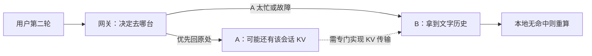

**怎么改？先做最简单的一步。**网关记住“这个会话上次去了 A”，下一轮**优先送 A**，叫会话粘性路由；但若 A 排队很长、KV 已满或故障，就送 B，宁愿重算，也不能让用户无限等。进阶版才让网关记“某个前缀可能在哪台机器”，把**预计省下的 prefill 时间**与排队时间、KV 空间一起比较。这个目录只是线索：A 可能已经驱逐了缓存，所以目标实例必须再查一次。跨实例真的要复用 A 的 KV，需要专门的 KV 传输或共享存储，不能把 A 的 block 编号直接交给 B。[^connector][^blockpool]

**两层调度别说反：**网关决定“请求去 A 还是 B”；我的 `cache_affinity` 只在**已选中的那台 engine 内**，决定其 waiting 队列里“谁先准入”。文字历史和流式输出的会话 ID 可由业务层管理，但正在某个 engine 里的 request 状态、进度和内部指针不能当作跨进程共享对象直接使用。当前项目只测单 deployment，这些路由/传输方案是下一步设想，不能拿 +4.20% 证明多实例也提升。[^scheduler][^phase6h]

**面试 20 秒版：**“会话历史文本能转到任何实例，但 GPU 里的 KV 不会自动跟着转。我的 APC 调度只看本机缓存；网关随机分流会损失这次命中。最简单是让同一会话优先回上次的实例，但若那台太忙，要改道并允许重算。”

**追问时再说 60 秒版：**“网关先根据会话 ID 做粘性路由，同时看实例队列和剩余 KV 容量，避免为了命中让请求一直排队。更进一步可以维护‘前缀可能在哪台’的目录，但这是过期风险较高的提示，目标实例仍须确认实际命中。若必须跨机器复用，需要显式搬运 KV 或共享缓存；传输时间也可能大于重算时间。网关解决去哪台，我的策略解决那台里面谁先执行；目前只验证了后一层。”

### 9. 多组 aggregation 复用同一批 aggregation node states？

这里的 `aggregation/node states` 不是本项目代码中的固定术语，面试先确认：是**网关汇总多个实例的缓存/负载状态**，还是 vLLM `KVConnectorWorkerMetadata.aggregate()` 在**单 engine step 内汇总 worker metadata**？这两者作用域不同，不能混答。后者确实是 vLLM connector 接口中的 worker 到 scheduler 汇总，并不自动变成跨 deployment 的全局缓存目录。[^connector]

若是网关：多组可以读取同一节点的**只读观测快照**，但不能把同一份可变“剩余容量”各自独立扣减，否则双重准入、热点和 stale hit。节点状态以 `(deployment, instance, model version, epoch)` 定义身份；更新有时间戳/TTL，做容量预约或幂等 claim，组间共享只读事实、写入由节点/统一控制面仲裁。若是 connector metadata：检查聚合函数是否交换/结合、是否按 step/request/worker 唯一键去重、错误是否传播，不能跨 step 复用旧对象。

**白话例子：** 两个网关聚合组都从快照看到节点 A“还能接 10 个请求”，各自同时向 A 派 10 个，结果 A 瞬间收到 20 个，状态虽然共享，却没有协调**容量扣减**。另外，A 的缓存快照说“有前缀 P”，但它已被驱逐，此时只能在 A 正式准入时再查一遍并回退重算/改路由。若面试官说的是 vLLM `aggregate()`，则讨论的是“同一步多个 worker 的数据如何合并”，不能拿它解释跨实例路由。

### 10. 满载时快速失败还是抢占降级？

**速答：** 先判断容量与截止时间是否可行。高优先级、已在服务中、有明确恢复希望的请求可在抢占预算内让低优先级任务让位；新来的低优先级请求若预计等待超过 SLA 或内存无法满足，应早拒绝/429 或交给上层重试与别的实例。盲目抢占可能反复重算，盲目快速失败会浪费本可排队完成的容量。

例如服务承诺 2 秒内给首 token，但当前队列预计至少等 10 秒，且没有别的实例可接：让请求排队 10 秒才报错比立刻明确拒绝更差。反之，一个马上能通过回收少量块完成的高优先级恢复请求，立即拒绝会丢掉已投入的计算。做判断要把“用户是否愿意等”“是否真有可回收容量”和“抢占别人造成的重算”放在一起。

建议门槛：每请求最大等待、每时间窗最大抢占次数、预计即时可回收 blocks 是否覆盖短缺、恢复重算成本、租户配额、SLO slack。`reclaimable_aware` 已体现“抢占真的能释放多少块”的一部分，但**当前项目没有完整 admission control/快速失败闭环**；面试不要声称已经实现。[^policy]

**面试可直接说：** “我已做抢占目标的成本选择，但没有做完整的过载拒绝。线上应先用 SLO 和容量判断是否可完成，再在有限抢占预算内救高价值请求；不可完成时快速失败并给网关重试信号。”

### 11. 离真实线上还有什么？

按顺序回答：① 同模型/多模型、不同 prefix 复用率、KV budget、QPS、prompt/output 长度及真实到达分布做泛化；② offload/connector 与 PD 分离的状态一致、失败重试和传输成本；③ 多实例路由、会话亲和及负载均衡；④ 监控 TTFT/TPOT/ITL P99、抢占恢复、缓存命中、GPU/CPU/网络占用与租户公平；⑤ 超时、取消、重启、滚动升级、SLO 快速失败与回退；⑥ 灰度 A/B 与自动禁用负收益策略。[^phase6h][^phase6i]

这些不是让你面试时一次念完的清单，可以按对方的追问归类：**正确性**（KV 真在不在、失败能否恢复）；**性能泛化**（不同模型、负载、预算还快不快）；**可运营性**（监控、灰度、回退）；**公平与稳定**（长请求、不同租户、过载）。每类给一个具体例子即可。

主动交代负结果比硬辩更有力：16-prefix/1250-block 有正收益，但 **1000-block 外推失败**；16-prefix 的 ITL P99 反而 +4.21%。所以当前结论是“特定高压负载下有效”，不是“普遍线上提速”。[^phase6h]

**面试可直接说：** “现在是可复现的单机策略实验，不是线上全链路系统。下一步先拿真实到达 trace 和第二种模型做泛化，再接多实例状态与 connector；每一步保留默认策略回退，失败或尾延迟变差就关掉。”

## 5. 质疑 12：每个指标和归因实验怎么解释

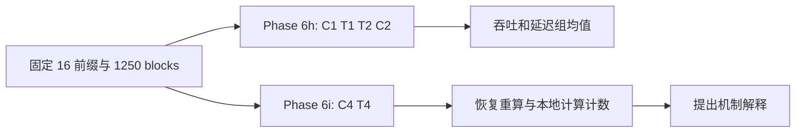

| 简历指标 | 正确含义与口径 | 不能说成 |
|---|---|---|
| output throughput +4.20% | 固定输出 token 总数 / 正式请求完成墙钟时间；16-prefix 两对反向 A/B 的 C/T 组均值 828.435→863.265 tok/s | 单请求 decode 速度都 +4.2% |
| 总耗时 -4.00% | 同批正式请求完成时间均值 237.334→227.842 s | 每个请求延迟 -4% |
| TTFT P99 -2.24% | 请求从提交到首 token 的第 99 百分位，组均值 40777.586→39866.180 ms | 首 token 的模型计算时间 |
| TPOT P99 -15.43% | 每请求生成 token 的平均间隔在请求间取 P99，组均值 62.476→52.835 ms | 所有逐 token 间隔的 P99；也不是 ITL P99 |
| ITL P99 +4.21% | 逐输出间隔的尾部在本轮变差；应主动报出 | 所有尾延迟都改善 |
| resume recompute -5.52% | 另一对 C4/T4 中，恢复调度区间与抢占前已算 frontier 的重叠 token：197286→186390 | 抢占次数 -5.52% |
| total local context compute -3.37% | `首次 prefill 本地计算 + 恢复重算`：271852→262684 token | CPU 计算量下降 3.37%，或 CUDA 时间下降 3.37% |

**先把三个延迟词讲成人话：** TTFT 是“我发出请求，到第一次看到回答等了多久”，里面含排队和 prefill；TPOT 是“一个请求开始输出后，平均每个输出 token 等多久”，然后把所有请求的这个数拿来统计；ITL 是“一次相邻输出之间真实间隔多久”，直接观察卡顿。P99 的意思是按数值排序后，约 99% 的样本不超过这个值，强调最慢的一小部分；但 **TPOT P99 的样本单位是请求，ITL P99 的样本单位是逐次间隔**，所以完全可能 TPOT P99 变好、ITL P99 变差。[^phase6h]

**吞吐 +4.20% 的最简单解释：** 四轮正式请求做了相同的总输出 token 工作；对照组平均每秒产出约 828 token，策略组约 863 token。它是整个服务在这一批负载下的生产速度，并不保证某个用户的第一个 token 更快，也不能推出每轮 decode 的 kernel 快了 4.2%。

性能确认：RTX 4090、Qwen2.5-7B、16 类约 900-token 共享前缀、64-token suffix、每请求 1024 输出、1250 GPU KV blocks、48 warmup + 192 正式请求、并发 48。唯一控制变量是 `default admission` 对 `cache_affinity(W=8, aging=10s)`；两对反向顺序 `C1→T1`、`T2→C2`，各轮 192/192 成功且输入/输出 token 相同。对照和 treatment **共同使用** recompute-aware preemption 与 LRU retention，因此 +4.20% 不能归因到抢占策略本身。[^phase6h]

归因另做 fresh-process C4→T4；抓取 `/metrics` 快照时包含 warmup + 正式请求共 240 个请求，所以不能把其绝对计数除以 Phase 6h 的 192 来解释。最初发现原生 `prefill_stats` 只计首次 prefill，漏掉 post-preemption repeat prefill；于是新增 `preempted_computed_tokens` 和 `resume_recompute_tokens`，按重叠区间避免把恢复后尚未计算过的新进度计作重算，并扣除已恢复的 APC 前缀。C4/T4 中 preemption 407→458 **增加**，首次 prefill local compute 74566→76294 **增加**，但恢复重算下降 10896，合计本地上下文计算下降 9168。engine output 次数也减少，支持“执行顺序改变后重复计算和 batch shape 改善”的解释；这是一对机制支持实验，**不能证明唯一因果路径**。[^phase6i][^scheduler]

**“归因”不是只看一个数字一起涨跌。** 设想对照组请求被抢占时已经算到 token 1000，恢复时前 600 还在 APC，重复计算 400；策略组同样被抢占，但恢复时前 800 还在，只重复 200。两边抢占次数甚至可以一样或策略组更多，真实重算量仍可能下降。因此报告额外记录“原来算到哪儿”和“恢复后重复跑了哪段”；不能用“抢占次数下降”代替机制。实际 C4/T4 恰好是策略组抢占**更多**、但恢复重算**更少**。[^phase6i]

面试回答公式：`total local context compute = first-prefill local compute + actual resume recompute`。这里的 **local** 指在本地 GPU 上重新做 context 前向，相对于从 prefix cache 或外部 KV 恢复；不是 CPU 侧排队计算。`TTFT` 受排队、prefill、传输影响；`TPOT`/`ITL` 受 decode 与混批影响，两个尾指标定义不同。[^phase6i]

**面试可直接说：** “+4.20% 是两对反向 A/B 的端到端组均值；-5.52% 和 -3.37% 来自另一对机制实验。后者说明减少了恢复重算这个可能的收益来源，但不能说它独自解释了全部吞吐变化。ITL P99 在性能确认中还变差了约 4.21%。”

## 6. 质疑 13：算子优化到底做了什么

### 分页 KV 写入：改的是 launch，不是 KV 算法

先翻译 CUDA 术语：一个 **thread** 是执行指令的工作线程；32 个线程组成一个 **warp**；一次 kernel 启动会创建许多线程块（**CTA/block**）。`launch configuration` 决定“每个 CTA 放几个线程、总共放多少 CTA”。`slot_mapping` 把请求的逻辑 token 位置变成 GPU KV 页中的物理槽位；kernel 把本轮算出的 K/V 写进这个槽位。**本优化没有换页表、没有改变 K/V 数值，只是让复制工作由合适数量的线程执行。**[^phase7]

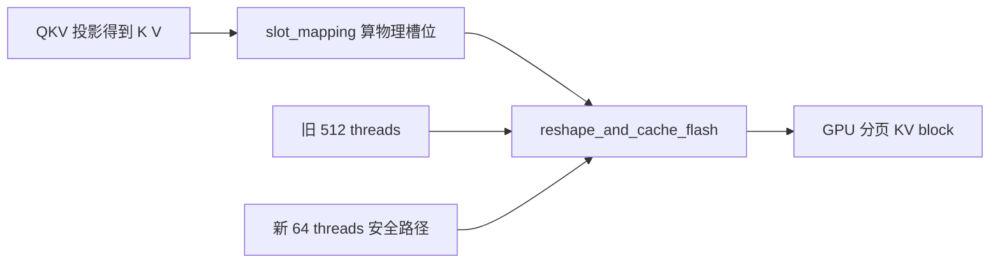

生产链是 FlashAttention backend → `fa_utils.do_kv_cache_update` → `reshape_and_cache_flash` → `csrc/libtorch_stable/cache_kernels.cu`。一个 Qwen2.5-7B token 有 `4 KV heads × 128 dim = 512` 个 BF16 元素；kernel **原本已经**按 16 bytes/线程复制，即每线程 8 个 BF16，只需 `512/8=64` 个有效线程。旧 launcher 按标量元素数取 `min(512,512)=512` threads，后 448 线程不搬数据。新 launcher 仅在 dtype、NHD 连续布局、scale、基地址/stride 16-byte 对齐等条件满足时，按向量数取整 warp、至少 64 threads；FP8、HND、非对齐等仍走旧通用路径。每 token 一个 CTA、slot mapping 和写入内容均不变。[^phase7][^cachekernel]

为何能快：少占 resident-thread 配额，更多有用 CTA 可同时驻留；不是“增加 occupancy 百分比”那么简单。CUPTI device-time、同工具链 A/B 下，1024-token 形状 `9.569→6.592 us`，即 `1.45x`；1-token 只有 `1.013x`，4096-token 为 `1.066x`。测了随机输入正确性、slot=-1、非连续 QKV、fallback。**1.45x 是生产 kernel 的代表形状微基准，不是服务吞吐 +45%。**[^phase7]

可以把旧配置想成“派 512 人搬 64 箱，每箱已经能被一人一次抱走”：大多数人闲着，却仍占了现场的工位。按实际 16-byte 向量宽度计算，只需 64 个有用线程；派少一点人使 GPU 同时容纳更多独立 token 的工作。安全守卫很重要：若数据未对齐、布局不同或使用 FP8，向量化假设不成立，就保留旧通用路径。这里的 **16 byte** 是一次内存访问的宽度，不是 16 个 token，也不是 KV block 的 16-token 页大小，三个“16”别混淆。[^phase7]

**面试可直接说：** “原 CUDA 写 KV 已经是向量拷贝，Qwen 代表形状每 token 512 个 BF16 元素，每线程搬 8 个，只需要 64 个线程；旧 launcher 给了 512。我的改动在对齐和布局满足时把 CTA 缩到 64，并在不满足时回退。CUPTI 测得 1024-token kernel 1.45x，服务吞吐不能按这个比例外推。”

### RoPE：改的是数据映射与并行度，不是旋转公式

RoPE 在 Q/K 上按位置旋转：NeoX 风格把 head 的前半和后半配对，简写 `y1=x1 cosθ - x2 sinθ, y2=x2 cosθ + x1 sinθ`。原通用 kernel 对代表形状主要是标量、近似一 token 一 block；短 decode token 时 CTA 太少，且 fused-QKV split 后 Q/K 的 token stride 非连续，简单把它当紧密数组会读错。新 fast path 用 16-byte 对齐向量（8 个 BF16/FP16）同时读取本半、配对半和 cos/sin，保持 FP32 中间计算后写回；从**真实 stride**寻址。[^phase8][^ropekernel]

**先理解公式与数据：** RoPE 是给 Q/K 加位置信息，便于注意力知道 token 顺序；它不是 KV Cache，也没有改变模型要做的旋转数学。Qwen 这类 NeoX 布局中，一个 head 前半段元素要与后半段对应元素成对旋转。旧实现逐元素处理；新路径让一次内存操作搬一小组相邻元素，再找到对应的另一半做相同公式。若 Q/K 从一个大 QKV tensor 中切出，Q 的下一 token 不一定紧挨上一个 Q，必须按照 tensor 的真实 stride 跨过去，否则结果会错。

两种并行映射：`num_tokens < 4096` 用 head-parallel，grid 的第二维分 Q/K heads，一 CTA 管一个 head 与最多 8 tokens，短序列也有足够 CTA；`>=4096` 用 token-parallel，一 CTA 处理一组 tokens、复用 cos/sin 后遍历 heads，降低重复读。阈值来自测量：256 token 就切换会退化，后来只扫 1024/2048/4096 并定在 4096。只有 NeoX、head size=rotary dim=128、offset 0、2-byte dtype、Q/K/cache 对齐且 stride 可被 8 整除等条件满足才走快路径；其他 dtype/layout/rotary 变体**靠通用 fallback 兼容**，不是快路径全支持。真实 fused-QKV view 的 CUPTI A/B，1 token `3.584→1.952 us=1.84x`，4096 token `97.596→86.460 us=1.13x`，随机输入和通用矩阵均验过。**未证明整服务吞吐提高 1.13～1.84x。**[^phase8][^ropekernel]

**为什么两种并行度？** 若只有 1 个 decode token，却让一个 CTA 独自处理所有 Q/K heads，GPU 上绝大多数 SM 没工作；把不同 heads 分给多个 CTA，就能同时开工。若有 4096 token，本来已有足够多 CTA，再拆 head 会让 cos/sin 等数据重复读取，所以转为按 token 分工。4096 是这个 GPU、模型形状下实测的切换点，不是 RoPE 的数学常数，更不是跨卡通用阈值。[^phase8]

**面试可直接说：** “我保持 RoPE 公式，用 16-byte 向量处理 Q/K 的配对元素；短序列按 head 并行让 GPU 有足够 CTA，长序列按 token 并行减少重复读取；只在 Qwen 代表布局和对齐条件成立时启用，其他情况回退。1.13～1.84x 来自真实 fused-QKV layout 的 kernel 微基准。”

追问“为什么分别优化 KV 写入和 RoPE”：它们都在每层真实调用链上，有明确的 launch/访存问题；KV 写入改变 CTA threads，RoPE 改向量访问和并行映射，都是算子层微基准；调度的 +4.20% 来自另一组端到端 A/B，**不可把两个收益相加**。RMSNorm 也做过小幅 launcher 调整，代表形状仅 `1.01～1.04x`，不要夸大。[^phase7][^phase8]

## 7. 额外高概率追问与最后一小时路线

### 必须能区分的概念

| 追问 | 20 秒回答 |
|---|---|
| APC 与 KV Cache 区别？ | KV Cache 保存单请求历史 K/V；APC 用完整前缀 block 的 hash 让后续请求复用仍在的 KV。 |
| Paged KV 解决什么？ | 固定大小物理块按需分配，逻辑 block table 映射到物理块；它解决分配和共享，不自动决定准入顺序。 |
| 共享 block 抢占为什么未必释放显存？ | 其他请求仍有 ref，或释放被延迟；必须看立即可回收块，不能只数请求持有块。 |
| 缓存命中率高为何吞吐未必高？ | 命中请求可能挤占 decode、造成更多抢占；外部命中还要传输，batch shape 与队列等待也变。Phase 6h 命中数并未更高。 |
| Prefix hash 如何防错误复用？ | 链式 hash 含先前前缀和当前 block 内容，实际身份还需模型/适配器/租户等 salt 与版本隔离；不能跨不同权重直接共享。 |
| 为什么不全局排序？ | 会增加查询 CPU 与尾部饥饿；限制同优先级 W=8、aging，默认可回退。 |
| TP/PP/DP 与 PD 分离？ | TP/PP 是一条前向的模型分片，DP 是独立模型副本；PD 是 prefill 与 decode 服务角色分开，需要 KV 交接。 |
| Offload 命中与 GPU 命中？ | 前者省计算但付传输/排队/同步，后者本地可直接复用；选择应比时间而不是 token 数。 |
| 为什么要 generation？ | prefix peek 是 KV 状态的快照；分配、释放、驱逐后旧快照可能无效，统一失效比维护复杂依赖图更可靠。 |
| 何时原方案可能负收益？ | 低前缀复用、KV 太紧、请求分散到多个实例、外部传输慢、强 SLO 或高 QPS 使探测成本明显时。1000-block 测试已提示外推风险。 |

### 只剩 1 小时，优先看 vLLM 自己改的关键链路

建议 **40 分钟 vLLM + 10 分钟 nano 对照 + 10 分钟口述**。理由：面试官质疑的是简历项目是否真做过、边界是否清楚；能从你的生产代码解释一次准入、一次抢占、一次缓存失效，比再把 nano 全部模块通读一遍更有用。

1. **0～10 分钟**：打开 `vllm/v1/core/sched/policy.py`。能手指代码讲 `AdmissionCandidate`、`choose_admission`、`RecomputeAware...`、`ReclaimableAware...`：硬优先级、aging、恢复保护、即刻回收。
2. **10～22 分钟**：打开 `scheduler.py` 的 `_select_cache_affinity_request`、`schedule` waiting/running 两侧、`_preempt_request`、`_record_resume_recompute_tokens`。顺着“请求进来 → prefix peek → 选中 → allocate → preempt/free → 重新入队 → resume”口述一遍。
3. **22～32 分钟**：打开 `feature_context.py`、`kv_cache_manager.py` 的 `peek_computed_blocks/get_computed_blocks/free` 和 `block_pool.py` 的 free queue/hash map。重点说清**查询不改状态、generation 失效、ref_cnt=0 不等于 KV 立即消失**。
4. **32～40 分钟**：打开 Phase 6h、6i、7、8 报告中的结果表。背住实验边界、负结果、两个不同 A/B 轮次和 kernel 微基准口径。
5. **40～50 分钟**：用 nano 的 `LLMEngine.step`、`Scheduler.schedule`、`BlockManager.allocate/deallocate`、`ModelRunner.prepare_prefill/decode` 复述最短闭环；不深读每个 layer。
6. **50～60 分钟**：不看文档，口述开场 90 秒，再口述最难四题：offload、抢占恢复、多实例网关、归因与算子；答不上来时回到上面的表和图。

回答节奏固定为：**先说当前做了什么和实验边界 → 解释机制及代码位置 → 承认具体失效场景 → 给可验证的扩展方案**。不要把未来方案说成已实现，也不要用 nano-vLLM 简化代码证明 vLLM 生产版行为。

## 8. 代码与证据索引

| 问题 | 最值得打开的本仓文件 |
|---|---|
| 决策排序 | [`vllm/v1/core/sched/policy.py`](../vllm/v1/core/sched/policy.py) |
| 准入、chunk、抢占、恢复计数 | [`vllm/v1/core/sched/scheduler.py`](../vllm/v1/core/sched/scheduler.py) |
| KV 快照失效 | [`vllm/v1/core/sched/feature_context.py`](../vllm/v1/core/sched/feature_context.py) |
| 本地 APC 查找与 free | [`vllm/v1/core/kv_cache_manager.py`](../vllm/v1/core/kv_cache_manager.py) |
| 可驱逐 block、引用与 hash | [`vllm/v1/core/block_pool.py`](../vllm/v1/core/block_pool.py) |
| Offload 与 connector 接口 | [`vllm/distributed/kv_transfer/kv_connector/v1/base.py`](../vllm/distributed/kv_transfer/kv_connector/v1/base.py)、[`vllm/config/cache.py`](../vllm/config/cache.py) |
| GPU KV 写入 | [`csrc/libtorch_stable/cache_kernels.cu`](../csrc/libtorch_stable/cache_kernels.cu) |
| RoPE 快路径 | [`csrc/libtorch_stable/pos_encoding_kernels.cu`](../csrc/libtorch_stable/pos_encoding_kernels.cu) |

[^phase6h]: [Phase 6h: 16-prefix 两对反向 A/B](PHASE6H_PREFIX_DIVERSITY_REPORT_CODEX.md)。
[^phase6i]: [Phase 6i: 机制归因与 telemetry 审计](PHASE6I_MECHANISM_ATTRIBUTION_REPORT_CODEX.md)。
[^phase6f]: [Phase 6f: 更紧 KV 预算的外推检查](PHASE6F_KV_BUDGET_REPORT_CODEX.md)。
[^phase7]: [Phase 7: KV 写入 kernel 优化](PHASE7_KERNEL_OPTIMIZATION_REPORT_CODEX.md)。
[^phase8]: [Phase 8: RoPE 与 RMSNorm 优化](PHASE8_OPERATOR_OPTIMIZATION_REPORT_CODEX.md)。
[^policy]: [调度决策策略](../vllm/v1/core/sched/policy.py)。
[^scheduler]: [V1 Scheduler](../vllm/v1/core/sched/scheduler.py)。
[^enginecore]: [EngineCore step 调用 Scheduler 并执行模型](../vllm/v1/engine/core.py)。
[^request]: [Request 的 token 状态与异步在途计数](../vllm/v1/request.py)。
[^feature]: [KV generation 特征上下文](../vllm/v1/core/sched/feature_context.py)。
[^kvmgr]: [KVCacheManager](../vllm/v1/core/kv_cache_manager.py)。
[^blockpool]: [BlockPool](../vllm/v1/core/block_pool.py)。
[^hash]: [KV hash 及 block 工具](../vllm/v1/core/kv_cache_utils.py)。
[^config]: [SchedulerConfig](../vllm/config/scheduler.py)。
[^connector]: [KVConnector V1 接口](../vllm/distributed/kv_transfer/kv_connector/v1/base.py)。
[^interview]: [原项目面试准备文档](vllm面试向项目准备文档0917.md)。
[^cachekernel]: [KV 写入 CUDA 实现](../csrc/libtorch_stable/cache_kernels.cu)。
[^ropekernel]: [RoPE CUDA 实现](../csrc/libtorch_stable/pos_encoding_kernels.cu)。
[^nano]: [nano-vLLM 引擎](../../nano_vllm_xxy/nanovllm/engine/llm_engine.py)。
[^pagedpaper]: Kwon et al., [Efficient Memory Management for Large Language Model Serving with PagedAttention](https://arxiv.org/abs/2309.06180), 2023。
[^historical]: [vLLM metrics design 对 V0 swap、SequenceGroup、分支共享与 V1 差异的说明](../docs/design/metrics.md)。
[^prefixdesign]: [vLLM Automatic Prefix Caching 设计文档](../docs/design/prefix_caching.md)。
[^cacheconfig]: [vLLM CacheConfig 中 APC 开关、hash 算法与 KV offload 配置](../vllm/config/cache.py)。
[^vllmconfig]: [VllmConfig 将 KV offload 配置转换为 connector](../vllm/config/vllm.py)。
[^weightoffload]: [模型权重 CPU offload 配置](../vllm/config/offload.py)。
