# vLLM KV-Aware Scheduling 项目讲解与面试问答（对话整理）

> 来源：简历指导前的项目梳理对话完整记录
> 分支：`project/kv-aware-scheduling`（baseline `fd57c4b7` → HEAD `f79f4c3f`，共 21 个 commit，P1–P8 阶段化推进）
> 用途：初学者向自述材料 + 防被问住的追问预案
> 姊妹文档：`面试.md`（更完整的技术讲义，可对照阅读）

---

## 目录

1. [项目一句话定位](#一项目一句话定位)
2. [Idea 来自哪三篇论文](#二idea-来自哪三篇论文)
3. [vLLM V1 基础架构（先建脑图）](#三vllm-v1-基础架构先建脑图)
4. [基础术语精准翻译与图解](#四基础术语精准翻译与图解)
5. [四个改动逐个讲清楚](#五四个改动逐个讲清楚)
6. [P1–P8 阶段化改动一览表](#六p1p8-阶段化改动一览表)
7. [P1–P8 英文名词逐个翻译 + 人话解释](#七p1p8-英文名词逐个翻译--人话解释)
8. [简历逐条拆解（四层结构 + 追问 Q&A）](#八简历逐条拆解四层结构--追问-qa)
9. [STAR 法则整段话术](#九star-法则整段话术)
10. [generation 失效举例 + TPOT/TTFT 全称](#十generation-失效举例--tpotttft-全称)
11. [高频追问汇总与兜底话术](#十一高频追问汇总与兜底话术)
12. [面试前 30 分钟准备清单](#十二面试前-30-分钟准备清单)

---

## 一、项目一句话定位

> 在 vLLM V1 推理引擎里，把"KV Cache 命中情况"变成调度器做决策的一等公民，并顺手优化了 KV 写入和 RoPE 两个 CUDA 算子。

开场口播版（先背这个）：

> "这个项目在 vLLM 推理引擎里做两件事：**控制面**让调度器决策时看见 KV 缓存状态，**数据面**把 KV 写入和 RoPE 算子调快，最后用 A/B 压测证明收益。"

---

## 二、Idea 来自哪三篇论文

这个项目不是凭空想的，是站在 3 篇经典论文肩膀上做的"组合微创新"。

| 论文 | 会议/时间 | 核心讲了什么 | 启发本项目的部分 |
|---|---|---|---|
| **PagedAttention / vLLM**（Kwon et al., arXiv:2309.06180） | SOSP'23 | 把 OS 的虚拟内存 + 分页搬进 LLM 推理：KV Cache 切成固定大小 block，用 block table 索引；提出 **preemption（抢占）+ recompute/swap 二选一**的调度思路 | 分页 KV Cache 基础、"recompute-aware 抢占"直接来源于此 |
| **Sarathi-Serve**（Agrawal et al., arXiv:2403.02310） | 2024 | **chunked prefill + stall-free batching**：长 prefill 切成等大 chunk 和 decode 混批，避免 prefill 阻塞 decode 造成尾延迟抖动 | 启发"调度决策要权衡 prefill 剩余量、重算成本、对在跑 decode 的影响"——recompute-aware victim selection 是这种权衡的延伸 |
| **SGLang / RadixAttention**（Zheng et al., arXiv:2312.07104） | NeurIPS'24 | radix tree 维护历史 prompt 的 KV，自动检测前缀复用，LRU 驱逐；提出 **cache-aware scheduling** | "Top-W cache-affinity admission""prefix KV retention""aging 公平性"是把 cache-aware scheduling 在 vLLM V1 上工程化落地 |

**一句话讲清微创新**：vLLM V1 自己已实现 PagedAttention + Automatic Prefix Caching，但**调度器本身没把"缓存命中"当成调度决策的核心信号**——仍是 FCFS + 简单 LRU 驱逐。本项目把这层"缓存感知"补上：recompute-aware 选 victim、Top-W admission、aging 防饿死、懒加载特征上下文降 CPU 开销。

---

## 三、vLLM V1 基础架构（先建脑图）

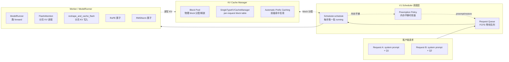

三个关键概念要能脱口而出：

1. **Paged KV Cache**：KV 不连续存，切成 block（默认 16 token/block），用 block table 索引。好处：消除碎片化 + 共享前缀。
2. **Automatic Prefix Caching（APC）**：相同前缀的 prompt 共享同一批 block，新请求命中前缀就跳过这段 prefill。
3. **Preemption（抢占）**：内存不够时把在跑请求"踢出去"，vLLM 默认 recompute（重新跑一遍 prefill），而不是 swap 到 CPU。

---

## 四、基础术语精准翻译与图解

### 4.1 KV block 的四个状态词

| 英文 | 精准中文 | 人话解释 |
|---|---|---|
| allocation | 分配 | 空闲 block 被拿去给某请求存 KV |
| free | 释放 | 请求用完，block 归还空闲池 |
| eviction | 驱逐/淘汰 | 内存紧张时，把**缓存池里**最旧的（LRU）block 丢掉腾地方 |
| deferred free | 延迟释放 | block 被多个请求**共享**时，某个请求结束不能立刻还块，要等最后一个引用者也结束才真正归还 |

这 4 个词描述**同一个 KV block 一生的四个关键时刻**：

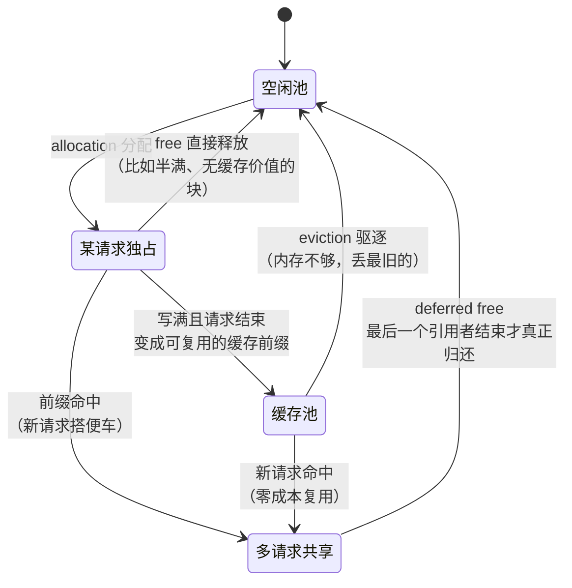

**为什么项目要盯这 4 个时刻**：调度器缓存的"前缀命中信息"在这些时刻会**过期**——比如特征缓存说"请求 R 命中前缀 P"，结果 P 刚被 eviction 丢了，信息就错了。所以 feature_context 在这 4 个事件上做失效。

### 4.2 retention（保留/留存）

eviction 的**反面**：eviction 决定"删谁"，retention 决定"**留谁**"。同一枚硬币的两面。

本项目里：驱逐缓存时不是无脑丢最旧的，而是先看**等待队列里有没有人还需要这个前缀**——有需求的块标记为高保留层级（retention tier），跳过它，去驱逐没人要的。

### 4.3 "16 类共享前缀 + 1250 KV blocks"指什么

**压测场景的人为设定**，两个数字各有目的：

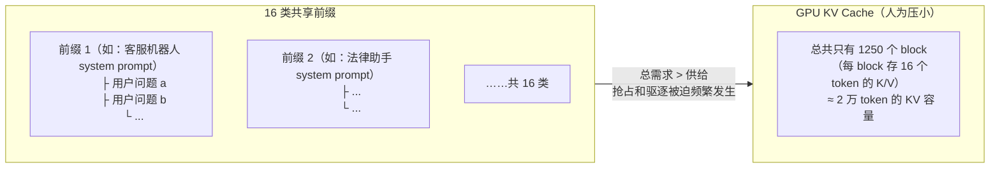

- **16 类共享前缀**：模拟真实业务——16 个不同"租户/话题"（比如 16 个不同角色的 system prompt），每个前缀下挂一批用户问题。既有**大量前缀命中**（收益来源），又有**前缀间的缓存竞争**（策略差异显现的土壤）。
- **1250 KV blocks**：故意把 GPU KV cache 总容量压小。**如果内存无限大，任何调度策略都一样好**——只有制造稀缺，抢占和驱逐才频繁发生，baseline 和 KV-aware 的差距才测得出来。

一句话：**16 类前缀是"考题"，1250 blocks 是"紧巴巴的考场"。**

---

## 五、四个改动逐个讲清楚

### 改动 1：KV 感知调度（P1-P2-P3-P5-P6）

#### 原系统的三个痛点

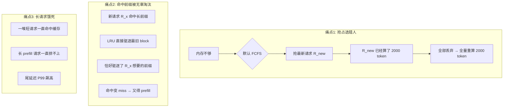

#### 解法：recompute-aware + Top-W admission + aging

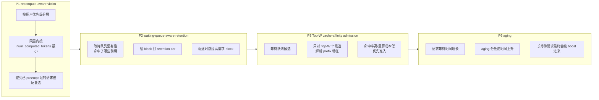

**改了哪些代码**（被问"在哪改的"时回答）：

- 新增 `vllm/v1/core/sched/policy.py`（233 行）：抽出 `SchedulingDecisionPolicy` 抽象类，三种实现 `Default / RecomputeAware / ReclaimableAware`，是"策略可插拔"的关键。
- 改 `vllm/v1/core/sched/scheduler.py`（+543 行）：在 preemption victim 选择、admission 决策处插入 policy 钩子。
- 改 `vllm/v1/core/sched/request_queue.py`（+182 行）：把 FCFS 改成可按"waiting order key"排序的堆。
- 改 `vllm/v1/core/kv_cache_utils.py`（+106 行）：新增 `BlockRetentionTier`、`popleft_n_by_retention_tier`，按保留层级选 free block。
- 改 `vllm/config/scheduler.py`（+57 行）：新增开关 `preemption_policy={default|recompute_aware|reclaimable_aware}`、`admission_policy={default|cache_affinity}`，**改动是开关可控的，不开就完全走原逻辑**。

**话术**：

> "我没有改 vLLM 原有调度主循环，而是抽出一层 SchedulingDecisionPolicy，把 preemption victim 选择、admission、retention 三件事做成可插拔策略。配置层加了 `preemption_policy` 和 `admission_policy` 两个开关，默认值就是 baseline 行为，所以是兼容性增强，不是替换。"

### 改动 2：KV 状态一致性（P4 feature_context 懒加载）

**解决的问题**：调度器每步都要查"每个请求命中了哪些前缀、还剩多少 prefill"。每次都实查 KVCacheManager，CPU 开销会吃掉 serving wall time。但前缀状态又不能算错——block 被 evict 了，缓存的"命中特征"就要失效。

```mermaid
flowchart LR
    subgraph 朴素做法[朴素做法: 每次调度全量查]
        P1[每步遍历所有候选请求]
        P2[对每个请求查 KVCacheManager<br/>算 prefix 命中]
        P3[CPU 开销 O(N*W)]
    end
    subgraph 你的做法[本做法: 懒加载 + generation 失效]
        L1[只对 Top-W 候选解析]
        L2[结果缓存进 SchedulingFeatureContext]
        L3[KV generation 号变化 → 自动失效]
        L4[allocation/free/eviction/deferred_free<br/>四个边界都触发失效]
    end
    朴素做法 -. 对比 .-> 你的做法
```

**新增文件** `vllm/v1/core/sched/feature_context.py`（106 行）：

- `SchedulingFeatureContext` 类：缓存 local prefix / cached tokens / 剩余 prefill 等调度特征。
- **KV generation 失效机制**：每次 KV block 状态变更（allocation / free / eviction / deferred_free），generation 号 +1，懒加载的特征自动标记为脏，下次访问重算。
- **Top-W 解析**：只对等待队列里 Top-W 个候选请求做 prefix 解析，W 是可配置窗口。

**话术**：

> "核心矛盾是：调度决策需要 prefix 命中信息，但每个候选都实查 KVCacheManager 太贵。我设计了 SchedulingFeatureContext，懒加载 + KV generation 号失效，只对 Top-W 候选解析。覆盖了 allocation、free、eviction、deferred_free 四个状态边界。最终重复 prefix 查询降 7.94%，策略 CPU 开销只占 serving wall time 0.41%。"

### 改动 3：端到端性能优化（压测设计）

这部分是"怎么证明改动有效"，是 `Documents_xxy/stress_bench.py`（521 行）做的 A/B 压测设计。

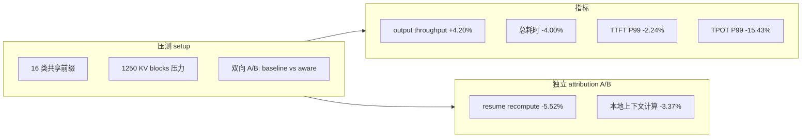

**话术**：

> "为了证明不是噪声，我设计了两层 A/B：第一层是端到端 stress bench，16 类共享前缀 + 1250 KV blocks 的内存压力下，对比 baseline 和 KV-aware；第二层是机制 attribution A/B，单独开关 recompute-aware 策略，量出 resume recompute -5.52%、本地上下文计算 -3.37%——证明收益确实来自策略本身，不是其他变量。"

### 改动 4：CUDA 算子优化（P7-P8）

#### 4.1 分页 KV Cache 写入 launch config（P7）

`csrc/libtorch_stable/cache_kernels.cu` 的 `reshape_and_cache_flash_kernel`。

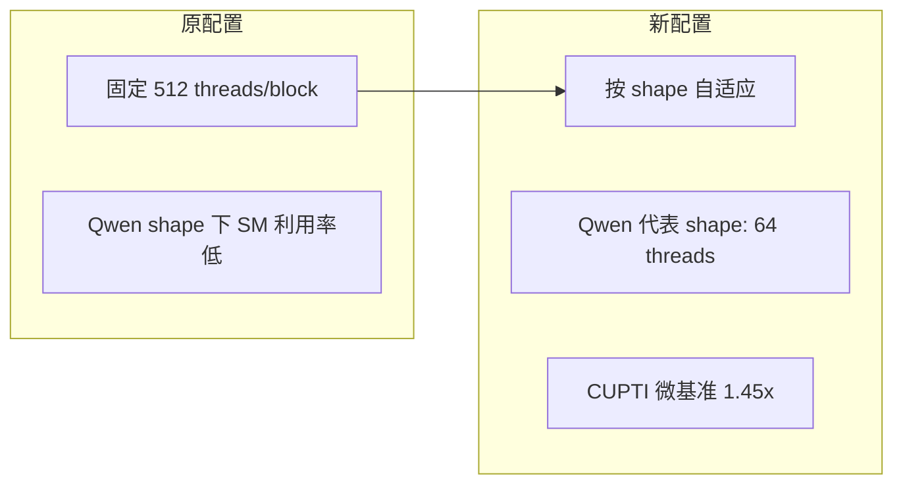

**为什么降线程反而快**（面试可能被追问）：

- Qwen 代表 shape 下 num_tokens 小、head 数少，512 threads 会让每个 SM 上 warp 间空转严重。
- 降到 64 threads/block 后，**SM 占用率反而提升**（更多 block 同时跑），且每个线程处理的 token 对齐度更好。
- 用 CUPTI（CUDA Profiling Tools Interface）微基准测的是 kernel 单次执行耗时，排除 Python overhead。

新增探测文件 `benchmarks/kernels/phase7_kv_write_launch_config.cu`（94 行）：校验 block_threads 只能是 64/128/256/512。

#### 4.2 RoPE alignment-gated 16-byte 向量化双并行快路径（P8）

`csrc/libtorch_stable/pos_encoding_kernels.cu`（+157 行）。

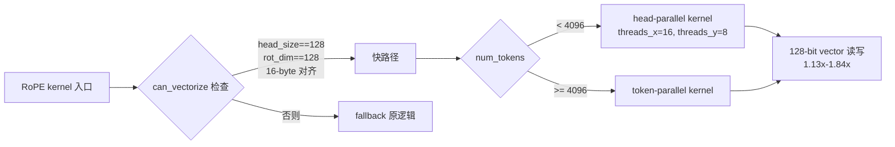

**关键术语翻译**：

- **alignment-gated**：kernel 启动前用 `can_vectorize` 检查 head_size、rot_dim、stride、pointer 是否满足 16-byte 对齐。不满足就走原 fallback，保证兼容性。
- **16-byte 向量化**：用 `AlignedVector<vector_t, 8>` 一次读写 8 个 float（128-bit / `float4` 风格），减少指令数和内存事务。
- **双并行**：小 batch 走 head-parallel（每个 thread block 处理一个 head），大 batch 走 token-parallel，按 num_tokens=4096 切换。
- **fused-QKV layout**：Qwen 等模型把 Q/K/V 拼成一个 tensor 一起算，layout 是 [num_tokens, num_q_heads+2*num_kv_heads, head_size]，对齐条件和单独 Q/K/V 不一样，所以要特判。
- **兼容性**：dtype、layout、rotary 变体不满足快路径条件时，回退到原 `rotary_embedding_kernel`，行为完全一致。

#### 4.3 RMSNorm（5 行小改动）

`csrc/libtorch_stable/layernorm_kernels.cu`：用 `gcd(16/sizeof(scalar_t), hidden_size)` 算向量化宽度，配合 `batch_invariant_launch` 按 num_tokens 调 block 大小。改动小但是 Qwen RMSNorm 在小 batch 下的关键调优。

---

## 六、P1–P8 阶段化改动一览表

| 阶段 | commit 主题 | 文件 | 一句话讲清改了什么 |
|---|---|---|---|
| P1 | recompute-aware preemption victim selection | `vllm/v1/core/sched/policy.py` 新增 | 抢占时按"重算成本最小"选 victim，而不是 FCFS 抢最新 |
| P2 | waiting-queue-aware prefix KV retention | `vllm/v1/core/kv_cache_utils.py`, `request_queue.py` | 驱逐 block 时跳过等待队列里有人命中的前缀 |
| P3 | bounded cache-affinity admission | `vllm/v1/core/sched/scheduler.py` | 等待队列准入时按 prefix 命中率优先，Top-W 候选 |
| P4 | cache generation-scoped scheduling features | `vllm/v1/core/sched/feature_context.py` 新增 | 懒加载 + KV generation 失效的调度特征上下文 |
| P5a | tier waiting-demand retention | `vllm/v1/core/kv_cache_utils.py` | 给 block 打 retention tier，按层级驱逐 |
| P5b | estimate reclaimable request blocks | `vllm/v1/core/kv_cache_manager.py` | 估算请求可立即回收的 KV block 数 |
| P5c | select victims by reclaimable KV shortfall | `vllm/v1/core/sched/policy.py` | KV 不够时优先抢可回收 block 多的请求 |
| P6 | measure KV-aware preemption cost + tradeoffs | `Documents_xxy/stress_bench.py` 新增 | A/B 压测量化收益 + aging sweep |
| P6h-i | prefix diversity + mechanism attribution | `vllm/v1/core/sched/scheduler.py` | 独立 attribution A/B 证明收益来自策略 |
| P7 | vectorized reshape_and_cache_flash launch config | `csrc/libtorch_stable/cache_kernels.cu`, `benchmarks/kernels/phase7_kv_write_launch_config.cu` 新增 | Qwen shape 下 512→64 threads，CUPTI 1.45x |
| P8 | Qwen RMSNorm + RoPE paths | `csrc/libtorch_stable/pos_encoding_kernels.cu`, `layernorm_kernels.cu` | alignment-gated 16-byte 向量化双并行快路径 |

---

## 七、P1–P8 英文名词逐个翻译 + 人话解释

| 阶段 | 英文 | 精准中文 | 人话解释 |
|---|---|---|---|
| P1 | recompute-aware preemption **victim** selection | 重算成本感知的抢占牺牲者选择 | 内存不够要抢人时，抢"**已算 token 最少**"的请求——它回来后重算最便宜；默认 FCFS 抢最新请求，可能抢掉已算 2000 token 的，损失巨大 |
| P2 | waiting-queue-aware prefix KV retention | 等待队列感知的前缀 KV 保留 | 驱逐缓存时，先看**排队的人**谁还需要这个前缀，有人要的留着，没人要的才丢 |
| P3 | bounded cache-affinity admission | 有界缓存亲和准入 | 从等待队列放人进 running 时，优先放"**和已有缓存最匹配**"的请求（放了就能搭便车）；bounded = 只考察前 W 个候选，控制 CPU 开销 |
| P4 | cache generation-scoped scheduling features | 按缓存版本代数划分作用域的调度特征 | 调度要用的"命中信息"做成缓存：给 KV 状态发一个递增的**版本号**（generation），状态一变版本号就变，旧特征自动作废重算 |
| P5a | tier waiting-demand retention | 分层等待需求保留 | 给缓存块按"排队需求的强弱"**分等级**，驱逐时从最低等级开始丢 |
| P5b | estimate reclaimable request blocks | 估算请求可回收块数 | 预先算好：**如果抢掉某个请求，能立刻拿回几个 block** |
| P5c | select victims by reclaimable KV shortfall | 按可回收量与 KV 缺口选择牺牲者 | 谁身上能"回血"最多、又刚好补上缺口，就抢谁（而不是只看重算成本） |
| P6 | measure preemption cost + tradeoffs, aging sweep | 度量抢占成本与权衡，aging 参数扫描 | 压测量化收益；同时**扫描 aging 参数**——因为防饿死机制本身也有开销，要找到平衡点 |
| P6h-i | prefix diversity + mechanism attribution | 前缀多样性 + 机制归因 | 换不同前缀分布再测（验证不是只对一种考题有效）；单独开关某个机制做 A/B（证明收益确实来自它，不是噪声） |
| P7 | reshape_and_cache_flash launch config | KV 写入算子的启动配置调优 | reshape_and_cache_flash 是**把新算出的 K/V 写进分页缓存**的 CUDA 算子；launch config = kernel 启动时的线程数形状，Qwen 场景下 512→64 线程反而更快 |
| P8 | Qwen RMSNorm + RoPE paths | Qwen 的 RMSNorm 与 RoPE 算子路径 | 给 Qwen 常用的两个算子加**向量化快路径**：RMSNorm（归一化）、RoPE（位置编码旋转） |

补充术语表（可能被追问）：

| 英文 | 中文 | 解释 |
|---|---|---|
| aging | 老化 | 请求排队越久分数越高，防止被短请求饿死 |
| attribution | 归因 | 证明"性能提升是因为我改的机制"，排除其他因素 |
| CUPTI | NVIDIA 性能分析接口 | 精确测单个 kernel 执行耗时的官方工具，排除 Python 开销干扰 |
| alignment-gated | 对齐门控 | 先检查内存地址是否 16 字节对齐，满足才走快路径，不满足走原路径 |
| vectorized | 向量化 | 一条指令读写多个数（16 字节 = 4 个 float），减少指令数 |
| dual-parallel | 双并行 | 小批量按 head 并行、大批量按 token 并行，两种 kernel 按规模切换 |

**面试三句话收拢**：

1. **控面**（P1-P5）：vLLM 原本"抢最新、丢最旧"，我改成"**抢损失最小的、留还有人要的、放最能搭便车的**"，并用版本号懒加载保证调度信息不过期。
2. **验证**（P6）：16 类前缀 + 压小的 1250 blocks 制造竞争，双向 A/B + 机制归因证明收益。
3. **数据面**（P7-P8）：调度之外，把 KV 写入和 RoPE/RMSNorm 三个高频算子的启动配置和访存路径也调优了。

---

## 八、简历逐条拆解（四层结构 + 追问 Q&A）

### 总图：简历四条 = 一个系统的四个层次

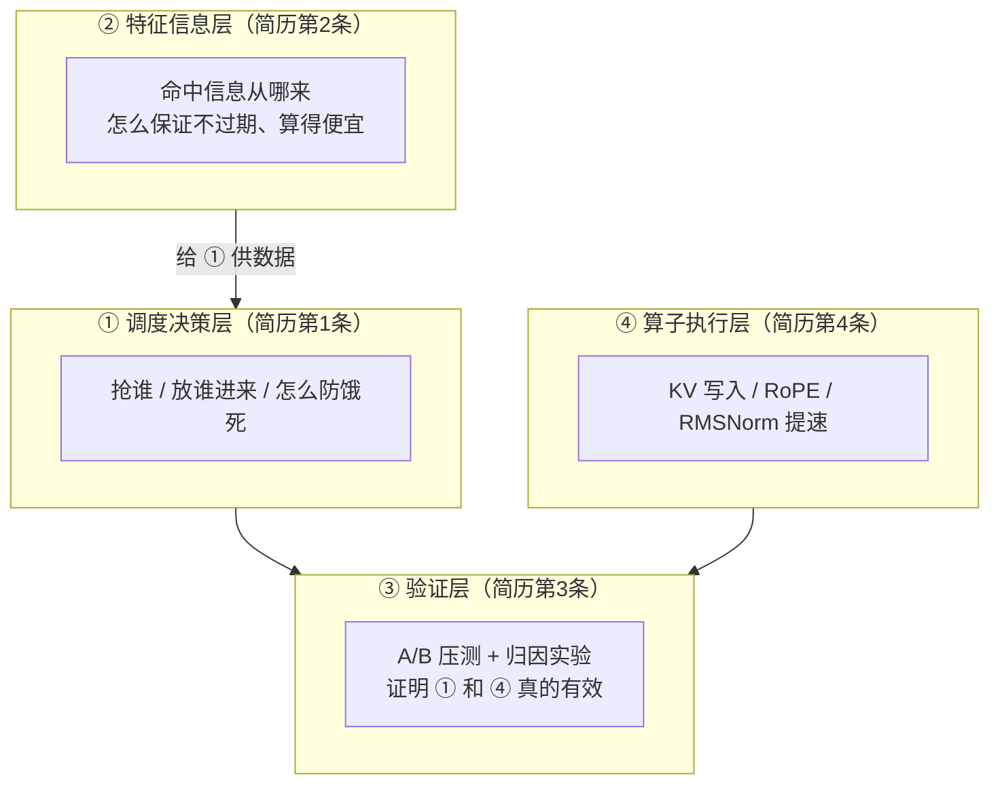

记住这个分层：**②给①供情报，③给①④发成绩单**。任何追问都能往这四层里放。

### 简历第 1 条：KV 感知调度

**人话翻译**：调度器每步做三个决策——**抢谁**（preemption）、**放谁进来**（admission）、**怎么不让老实人饿死**（aging）。原版 vLLM 这三个决策都不看缓存，我让它们都看。

四个"综合信号"王牌表，必须背：

| 信号 | 用在哪个决策 | 只看它会怎样（反面） |
|---|---|---|
| 请求优先级 | 抢占时分层 | 会跨优先级乱抢，高优请求被低优拖累 |
| 缓存前缀命中 | 准入 + 保留 | 命中的请求进不来，缓存等于白存 |
| 剩余 prefill 量 | 抢占 | 快算完的被抢，前功尽弃 |
| 恢复重算成本 | 抢占 | 抢掉已算 2000 token 的，恢复时全部重算 |

**必然追问**：

**Q1: 为什么需要四个信号？一个不行吗？**
> 这是多目标问题：公平（优先级/aging）、吞吐（缓存命中）、损失控制（重算成本）互相冲突，单一信号必然牺牲另一头。比如只看缓存命中率会让不命中的长请求饿死，所以我加了 aging 兜底。

**Q2: Top-W 的 W 是什么？为什么要有界？**
> W 是准入时解析 prefix 特征的候选窗口大小。解析 prefix 命中是要花 CPU 的，对所有排队请求都解析开销太大，所以只看排前面的 W 个——这是精度和开销的折中。

**Q3: aging 具体怎么做的？**
> 请求在等待队列里每多等一段时间，准入评分就加一个随时间增长的加成，等待足够久的请求分数终会盖过 cache affinity，被放进来。P6 阶段我做过 aging 参数扫描找平衡点。

### 简历第 2 条：KV 状态一致性

**人话翻译**：第 1 条的决策依赖"谁命中了什么前缀"这个情报。但这个情报**随时会过期**（block 被驱逐、被释放）。我做了个**情报缓存**：用版本号判断过期，只对 Top-W 候选解析，所以又准又便宜。

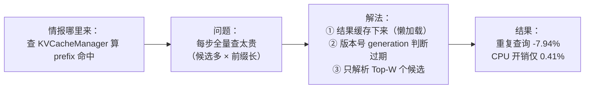

**必然追问**：

**Q1: 什么是懒加载？**
> 第一次用到某请求的前缀特征才去算，算完存起来；之后直接用缓存。不是每步调度都全量重算。

**Q2: generation 失效是什么？为什么不用逐项比对？**
> KV 状态每发生一次关键变化（allocation/free/eviction/deferred free），全局版本号 +1。特征上记着"我是第几版时算的"，版本号对不上就作废重算。这样**判断过期是 O(1)**，不用逐个 block 去比对。

**Q3: 为什么恰好是这四个边界？**
> 这是 KV block 生命周期里**所有权/可用性发生转移的全部时刻**。特征缓存说"请求 R 命中前缀 P"，只有这四种事件会让这句话变假，所以在这四个点上打失效标记就完备了。

**Q4: 7.94% 和 0.41% 怎么测的？**
> 在压测框架里插桩统计：重复 prefix 查询次数对比（懒加载生效前/后）；策略代码的 CPU 时间除以整体 serving wall time，占 0.41%——证明策略是"免费的午餐"。

### 简历第 3 条：端到端性能优化

**人话翻译**：怎么证明前面不是自嗨——**双向 A/B**（baseline vs 开启 KV-aware，同一压测负载跑两遍对比）+ **归因实验**（单独开关某个机制，确认收益来源）。

指标翻译表（P99 被问必答）：

| 指标 | 人话 | 为什么重要 |
|---|---|---|
| output throughput +4.20% | 每秒产出 token 多了 | 吞吐是硬通货 |
| 总耗时 -4.00% | 整个压测跑得更快 | 整体效率 |
| TTFT P99 -2.24% | **最慢的那 1% 请求**等多久看到第一个字 | 用户体感 |
| TPOT P99 -15.43% | 最慢的 1% 请求，**每个字之间隔多久** | 流式输出卡不卡 |
| resume recompute -5.52% | 被抢占请求回来后**重新算的量** | 归因：证明是抢占优化的功劳 |
| 本地上下文计算 -3.37% | 策略自身 CPU 开销降低 | 归因：证明第 2 条的功劳 |

**必然追问**：

**Q1: 为什么 TPOT P99 改善（-15.43%）远大于 TTFT（-2.24%）？**
> 这是本项目最漂亮的一问，标准答案：被抢占的请求恢复时要跑一整段长 prefill，而 vLLM 是 prefill 和 decode **混批**的——batch 里混入长 prefill 会拖慢同批所有 decode 请求的每步时间，造成 TPOT 尖刺（这也是 Sarathi-Serve 论文的核心观察）。我的策略减少抢占、让恢复更快，**直接砍掉了这些尖刺**，所以尾延迟改善最大。TTFT 主要由排队和首次 prefill 决定，调度优化帮助有限，方向对但幅度小。

**Q2: P99 是什么？为什么看 P99 不看平均？**
> 99 分位 = 最慢 1% 请求的水平。平均值会被大量正常请求稀释，而用户骂的是那 1% 的卡顿。尾延迟才反映调度问题（抢占、饿死都发生在尾部）。

**Q3: 为什么 TPOT 均值没报只报 P99？**
> 抢占是个别请求的倒霉事件，它造成的是**长尾分布恶化**，不是整体平移——P99 恰好是捕捉它的正确指标。

**Q4: 归因实验是什么？为什么 A/B 不够？**
> 端到端 A/B 只能证明"整体变好了"，不能证明"是哪个机制带来的"（可能有别的混杂因素）。所以单独开关 recompute 机制再跑 A/B：resume recompute -5.52% 说明被抢占请求重算量真的降了，收益来源坐实。

### 简历第 4 条：算子优化

**人话翻译**：调度之外，把执行路径上三个高频 CUDA 算子调快：**KV 写入**（调启动配置）、**RoPE**（向量化快路径）、**RMSNorm**（小改）。

**必然追问**：

**Q1: 线程数 512 降到 64，为什么降了反而快？（必考）**
> Qwen 代表 shape 出现在 decode 阶段：每步 num_tokens 很小、head 数少。512 threads/block 意味着每个 block 要凑够 512 线程的工作量，小 shape 下大量 warp 在空转。降到 64 后每个 block 虽然小，但 GPU 上能同时驻留**更多 block**，SM 占用率（occupancy）反而更高，实际并行度上升。1.45x 是 CUPTI（NVIDIA 官方 profiling 接口）测的纯 kernel 执行时间，排除了 Python 开销干扰。

**Q2: alignment-gated 是什么？为什么必须有这道门？**
> 16-byte 向量化 = 用一条 128-bit 指令一次读写 4 个 float，但硬件要求**地址按 16 字节对齐**，不对齐时直接出错或变慢。所以 kernel 启动前先检查 head_size、rotary 维度、stride、指针地址是否满足条件，满足才走快路径，不满足自动回退原 kernel。这道门是**正确性保障**，让优化对任意模型配置都安全。

**Q3: "双并行"是什么？**
> 两套 kernel 按 batch 大小切换：小批量（< 4096 token）用 head-parallel（按注意力头切分任务），大批量用 token-parallel（按 token 切分），保证两种规模下 GPU 都喂得饱。

**Q4: fused-QKV layout 是什么？为什么要特殊处理？**
> Qwen 这类模型把 Q、K、V 拼成一个大 tensor 一起输出，内存布局和分离的 Q/K/V 不同——对齐条件不一样。快路径的对齐检查就是按这个真实布局设计的，在它上面测出 1.13x–1.84x；其他 dtype/layout/rotary 变体不满足条件就走 fallback，行为和原版完全一致。

**Q5（背景陷阱题）：依托的是昇腾孵化中心，为什么优化的是 CUDA？**
> 项目分两层：调度层是纯 Python 逻辑，平台无关，昇腾上同样适用；算子层我在 NVIDIA GPU 上用 CUPTI 做的微基准验证（可精确量化），仓库里有 NPU 适配的调研笔记，思路（调 launch 配置、向量化访存）在 CANN 工具链上同样成立，只是具体接口不同。

---

## 九、STAR 法则整段话术

**Situation（背景）**：

> vLLM V1 已经实现了 PagedAttention + Automatic Prefix Caching，但调度策略本身仍是 FCFS + 简单 LRU 驱逐。高并发推理下有三个问题：抢占抢错人导致大段 KV 被丢弃重算、命中前缀被无辜驱逐、长 prefill 请求被短请求饿死。同时分页 KV 写入和 RoPE 在 Qwen 等模型代表 shape 下 launch config 不合理，算子效率低。

**Task（任务）**：

> 在不破坏 baseline 兼容性的前提下，把"KV Cache 命中"作为调度决策的一等公民，设计 KV 感知调度策略并保持状态一致性；同时优化 CUDA 数据面（KV 写入 + RoPE + RMSNorm）。

**Action（行动，按 P1-P8）**：

> 1. 抽出 SchedulingDecisionPolicy 抽象层，实现 recompute-aware preemption（按 num_computed_tokens 最小选 victim，避免抢已算 2000 token 的请求）
> 2. 新增 waiting-queue-aware prefix KV retention（给 block 打 retention tier，驱逐时跳过高需求前缀）
> 3. 新增 Top-W cache-affinity admission（等待队列按 prefix 命中率优先准入，W 可配）
> 4. 设计 SchedulingFeatureContext 懒加载 + KV generation 失效机制，覆盖 allocation/free/eviction/deferred_free 四个状态边界，避免每次调度都全量查 KVCacheManager
> 5. 实现 reclaimable-aware victim selection（KV 不够时优先抢可回收 block 多的请求）+ aging 公平性机制防饿死
> 6. 设计 stress bench 做双向 A/B + 独立 attribution A/B 量化收益
> 7. 优化 reshape_and_cache_flash launch config（Qwen shape 512→64 threads）
> 8. 设计 alignment-gated 16-byte 向量化双并行 RoPE 快路径，fallback 兼容其他 dtype/layout/rotary 变体

**Result（结果）**：

> 端到端 A/B：output throughput +4.20%、总耗时 -4.00%、TTFT P99 -2.24%、TPOT P99 -15.43%。独立 attribution：resume recompute -5.52%、本地上下文计算 -3.37%。CUDA 微基准：KV 写入 1.45x、RoPE 1.13x-1.84x。策略 CPU 开销仅占 serving wall time 0.41%，重复 prefix 查询降 7.94%。

---

## 十、generation 失效举例 + TPOT/TTFT 全称

### generation 失效：一个完整的小故事

**场景**：调度器要决定"放谁进 running 批次"，依据是"谁命中了缓存前缀"。这个情报贵，所以要缓存；但缓存会过期，所以要有失效机制。

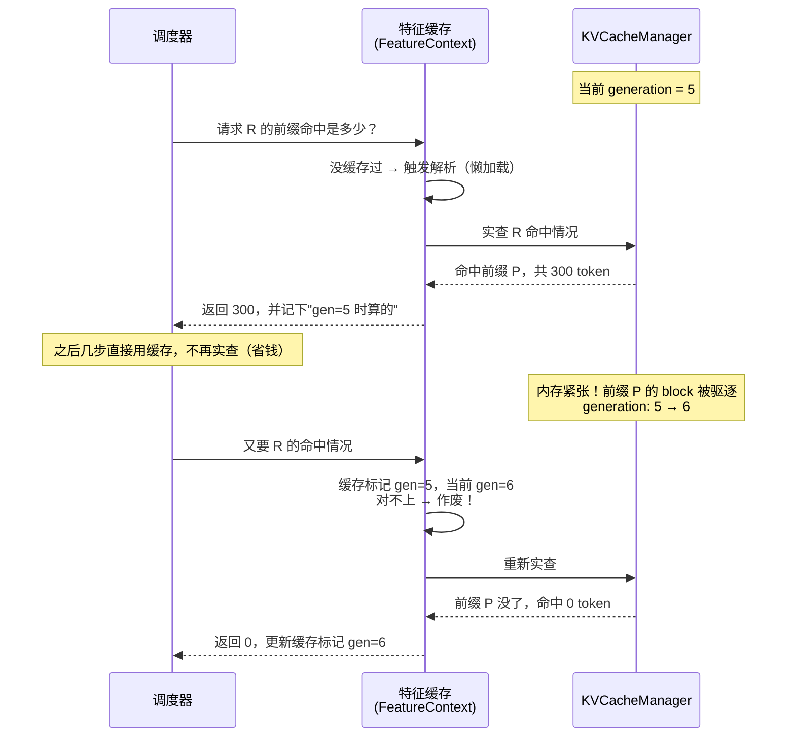

**一句话原理**：给 KV 状态发一个**全局递增的版本号**。任何关键变化——**分配、释放、驱逐、延迟释放**四个事件任意发生一个——版本号就 +1。特征缓存里记着"我是第几版时算的"，下次用时版本号对不上就作废重算。

**为什么必须有（反面例子）**：假如没有这套机制——缓存说"R 命中 300 token"，调度器放心地放 R 进来，结果前缀 P 早被驱逐了，实际命中 0。R 照样要全量 prefill：**决策基于假情报，白占了一次机会**，比不算还糟。

**为什么用版本号而不是逐个检查**：R 的前缀可能占几十个 block，逐个问"这个 block 还在吗"是 O(n)；比对一个整数是 **O(1)**。这就是 0.41% CPU 开销的来源之一。

**被追问时的标准答案**：

> "本质是**乐观并发控制**的思路：先相信缓存、用时校验版本，而不是每次悲观地全量重查。四个失效边界对应 KV block 所有权转移的全部时刻，所以校验是完备的。"

### TPOT / TTFT 全称

**TPOT = Time Per Output Token**，中文：**每输出 token 耗时**。

| 指标 | 全称 | 人话 |
|---|---|---|
| TTFT | Time To First Token | 用户等多久看到**第一个字**（含排队 + prefill） |
| TPOT | Time Per Output Token | 从第二个字起，**每出一个字**的平均间隔 |

- 计算方式：`(总时间 - TTFT) ÷ (输出 token 数 - 1)`——首 token 要排除，因为它混着 prefill。
- 对应体感：TTFT 是"多久开始说话"，TPOT 是"打字机速度"。流式输出卡不卡，看 TPOT。
- 简历里的 **TPOT P99 = 最慢 1% 请求的每字间隔**——之所以它改善最大（-15.43%），因为被抢占请求恢复时的长 prefill 混进批次，会拖慢同批所有 decode 的每一步，制造的正是这种尾部尖刺。

**进阶补充**：TPOT 在有些系统里也叫 **ITL**（Inter-Token Latency，token 间延迟），两者同义，面试提到哪个都行。

---

## 十一、高频追问汇总与兜底话术

### 通用高频追问（第一轮整理的 5 问）

**Q1: 你这个和 vLLM 自带的 APC 有什么区别？**
> APC 只做"前缀命中就复用"，它不管调度顺序。如果命中前缀的请求排在 FCFS 后面，照样要等。我做的是把"命中"反馈到调度决策本身——选 victim、admission、retention 都看命中信息。

**Q2: recompute-aware 具体按什么指标选 victim？**
> 先按用户优先级分层（不能跨优先级抢），同层内按 `num_computed_tokens` 最小优先（重算成本最低），同时记录已被 preempt 过的请求避免反复被抢。

**Q3: aging 机制怎么防止饿死？**
> 请求等待时间越长，aging 分数越高，admission 时会被 boost。但 aging 不是无条件的，会受 cache affinity 约束，避免把高命中请求挤出去换低命中长等待请求。

**Q4: 为什么降线程数反而加速？**
> Qwen 代表 shape 下 num_tokens 小、head 数少，512 threads 会让 warp 间严重空转。降到 64 后 SM 占用率提升，更多 block 并行，且 token 对齐更好。用 CUPTI 微基准测的是纯 kernel 耗时，排除 Python overhead。

**Q5: 你的改动是替换原有逻辑吗？会破坏兼容性吗？**
> 不是替换，是可插拔策略。配置层新增了 `preemption_policy` 和 `admission_policy` 两个开关，默认值就是 baseline 行为。CUDA 算子的快路径前有 alignment-gated 检查，不满足就 fallback 走原 kernel，行为完全一致。

### 兜底话术（被问住时用）

被问到真不知道的细节时，**不要编**，用这个：

> "这个细节我实现时参考了 vLLM 的现有机制做的适配，具体参数我可以回去确认。但设计层面我可以讲清楚——（然后拉回四层故事：②给①供情报，③给①④发成绩单，④是执行提速）"

三个保命原则：

1. **数字永远别说错**：+4.20% / -4.00% / -2.24% / -15.43% / -5.52% / -3.37% / 1.45x / 1.13x–1.84x / 7.94% / 0.41%——这是唯一不能虚的牌。
2. **不知道的实现细节 → 归到"工程取舍"**：所有 Top-W、aging、有界窗口，本质都是"精度 vs 开销"的折中，往这个方向答不会错。
3. **每答完一个追问，收一句"所以这就是为什么 XX 指标改善了 XX%"**——把讨论主动权拉回成绩单。

---

## 十二、面试前 30 分钟准备清单

1. 打开 `vllm/v1/core/sched/policy.py` 和 `vllm/v1/core/sched/feature_context.py` 这两个新增文件，对照"改动 1/2"的图看一遍，至少能认出类名和方法名。
2. 打开 `vllm/config/scheduler.py` 看新增的开关定义，能背出 `preemption_policy` 和 `admission_policy` 两个名字。
3. 把 STAR 四段念一遍，确保能在 90 秒内讲完。
4. 准备好 3 篇论文的名字 + 一句话核心：PagedAttention（SOSP'23）、Sarathi-Serve、SGLang/RadixAttention（NeurIPS'24）。
